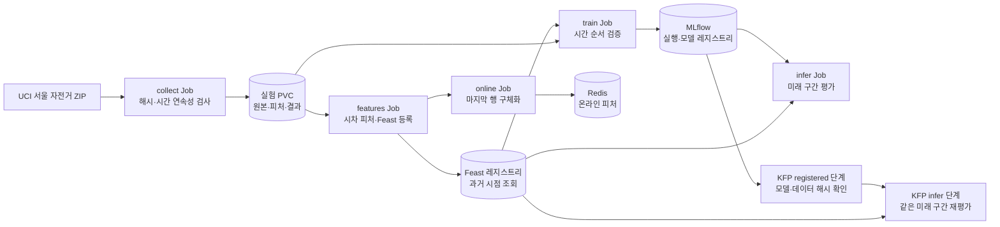
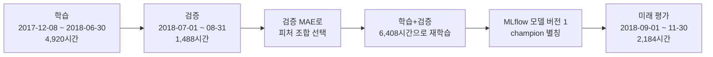
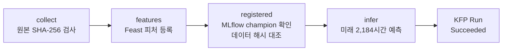

# 한국 데이터로 다시 만든 서울 공공자전거 Feast·MLflow·KFP 실험

> 해당 포스팅은 현재 재직 중인 회사와 관련이 없고, 개인 역량 개발을 위한 스터디 자료로 활용할 예정입니다.
>
> **읽은 자료:** *Machine Learning Platform Engineering* 4\~5장과 스터디 자료. **실습 데이터:** UCI *Seoul Bike Sharing Demand*의 서울 시간별 공공자전거 대여량. **검증 환경:** 2026년 10월 31일 Mac M3 Pro의 Rancher Desktop Kubernetes. 이 글의 Job·KFP 상태와 지표는 그날 실행해 남긴 기록을 바탕으로 한다. 이번 글을 고치면서 실험을 새로 돌려 수치를 만든 것은 아니다.

책의 소득 분류 데이터를 그대로 따라가는 대신, **서울 공공자전거의 다음 한 시간 대여량**을 예측하는 실험으로 4\~5장을 다시 읽었다. 이 데이터에는 매 시간의 관측 시각이 있다. 덕분에 Feast가 예측 시각에 맞는 피처 행을 돌려주는지, MLflow에 등록한 모델을 KFP가 다시 찾는지, 무작위 평가 점수가 미래 구간에서도 유지되는지를 한 흐름에서 확인할 수 있다.

본론에 들어가기 전에, 이 글에서 묶는 세 도구를 한 줄로 정리한다. 모두 쿠버네티스 위에서 머신러닝 플랫폼을 이루는 오픈소스 구성요소이고, 각자 맡는 역할이 다르다.

| 도구 | 한 줄 정의 | 이 실험에서 맡은 일 |
| --- | --- | --- |
| **Feast** | 피처 스토어. 모델이 쓸 입력값(피처)을 한 번 정의해 저장하고, 과거 시점용(오프라인)과 실시간용(온라인)으로 같은 값을 제공한다 | 예측 시각 기준으로 "그때 알 수 있던" 대여량·날씨 피처를 조회 |
| **MLflow** | 실험 추적·모델 레지스트리. 어떤 데이터·설정으로 학습한 모델인지 기록하고, 버전을 붙여 등록·배포한다 | 후보 모델의 지표·데이터 해시를 남기고 최종 모델을 버전 1로 등록 |
| **KFP**(Kubeflow Pipelines) | 파이프라인 오케스트레이터. 여러 단계(컴포넌트)를 DAG로 묶어 순서대로 실행하고 상태를 관리한다 | 등록된 모델을 재학습 없이 불러와 배치 추론 DAG로 실행 |

세 도구는 각각 하나의 질문에 대응한다. **Feast:** 예측 시각에 맞춰 만든 대여량·날씨 피처를 조회할 수 있는가? **MLflow:** 어떤 데이터와 피처로 선택한 모델인지 다시 찾을 수 있는가? **KFP:** 등록된 모델을 재학습하지 않고 배치 추론에 다시 쓸 수 있는가? 마지막에는 전체 소스와 제출 코드를 파일별로 본문에 실었다. 경로 링크를 열지 않아도 코드를 확인할 수 있도록 했다.

<!--truncate-->

***

## 1. 왜 이 데이터를 선택했나

[UCI의 Seoul Bike Sharing Demand](https://archive.ics.uci.edu/dataset/560/seoul+bike+sharing+demand)를 골랐다. 4장의 Feast를 공부하려면 `언제` 측정했고 `언제` 사용할 수 있었는지가 분명한 데이터가 더 적합하다. 서울 자전거 자료에는 1년치의 **시간별 대여량과 날씨**, 날짜, 시각, 공휴일, 운행 여부가 함께 있다. 결과도 대여 **대수**라는 실제 숫자여서 MAE를 곧바로 해석할 수 있다. UCI 데이터 카드의 공개 라이선스 표시는 CC BY 4.0이다.

> 데이터 출처: *Seoul Bike Sharing Demand* [Dataset]. (2020). UCI Machine Learning Repository. [DOI: 10.24432/C5F62R](https://doi.org/10.24432/C5F62R). 원본에서 `t-1`, `t-24`, `t-168` 시차 피처를 새로 만들어 사용했다. 라이선스는 CC BY 4.0이다.

데이터를 고른 기준은 네 가지였다.

| 기준 | 확인한 내용 | 이 실험에서 얻는 것 |
| --- | --- | --- |
| 지역 | 서울 공공자전거 대여 기록 | **한국의 실제 수요**를 본다 |
| 시점 | 2017-12-01 00시부터 2018-11-30 23시까지 **8,760개 연속 시간** | 예측 시점보다 늦게 나온 값을 제외하는 규칙을 실습할 수 있다 |
| 평가 | 매 시간의 실제 대여 대수가 있음 | 하루 전 값을 쓰는 기준선과 모델의 MAE·RMSE를 재계산할 수 있다 |
| 크기 | CSV 약 0.6MB, 원본 8,760행 | Mac M 시리즈의 로컬 arm64 Kubernetes에서 Feast·MLflow·KFP를 돌릴 수 있다 |

다만 **한 도시의 1년치 집계 자료**다. 자전거 대여소별 수요나 여러 해의 추세를 예측하는 성능으로 일반화하면 안 된다. 이 글의 모델도 2018년 9\~11월을 **이미 관측된 직전 시간의 대여량을 이용해 한 시간씩 전진하며** 평가한다. 3개월을 한 번에 미리 예보한 결과가 아니다.

## 2. 예측 시각을 먼저 정했다

목표는 `t`시가 시작할 때 `t`시의 대여 대수를 예측하는 것이다. 이때 데이터 파일에 `t`시의 온도와 대여 대수가 함께 있다고 해서 둘 다 입력으로 쓰면 안 된다. `t`시의 실제 대여 대수는 정답이고, `t`시 동안 측정한 날씨도 시간 시작 시점에는 모를 수 있다. 따라서 첫 모델에는 다음 값만 넣었다.

| 입력 | 계산 방법 | `t`시 시작 시 사용 가능한가 |
| --- | --- | --- |
| 시각·요일·월·공휴일 | `t`의 달력 | 가능. 공휴일은 사전에 공지된 일정이라고 가정 |
| `lag_1` | `t-1`시의 실제 대여량 | 직전 시간 집계가 마감됐다는 가정 아래 가능 |
| `lag_24` | `t-24`시의 실제 대여량 | 가능 |
| `lag_168` | `t-168`시의 실제 대여량 | 가능 |
| `prev_temperature`, `prev_rainfall` | `t-1`시의 날씨 | 직전 관측이 들어왔다는 가정 아래 가능. **모델 후보 하나에만 사용** |
| `t`시의 실제 대여량·측정 날씨 | 같은 행에 존재 | 예측 시점에는 사용 불가 |

CSV의 `Date`와 `Hour`는 서울 현지 시각으로 합친 뒤 `Asia/Seoul`을 붙였다. Feast에는 UTC `event_timestamp`로 저장하고, 사람이 읽는 보고서에는 서울 시각을 함께 남겼다. **서울 2018-11-30 23시는 UTC 14시**다. 다운로드 ZIP의 SHA-256은 `139e9908…9e7baac4`, 내부 CSV의 SHA-256은 `373339b7…7b749c60`이었다. ZIP 해시가 달라지면 수집 Job은 중단한다. CSV를 `latin1`로 읽은 이유는 컬럼명에 있는 `°C`를 깨뜨리지 않기 위해서다.

```python
local_time = pd.to_datetime(
    df["Date"] + " " + df["Hour"].astype(str).str.zfill(2),
    format="%d/%m/%Y %H",
).dt.tz_localize("Asia/Seoul")

features["lag_1"] = df["Rented Bike Count"].shift(1)
features["lag_24"] = df["Rented Bike Count"].shift(24)
features["lag_168"] = df["Rented Bike Count"].shift(168)
features["prev_temperature"] = df["Temperature(°C)"].shift(1)
```

일주일 전 값이 없는 처음 168행을 제거해 **8,592시간**을 실험 대상으로 삼았다. 수집 Job은 원본 8,760행의 중복 시각, 빠진 시간, 빈 셀도 검사했다. 이 규칙과 결과는 수집 명세에 남겼다.

## 3. Rancher Desktop에서 어떤 자원이 돌았나

Mac M3 Pro에서 Rancher Desktop VM을 **8 CPU·16GB 메모리**로 설정했고, Docker 엔진은 Moby, Kubernetes는 `rancher-desktop` 컨텍스트의 `v1.34.4+k3s1`을 사용했다. 실습 이미지는 `python:3.11-slim-bookworm` 기반으로 **`linux/arm64`로 빌드**했다. 모델은 CPU에서 학습하는 `HistGradientBoostingRegressor`다. [Rancher Desktop은 Mac에서 Linux VM으로 Kubernetes를 실행](https://docs.rancherdesktop.io/references/architecture/)한다. [MPS는 Apple의 Mac용 Metal GPU 경로](https://developer.apple.com/metal/pytorch/)인데, 이번 VM의 파드에는 그 장치가 노출되지 않아 컨테이너 학습에는 사용하지 않았다.

이 로컬 환경에서는 Docker로 빌드한 이미지를 같은 Rancher Desktop 클러스터가 사용할 수 있어 `imagePullPolicy: Never`로 실행했다. 다른 노드나 원격 클러스터에서 그대로 실행하려면 접근 가능한 이미지 레지스트리에 푸시하고 이미지 주소를 바꿔야 한다.

```bash
rdctl list-settings                 # VM cpu=8, memoryInGB=16 확인
kubectl config current-context     # rancher-desktop
kubectl get nodes -o wide          # Ready 확인
kubectl get node -o jsonpath='{.items[0].status.nodeInfo.architecture}'  # arm64
kubectl top node                    # 실습 시작 전 메모리 약 4.6GiB 사용

cd blog/machine-learning-platform-engineering/examples/seoul_bike_k8s
docker build --platform linux/arm64 -t seoul-bike-ml:dev .
kubectl apply -f k8s/base.yaml
kubectl -n mlpe-seoul-bike rollout status deploy/mlflow
kubectl -n mlpe-seoul-bike rollout status deploy/redis
```

`mlpe-seoul-bike` 네임스페이스를 새로 만들었다. **MLflow Deployment**는 SQLite 메타데이터와 모델 아티팩트를 2GiB PVC에 저장한다. 원본·피처 Parquet, Feast 레지스트리, 예측 결과는 별도의 1GiB PVC에 둔다. **Redis Deployment**는 온라인 피처 저장소다. MLflow·Redis는 `ClusterIP` 서비스로 연결했다. 비밀번호와 외부 NodePort 없이 로컬 실습 범위에서만 사용했다. 팀 단위 서버라면 인증·영속 Redis·공유 객체 저장소 설계가 추가로 필요하다.

당시의 VM·클러스터 설정은 환경 기록에 별도로 남겼다.



이 그림에서 화살표는 **데이터 흐름**이다. 첫 실행의 Job 순서는 `run.sh`가 `collect → features → train → infer → online` 순으로 각 Job의 `Complete`를 기다리며 관리했다. 그다음 **KFP standalone**을 별도로 설치해, 등록된 모델 버전 1을 사용하는 배치 추론 DAG를 실행했다. 두 경로는 각각 아래에서 확인한다.

## 4. Kubernetes Job 다섯 개를 순서대로 실행했다

재실행 명령은 다음 한 줄이다. 스크립트는 컨텍스트가 `rancher-desktop`인지 확인하고, 이미지를 arm64로 빌드한 뒤 YAML을 적용한다. 각 Job이 성공해야 다음 Job을 시작하며, 실패하면 해당 Job 로그를 출력한다.
이미 같은 네임스페이스에 MLflow 기록이 있다면 재실행할 때 새 실행과 **새 모델 버전**이 쌓인다. 본문의 버전 1은 이 글을 쓸 때 처음 완료한 실행의 결과다.

```bash
cd blog/machine-learning-platform-engineering/examples/seoul_bike_k8s
bash run.sh

kubectl -n mlpe-seoul-bike get jobs
# collect    Complete   1/1   13s
# features   Complete   1/1    7s
# train      Complete   1/1   2m23s
# infer      Complete   1/1   41s
# online     Complete   1/1    7s
```

한 Job의 YAML에는 이미지, 자원 요청·상한, `/work`에 붙일 PVC, 실패 후 재시도 횟수가 들어간다. 예를 들어 `train`은 **CPU 500m·메모리 1GiB 요청**, **메모리 3GiB 상한**, `backoffLimit: 0`으로 실행했다. MLflow 주소는 `http://mlflow:5000`이다. 이 이름은 같은 네임스페이스의 Service DNS로 해석된다. Mac에서 보이는 `localhost:5000`을 파드에 넣으면 파드 **자기 자신**을 가리키므로 MLflow에 연결되지 않는다.

```yaml
apiVersion: batch/v1
kind: Job
metadata:
  name: train
  namespace: mlpe-seoul-bike
spec:
  backoffLimit: 0
  template:
    spec:
      restartPolicy: Never
      containers:
        - name: train
          image: seoul-bike-ml:dev
          imagePullPolicy: Never
          args: ["train"]
          env:
            - {name: MLFLOW_TRACKING_URI, value: "http://mlflow:5000"}
          resources:
            requests: {cpu: 500m, memory: 1Gi}
            limits: {memory: 3Gi}
          volumeMounts:
            - {name: data, mountPath: /work}
      volumes:
        - name: data
          persistentVolumeClaim: {claimName: experiment-data}
```

파드와 PVC가 실제로 만들어졌는지는 다음처럼 확인했다. `readout` 파드는 Job 결과를 로컬의 `run-output/`으로 복사할 때만 사용하는 임시 파드다. 게시용 `evidence/`에는 원본 데이터 대신 집계 JSON만 옮겼다.
완료된 Job 목록도 실행 직후의 출력이다.

```bash
kubectl -n mlpe-seoul-bike get pods,pvc
kubectl -n mlpe-seoul-bike logs job/collect
kubectl -n mlpe-seoul-bike logs job/features
kubectl -n mlpe-seoul-bike logs job/train | tail -10
kubectl -n mlpe-seoul-bike logs job/infer | tail -5
python3 verify.py
# VERIFY {"source_rows": 8760, "feature_rows": 8592,
#         "test_rows": 2184, "test_mae": 90.8443,
#         "baseline_mae": 386.4167, "online_matches_offline": true}
```

### Feast가 한 도시의 긴 시계열을 한 번에 조인하다 OOM 발생

처음에는 `city_id="seoul"`의 8,592개 시점을 **한 번의 `get_historical_features` 호출**에 모두 넣었다. Feast 0.40.1의 파일 기반 오프라인 스토어에서 이 조회 Job은 **2GiB 상한에 걸려 `OOMKilled`** 됐다. 피처 값이 8,592×5개뿐이라고 조인 도중 필요한 메모리도 작다고 생각한 것이 실수였다. 레지스트리 등록 자체는 끝났지만 과거 시점 조인을 검증하기 전에 종료됐다.

피처 검사는 32개 시점을 고르게 뽑아 원본 시차 값과 Feast 반환값을 대조했다. 학습·추론에 쓰는 전체 8,592개 시점은 **168시간씩 나눠 조회**하고 합쳤다. 이 변경 후 `features`와 `train` Job이 정상 완료됐다. 배치 크기 168은 이 로컬 실습에서 메모리를 통과한 값이지, 다른 Feast 백엔드에 공통으로 맞는 수치는 아니다. 전체 조회의 성능이 중요해지면 파일 스토어 대신 대량 시점 조인에 맞는 오프라인 저장소도 비교해야 한다.

```python
parts = []
for start in range(0, len(entity), 168):
    part = store.get_historical_features(
        entity_df=entity.iloc[start:start + 168],
        features=["bike_hourly:lag_1", "bike_hourly:lag_24", "..."],
    ).to_df()
    parts.append(part)
joined = pd.concat(parts, ignore_index=True)
```

## 5. Feast에서 과거 시점과 온라인 피처를 같은 값으로 확인했다

Feast 엔티티는 `city_id`이고 이번 자료에는 `"seoul"` 하나만 있다. `bike_hourly` FeatureView에는 시차 대여량 세 개와 직전 날씨 두 개를 넣었다. 피처 행의 `event_timestamp`는 **그 값이 예측에 사용 가능한 `t`시의 시작**을 뜻한다. 따라서 `t`행의 `lag_1`은 `t-1`행의 대여량을 가리킨다. `get_historical_features`에는 예측 대상의 `city_id`와 `event_timestamp`를 넘기고, 반환된 피처를 미리 계산한 시차 값과 대조했다. 표본 32개 시점의 다섯 피처가 모두 일치했다. [Feast 과거 시점 조회 문서](https://docs.feast.dev/getting-started/concepts/feature-retrieval)

TTL은 **1시간**으로 정했다. 매 시간 피처 행을 만들었으므로, 누락이 없을 때 조회 대상 시간의 행을 사용한다. 어느 시간이 빠진다면 전날 값을 조용히 끌고 오지 않게 하려는 설정이다. 이 TTL은 `lag_168`이 일주일 전 관측을 포함한다는 사실과 충돌하지 않는다. `lag_168`은 **현재 피처 행의 값**이고, TTL은 **그 피처 행 자체의 유효 시각**에 적용된다.

온라인 조회는 마지막 시각의 피처 **한 행만** `materialize`로 Redis에 보냈다. `redis-cli dbsize`는 `1`이었고, `get_online_features` 값이 그 시각의 오프라인 Parquet과 같았다.

```python
store = FeatureStore(repo_path="/work/feast_repo")
store.materialize(last_time - timedelta(hours=1),
                  last_time + timedelta(minutes=1))
online = store.get_online_features(
    features=["bike_hourly:lag_1", "bike_hourly:lag_24",
              "bike_hourly:lag_168", "bike_hourly:prev_temperature",
              "bike_hourly:prev_rainfall"],
    entity_rows=[{"city_id": "seoul"}],
).to_df()
```

```bash
kubectl -n mlpe-seoul-bike logs job/online
kubectl -n mlpe-seoul-bike exec deploy/redis -- redis-cli dbsize
# 1
```

| 마지막 조회 대상 | 오프라인 값 | Redis 온라인 값 |
| --- | ---: | ---: |
| 서울 시각 | 2018-11-30 23:00 | 같은 시각 |
| `lag_1` | 712 | 712 |
| `lag_24` | 559 | 559 |
| `lag_168` | 548 | 548 |
| 직전 온도 | 약 2.1°C | 약 2.1°C |
| 직전 강수량 | 0 | 0 |

이 결과가 **전체 기간의 온라인/오프라인 일치**를 보증하지는 않는다. 마지막 1개 행만 구체화하고 확인했다. 시간 경계를 하나씩 넘기며 온라인 값을 교체하는 실시간 수집 파이프라인도 이번에는 만들지 않았다. 피처 검증 결과, 온라인 조회 결과에 숫자를 남겼다.

## 6. MLflow에는 무엇을 기록하고 어떻게 모델을 골랐나

분할은 무작위가 아니라 **달력 순서**로 했다. 2017년 12월 8일부터 2018년 6월 말까지 4,920시간으로 후보 모델을 학습하고, 7\~8월 1,488시간으로 선택했다. 마지막 9\~11월 2,184시간은 선택이 끝난 뒤의 미래 평가로 남겨 뒀다. 일주일 시차 때문에 원본의 첫 7일이 제외돼 학습 시작 시각이 12월 8일이다.



비교한 대상은 `t-24`의 실제 대여량을 그대로 답하는 **하루 전 기준선**, `시각·요일·월·공휴일+시차 3개`를 쓰는 HistGradientBoosting 모델, 여기에 **직전 온도·강수량**을 더한 모델이다. 기준선에 학습 단계가 없다는 점도 중요하다. MAE는 매 시간의 예측 대수와 실제 대수 차이의 절댓값을 평균한 값이다. **MAE 90이면 한 시간당 평균 90대 정도 벗어난다.**

| 후보 | 7\~8월 검증 MAE↓ | 검증 RMSE↓ | 결정 |
| --- | ---: | ---: | --- |
| 하루 전 같은 시각 (`lag_24`) | 265.55 | 456.26 | 단순 기준선 |
| 달력 + 시차 1·24·168시간 | **103.76** | **157.44** | 선택 |
| 달력 + 시차 + 직전 온도·강수량 | 118.46 | 171.30 | 이번 검증에서는 더 나쁨 |

직전 날씨를 추가하면 무조건 좋아질 것 같았지만 실제로는 그렇지 않았다. 이는 **이 피처 구성과 7\~8월 검증 구간의 결과**다. 온도와 수요의 관계가 없다는 결론은 아니다. 계절별 자료의 양, 습도·강설 누락, 모델 설정, 날씨 관측 지연 등 다른 요인도 있을 수 있다. 이번 데이터에서 할 수 있는 정직한 판단은 **검증 MAE가 낮은 단순한 후보를 등록한다**는 것이다.

최종 모델은 학습+검증 6,408시간으로 다시 학습했다. MLflow 3.0.0에 기준선·두 후보·최종 모델을 별도 실행으로 남기고, 데이터 SHA-256·피처 이름·분할 경계·검증 지표를 기록했다. 최종 모델은 `seoul-bike-hourly` **버전 1**로 등록하고 `champion` 별칭을 붙였다. 추론 Job은 등록된 버전과 별칭을 각각 불러 같은 예측인지 확인했다. UI는 필요할 때만 다음처럼 포트 포워딩한다.

```python
with mlflow.start_run(run_name="champion-calendar-and-lags"):
    mlflow.log_params({"features": ",".join(columns),
                       "dataset_sha256": csv_sha256})
    model_info = mlflow.sklearn.log_model(final_model, name="model")
registered = mlflow.register_model(model_info.model_uri,
                                   "seoul-bike-hourly")
MlflowClient().set_registered_model_alias("seoul-bike-hourly",
                                          "champion", registered.version)
```

```bash
kubectl -n mlpe-seoul-bike port-forward svc/mlflow 15002:5000
# Mac 브라우저: http://localhost:15002
```

## 7. 무작위 평가는 67.88대, 미래 평가는 90.84대였다

`infer` Job은 학습 Job 메모리에 남아 있는 모델을 쓰지 않는다. **MLflow 레지스트리의 버전 1을 다시 다운로드**하고 Feast로 미래 구간 피처를 조회한 뒤 예측한다. 버전 번호를 지정해 불러온 결과와 `champion` 별칭으로 불러온 결과가 같다는 것도 검사했다.

| 평가 | MAE↓ | RMSE↓ | 읽는 방법 |
| --- | ---: | ---: | --- |
| 같은 전체 기간을 섞은 무작위 25% 홀드아웃 | **67.88** | 124.66 | 모든 계절이 학습·평가에 섞인 참고 실험 |
| **2018년 9\~11월 미래 2,184시간** | **90.84** | 147.33 | 이 글에서 사용할 모델 평가 |
| 미래 2,184시간의 하루 전 기준선 | 386.42 | 651.68 | 같은 기간의 단순 비교 |

무작위 평가가 더 좋아 보이는 이유를 하나로 단정할 수는 없다. 무작위 분할은 9\~11월의 다른 시간대를 학습에 섞고, 시간상 가까운 행이 서로 다른 집합에 놓인다. 특히 시차 피처는 이웃 시간대의 관측에 강하게 연결된다. 실제로 8월까지 학습해 9\~11월을 맞히는 상황과 다르다. 따라서 **67.88을 배포 성능으로 게시하지 않고**, 미래 구간의 **90.84**를 기준으로 읽었다. 미래 구간도 실제 직전 시간 집계가 매 시간 갱신된다는 운영 가정이 필요하다.

미래 구간을 월별로 나누면 9월 **98.18**, 10월 **98.09**, 11월 **76.02 MAE**였다. RMSE가 MAE보다 크게 나온 것은 큰 오차가 일부 있음을 보여준다. 실제 최대 절대오차는 **974.27대**였다. 평균 하나만 남겼다면 놓쳤을 신호다. 모델 선택 기록과 미래 평가 기록에서 원수치를 확인할 수 있다.

### 운행하지 않는 시간이라는 새로운 질문

미래 평가의 2,184시간 중 실제 대여량이 0인 시간은 **247시간**이었다. 원본의 `Functioning Day=No`인 시간도 정확히 **247시간**이었고, 그 시간의 실제 대여량은 모두 0이었다. 모델은 이때 평균 **64.75대**를 예측했다. 그러니 일부 오차는 수요의 변화보다 **서비스가 그 시간에 운영되지 않았는지**를 모르기 때문에 생긴다.

`Functioning Day`가 예측 시점 전에 운영 일정으로 제공된다고 **가정만** 하고, 그 247시간의 예측을 0으로 바꿔 보는 사후 계산을 했다. 미래 MAE는 **90.84 → 83.52대**로 내려갔다. 하지만 데이터 컬럼이 있다는 사실만으로 그 상태를 미리 알 수 있다는 뜻은 아니다. 이 숫자는 배포 모델의 성능이 아니라, **운영 상태 정보가 제때 들어올 때 기대할 수 있는 개선의 단서**다. 다음 실험이라면 운영 중단 공지의 발생 시각을 수집하고 `공지 시각 ≤ 예측 시각`일 때만 사용해야 한다.

## 8. KFP standalone에서 등록 모델로 배치 추론했다

앞부분의 `run.sh`는 Kubernetes Job을 나누어 실행하지만, **단계 사이의 순서는 Mac에서 실행한 셸 스크립트**가 관리한다. 책 5장에서 다룬 KFP가 이 순서를 실제로 관리하는지도 확인하고 싶었다. 그래서 기존 `mlpe-seoul-bike`는 그대로 두고, KFP 2.17.3의 [공식 standalone 매니페스트](https://github.com/kubeflow/pipelines/tree/2.17.3/manifests/kustomize)를 `kubeflow` 네임스페이스에 설치했다. MySQL, SeaweedFS, Argo Workflow 컨트롤러, KFP API·UI 등이 함께 올라왔다. **Kubeflow 전체 플랫폼을 설치한 것은 아니다.**

```bash
export PIPELINE_VERSION=2.17.3
kubectl apply -k \
  "github.com/kubeflow/pipelines/manifests/kustomize/cluster-scoped-resources?ref=$PIPELINE_VERSION"
kubectl wait --for=condition=Established \
  crd/applications.app.k8s.io crd/workflows.argoproj.io --timeout=90s
kubectl apply -k \
  "github.com/kubeflow/pipelines/manifests/kustomize/env/platform-agnostic?ref=$PIPELINE_VERSION"
kubectl -n kubeflow get deployments
```

### Mac arm64에서 만난 이미지 두 가지

설치 도중 `metadata-writer` 파드는 `ErrImagePull`이었다. `ghcr.io/kubeflow/kfp-metadata-writer:2.17.3`에는 이 실행 시점에 **arm64 매니페스트가 없었고**, 이벤트에는 `no matching manifest for linux/arm64/v8`이 나왔다. 반면 VM에서 `docker run --platform linux/amd64 alpine:3.23 uname -m`을 실행하면 `x86_64`가 출력되어 amd64 에뮬레이션이 가능했다. 이 **로컬 실습 환경에서만** 해당 이미지를 amd64로 받아 별도 태그를 붙이고 Deployment를 바꿨다.

```bash
docker pull --platform linux/amd64 \
  ghcr.io/kubeflow/kfp-metadata-writer:2.17.3
docker tag ghcr.io/kubeflow/kfp-metadata-writer:2.17.3 \
  kfp-metadata-writer:amd64-lab
kubectl -n kubeflow set image deploy/metadata-writer \
  main=kfp-metadata-writer:amd64-lab
kubectl -n kubeflow patch deploy metadata-writer --type=json \
  -p='[{"op":"replace","path":"/spec/template/spec/containers/0/imagePullPolicy","value":"Never"}]'
kubectl -n kubeflow rollout status deploy/metadata-writer
```

첫 워크플로의 `kfp-launcher` 이미지는 arm64 이미지가 있었지만 다운로드 중 네트워크 타임아웃이 났다. 이때 Kubernetes API도 잠깐 TLS handshake timeout을 반환했고 노드가 일시적으로 `NotReady`였다. 메모리 부족으로 판정할 근거는 없었다. 노드가 회복된 뒤 `docker pull --platform linux/arm64 ghcr.io/kubeflow/kfp-launcher:2.17.3`로 이미지를 받아 두자 같은 워크플로가 **재시도되면서 다음 단계로 진행**했다. 설치 후 확인한 노드 사용량은 약 **5.9GiB/16GiB**였다. 이미지의 아키텍처와 네트워크 오류는 다른 문제여서 각각 로그를 보고 처리해야 했다.

### 4장의 모델을 5장의 입력으로 쓴다

이번 KFP 파이프라인은 모델을 다시 학습하지 않는다. **4장에서 등록한 모델을 이용한 배치 추론**이라는 5장의 질문에 맞춰 네 컴포넌트를 정의했다.



KFP는 `kubeflow` 네임스페이스에 있으므로 `mlpe-seoul-bike`의 PVC를 그대로 붙일 수 없다. **KFP 전용 1GiB PVC `seoul-bike-work`**를 만들고 네 컴포넌트 모두 `/work`에 마운트했다. Feast 설정이 사용하는 `redis:6379`는 `kubeflow`의 `ExternalName` 서비스로 기존 Redis에 연결했다. 이번 KFP의 **과거 시점 배치 조회는 Redis의 피처 값을 읽지 않으며**, 이 서비스는 Feast 설정을 재사용하기 위한 경로다. 모델 추적 서버는 파드 안에서 `http://mlflow.mlpe-seoul-bike.svc.cluster.local:5000`으로 접근했다. 서비스 이름 앞에 네임스페이스가 추가된 이유는 두 서버가 서로 다른 네임스페이스에 있기 때문이다.

KFP SDK 2.17.3으로 만든 `pipeline.py`는 `@dsl.container_component`로 앞의 `seoul-bike-ml:dev` 이미지를 재사용한다. `.after()`가 단계 순서를 선언하고 `kfp.kubernetes.mount_pvc()`가 각 태스크에 같은 PVC를 붙인다. PVC 파일이 바뀌는 파이프라인이므로 컴포넌트 캐시는 껐다. `registered` 단계에서는 MLflow 별칭의 **버전·실행 ID·피처 열 목록**을 읽고, 그 실행에 적힌 원본 CSV 해시가 이번 `collect`에서 확인한 해시와 같아야 다음으로 넘어간다.

```python
@dsl.pipeline(name="seoul-bike-registered-batch-inference")
def pipeline():
    collected = collect()
    feature_view = features().after(collected)
    model = registered().after(feature_view)
    predictions = infer().after(model)
    for task in (collected, feature_view, model, predictions):
        kfp.kubernetes.mount_pvc(
            task, pvc_name="seoul-bike-work", mount_path="/work"
        )
        task.set_caching_options(False)
```

`run_kfp.sh`에 설치부터 컴파일·제출까지 모았다. 이미 KFP가 떠 있다면 API를 로컬 18088 포트로 포워딩하고 아래 순서만 실행해도 된다. SDK는 별도 `.venv`에 설치해 Feast·MLflow 컨테이너 의존성과 섞지 않았다.

```bash
cd blog/machine-learning-platform-engineering/examples/seoul_bike_k8s
uv venv --python 3.11 .venv
uv pip install --python .venv/bin/python \
  'kfp==2.17.3' 'kfp-kubernetes==2.17.3'
kubectl apply -f kfp/infra.yaml
.venv/bin/python kfp/pipeline.py

# 다른 터미널에서 유지
kubectl -n kubeflow port-forward svc/ml-pipeline 18088:8888

# 제출하는 터미널
.venv/bin/python kfp/submit.py
kubectl -n kubeflow get workflows
# seoul-bike-registered-batch-inference-7m4wb   Succeeded
```

첫 실행은 이미지 다운로드 지연까지 포함해 약 **5분** 걸렸다. KFP의 Run 상태는 `SUCCEEDED`였고, 네 컴포넌트가 순서대로 `Completed`였다. 별도 KFP PVC에서 결과를 꺼내 첫 Kubernetes Job의 결과와 대조했다.

```bash
kubectl apply -f kfp/readout.yaml
kubectl -n kubeflow wait --for=condition=Ready \
  pod/seoul-bike-readout --timeout=90s
mkdir -p kfp-output
for name in manifest selection results; do
  kubectl -n kubeflow cp \
    "seoul-bike-readout:/work/${name}.json" "kfp-output/${name}.json"
done
kubectl -n kubeflow delete pod seoul-bike-readout
```

두 실행이 같은 데이터를 보고 같은 등록 모델을 썼는지는 파일을 비교해 확인할 수 있다. 아래 코드는 원본 해시, 모델 이름·버전, 미래 평가 행 수와 MAE를 함께 검사한다. 각 모델 예측값의 완전한 행별 일치를 주장하는 검사는 아니다.

```python
import json
from pathlib import Path

def read(folder, name):
    return json.loads((Path(folder) / f"{name}.json").read_text())

job_manifest = read("run-output", "manifest")
kfp_manifest = read("kfp-output", "manifest")
job_result = read("run-output", "results")
kfp_result = read("kfp-output", "results")
kfp_selection = read("kfp-output", "selection")

assert job_manifest["csv_sha256"] == kfp_manifest["csv_sha256"]
assert kfp_selection["lineage_check"] is True
assert job_result["model"]["name"] == kfp_result["model"]["name"]
assert job_result["model"]["version"] == kfp_result["model"]["version"]
assert job_result["rows"] == kfp_result["rows"]
assert job_result["future_test"]["mae"] == kfp_result["future_test"]["mae"]
print("Job과 KFP의 데이터·모델 버전·미래 MAE 일치")
```

| 대조 항목 | Job 실행 | KFP 실행 |
| --- | --- | --- |
| 원본 CSV SHA-256 | `373339b7…7b749c60` | 같음 |
| MLflow 모델 | `seoul-bike-hourly` 버전 **1** | 같음 |
| 미래 평가 행 수 | **2,184** | **2,184** |
| 미래 MAE | **90.8443대** | **90.8443대** |
| 워크플로 상태 | Job 5개 `Complete` | KFP Run `SUCCEEDED` |

KFP 실행 대조 기록과 워크플로 상태를 남겼다. KFP UI를 볼 때는 `kubectl -n kubeflow port-forward svc/ml-pipeline-ui 18080:80`으로 로컬 주소만 열면 된다.

한 가지 한계도 보였다. `.after()`는 **실행 순서**를 KFP에 알려주지만, 네 컴포넌트가 공유 PVC의 `/work/*.parquet`를 읽고 쓰는 관계는 YAML의 **정식 Dataset 입출력으로 선언하지 않았다.** KFP UI에는 태스크와 로그가 남지만, 데이터 아티팩트의 계보는 이 코드만으로 완성되지 않는다. 다음 버전에서는 `Output[Dataset]`·`Input[Dataset]` 연결로 파일을 전달하고, 공유 PVC는 꼭 필요한 데이터에만 써야 한다. **오케스트레이터를 설치하는 것과 파이프라인의 데이터 계약을 명시하는 것은 서로 다른 작업**이었다.

## 9. 4\~5장을 다시 읽으며 남은 것

이번 실습에서 4장의 도구는 각각 질문 하나를 붙잡았다. **Feast**는 “이 예측 시각에 사용할 수 있던 피처인가?”를, **MLflow**는 “어느 데이터와 피처로 고른 몇 번째 모델인가?”를 답하게 했다. 모델 정확도 외에도 첫 조인 Job이 `OOMKilled`된 기록, 날씨 피처가 검증 성능을 낮춘 결과, 운행 중단 247시간의 오류가 실험의 일부가 됐다.

5장의 자동화도 한 단계 더 확인했다. 첫 실행은 `run.sh`가 Kubernetes Job 다섯 개의 순서를 제어했고, 두 번째 실행은 **KFP가 네 컴포넌트의 순서를 제어**했다. 둘 다 같은 MLflow 모델로 같은 미래 MAE가 나왔다. Job만으로도 컨테이너 격리, 자원 상한, 로그, PVC, 실패 상태는 볼 수 있었고, KFP는 실행 그래프와 Run 단위 관리를 더했다. 그러나 KFP 버전에도 PVC에 숨은 파일 의존성이 남아 있어, 책에서 강조한 **컴포넌트의 명시적 입출력**은 다음 과제로 이어진다.

가장 중요한 다음 질문은 모델 종류보다 **정보의 도착 시각**이다. 직전 대여량이 실제로 매시 정각에 확정되는지, 운영 중단 일정이 언제 공지되는지, 날씨 관측이 얼마 뒤에 들어오는지를 알아야 지금의 `t-1` 피처가 현실에서도 안전하다. 책의 “재현 가능한 실험과 일관된 피처”가 필요한 이유는 도구를 써 보면 더 구체적으로 드러난다. 같은 숫자라도 **언제 알 수 있었는지**가 빠지면 좋은 검증 점수는 서비스의 답이 되지 않는다.
현재 모델은 입력 열 목록을 별도 `selection.json`으로 보존했지만 MLflow 모델의 **입력 signature는 기록하지 않았다.** 새 버전의 피처가 들어와도 인터페이스가 맞는지 배포 전에 확인하려면 signature와 입력 예시까지 모델과 함께 등록하는 것이 다음 보강 지점이다.


KFP의 `registered` 단계가 확인한 원본 CSV 해시와 MLflow 실행에 기록한 해시가 같았고, 같은 모델 버전으로 Job과 KFP가 **같은 2,184시간에 MAE 90.8443**을 냈다. 이 대조는 파이프라인이 ‘성공’했다는 표시보다 더 강한 검증이다. 다만 공유 PVC 안의 파일이 암묵적으로 이어지므로, 다음 버전에서는 KFP의 `Input[Dataset]`·`Output[Dataset]`으로 중간 산출물을 명시할 필요가 있다.

실시간 API와 HPA 부하 실험은 이 글의 4\~5장 배치 실습과 별도 범위다. 이 부분은 후속 운영 실험 글에서 따로 다룰 예정이다.

## 10. 전체 재현 코드: 파일별로 복사하기

아래 코드는 이 글에 사용한 실습 파일을 그대로 본문에 넣은 것이다. 블로그만 보고 재현하려면 빈 디렉터리에 표의 상대 경로대로 파일을 만들면 된다. **`run.sh`를 먼저 실행해 모델을 등록하고, 이어 `run_kfp.sh`를 실행한다.** KFP 파이프라인은 기존 MLflow의 `champion` 모델을 조회하므로 순서가 중요하다. `kfp/seoul-bike-pipeline.yaml`은 `kfp/pipeline.py`가 컴파일해 만든다. 원본 CSV·Parquet·SQLite DB는 생성물이므로 본문에 넣지 않았다.

```text
seoul_bike_k8s/
├── Dockerfile
├── requirements.txt
├── experiment.py
├── serve.py
├── load.py
├── verify.py
├── run.sh
├── run_kfp.sh
├── k8s/
│   ├── base.yaml
│   ├── collect.yaml
│   ├── features.yaml
│   ├── train.yaml
│   ├── infer.yaml
│   ├── online.yaml
│   └── readout.yaml
└── kfp/
    ├── infra.yaml
    ├── pipeline.py
    ├── submit.py
    └── readout.yaml
```

**환경:** Mac arm64, Rancher Desktop Moby, Kubernetes 컨텍스트 `rancher-desktop`, VM 8 CPU·16GB, Python 3.11과 `uv`. 아래 `Dockerfile`은 서빙 실습의 `serve.py`, `load.py`도 복사하므로 두 파일도 함께 싣는다. KFP는 standalone 2.17.3을 설치한다. 기존 클러스터의 버전이나 이미지가 다르면 설치 명령과 이미지 아키텍처를 먼저 확인해야 한다.

```bash
kubectl config current-context   # rancher-desktop
kubectl get nodes -o wide          # arm64 Ready 확인
cd seoul_bike_k8s
bash run.sh                        # 수집 → Feast → MLflow 학습·등록 → 배치·온라인 검증
bash run_kfp.sh                    # KFP standalone 설치 → 컴파일 → SDK 제출
```

### 10.1 컨테이너와 의존성

**`requirements.txt`**

```text
feast[redis]==0.40.1
mlflow==3.0.0
numpy==1.26.4
pandas==2.2.3
pyarrow==17.0.0
scikit-learn==1.5.2
sqlalchemy>=2.0,<2.1
```

**`Dockerfile`**

```dockerfile
FROM python:3.11-slim-bookworm

ENV PYTHONUNBUFFERED=1 PIP_NO_CACHE_DIR=1 GIT_PYTHON_REFRESH=quiet
WORKDIR /app
COPY requirements.txt .
RUN pip install --no-cache-dir -r requirements.txt
COPY experiment.py .
COPY serve.py load.py ./
ENTRYPOINT ["python", "/app/experiment.py"]
```

### 10.2 데이터 수집·Feast·MLflow·추론 구현

`experiment.py`는 단계 이름을 인수로 받는다. `collect`는 UCI ZIP을 해시로 확인하고 서울 시각을 UTC 이벤트 시각으로 바꾼다. `features`는 시차 피처와 Feast 뷰를 만들고 32개 시점을 원본과 대조한다. `train`은 시간 순서로 후보를 비교해 MLflow에 모델을 등록한다. `registered`는 KFP에서 별칭과 원본 해시를 확인한다. `infer`는 등록 버전으로 미래 구간을 평가한다. `online`은 마지막 행만 Redis에 구체화하고 값이 일치하는지 확인한다.

**`experiment.py`**

<details>
<summary><code>experiment.py</code> 전체 보기 (약 380줄)</summary>

```python
"""Point-in-time Seoul bike demand experiment for local arm64 Kubernetes."""
import argparse
import hashlib
import io
import json
import os
import sys
import urllib.request
import zipfile
from datetime import timedelta
from pathlib import Path

import mlflow
import mlflow.sklearn
import numpy as np
import pandas as pd
from feast import Entity, FeatureStore, FeatureView, Field, FileSource
from feast.types import Float32, Int64
from mlflow import MlflowClient
from sklearn.ensemble import HistGradientBoostingRegressor
from sklearn.metrics import mean_absolute_error, mean_squared_error
from sklearn.model_selection import train_test_split


ROOT = Path(os.environ.get("BIKE_DATA_ROOT", "/work"))
REPO = ROOT / "feast_repo"
URL = "https://archive.ics.uci.edu/static/public/560/seoul+bike+sharing+demand.zip"
ZIP_SHA256 = "139e9908f0a3544bb222386855c9ce107e96467306bb8e4ce936aab59e7baac4"
MODEL_NAME = "seoul-bike-hourly"
FEATURES = ["lag_1", "lag_24", "lag_168", "prev_temperature", "prev_rainfall"]
FEATURE_REFS = [f"bike_hourly:{name}" for name in FEATURES]
BASE_COLS = ["hour", "weekday", "month", "holiday", "lag_1", "lag_24", "lag_168"]
WEATHER_COLS = BASE_COLS + ["prev_temperature", "prev_rainfall"]
TRAIN_END = pd.Timestamp("2018-07-01", tz="Asia/Seoul")
VAL_END = pd.Timestamp("2018-09-01", tz="Asia/Seoul")


def save_json(name, value):
    ROOT.mkdir(parents=True, exist_ok=True)
    (ROOT / name).write_text(json.dumps(value, ensure_ascii=False, indent=2) + "\n")


def collect():
    request = urllib.request.Request(URL, headers={"User-Agent": "mlpe-study/1.0"})
    with urllib.request.urlopen(request, timeout=90) as response:
        data = response.read()
    digest = hashlib.sha256(data).hexdigest()
    if digest != ZIP_SHA256:
        raise ValueError(f"Dataset ZIP SHA-256 changed: {digest}")
    with zipfile.ZipFile(io.BytesIO(data)) as archive:
        raw = archive.read("SeoulBikeData.csv")
    csv_digest = hashlib.sha256(raw).hexdigest()
    df = pd.read_csv(io.BytesIO(raw), encoding="latin1")
    local_time = pd.to_datetime(
        df["Date"] + " " + df["Hour"].astype(str).str.zfill(2),
        format="%d/%m/%Y %H",
    ).dt.tz_localize("Asia/Seoul")
    df.insert(0, "local_time", local_time)
    df.insert(1, "event_timestamp", local_time.dt.tz_convert("UTC"))
    df = df.sort_values("event_timestamp").reset_index(drop=True)
    if len(df) != 8760 or df["event_timestamp"].nunique() != 8760:
        raise ValueError("Expected 8760 unique hourly rows")
    if not df["event_timestamp"].diff().dropna().eq(pd.Timedelta(hours=1)).all():
        raise ValueError("Missing or duplicated hours")
    if df.isna().any().any():
        raise ValueError("Unexpected missing cells")
    df.to_parquet(ROOT / "source.parquet", index=False)
    save_json("manifest.json", {
        "dataset": "UCI Seoul Bike Sharing Demand",
        "source": URL,
        "zip_sha256": digest,
        "csv_sha256": csv_digest,
        "rows": len(df),
        "first_local_time": str(df["local_time"].iloc[0]),
        "last_local_time": str(df["local_time"].iloc[-1]),
        "missing_hours": 0,
        "target": "Rented Bike Count",
        "prediction_time": "start of target hour in Asia/Seoul",
    })
    print(f"COLLECT rows={len(df)} zip_sha256={digest} csv_sha256={csv_digest}")


def prepare_features():
    df = pd.read_parquet(ROOT / "source.parquet")
    count = df["Rented Bike Count"]
    local = df["local_time"].dt.tz_convert("Asia/Seoul")
    feature_df = pd.DataFrame({
        "city_id": "seoul",
        "event_timestamp": df["event_timestamp"],
        "lag_1": count.shift(1).astype("float32"),
        "lag_24": count.shift(24).astype("float32"),
        "lag_168": count.shift(168).astype("float32"),
        "prev_temperature": df["Temperature(°C)"].shift(1).astype("float32"),
        "prev_rainfall": df["Rainfall(mm)"].shift(1).astype("float32"),
    }).iloc[168:].reset_index(drop=True)
    entity = pd.DataFrame({
        "city_id": "seoul",
        "event_timestamp": df["event_timestamp"].iloc[168:].reset_index(drop=True),
        "local_time": local.iloc[168:].reset_index(drop=True),
        "hour": local.dt.hour.iloc[168:].reset_index(drop=True).astype("int64"),
        "weekday": local.dt.dayofweek.iloc[168:].reset_index(drop=True).astype("int64"),
        "month": local.dt.month.iloc[168:].reset_index(drop=True).astype("int64"),
        "holiday": (df["Holiday"] == "Holiday").iloc[168:].reset_index(drop=True).astype("int64"),
        "target": count.iloc[168:].reset_index(drop=True).astype("int64"),
    })
    assert len(feature_df) == 8592
    assert feature_df[FEATURES].notna().all().all()
    assert feature_df["lag_1"].iloc[-1] == count.iloc[-2]
    assert feature_df["lag_24"].iloc[-1] == count.iloc[-25]
    assert feature_df["lag_168"].iloc[-1] == count.iloc[-169]
    REPO.mkdir(parents=True, exist_ok=True)
    feature_df.to_parquet(ROOT / "features.parquet", index=False)
    entity.to_parquet(ROOT / "entities.parquet", index=False)
    (REPO / "feature_store.yaml").write_text(
        "project: seoul_bike\n"
        "registry: /work/feast_repo/registry.db\n"
        "provider: local\n"
        "offline_store:\n  type: file\n"
        "online_store:\n  type: redis\n  connection_string: redis:6379\n"
        "entity_key_serialization_version: 2\n"
    )
    user = Entity(name="city_id", join_keys=["city_id"])
    source = FileSource(path="/work/features.parquet", timestamp_field="event_timestamp")
    view = FeatureView(
        name="bike_hourly",
        entities=[user],
        ttl=timedelta(hours=1),
        schema=[
            Field(name="lag_1", dtype=Float32),
            Field(name="lag_24", dtype=Float32),
            Field(name="lag_168", dtype=Float32),
            Field(name="prev_temperature", dtype=Float32),
            Field(name="prev_rainfall", dtype=Float32),
        ],
        source=source,
        online=True,
    )
    store = FeatureStore(repo_path=str(REPO))
    store.apply([user, view])
    audit_entity = entity[["city_id", "event_timestamp"]].iloc[::269].copy()
    historical = store.get_historical_features(
        entity_df=audit_entity, features=FEATURE_REFS
    ).to_df()
    historical = historical.sort_values("event_timestamp").reset_index(drop=True)
    expected = feature_df.iloc[::269].sort_values("event_timestamp").reset_index(drop=True)
    for name in FEATURES:
        if not np.allclose(historical[name], expected[name], equal_nan=True):
            raise AssertionError(f"Feast PIT mismatch for {name}")
    print(f"FEATURES rows={len(feature_df)} feast_historical_parity=true")
    save_json("feature_audit.json", {
        "rows": len(feature_df),
        "feature_view": "bike_hourly",
        "feast_historical_parity": True,
        "historical_audit_rows": len(audit_entity),
        "features": FEATURES,
        "timestamp_rule": "feature row at prediction hour t contains observations through t-1 only",
        "feast_ttl_hours": 1,
    })


def joined_frame():
    entity = pd.read_parquet(ROOT / "entities.parquet")
    store = FeatureStore(repo_path=str(REPO))
    # Feast 0.40 file-store PIT join can create a large intermediate table for
    # one city with thousands of timestamps. Bounded batches keep memory stable.
    parts = []
    for start in range(0, len(entity), 168):
        part = store.get_historical_features(
            entity_df=entity.iloc[start:start + 168], features=FEATURE_REFS
        ).to_df()
        parts.append(part)
        if start % 2016 == 0:
            print(f"Feast PIT joined {min(start + 168, len(entity))}/{len(entity)}", flush=True)
    joined = pd.concat(parts, ignore_index=True)
    joined["local_time"] = pd.to_datetime(joined["local_time"], utc=True).dt.tz_convert("Asia/Seoul")
    joined = joined.sort_values("event_timestamp").reset_index(drop=True)
    if len(joined) != 8592 or joined[FEATURES].isna().any().any():
        raise AssertionError("Feast training join incomplete")
    return joined


def metrics(y, p):
    return {
        "mae": round(float(mean_absolute_error(y, p)), 4),
        "rmse": round(float(np.sqrt(mean_squared_error(y, p))), 4),
    }


def make_model():
    return HistGradientBoostingRegressor(
        max_iter=160, max_leaf_nodes=15, l2_regularization=1.0,
        learning_rate=0.06, random_state=42,
    )


def train():
    mlflow.set_tracking_uri(os.environ.get("MLFLOW_TRACKING_URI", "http://mlflow:5000"))
    mlflow.set_experiment("seoul-bike-hourly")
    df = joined_frame()
    train_df = df[df.local_time < TRAIN_END]
    val_df = df[(df.local_time >= TRAIN_END) & (df.local_time < VAL_END)]
    test_df = df[df.local_time >= VAL_END]
    if min(map(len, (train_df, val_df, test_df))) == 0:
        raise AssertionError("Empty time split")
    baseline_val = metrics(val_df.target, val_df.lag_24)
    with mlflow.start_run(run_name="seasonal-naive-24h") as run:
        mlflow.log_params({"method": "y[t-24]", "split": "calendar", "dataset_sha256": json.loads((ROOT / "manifest.json").read_text())["csv_sha256"]})
        mlflow.log_metrics({f"val_{k}": v for k, v in baseline_val.items()})
    candidate_results = {}
    for name, cols in [("calendar-and-lags", BASE_COLS), ("plus-previous-weather", WEATHER_COLS)]:
        model = make_model().fit(train_df[cols], train_df.target)
        score = metrics(val_df.target, model.predict(val_df[cols]).clip(min=0))
        candidate_results[name] = {"columns": cols, "validation": score}
        with mlflow.start_run(run_name=name):
            mlflow.log_params({
                "features": ",".join(cols),
                "train_end_exclusive": str(TRAIN_END),
                "validation_end_exclusive": str(VAL_END),
                "random_state": 42,
                "dataset_sha256": json.loads((ROOT / "manifest.json").read_text())["csv_sha256"],
            })
            mlflow.log_metrics({f"val_{k}": v for k, v in score.items()})
    selected = min(candidate_results, key=lambda x: candidate_results[x]["validation"]["mae"])
    cols = candidate_results[selected]["columns"]
    final_train = df[df.local_time < VAL_END]
    final_model = make_model().fit(final_train[cols], final_train.target)
    # Demonstrate what a shuffled evaluation would have claimed with the same code and all seasons.
    random_train, random_test = train_test_split(df, test_size=0.25, random_state=42)
    random_model = make_model().fit(random_train[cols], random_train.target)
    random_score = metrics(random_test.target, random_model.predict(random_test[cols]).clip(min=0))
    with mlflow.start_run(run_name=f"champion-{selected}") as run:
        mlflow.log_params({
            "selected_candidate": selected,
            "features": ",".join(cols),
            "train_rows": len(final_train),
            "validation_rows": len(val_df),
            "future_test_rows": len(test_df),
            "dataset_sha256": json.loads((ROOT / "manifest.json").read_text())["csv_sha256"],
        })
        mlflow.log_metrics({f"selection_val_{k}": v for k, v in candidate_results[selected]["validation"].items()})
        model_info = mlflow.sklearn.log_model(final_model, name="model")
        run_id = run.info.run_id
    registered = mlflow.register_model(model_info.model_uri, MODEL_NAME)
    MlflowClient().set_registered_model_alias(MODEL_NAME, "champion", registered.version)
    output = {
        "splits": {"train": len(train_df), "validation": len(val_df), "future_test": len(test_df), "final_train": len(final_train)},
        "validation_baseline_24h": baseline_val,
        "candidates": candidate_results,
        "selected": selected,
        "random_holdout": random_score,
        "model": {"name": MODEL_NAME, "version": registered.version, "alias": "champion", "run_id": run_id, "columns": cols},
    }
    save_json("selection.json", output)
    print("TRAIN " + json.dumps(output, ensure_ascii=False))


def registered():
    """Resolve the chapter-4 registered model for a chapter-5 inference DAG."""
    tracking_uri = os.environ.get("MLFLOW_TRACKING_URI", "http://mlflow:5000")
    client = MlflowClient(tracking_uri)
    version = client.get_model_version_by_alias(MODEL_NAME, "champion")
    if not version.run_id:
        raise AssertionError("Registered model version has no source run")
    run = client.get_run(version.run_id)
    cols = run.data.params["features"].split(",")
    if not set(cols).issubset(set(WEATHER_COLS)):
        raise AssertionError(f"Unexpected registered model columns: {cols}")
    manifest = json.loads((ROOT / "manifest.json").read_text())
    if run.data.params["dataset_sha256"] != manifest["csv_sha256"]:
        raise AssertionError("Registered model was trained with different source data")
    output = {
        "model": {
            "name": MODEL_NAME,
            "version": version.version,
            "alias": "champion",
            "run_id": version.run_id,
            "columns": cols,
        },
        "source_csv_sha256": manifest["csv_sha256"],
        "lineage_check": True,
    }
    save_json("selection.json", output)
    print("REGISTERED " + json.dumps(output, ensure_ascii=False))


def infer():
    mlflow.set_tracking_uri(os.environ.get("MLFLOW_TRACKING_URI", "http://mlflow:5000"))
    selection = json.loads((ROOT / "selection.json").read_text())
    df = joined_frame()
    test_df = df[df.local_time >= VAL_END].copy()
    model_spec = selection["model"]
    version_uri = f"models:/{MODEL_NAME}/{model_spec['version']}"
    model = mlflow.sklearn.load_model(version_uri)
    alias_model = mlflow.sklearn.load_model(f"models:/{MODEL_NAME}@champion")
    predictions = model.predict(test_df[model_spec["columns"]]).clip(min=0)
    alias_predictions = alias_model.predict(test_df[model_spec["columns"]]).clip(min=0)
    if not np.allclose(predictions, alias_predictions):
        raise AssertionError("MLflow alias and version predictions differ")
    future = metrics(test_df.target, predictions)
    baseline = metrics(test_df.target, test_df.lag_24)
    test_df["prediction"] = predictions
    test_df["baseline_24h"] = test_df.lag_24
    test_df["absolute_error"] = abs(test_df.target - test_df.prediction)
    source_test = pd.read_parquet(ROOT / "source.parquet")
    source_test = source_test[
        source_test.local_time >= VAL_END
    ].sort_values("event_timestamp").reset_index(drop=True)
    if not np.array_equal(
        source_test.event_timestamp.to_numpy(), test_df.event_timestamp.to_numpy()
    ):
        raise AssertionError("Operational status audit is not time aligned")
    non_functioning = source_test["Functioning Day"].eq("No").to_numpy()
    if not np.all(test_df.target.to_numpy()[non_functioning] == 0):
        raise AssertionError("Non-functioning hours contain rentals")
    oracle_predictions = predictions.copy()
    oracle_predictions[non_functioning] = 0
    test_df[["local_time", "target", "prediction", "baseline_24h", "absolute_error"]].to_parquet(
        ROOT / "future_predictions.parquet", index=False
    )
    by_month = {
        str(month): metrics(group.target, group.prediction)
        for month, group in test_df.groupby(test_df.local_time.dt.strftime("%Y-%m"))
    }
    result = {
        "model": model_spec,
        "future_test": future,
        "baseline_24h": baseline,
        "rows": len(test_df),
        "by_month": by_month,
        "zero_target_hours": int((test_df.target == 0).sum()),
        "non_functioning_hours": int(non_functioning.sum()),
        "non_functioning_mean_prediction": round(float(predictions[non_functioning].mean()), 4),
        "oracle_status_mask_mae": metrics(test_df.target, oracle_predictions)["mae"],
        "max_absolute_error": round(float(test_df.absolute_error.max()), 4),
        "alias_prediction_parity": True,
    }
    if "random_holdout" in selection:
        result["random_holdout"] = selection["random_holdout"]
    save_json("results.json", result)
    print("INFER " + json.dumps(result, ensure_ascii=False))


def online():
    store = FeatureStore(repo_path=str(REPO))
    feature_df = pd.read_parquet(ROOT / "features.parquet")
    last_time = pd.Timestamp(feature_df.event_timestamp.iloc[-1])
    store.materialize(
        start_date=last_time.to_pydatetime() - timedelta(hours=1),
        end_date=last_time.to_pydatetime() + timedelta(minutes=1),
    )
    actual = store.get_online_features(
        features=FEATURE_REFS, entity_rows=[{"city_id": "seoul"}]
    ).to_df()
    expected = feature_df.iloc[-1]
    for name in FEATURES:
        if not np.isclose(float(actual[name].iloc[0]), float(expected[name])):
            raise AssertionError(f"Feast online mismatch for {name}")
    result = {
        "materialized_rows": 1,
        "city_id": "seoul",
        "online_matches_offline": True,
        "event_timestamp_utc": str(last_time),
        "online_features": {name: float(actual[name].iloc[0]) for name in FEATURES},
    }
    save_json("online_audit.json", result)
    print("ONLINE " + json.dumps(result, ensure_ascii=False))


def main():
    parser = argparse.ArgumentParser()
    parser.add_argument("stage", choices=["collect", "features", "train", "registered", "infer", "online"])
    args = parser.parse_args()
    globals()[args.stage if args.stage != "features" else "prepare_features"]()


if __name__ == "__main__":
    main()
```

</details>

### 10.3 Kubernetes 자원과 Job 순서

`base.yaml`은 실험용 PVC·MLflow·Redis를 만든다. 다섯 Job은 같은 `/work`를 순서대로 사용한다. `readout` 파드는 각 단계의 JSON 결과를 복사한 뒤 삭제한다.

**`k8s/base.yaml`**

```yaml
apiVersion: v1
kind: Namespace
metadata:
  name: mlpe-seoul-bike
---
apiVersion: v1
kind: PersistentVolumeClaim
metadata:
  name: experiment-data
  namespace: mlpe-seoul-bike
spec:
  accessModes: [ReadWriteOnce]
  resources:
    requests:
      storage: 1Gi
---
apiVersion: v1
kind: PersistentVolumeClaim
metadata:
  name: mlflow-data
  namespace: mlpe-seoul-bike
spec:
  accessModes: [ReadWriteOnce]
  resources:
    requests:
      storage: 2Gi
---
apiVersion: apps/v1
kind: Deployment
metadata:
  name: mlflow
  namespace: mlpe-seoul-bike
spec:
  replicas: 1
  selector:
    matchLabels:
      app: mlflow
  template:
    metadata:
      labels:
        app: mlflow
    spec:
      containers:
        - name: mlflow
          image: seoul-bike-ml:dev
          imagePullPolicy: Never
          command: ["mlflow"]
          args:
            - server
            - --host
            - 0.0.0.0
            - --port
            - "5000"
            - --workers
            - "1"
            - --backend-store-uri
            - sqlite:////mlflow/mlflow.db
            - --artifacts-destination
            - /mlflow/artifacts
            - --serve-artifacts
          ports:
            - containerPort: 5000
          readinessProbe:
            httpGet:
              path: /health
              port: 5000
            initialDelaySeconds: 5
            periodSeconds: 5
          resources:
            requests:
              cpu: 100m
              memory: 256Mi
            limits:
              memory: 1Gi
          volumeMounts:
            - name: mlflow-data
              mountPath: /mlflow
      volumes:
        - name: mlflow-data
          persistentVolumeClaim:
            claimName: mlflow-data
---
apiVersion: v1
kind: Service
metadata:
  name: mlflow
  namespace: mlpe-seoul-bike
spec:
  type: ClusterIP
  selector:
    app: mlflow
  ports:
    - port: 5000
      targetPort: 5000
---
apiVersion: apps/v1
kind: Deployment
metadata:
  name: redis
  namespace: mlpe-seoul-bike
spec:
  replicas: 1
  selector:
    matchLabels:
      app: redis
  template:
    metadata:
      labels:
        app: redis
    spec:
      containers:
        - name: redis
          image: redis:7.4-alpine
          ports:
            - containerPort: 6379
          readinessProbe:
            exec:
              command: ["redis-cli", "ping"]
            periodSeconds: 5
          resources:
            requests:
              cpu: 50m
              memory: 64Mi
            limits:
              memory: 256Mi
---
apiVersion: v1
kind: Service
metadata:
  name: redis
  namespace: mlpe-seoul-bike
spec:
  type: ClusterIP
  selector:
    app: redis
  ports:
    - port: 6379
      targetPort: 6379
```

**`k8s/collect.yaml`**

```yaml
apiVersion: batch/v1
kind: Job
metadata:
  name: collect
  namespace: mlpe-seoul-bike
spec:
  backoffLimit: 0
  template:
    spec:
      restartPolicy: Never
      containers:
        - name: collect
          image: seoul-bike-ml:dev
          imagePullPolicy: Never
          args: ["collect"]
          resources:
            requests: {cpu: 100m, memory: 128Mi}
            limits: {memory: 512Mi}
          volumeMounts:
            - {name: data, mountPath: /work}
      volumes:
        - name: data
          persistentVolumeClaim: {claimName: experiment-data}
```

**`k8s/features.yaml`**

```yaml
apiVersion: batch/v1
kind: Job
metadata:
  name: features
  namespace: mlpe-seoul-bike
spec:
  backoffLimit: 0
  template:
    spec:
      restartPolicy: Never
      containers:
        - name: features
          image: seoul-bike-ml:dev
          imagePullPolicy: Never
          args: ["features"]
          resources:
            requests: {cpu: 300m, memory: 512Mi}
            limits: {memory: 2Gi}
          volumeMounts:
            - {name: data, mountPath: /work}
      volumes:
        - name: data
          persistentVolumeClaim: {claimName: experiment-data}
```

**`k8s/train.yaml`**

```yaml
apiVersion: batch/v1
kind: Job
metadata:
  name: train
  namespace: mlpe-seoul-bike
spec:
  backoffLimit: 0
  template:
    spec:
      restartPolicy: Never
      containers:
        - name: train
          image: seoul-bike-ml:dev
          imagePullPolicy: Never
          args: ["train"]
          env:
            - {name: MLFLOW_TRACKING_URI, value: "http://mlflow:5000"}
          resources:
            requests: {cpu: 500m, memory: 1Gi}
            limits: {memory: 3Gi}
          volumeMounts:
            - {name: data, mountPath: /work}
      volumes:
        - name: data
          persistentVolumeClaim: {claimName: experiment-data}
```

**`k8s/infer.yaml`**

```yaml
apiVersion: batch/v1
kind: Job
metadata:
  name: infer
  namespace: mlpe-seoul-bike
spec:
  backoffLimit: 0
  template:
    spec:
      restartPolicy: Never
      containers:
        - name: infer
          image: seoul-bike-ml:dev
          imagePullPolicy: Never
          args: ["infer"]
          env:
            - {name: MLFLOW_TRACKING_URI, value: "http://mlflow:5000"}
          resources:
            requests: {cpu: 300m, memory: 512Mi}
            limits: {memory: 2Gi}
          volumeMounts:
            - {name: data, mountPath: /work}
      volumes:
        - name: data
          persistentVolumeClaim: {claimName: experiment-data}
```

**`k8s/online.yaml`**

```yaml
apiVersion: batch/v1
kind: Job
metadata:
  name: online
  namespace: mlpe-seoul-bike
spec:
  backoffLimit: 0
  template:
    spec:
      restartPolicy: Never
      containers:
        - name: online
          image: seoul-bike-ml:dev
          imagePullPolicy: Never
          args: ["online"]
          resources:
            requests: {cpu: 200m, memory: 256Mi}
            limits: {memory: 1Gi}
          volumeMounts:
            - {name: data, mountPath: /work}
      volumes:
        - name: data
          persistentVolumeClaim: {claimName: experiment-data}
```

**`k8s/readout.yaml`**

```yaml
apiVersion: v1
kind: Pod
metadata:
  name: readout
  namespace: mlpe-seoul-bike
spec:
  restartPolicy: Never
  containers:
    - name: readout
      image: seoul-bike-ml:dev
      imagePullPolicy: Never
      command: ["sh", "-c", "sleep 3600"]
      resources:
        requests: {cpu: 50m, memory: 64Mi}
        limits: {memory: 256Mi}
      volumeMounts:
        - {name: data, mountPath: /work}
  volumes:
    - name: data
      persistentVolumeClaim: {claimName: experiment-data}
```

**`run.sh`**

```bash
#!/usr/bin/env bash
set -euo pipefail

here="$(cd "$(dirname "${BASH_SOURCE[0]}")" && pwd)"
cd "$here"
namespace=mlpe-seoul-bike

if [[ "$(kubectl config current-context)" != "rancher-desktop" ]]; then
  echo "Select the rancher-desktop Kubernetes context first" >&2
  exit 1
fi

docker build --platform linux/arm64 -t seoul-bike-ml:dev .
kubectl apply -f k8s/base.yaml
kubectl -n "$namespace" rollout status deploy/mlflow --timeout=240s
kubectl -n "$namespace" rollout status deploy/redis --timeout=180s

for stage in collect features train infer online; do
  kubectl -n "$namespace" delete job "$stage" --ignore-not-found --wait=true
  kubectl apply -f "k8s/$stage.yaml"
  if ! kubectl -n "$namespace" wait --for=condition=complete "job/$stage" --timeout=1200s; then
    kubectl -n "$namespace" logs "job/$stage" --all-containers=true
    exit 1
  fi
  kubectl -n "$namespace" logs "job/$stage" --all-containers=true
done

kubectl -n "$namespace" delete pod readout --ignore-not-found --wait=true
kubectl apply -f k8s/readout.yaml
kubectl -n "$namespace" wait --for=condition=Ready pod/readout --timeout=120s
mkdir -p run-output
for name in manifest.json feature_audit.json selection.json results.json online_audit.json; do
  kubectl -n "$namespace" cp "readout:/work/$name" "run-output/$name"
done
kubectl -n "$namespace" delete pod readout --wait=true
python3 verify.py
echo "MLflow UI: kubectl -n $namespace port-forward svc/mlflow 15002:5000"
```

**`verify.py`**

```python
import json
from pathlib import Path

root = Path(__file__).parent / "run-output"
files = {name: json.loads((root / f"{name}.json").read_text())
         for name in ("manifest", "feature_audit", "selection", "results", "online_audit")}
assert files["manifest"]["rows"] == 8760
assert files["feature_audit"]["rows"] == 8592
assert files["feature_audit"]["feast_historical_parity"]
assert files["results"]["rows"] == files["selection"]["splits"]["future_test"]
assert files["results"]["alias_prediction_parity"]
assert files["online_audit"]["online_matches_offline"]
print("VERIFY " + json.dumps({
    "source_rows": files["manifest"]["rows"],
    "feature_rows": files["feature_audit"]["rows"],
    "test_rows": files["results"]["rows"],
    "test_mae": files["results"]["future_test"]["mae"],
    "baseline_mae": files["results"]["baseline_24h"]["mae"],
    "online_matches_offline": files["online_audit"]["online_matches_offline"],
}))
```

### 10.4 KFP 설치·DAG·실행 제출

KFP의 네 단계 `collect → features → registered → infer`는 같은 모델 이미지를 쓴다. `registered`는 앞서 MLflow에 등록한 버전과 원본 해시를 확인한다. `submit.py`의 `create_run_from_pipeline_package`가 **실제 실행 제출 호출**이다. `run_kfp.sh`는 KFP API를 18088 포트로 연결한 뒤 이 코드를 실행한다. 이 실습에서 실행을 제출한 경로는 **SDK 호출**이며, 직접 작성한 REST `curl` 제출 명령은 없다.

**`kfp/infra.yaml`**

```yaml
apiVersion: v1
kind: PersistentVolumeClaim
metadata:
  name: seoul-bike-work
  namespace: kubeflow
spec:
  accessModes: [ReadWriteOnce]
  resources:
    requests:
      storage: 1Gi
---
apiVersion: v1
kind: Service
metadata:
  name: redis
  namespace: kubeflow
spec:
  type: ExternalName
  externalName: redis.mlpe-seoul-bike.svc.cluster.local
  ports:
    - port: 6379
      targetPort: 6379
```

**`kfp/pipeline.py`**

```python
"""KFP v2 DAG that uses the registered chapter-4 model for batch inference."""
from kfp import compiler, dsl
import kfp.kubernetes


IMAGE = "seoul-bike-ml:dev"
MLFLOW_URI = "http://mlflow.mlpe-seoul-bike.svc.cluster.local:5000"


@dsl.container_component
def collect():
    return dsl.ContainerSpec(
        image=IMAGE, command=["python", "/app/experiment.py"], args=["collect"]
    )


@dsl.container_component
def features():
    return dsl.ContainerSpec(
        image=IMAGE, command=["python", "/app/experiment.py"], args=["features"]
    )


@dsl.container_component
def registered():
    return dsl.ContainerSpec(
        image=IMAGE,
        command=["env", f"MLFLOW_TRACKING_URI={MLFLOW_URI}", "python", "/app/experiment.py"],
        args=["registered"],
    )


@dsl.container_component
def infer():
    return dsl.ContainerSpec(
        image=IMAGE,
        command=["env", f"MLFLOW_TRACKING_URI={MLFLOW_URI}", "python", "/app/experiment.py"],
        args=["infer"],
    )


@dsl.pipeline(name="seoul-bike-registered-batch-inference")
def pipeline():
    collected = collect()
    feature_view = features().after(collected)
    model = registered().after(feature_view)
    predictions = infer().after(model)
    for task, limit in [
        (collected, "512Mi"),
        (feature_view, "2Gi"),
        (model, "512Mi"),
        (predictions, "2Gi"),
    ]:
        kfp.kubernetes.mount_pvc(task, pvc_name="seoul-bike-work", mount_path="/work")
        task.set_caching_options(False)
        task.set_cpu_request("200m")
        task.set_memory_request("128Mi")
        task.set_memory_limit(limit)


if __name__ == "__main__":
    compiler.Compiler().compile(
        pipeline_func=pipeline, package_path="kfp/seoul-bike-pipeline.yaml"
    )
```

**`kfp/submit.py`**

```python
"""Submit the compiled batch inference DAG to local KFP standalone."""
import json
from pathlib import Path

import kfp


client = kfp.Client(host="http://127.0.0.1:18088", namespace="kubeflow")
run = client.create_run_from_pipeline_package(
    "kfp/seoul-bike-pipeline.yaml",
    run_name="seoul-bike-registered-inference",
    experiment_name="seoul-bike-study",
    namespace="kubeflow",
    enable_caching=False,
)
finished = client.wait_for_run_completion(run.run_id, timeout=900)
result = {"run_id": run.run_id, "state": finished.state}
Path("kfp-output").mkdir(exist_ok=True)
Path("kfp-output/last-run.json").write_text(json.dumps(result, indent=2) + "\n")
print(json.dumps(result))
if finished.state != "SUCCEEDED":
    raise SystemExit(1)
```

**`kfp/readout.yaml`**

```yaml
apiVersion: v1
kind: Pod
metadata:
  name: seoul-bike-readout
  namespace: kubeflow
spec:
  restartPolicy: Never
  securityContext:
    runAsNonRoot: true
    runAsUser: 1000
    seccompProfile:
      type: RuntimeDefault
  containers:
    - name: readout
      image: seoul-bike-ml:dev
      imagePullPolicy: Never
      command: ["sh", "-c", "sleep 1800"]
      securityContext:
        allowPrivilegeEscalation: false
        capabilities:
          drop: ["ALL"]
      resources:
        requests: {cpu: 50m, memory: 64Mi}
        limits: {memory: 256Mi}
      volumeMounts:
        - {name: data, mountPath: /work}
  volumes:
    - name: data
      persistentVolumeClaim: {claimName: seoul-bike-work}
```

**`run_kfp.sh`**

```bash
#!/usr/bin/env bash
set -euo pipefail

here="$(cd "$(dirname "${BASH_SOURCE[0]}")" && pwd)"
cd "$here"
version=2.17.3

if [[ "$(kubectl config current-context)" != "rancher-desktop" ]]; then
  echo "Select the rancher-desktop Kubernetes context first" >&2
  exit 1
fi

kubectl apply -k "github.com/kubeflow/pipelines/manifests/kustomize/cluster-scoped-resources?ref=$version"
kubectl wait --for=condition=Established crd/applications.app.k8s.io crd/workflows.argoproj.io --timeout=90s
kubectl apply -k "github.com/kubeflow/pipelines/manifests/kustomize/env/platform-agnostic?ref=$version"

# This component's upstream tag has no arm64 manifest in the tested release.
docker pull --platform linux/amd64 "ghcr.io/kubeflow/kfp-metadata-writer:$version"
docker tag "ghcr.io/kubeflow/kfp-metadata-writer:$version" kfp-metadata-writer:amd64-lab
kubectl -n kubeflow set image deploy/metadata-writer main=kfp-metadata-writer:amd64-lab
kubectl -n kubeflow patch deploy metadata-writer --type=json \
  -p='[{"op":"replace","path":"/spec/template/spec/containers/0/imagePullPolicy","value":"Never"}]'
kubectl -n kubeflow rollout status deploy/metadata-writer --timeout=240s
kubectl -n kubeflow rollout status deploy/ml-pipeline --timeout=300s

docker pull --platform linux/arm64 "ghcr.io/kubeflow/kfp-launcher:$version"
docker build --platform linux/arm64 -t seoul-bike-ml:dev .
kubectl apply -f kfp/infra.yaml

if [[ ! -x .venv/bin/python ]]; then
  uv venv --python 3.11 .venv
fi
uv pip install --python .venv/bin/python "kfp==$version" "kfp-kubernetes==$version"
.venv/bin/python kfp/pipeline.py

kubectl -n kubeflow port-forward svc/ml-pipeline 18088:8888 \
  > /tmp/seoul-bike-kfp-portforward.log 2>&1 &
tunnel=$!
trap 'kill "$tunnel" 2>/dev/null || true' EXIT
for _ in $(seq 1 30); do
  if curl -fsS http://127.0.0.1:18088/apis/v2beta1/healthz > /dev/null; then
    break
  fi
  sleep 2
done
.venv/bin/python kfp/submit.py
```

### 10.5 이미지 빌드에 함께 들어간 서빙 코드

아래 두 파일은 이번 4\~5장 배치 결과를 계산하는 데 쓰이지 않는다. 실습 당시 Dockerfile이 두 파일을 함께 복사했으므로, **위 코드를 그대로 빌드할 수 있도록** 남긴다. API와 HPA의 동작·성능 해석은 후속 글에서 다룬다.

**`serve.py`**

```python
"""Small Kubernetes prediction API backed by MLflow and Feast online features."""
import json
import os
from pathlib import Path

import mlflow
import mlflow.sklearn
import pandas as pd
from fastapi import FastAPI, HTTPException

from feast import FeatureStore


ROOT = Path(os.environ.get("BIKE_DATA_ROOT", "/work"))
app = FastAPI(title="Seoul bike hourly forecast lab")
model = None
store = None
selection = None
latest = None
calendar = None


@app.on_event("startup")
def startup():
    global model, store, selection, latest, calendar
    mlflow.set_tracking_uri(os.environ.get("MLFLOW_TRACKING_URI", "http://mlflow:5000"))
    selection = json.loads((ROOT / "selection.json").read_text())
    latest = json.loads((ROOT / "online_audit.json").read_text())
    store = FeatureStore(repo_path=str(ROOT / "feast_repo"))
    model = mlflow.sklearn.load_model("models:/seoul-bike-hourly@champion")
    calendar = pd.read_parquet(
        ROOT / "entities.parquet", columns=["event_timestamp", "holiday"]
    ).iloc[-1]


@app.get("/health")
def health():
    return {"ok": model is not None and store is not None}


@app.get("/predict")
def predict():
    if model is None or store is None:
        raise HTTPException(503, "Model is still loading")
    timestamp = pd.Timestamp(latest["event_timestamp_utc"]).tz_convert("Asia/Seoul")
    # The switch reproduces the intentionally unoptimized first load test.
    current_calendar = (
        pd.read_parquet(ROOT / "entities.parquet", columns=["event_timestamp", "holiday"]).iloc[-1]
        if os.environ.get("RELOAD_CALENDAR_EACH_REQUEST") == "1"
        else calendar
    )
    if pd.Timestamp(current_calendar.event_timestamp) != pd.Timestamp(latest["event_timestamp_utc"]):
        raise HTTPException(503, "Online feature timestamp does not match calendar row")
    feature_names = ["lag_1", "lag_24", "lag_168", "prev_temperature", "prev_rainfall"]
    retrieved = store.get_online_features(
        features=[f"bike_hourly:{name}" for name in feature_names],
        entity_rows=[{"city_id": "seoul"}],
    ).to_df()
    if retrieved[feature_names].isna().any().any():
        raise HTTPException(503, "Online features have not been materialized")
    row = {
        "hour": timestamp.hour,
        "weekday": timestamp.dayofweek,
        "month": timestamp.month,
        "holiday": int(current_calendar.holiday),
        **{name: float(retrieved[name].iloc[0]) for name in feature_names},
    }
    columns = selection["model"]["columns"]
    prediction = max(0.0, float(model.predict(pd.DataFrame([row])[columns])[0]))
    return {
        "prediction_hour": str(timestamp),
        "predicted_rentals": round(prediction, 3),
        "model_version": selection["model"]["version"],
        "feature_source": "Feast Redis online store",
    }
```

**`load.py`**

```python
"""Generate bounded in-cluster request load and report aggregate latency."""
import json
import os
import time
import urllib.request
from concurrent.futures import ThreadPoolExecutor, as_completed


url = os.environ.get("TARGET_URL", "http://bike-api:8000/predict")
duration = int(os.environ.get("DURATION_SECONDS", "150"))
workers = int(os.environ.get("WORKERS", "16"))
deadline = time.monotonic() + duration


def request_loop():
    successes = 0
    failures = 0
    latencies = []
    while time.monotonic() < deadline:
        started = time.monotonic()
        try:
            with urllib.request.urlopen(url, timeout=10) as response:
                if response.status != 200:
                    raise ValueError(response.status)
                response.read()
            successes += 1
        except Exception:
            failures += 1
        latencies.append(time.monotonic() - started)
    return successes, failures, latencies


with ThreadPoolExecutor(max_workers=workers) as pool:
    results = [future.result() for future in as_completed(
        [pool.submit(request_loop) for _ in range(workers)]
    )]
all_latencies = sorted(value for _, _, group in results for value in group)
successes = sum(item[0] for item in results)
failures = sum(item[1] for item in results)
print(json.dumps({
    "successes": successes,
    "failures": failures,
    "workers": workers,
    "duration_seconds": duration,
    "rps": round(successes / duration, 2),
    "p50_ms": round(all_latencies[len(all_latencies) // 2] * 1000, 2),
    "p95_ms": round(all_latencies[int(len(all_latencies) * 0.95)] * 1000, 2),
}, sort_keys=True))
```

## 11. 마무리

위 코드와 YAML을 빈 디렉터리에 그대로 두고 `run.sh` → `run_kfp.sh` 순으로 실행하면, 이 글의 수집부터 Feast 시점 조회, MLflow 등록, KFP 배치 추론까지 같은 경로를 다시 밟을 수 있다. 숫자가 조금 달라질 수는 있어도 **흐름과 검증 기준은 그대로** 재현된다.

책의 4\~5장을 소득 분류 대신 서울 공공자전거로 바꿔 읽은 이유는 하나였다. 시각이 분명한 데이터라야 "이 값을 예측 시점에 정말 쓸 수 있었나"를 끝까지 따질 수 있기 때문이다. 그 질문을 붙잡고 가니 도구를 설치했다는 사실보다, **Feast의 시점 조회·MLflow의 모델 계보·KFP의 실행 순서가 서로의 계약을 지키는지**가 실습의 본론이 됐다. 무작위 평가(67.88대)와 미래 평가(90.84대)의 간극, 날씨 피처가 오히려 검증을 낮춘 결과, 운행 중단 247시간의 오차는 모두 그 계약을 확인하는 과정에서 드러난 신호였다.

다음 글에서는 이 배치 파이프라인 위에 실시간 추론 API와 HPA 부하 실험을 얹어, "정보가 언제 도착하는가"라는 질문을 운영 관점에서 이어 볼 생각이다.

## 12. 참고 자료

- *Machine Learning Platform Engineering*, 4\~5장(pp. 97-148)
- [UCI Seoul Bike Sharing Demand 데이터셋](https://archive.ics.uci.edu/dataset/560/seoul+bike+sharing+demand) (CC BY 4.0, [DOI: 10.24432/C5F62R](https://doi.org/10.24432/C5F62R))
- [MLflow 모델 레지스트리 공식 문서](https://mlflow.org/docs/latest/ml/model-registry/workflow/)
- [Feast 과거 시점 조회 문서](https://docs.feast.dev/getting-started/concepts/feature-retrieval)
- [Kubeflow Pipelines 공식 문서](https://www.kubeflow.org/docs/components/pipelines/)

본문의 Mermaid는 책 4\~5장의 구성요소 관계를 확인한 뒤 이번 실습의 실행 경로에 맞춰 새로 그렸다. 원서 그림이나 스터디 자료의 화면 캡처는 옮기지 않았다.
