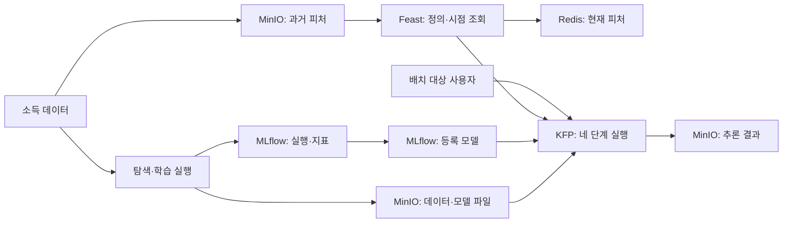
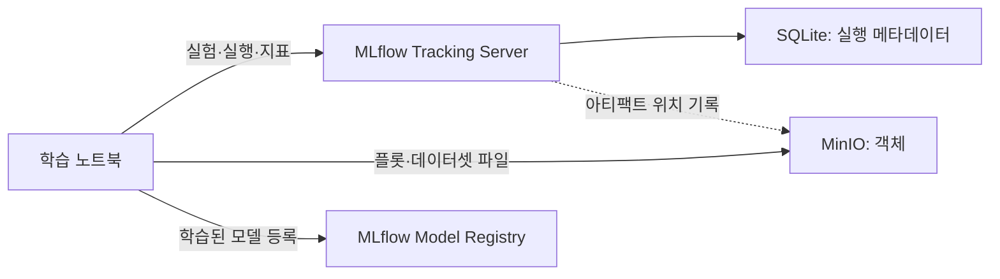
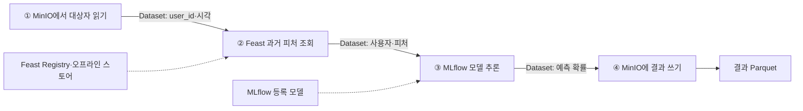

# MLflow·Feast·Kubeflow를 잇기 - 소득 분류 배치 추론까지

> 해당 포스팅은 현재 재직 중인 회사와 관련이 없고, 개인 역량 개발을 위한 스터디 자료로 활용할 예정입니다.
>
> **읽은 자료:** *Machine Learning Platform Engineering* 4~5장(pp. 97–148). 스터디에서 참고한 내용과 실행 결과도 반영했다.  
> **검증 환경:** Ubuntu 기반 로컬 K3s 스터디 서버, MLflow 3.0.0, Feast 0.40.1, KFP 2.4.0, MinIO·Redis. 아래 결과는 스터디 실행 기록에서 확인한 값이며, 이 글을 쓰면서 새로 실행한 결과는 아니다.

4장의 실험은 MLflow에 남기고, 같은 모델이 쓸 피처는 Feast에 등록했다. 5장에서는 MinIO에서 대상자를 읽어 Feast로 피처를 가져오고, MLflow 모델로 추론한 뒤 결과를 다시 MinIO에 쓰는 네 단계 파이프라인을 실행했다. 스터디 기록에서는 네 작업이 모두 성공했고, 결과 파일은 **30,162행 × 91열**, 결측값은 **0건**이었다. 파이프라인의 예측값을 같은 등록 모델의 직접 추론과 비교했을 때 최대 차이는 **0.0**이었다.

막힌 지점도 남았다. 책의 MLflow 2.6.0 예제를 실습 환경의 3.0.0으로 실행하면서 모델 아티팩트 경로가 달라졌고, 실험에서 높은 AUC가 나온 XGBoost 모델은 5장 추론 코드의 `predict_proba` 인터페이스와 맞지 않았다. Feast에 저장한 `localhost` 주소는 Kubernetes Pod에서 통하지 않았으며, KFP 사용자 네임스페이스의 아티팩트 Secret이 없어 실행이 한동안 멈췄다. 이 글은 성공한 명령만 나열하는 대신 **어느 연결이 왜 끊겼고 무엇을 확인해 해결했는지** 따라간다.

<!--truncate-->

***

## 1. 4~5장에서 연결하는 것

1~2장에서는 모델의 정답·평가·리니지를, 3장에서는 컨테이너와 Kubernetes의 배포 경로를 봤다. 4장은 **실험 결과와 피처를 다시 찾을 수 있게 만드는 장**, 5장은 **그 자산을 반복 가능한 배치 작업으로 묶는 장**이다.

| 구성요소 | 보관하거나 수행하는 것 | 이번 실습에서 확인한 경계 |
| --- | --- | --- |
| MLflow Tracking | 실행 ID, 파라미터, 지표, 입력 데이터의 메타데이터 | 어느 실행에서 어떤 AUC가 나왔는가 |
| MLflow Model Registry | 추론에 사용할 등록 모델과 버전 | KFP가 불러올 모델 버전은 무엇인가 |
| MinIO | 데이터셋, 모델·플롯 아티팩트, 파이프라인 결과 | 파일 자체가 저장되고 다시 읽히는가 |
| Feast Registry | 엔티티, 피처 뷰, 소스와 시점 규칙 | 피처 이름이 어느 데이터를 가리키는가 |
| Redis | 구체화한 온라인 피처 값 | 현재 사용자 피처를 조회할 수 있는가 |
| Kubeflow Pipelines(KFP) | 네 컴포넌트의 순서와 실행 상태 | 중간 결과가 다음 작업으로 전달되는가 |

책의 그림 4.1은 플랫폼 전체에서 실험 추적·모델 등록·피처 스토어가 어디에 자리하는지 보여 주고, 그림 5.2는 배치 추론 때 이들이 어떻게 연결되는지 설명한다. 아래는 이번 소득 분류 사례에 맞춰 정보의 흐름을 새로 그린 것이다.



**실험, 모델, 피처, 파이프라인은 서로 다른 자산**이다. MLflow에서 실행이 끝났다고 Redis에 피처가 들어가지는 않는다. Feast에 피처 뷰를 등록했다고 배치 추론이 자동으로 시작되지도 않는다. 각 경계에서 무엇을 입력받고 무엇을 남기는지 확인해야 전체 흐름이 재현된다.

이번 실습에서는 MinIO의 버킷도 용도별로 나눴다. 이름을 알아두면 어느 단계에서 파일이 사라졌는지 좁혀 보기 쉽다.

| 버킷 | 담긴 자료 | 쓰거나 읽는 주체 |
| --- | --- | --- |
| `mlflow-artifacts` | 플롯·모델 등 MLflow 아티팩트 | MLflow 실행 |
| `mlflow-datasets` | 학습·평가·참조 데이터 파일 | 학습 노트북 |
| `feature-data-sets` | 세 피처 그룹의 Parquet | Feast 오프라인 조회 |
| `feature-registry` | 피처 정의와 파이프라인용 설정 | Feast 등록 Job·KFP |
| `inference-datasets` | 대상자 목록과 최종 예측 파일 | KFP 읽기·쓰기 작업 |

이 글에는 책의 예제, 스터디에서 실제 확인한 결과, 아직 검증하지 않은 개선안을 구분해서 적었다. 예를 들어 KFP 파이프라인의 성공과 출력 파일은 실행 기록으로 확인할 수 있다. 뒤에서 제안하는 새 인코더 설계와 모델 별칭 전환은 다음 개선 작업이다.

## 2. 데이터부터 확인한다 - 4장 EDA

책의 소득 분류 예제는 연소득이 5만 달러를 넘는지 예측한다. 스터디에서 사용한 데이터는 **30,162행, 9열**이다. 입력 여덟 열은 `Workclass`, `Education`, `Marital-Status`, `Occupation`, `Relationship`, `Race`, `Sex`, `Native_country`이고, `Target`이 정답이다. 이 예제의 입력은 모두 범주형이다.

### 먼저 실습 경로를 만든다

뒤의 코드는 모두 **K3s 서버의 `~/mlpe-study`**에서 실행한다고 가정한다. 공개 예제 두 저장소를 이 폴더에 내려받으면 데이터와 KFP 컴포넌트 파일의 위치를 추측할 필요가 없다. 커밋을 고정한 이유는 저장소의 기본 브랜치가 바뀌어도 같은 파일 구성을 확인하기 위해서다. 아래는 **새로 따라 해 보는 재현용 환경**이며, 스터디 당시의 무작위 분할과 정확히 같은 지표를 보장하지 않는다.

```bash
mkdir -p ~/mlpe-study
cd ~/mlpe-study
git clone https://github.com/practical-mlops/chapter-4.git
git clone https://github.com/practical-mlops/chapter-5.git
git -C chapter-4 checkout b67a8228336781c933dd68bb7dc520bd484c3371
git -C chapter-5 checkout 332915b2f617e7fed8646b7c096653c87eed9d30

uv venv --python 3.11 .venv
uv pip install --python .venv/bin/python \
  'pandas==2.2.3' 'matplotlib==3.9.2' 'mlflow==3.0.0' \
  'minio==7.1.16' 'xgboost==1.7.6' 'feast[redis]==0.40.1' \
  'scikit-learn==1.5.2' 'pyarrow==18.1.0' 'sqlalchemy>=2.0,<2.1' \
  's3fs==2024.10.0' 'boto3==1.35.36' \
  'fsspec==2024.10.0' 'aiobotocore==2.15.2' \
  'jupyterlab' 'ipykernel'

# 이 글에서 사용하는 입력 파일이 실제로 있는지 확인
ls chapter-4/data/income_data.csv chapter-4/feast/feature_data/*.parquet
ls chapter-4/feast/data/entity_df.parquet
```

이제 원본 CSV는 `~/mlpe-study/chapter-4/data/income_data.csv`, 피처 파일 세 개는 `~/mlpe-study/chapter-4/feast/feature_data/`, 배치 대상자 파일은 `~/mlpe-study/chapter-4/feast/data/entity_df.parquet`에 있다. **2~4절의 Python 블록은 `~/mlpe-study`에서 연 동일한 Jupyter 커널에서 위에서 아래로 순서대로 실행한다.** 중간 변수를 다시 만들지 않도록 순서를 지킨다. 기존 Jupyter를 사용한다면 커널에 이 환경을 등록한다.

이후 명령을 따라가면 주요 파일은 다음 위치에 생긴다. 본문에서 `feast-local`처럼 짧게 쓴 경로도 모두 `~/mlpe-study`를 기준으로 한다.

| 경로 | 역할 |
| --- | --- |
| `~/mlpe-study/load-minio-env.sh` | Kubernetes Secret에서 MinIO 접속값을 읽어오는 스크립트 |
| `~/mlpe-study/column_list.pkl` | 학습 때 만든 입력 열의 이름과 순서 |
| `~/mlpe-study/feast-local/` | 호스트에서 쓰는 Feast 정의와 설정 |
| `~/mlpe-study/feast-cluster/` | KFP Pod에서 쓰는 Feast 설정과 등록 Job |
| `~/mlpe-study/chapter-5-work/` | 컴포넌트 이미지 작업본과 컴파일한 파이프라인 YAML |

```bash
cd ~/mlpe-study
.venv/bin/python -m ipykernel install --user --name mlpe-study \
  --display-name "MLPE study (Python 3.11)"
```

처음에는 행 수보다 **정답 비율과 범주별 건수**를 함께 보는 것이 중요했다. 스터디 데이터에서 `Target`의 `<=50K`는 22,654건으로 약 75%다. 모든 사람을 이 범주로 분류해도 정확도 75%가 나오므로, 모델 정확도 82%만으로는 성능을 충분히 설명할 수 없다.

```python
from pathlib import Path
import matplotlib.pyplot as plt
import pandas as pd

df = pd.read_csv("chapter-4/data/income_data.csv")
print(df.shape)                         # (30162, 9)
print(df["Target"].value_counts())
print(df.select_dtypes("object").describe().loc[["unique", "top", "freq"]])

# 각 범주의 건수(stack)와 고소득 비율(fill)을 같은 데이터로 비교
plot_dir = Path("eda-plots")
plot_dir.mkdir(exist_ok=True)
for column in df.columns.drop("Target"):
    counts = pd.crosstab(df[column], df["Target"])
    ratios = counts.div(counts.sum(axis=1), axis=0)
    fig, axes = plt.subplots(1, 2, figsize=(14, max(4, len(counts) * 0.35)))
    counts.plot.barh(stacked=True, ax=axes[0], title=f"{column}: 건수")
    ratios.plot.barh(stacked=True, ax=axes[1], title=f"{column}: 비율")
    axes[1].set_xlim(0, 1)
    fig.tight_layout()
    fig.savefig(plot_dir / f"{column}.png", dpi=120)
    plt.close(fig)
```

`Workclass`에서 `Private`은 22,286건이다. 이처럼 범주의 크기가 크게 다를 때는 **건수 그래프와 비율 그래프가 서로 다른 질문에 답한다.**

- `position="stack"`은 각 범주에 사람이 몇 명 있는지 보여 준다.
- `position="fill"`은 각 범주 안에서 `<=50K`와 `>50K`가 차지하는 비율을 보여 준다.

자영업 범주의 고소득 비율이 커 보이더라도 표본 수가 작으면 결과 해석은 달라질 수 있다. 그래프를 저장할 때도 제목에 변수 이름을 넣고, 사용한 데이터 버전과 생성 코드를 함께 남겨야 나중에 같은 그림을 다시 만들 수 있다.

### 분할과 인코딩도 실행 조건이다

범주형 열은 더미 변수로 바꾸고 정답은 0/1로 인코딩한다. 스터디 코드에서는 여덟 범주형 열이 **90개의 숫자 열**이 됐다. `column_list.pkl`에는 그 열의 **이름과 순서**가 저장된다. 5장 추론 컴포넌트가 이 목록을 읽어 입력 열을 맞춘다.

```python
import pickle
from sklearn.model_selection import train_test_split

features = df.drop(columns="Target")
encoded = pd.get_dummies(features, drop_first=True, dtype=float)
column_list = encoded.columns.tolist()
assert encoded.shape[1] == 90
with open("column_list.pkl", "wb") as file:
    pickle.dump(column_list, file)

target = df["Target"].astype(str).str.strip().eq(">50K").astype(int)
X_train, X_test, y_train, y_test = train_test_split(
    encoded, target, test_size=0.2, stratify=target, random_state=42
)
print(X_train.shape, X_test.shape)
print("고소득 비율:", y_train.mean(), y_test.mean())
```

원본 예제의 `train_test_split`에는 `random_state`가 없다. 실행할 때마다 학습·평가 행이 달라져 지표도 조금씩 바뀐다. 위 **재현용 코드**에는 `random_state=42`와 `stratify=target`을 넣어 세 모델을 같은 행과 클래스 비율에서 비교한다. 이 변경 때문에 아래 스터디 기록의 AUC 숫자와 새 실행의 숫자는 달라질 수 있다.

소득 데이터에는 성별·인종 같은 열도 포함돼 있다. 이 글은 책의 도구 간 연결을 공부하기 위한 예제다. 실제 의사결정에 쓰려면 예측 품질뿐 아니라 집단별 오류와 데이터 사용 기준을 별도로 검토해야 한다.

## 3. MLflow가 남기는 기록과 MinIO가 담는 파일

책의 예제는 `mlflow==2.6.0`과 `mlflow ui` 명령을 쓴다. 스터디 실행 환경은 달랐다. **MLflow 3.0.0 서버**를 띄우고 SQLite를 백엔드 저장소로, MinIO를 아티팩트 저장소로 사용했다. 서버에 실험·실행·지표가 기록되고, 플롯·데이터셋·모델 파일은 객체 스토리지의 경로로 연결된다.

서버를 시작할 때는 **메타데이터 저장 위치와 아티팩트 저장 위치**를 따로 지정한다. 이번 재현 예제에서는 MinIO를 로컬 19000 포트로 연결한다. 첫 번째 터미널은 계속 열어 둔다.

```bash
kubectl -n kubeflow port-forward svc/minio-service 19000:9000
```

다른 터미널에서 MinIO 접속값을 Kubernetes Secret에서 읽는 스크립트를 만든다. 스크립트에는 **값 대신 조회 명령만** 들어간다. 이후 새 터미널을 열 때마다 이 파일을 `source`하면 Feast와 MLflow가 같은 MinIO에 접근한다. 필요한 버킷을 만든 다음 MLflow 서버를 실행한다. `sqlite:///$PWD/mlflow.db`는 현재 디렉터리가 `~/mlpe-study`일 때 SQLite 파일을 그 안에 만든다.

```bash
cd ~/mlpe-study
cat > load-minio-env.sh <<'SH'
export MINIO_ACCESS_KEY="$(
  kubectl -n kubeflow get secret mlpipeline-minio-artifact \
    -o jsonpath='{.data.accesskey}' | base64 -d
)"
export MINIO_SECRET_KEY="$(
  kubectl -n kubeflow get secret mlpipeline-minio-artifact \
    -o jsonpath='{.data.secretkey}' | base64 -d
)"
export AWS_ACCESS_KEY_ID="$MINIO_ACCESS_KEY"
export AWS_SECRET_ACCESS_KEY="$MINIO_SECRET_KEY"
export MLFLOW_S3_ENDPOINT_URL="http://127.0.0.1:19000"
export FEAST_S3_ENDPOINT_URL="$MLFLOW_S3_ENDPOINT_URL"
export FEAST_DATA_ENDPOINT="$MLFLOW_S3_ENDPOINT_URL"
export AWS_ENDPOINT_URL="$MLFLOW_S3_ENDPOINT_URL"
SH
source ./load-minio-env.sh

.venv/bin/python - <<'PY'
import os
from minio import Minio

client = Minio(
    "127.0.0.1:19000",
    access_key=os.environ["MINIO_ACCESS_KEY"],
    secret_key=os.environ["MINIO_SECRET_KEY"],
    secure=False,
)
for name in (
    "mlflow-artifacts", "mlflow-datasets", "feature-data-sets",
    "feature-registry", "inference-datasets"
):
    if not client.bucket_exists(name):
        client.make_bucket(name)
    print(name, "준비 완료")
PY

.venv/bin/mlflow server --host 0.0.0.0 --port 5000 \
  --backend-store-uri "sqlite:///$PWD/mlflow.db" \
  --default-artifact-root s3://mlflow-artifacts/chapter-4
```

노트북 커널에도 같은 MinIO 환경변수가 필요하다. 세 번째 터미널에서 Jupyter를 시작하고, **MLPE study (Python 3.11)** 커널을 선택한다. Jupyter 프로세스가 환경변수를 물려주므로 앞의 Python 셀에서 `MINIO_ACCESS_KEY`와 `MINIO_SECRET_KEY`를 읽을 수 있다. 원격 Mac 브라우저로 접속할 때는 Mac에서 `ssh -N -L 8888:127.0.0.1:8888 <K3s 서버 SSH 주소>`로 포트 포워딩한다. 노트북이 같은 호스트에서 실행된다면 추적 주소는 `http://127.0.0.1:5000`이다. KFP Pod에서는 **Pod가 도달할 수 있는 MLflow 주소**를 런타임 파라미터로 사용한다.

```bash
cd ~/mlpe-study
source ./load-minio-env.sh
.venv/bin/jupyter lab --no-browser --ip 127.0.0.1 --port 8888
```

실제 스터디에서도 MLflow 서버를 호스트에서 운영하고, 아티팩트를 MinIO에 저장했다. 위 서버는 KFP Pod에서도 닿도록 모든 호스트 인터페이스에서 요청을 받는다. 이 학습용 서버는 인증을 구성하지 않았으므로 접근 가능한 네트워크 범위를 실습 환경으로 제한한다.



여기서 `mlflow.log_input()`과 MinIO 업로드는 구분해야 한다. `log_input()`은 데이터프레임의 스키마, 행 수, 출처 등 **데이터셋 메타데이터를 실행에 연결**한다. 원본 CSV 파일 자체를 객체 스토리지에 두는 작업은 별도로 진행했다. MLflow 화면에 데이터셋 항목이 보인다는 이유만으로 원본 데이터가 보존됐다고 판단하면 안 된다.

EDA 그래프도 하나의 실행으로 기록했다. 위에서 만든 `eda-plots`를 `start_run` 안에서 아티팩트로 올리면, 해당 실행의 Artifacts에서 그래프를 찾을 수 있다. 같은 디렉터리에 예전 그림이 남아 있으면 함께 업로드되므로, 새 실행마다 비어 있는 출력 디렉터리를 만드는 편이 확인하기 쉽다.

```python
import mlflow

mlflow.set_tracking_uri("http://127.0.0.1:5000")
mlflow.set_experiment("income-classifier")
with mlflow.start_run(run_name="eda-income"):
    mlflow.log_artifacts("eda-plots", artifact_path="eda-plots")
    mlflow.log_param("source_file", "chapter-4/data/income_data.csv")
    mlflow.log_metric("source_rows", len(df))
```

학습 실행에는 모델 설정만이 아니라 학습·평가·참조 데이터셋의 출처, 테스트 AUC와 정확도, 학습 모델을 **같은 run에 연결**했다. 이를 통해 “점수가 가장 높다”라는 결과뿐 아니라 **어느 입력에서 얻은 점수인가**를 되짚을 수 있다.

```python
from io import BytesIO
import os
from minio import Minio
from sklearn.ensemble import RandomForestClassifier
from sklearn.metrics import accuracy_score, roc_auc_score
from sklearn.tree import DecisionTreeClassifier

minio_client = Minio(
    "127.0.0.1:19000",
    access_key=os.environ["MINIO_ACCESS_KEY"],
    secret_key=os.environ["MINIO_SECRET_KEY"],
    secure=False,
)

def upload_csv(frame: pd.DataFrame, object_name: str) -> str:
    data = frame.to_csv(index=False).encode("utf-8")
    minio_client.put_object(
        "mlflow-datasets", object_name, BytesIO(data), len(data),
        content_type="text/csv",
    )
    return f"s3://mlflow-datasets/{object_name}"

train_frame = X_train.reset_index(drop=True).copy()
train_frame["Target"] = y_train.reset_index(drop=True)
test_frame = X_test.reset_index(drop=True).copy()
test_frame["Target"] = y_test.reset_index(drop=True)

for run_name, estimator in (
    ("decision-tree", DecisionTreeClassifier(random_state=42)),
    ("random-forest", RandomForestClassifier(n_estimators=100, random_state=42)),
):
    with mlflow.start_run(run_name=run_name) as run:
        for context, frame in (
            ("training", train_frame),
            ("testing", test_frame),
            ("reference", features),
        ):
            object_name = f"income-classifier/{run.info.run_id}/{context}.csv"
            source = upload_csv(frame, object_name)
            dataset = mlflow.data.from_pandas(frame, source=source)
            mlflow.log_input(dataset, context=context)

        estimator.fit(X_train, y_train)
        probabilities = estimator.predict_proba(X_test)[:, 1]
        mlflow.log_metric("roc_auc_score_test", roc_auc_score(y_test, probabilities))
        mlflow.log_metric("test_accuracy", accuracy_score(y_test, estimator.predict(X_test)))
        mlflow.log_params(estimator.get_params())
        mlflow.sklearn.log_model(estimator, name="income-classifier")
        # 5장 추론 컴포넌트가 모델 실행 ID로 이 목록을 내려받는다.
        mlflow.log_artifact("column_list.pkl")
        print(run_name, run.info.run_id, roc_auc_score(y_test, probabilities))
```

이 코드는 앞 절에서 만든 `df`, `features`, `X_train` 등의 값을 그대로 이어받는 **재현용 셀**이다. 책의 원본 노트북과 달리 두 모델이 같은 고정 분할을 사용한다. 이 코드의 결과를 위 스터디 표의 숫자와 동일한 과거 실행으로 취급하지 않는다.

## 4. 세 모델을 비교하니 모델 선택 기준이 달라졌다

결정 트리, 랜덤 포레스트, XGBoost를 돌린 뒤 테스트 AUC를 비교했다. 스터디 화면에 남은 값은 다음과 같다. **실행마다 분할이 고정되지 않았으므로**, 이 작은 점수 차이를 모델 간 우열의 확정 근거로 읽지는 않는다.

| 실행 | 기록된 테스트 AUC | 읽을 때 확인할 것 |
| --- | ---: | --- |
| 결정 트리 | 0.8200 | 단일 트리의 확률로 계산 |
| 랜덤 포레스트 | 0.8571 | 5장 배치 추론 코드와 인터페이스가 맞는 후보 |
| 원본 XGBoost 실행 | 0.7248 | 마지막 `binary:hinge`의 0/1 출력을 지표에 사용 |
| 분리한 XGBoost `binary:logistic` 실행 | 0.8633 | 확률을 사용했고, 별도 run에서 기록 |

ROC AUC는 양성과 음성을 **점수 순서로 얼마나 잘 구별하는지** 본다. `binary:logistic`은 확률을 반환하지만 `binary:hinge`는 0/1 클래스를 바로 반환한다. 후자의 AUC에 0/1 값을 넣으면 가능한 점수가 둘뿐이라 순위 정보가 크게 줄어든다. 원본 XGBoost 실행의 낮은 AUC만 보고 “XGBoost 모델이 약하다”고 결론 내리기 어려운 이유다.

더 큰 문제는 **한 run 안에서 서로 다른 목적 함수로 `xgb.train()`을 두 번 호출한 것**이었다. 첫 학습의 자동 기록과 둘째 학습의 수동 지표가 한 실행에 섞였고, 자동 로깅에서는 이미 기록한 파라미터를 다른 값으로 바꾸려 한다는 경고가 나왔다. 스터디에서는 `binary:logistic`과 `binary:hinge`를 별도 run으로 나눠 두 모델의 설정·지표를 각각 확인했다.

```python
import xgboost as xgb

mlflow.xgboost.autolog()
dtrain = xgb.DMatrix(X_train, label=y_train)
dtest = xgb.DMatrix(X_test, label=y_test)
base_params = {
    "colsample_bytree": 1,
    "learning_rate": 1,
    "max_depth": 10,
    "subsample": 1,
}

for objective in ("binary:logistic", "binary:hinge"):
    with mlflow.start_run(run_name=f"xgboost-{objective.split(':')[1]}"):
        params = {**base_params, "objective": objective}
        model = xgb.train(params, dtrain, num_boost_round=30)
        scores = model.predict(dtest)
        labels = (scores >= 0.5).astype(int)
        auc = roc_auc_score(y_test, scores)
        accuracy = accuracy_score(y_test, labels)
        mlflow.log_metric("roc_auc_score_test", auc)
        mlflow.log_metric("test_accuracy", accuracy)
        print(objective, "AUC", auc, "accuracy", accuracy)
```

이 셀은 2절의 고정 분할을 이어받는다. `binary:logistic`에서는 확률을 임계값 0.5로 0/1로 바꿔 정확도를 구한다. `binary:hinge`의 점수는 이미 0/1이라 같은 식으로 계산해도 값이 바뀌지 않는다. 두 목적 함수의 AUC는 입력 점수가 확률인지 클래스인지 확인하며 읽어야 한다.

### AUC 1등을 그대로 등록하지 않은 이유

실행 목록에서 가장 높은 AUC는 분리한 XGBoost `binary:logistic`이었다. 하지만 책의 5장 추론 컴포넌트는 로드한 모델에 **`predict_proba()`를 호출**한다. `xgb.train()`으로 만든 XGBoost `Booster`는 그 메서드를 제공하지 않는다. 이 파이프라인을 고치지 않고 연결할 모델로는 **사이킷런 랜덤 포레스트**를 선택해야 했다.

여기서 구분할 기준이 두 개다.

1. **평가 기준:** 동일한 데이터와 지표로 어떤 모델이 업무 목표에 맞는가.
2. **실행 계약:** 등록 모델이 파이프라인의 입력 열과 `predict_proba()` 호출을 처리할 수 있는가.

스터디에서는 랜덤 포레스트 실행의 모델 종류를 확인한 뒤 `random-forest-classifier` **버전 1**로 등록하고 `Production` 단계로 전환했다. 그 후 5장 코드는 `models:/random-forest-classifier/Production`을 사용했다. 이는 **기존 예제와 맞추기 위한 선택**이다. MLflow 공식 문서는 모델 단계(stage)를 더 이상 새 설계의 기본 경로로 권하지 않고 별칭(alias) 사용을 안내한다. 새 파이프라인에서 별칭을 쓰려면 모델 조회 코드도 함께 바꿔야 한다.

MLflow 3.0.0에서는 run의 고정 아티팩트 경로로만 모델을 찾으려 하면 등록 과정이 어긋날 수 있다. 스터디에서는 선택한 run에 연결된 **logged model ID**를 확인해 등록했다. 모델 이름을 `random-forest-classifier`라고 정하기 전에는 실제 저장된 모델이 랜덤 포레스트인지도 확인했다. 최고 점수 모델을 무조건 그 이름으로 등록하면 레지스트리의 이름과 내용물이 달라질 수 있기 때문이다.

아래는 위에서 실행한 `random-forest` run을 찾아 연결된 logged model을 등록하는 **재현용 코드**다. XGBoost run의 AUC가 더 높더라도 5장 컴포넌트가 요구하는 `predict_proba()`를 제공하는 후보를 명시적으로 선택한다. 같은 이름을 다시 등록하면 버전 번호가 1보다 커질 수 있으므로 출력된 버전을 확인한다.

```python
from mlflow import MlflowClient

client = MlflowClient()
experiment = client.get_experiment_by_name("income-classifier")
runs = client.search_runs(
    experiment_ids=[experiment.experiment_id],
    order_by=["metrics.roc_auc_score_test DESC"],
)
rf_run = next(
    run for run in runs
    if run.data.tags.get("mlflow.runName") == "random-forest"
    and run.data.params.get("n_estimators") == "100"
)
logged_models = mlflow.search_logged_models(
    experiment_ids=[experiment.experiment_id],
    filter_string=f"source_run_id = '{rf_run.info.run_id}'",
    output_format="list",
)
if len(logged_models) != 1:
    raise RuntimeError(f"랜덤 포레스트 logged model 수: {len(logged_models)}")

registered = mlflow.register_model(
    f"models:/{logged_models[0].model_id}",
    "random-forest-classifier",
)
client.transition_model_version_stage(
    name=registered.name,
    version=registered.version,
    stage="Production",
    archive_existing_versions=True,
)
version = client.get_model_version(registered.name, registered.version)
assert version.run_id == rf_run.info.run_id
print(registered.name, registered.version, version.current_stage, version.run_id)
```

마지막 `assert`는 5장 추론 코드가 모델 버전의 `run_id`로 `column_list.pkl`을 찾아야 하기 때문에 넣었다. 실패하면 단계 승격만 확인하고 넘어가지 말고, 등록 모델과 실행 아티팩트의 연결부터 점검해야 한다.

## 5. Feast에 피처를 등록할 때 생기는 세 가지 경로

책의 4장은 하나의 소득 CSV를 피처 그룹 세 개로 나눠 현실의 분산된 데이터 소스를 흉내 낸다. 기준 엔티티는 `user_id`다. 세 Parquet 파일에는 `user_id`와 피처 시각이 들어 있으며, 다음 FeatureView가 각 파일을 가리킨다.

| FeatureView | 피처 | 의미 |
| --- | --- | --- |
| `demographic` | 출신 국가, 성별, 인종 | 인구통계 |
| `relationship` | 가구 내 관계, 혼인 상태 | 관계 |
| `occupation` | 고용 형태, 학력, 직업 | 직업 |

Feast를 이해할 때 **정의, 과거 값, 현재 값**을 나눠 보면 덜 헷갈린다.

- **레지스트리:** `user_id`와 FeatureView, 스키마, 데이터 소스, TTL을 기록한다.
- **오프라인 스토어:** 과거 시점 조회에 쓸 Parquet 파일을 보관한다.
- **온라인 스토어:** 구체화한 현재 값을 Redis에서 빠르게 제공한다.


이 도식은 책의 그림 4.10을 이번 저장소와 조회 경로에 맞춰 다시 구성했다. `feast apply`는 **정의를 레지스트리에 등록**한다. 그 명령만으로 Redis에 사용자 값이 들어가는 것은 아니다. 실제 스터디 기록에서도 등록 직후 Redis의 키 수는 0이었고, `materialize` 뒤에 값이 생겼다.

먼저 공개 예제에 들어 있는 Parquet 파일 세 개와 배치 대상자 파일을 MinIO에 올린다. 3절의 MinIO 포트 포워딩을 유지한 상태에서 `~/mlpe-study`에서 실행한다.

```bash
cd ~/mlpe-study
source ./load-minio-env.sh

.venv/bin/python - <<'PY'
import os
from pathlib import Path
from minio import Minio

client = Minio(
    "127.0.0.1:19000",
    access_key=os.environ["MINIO_ACCESS_KEY"],
    secret_key=os.environ["MINIO_SECRET_KEY"],
    secure=False,
)
feature_dir = Path("chapter-4/feast/feature_data")
for file in feature_dir.glob("*.parquet"):
    client.fput_object("feature-data-sets", file.name, str(file))
    print("업로드:", "feature-data-sets/" + file.name)
entity_file = Path("chapter-4/feast/data/entity_df.parquet")
client.fput_object("inference-datasets", "entity_df.parquet", str(entity_file))
print("업로드: inference-datasets/entity_df.parquet")
PY
```

다음 내용은 `~/mlpe-study/feast-local/features.py` 전체다. 먼저 `mkdir -p ~/mlpe-study/feast-local`을 실행하고 아래 블록을 해당 파일로 저장한다. 파일 소스의 주소는 `FEAST_DATA_ENDPOINT`에서 읽으므로 로컬 적용 때는 포트 포워딩 주소를, 클러스터 안에서 다시 적용할 때는 MinIO Service 주소를 사용할 수 있다. `user_id`가 엔티티이고, 세 FeatureView 모두 같은 **365일 TTL**을 갖는다.

```python
# feast-local/features.py
import os
from datetime import timedelta
from feast import Entity, FeatureView, Field, FileSource
from feast.data_format import ParquetFormat
from feast.types import String

user = Entity(name="user_id", description="Income dataset user")

def make_view(name: str, filename: str, columns: list[str]) -> FeatureView:
    return FeatureView(
        name=name,
        entities=[user],
        schema=[Field(name=column, dtype=String) for column in columns],
        ttl=timedelta(days=365),
        source=FileSource(
            path=f"s3://feature-data-sets/{filename}",
            file_format=ParquetFormat(),
            s3_endpoint_override=os.environ["FEAST_DATA_ENDPOINT"],
        ),
    )

demographic = make_view(
    "demographic", "demographic_features.parquet",
    ["Native_country", "Sex", "Race"],
)
relationship = make_view(
    "relationship", "relationship_features.parquet",
    ["Relationship", "Marital-Status"],
)
occupation = make_view(
    "occupation", "occupational_features.parquet",
    ["Workclass", "Education", "Occupation"],
)
```

`ttl=365일`은 과거 시점 조회에서 얼마만큼 이전 값까지 후보로 볼지를 제한한다. 설정이 길수록 무조건 좋은 것은 아니다. 오래된 값도 허용해도 되는 피처인지 업무 의미를 먼저 정해야 한다. 이 예제는 필요한 소득 데이터의 피처를 빠뜨리지 않으려는 학습용 설정이다.

로컬 Feast 설정 파일은 아래처럼 만든다. Redis 비밀번호는 `redis-auth` Secret에서 읽어 **로컬의 파일**에만 쓴다. 이 파일은 공개 저장소에 넣지 않는다. 스터디 K3s의 Redis NodePort가 30006인 구성에 해당하며, 포트가 다르면 연결 문자열을 바꾼다.

```bash
cd ~/mlpe-study
mkdir -p feast-local
# 바로 위 Python 블록을 feast-local/features.py로 저장한 뒤 실행
source ./load-minio-env.sh
export REDIS_PASSWORD="$(
  kubectl -n redis get secret redis-auth \
    -o jsonpath='{.data.redis-password}' | base64 -d
)"
.venv/bin/python - <<'PY'
import os
from pathlib import Path

password = os.environ["REDIS_PASSWORD"]
config = (
    "project: income_local\n"
    "registry: s3://feature-registry/registry_local.db\n"
    "provider: local\n"
    "entity_key_serialization_version: 2\n"
    "offline_store:\n  type: file\n"
    "online_store:\n  type: redis\n"
    f'  connection_string: "127.0.0.1:30006,password={password}"\n'
)
path = Path("feast-local/feature_store.yaml")
path.write_text(config)
path.chmod(0o600)
print("설정 파일 생성:", path)
PY
cd feast-local
../.venv/bin/feast apply
```

### 과거 시점 조회는 오늘의 값을 과거로 보내지 않는다

1월 7일, 5월 21일, 12월 4일에 같은 사용자의 피처가 기록됐다고 하자. 5월 22일자 추론 자료를 만들 때는 5월 21일의 값이 필요하다. 12월 값을 붙이면 당시 알 수 없던 미래 정보를 사용하게 된다.

```text
1월 7일 값 ─── 5월 21일 값 ── 5월 22일 조회 ───────── 12월 4일 값
                      ↑ 사용                              ↑ 사용 불가
```

Feast의 `get_historical_features()`는 `user_id`와 `event_timestamp`가 담긴 엔티티 데이터프레임을 받고, 요청한 피처의 그 시점 이전 값을 찾는다.

```python
from feast import FeatureStore
import pandas as pd

store = FeatureStore(repo_path="feast-local")
entity_df = pd.DataFrame({
    "user_id": ["9f2ac416-06e1-44a0-87bd-d4787c85bf66"],
    "event_timestamp": [pd.Timestamp("2023-01-30T10:59:42Z")],
})
historical = store.get_historical_features(
    entity_df=entity_df,
    features=["demographic:Sex", "occupation:Occupation"],
).to_df()
print(historical[["user_id", "event_timestamp", "Sex", "Occupation"]])
```

실제 스터디 조회에서는 특정 사용자를 **2023년 1월 30일 10:59:42** 시점으로 조회했다. 반환된 `Sex`는 `Male`, `Occupation`은 `Adm-clerical`이었다. 원본 피처의 기록 시각은 **1월 24일 06:52:20**으로 조회 시점보다 앞이었다. 결과 한 행과 원본 시각을 대조해 시점 조회가 의도대로 작동하는지 확인했다.

### 온라인 조회 전에 구체화한다

Redis는 과거 Parquet 파일을 조회 때마다 읽지 않는다. 먼저 지정 기간의 오프라인 값을 온라인 스토어로 옮겨야 한다. 스터디에서는 세 FeatureView를 각각 **30,162행씩 처리**한 뒤 Redis의 키 수 **30,162개**를 확인했다. Redis 내부 확인 결과, 이 구성에서는 사용자별로 세 뷰의 값이 같은 키에 들어 있었다. 이 키 구조는 사용한 Feast 버전에서 관찰한 구현 결과이며, 모든 버전의 규칙으로 가정하지 않는다.

```sh
cd ~/mlpe-study/feast-local
source ../load-minio-env.sh
../.venv/bin/feast materialize \
  2022-09-16T00:00:00 2023-09-17T00:00:00
kubectl -n redis exec redis-0 -- redis-cli DBSIZE
```

위 기간은 이번 데이터 파일을 대상으로 한 값이다. 실제 실행에서는 시간대까지 확인해야 한다. `get_online_features()`로는 시각 인수 없이 Redis에 현재 구체화된 값을 조회한다. 스터디에서는 온라인 조회와 피처 서버의 `POST /get-online-features`에서 `Sex=Male`을 확인했다. 온라인 값은 새 파일을 올렸다고 저절로 바뀌지 않는다. 새 기간을 구체화해야 최신 값이 반영된다.

SDK에서 바로 조회할 때는 엔티티 행을 넘기고, 반환된 데이터프레임에서 필요한 열을 확인한다.

```python
store = FeatureStore(repo_path="feast-local")
online = store.get_online_features(
    features=["demographic:Sex"],
    entity_rows=[{"user_id": "9f2ac416-06e1-44a0-87bd-d4787c85bf66"}],
).to_df()
print(online[["user_id", "Sex"]])
```

Feast SDK를 쓰지 않는 서비스에서는 `feast serve`로 피처 서버를 띄워 같은 온라인 값을 HTTP로 조회할 수 있다. 스터디 기록의 응답에서는 해당 피처 상태가 `PRESENT`였고 값은 `Male`이었다. 레지스트리를 눈으로 점검할 때는 Feast UI도 사용했다. 기본 UI 포트가 Jupyter와 겹쳐 **다른 포트**로 실행했다. 두 경로 모두 `feast apply`로 등록한 정의를 읽으며, 실제 값은 조회 방식에 따라 오프라인 파일이나 Redis에서 온다.

```bash
cd ~/mlpe-study/feast-local
source ../load-minio-env.sh
../.venv/bin/feast serve  # 터미널 A: 127.0.0.1:6566
```

```bash
cd ~/mlpe-study/feast-local
source ../load-minio-env.sh
../.venv/bin/feast ui -h 127.0.0.1 -p 8889  # 터미널 B: UI
```

원격 Mac에서 UI를 볼 때는 `ssh -N -L 8889:127.0.0.1:8889 <K3s 서버 SSH 주소>`로 연결하고 `http://127.0.0.1:8889`에 접속한다. 피처 서버가 떠 있는 동안 세 번째 터미널에서 HTTP 응답도 확인할 수 있다. `results`에 `Sex`의 값과 `PRESENT` 상태가 함께 나와야 한다.

```bash
curl -fsS -X POST http://127.0.0.1:6566/get-online-features \
  -H 'Content-Type: application/json' \
  -d '{
    "features": ["demographic:Sex"],
    "entities": {"user_id": ["9f2ac416-06e1-44a0-87bd-d4787c85bf66"]}
  }' | jq '.results'
```

## 6. `localhost`가 달라지는 순간 - 5장 연결의 첫 장애

4장에서 로컬 프로세스가 MinIO에 접속할 때는 포트 연결 뒤 `localhost`를 써도 됐다. 하지만 5장의 Feast 컴포넌트는 **Kubernetes Pod 안에서** 실행된다. Pod의 `localhost`는 노트북 서버나 MinIO가 아니라 **그 Pod 자신**이다. 로컬 주소가 저장된 4장 Feast 레지스트리를 그대로 가져다 쓰면 피처 파일에 접근하지 못한다.

| 실행 주체 | `localhost`가 가리키는 곳 | MinIO 접근 경로 |
| --- | --- | --- |
| 노트북·CLI가 실행되는 호스트 | 그 호스트 | 호스트에서 연결한 포트 |
| KFP 컴포넌트 Pod | 해당 Pod | 클러스터 내부 MinIO Service 이름 |
| Argo CD·다른 Pod | 각각 자기 Pod | 클러스터 내부 Service 이름 |

호스트에서 클러스터 내부 DNS 이름을 넣어 `feast apply`를 시험했을 때도 실패했다. 호스트는 그 Service 이름을 해석하지 못했기 때문이다. 결국 **클러스터 안의 Job에서 `feast apply`를 실행**해 Pod에서 접근 가능한 MinIO 주소를 레지스트리에 저장했다. 이때 5장용 레지스트리와 설정을 4장의 로컬 조회 설정과 분리했다.

아래는 그 구조를 따라 만드는 **클러스터용 설정과 Job의 전체 예시**다. 5장 배치 추론은 과거 시점의 오프라인 피처만 조회하므로 이 설정의 온라인 저장소는 로컬 SQLite로 둔다. 책 4장의 Redis 온라인 조회는 앞의 `feast-local` 설정으로 계속 실행한다. 두 설정은 `registry_local.db`와 `registry.db`도 서로 다르게 사용한다.

```bash
cd ~/mlpe-study
mkdir -p feast-cluster
cat > feast-cluster/feature_store.yaml <<'YAML'
project: income_cluster
registry: s3://feature-registry/registry.db
provider: local
entity_key_serialization_version: 2
offline_store:
  type: file
online_store:
  type: sqlite
  path: /tmp/income-online.db
YAML

kubectl -n kubeflow create configmap income-feast-repo \
  --from-file=features.py=feast-local/features.py \
  --from-file=feature_store.yaml=feast-cluster/feature_store.yaml \
  --dry-run=client -o yaml | kubectl apply -f -
```

Job에서는 `FEAST_DATA_ENDPOINT`를 클러스터 내부 MinIO 주소로 지정한다. `features.py`를 같은 파일로 재사용해도 `feast apply`가 **Pod 안에서** 실행되므로 `registry.db`에는 Pod가 접근할 수 있는 소스 주소가 기록된다. 다음 YAML을 `~/mlpe-study/feast-cluster/job.yaml`로 저장해 적용한다. 의존성은 `pyarrow==18.1.0`까지 고정했다. 재현 코드를 점검하면서 Feast 0.40.1이 설치한 NumPy 1.26과 최신 PyArrow 26의 조합에서는 import 오류가 나는 것을 확인했기 때문이다.

```yaml
# feast-cluster/job.yaml
apiVersion: batch/v1
kind: Job
metadata:
  name: income-feast-apply
  namespace: kubeflow
spec:
  backoffLimit: 0
  template:
    spec:
      restartPolicy: Never
      containers:
        - name: feast
          image: python:3.10-slim-bookworm
          command: ["/bin/sh", "-c"]
          args:
            - >-
              pip install --no-cache-dir 'feast[redis]==0.40.1'
              'pandas==2.2.3' 'pyarrow==18.1.0'
              's3fs==2024.10.0' 'boto3==1.35.36'
              'fsspec==2024.10.0' 'aiobotocore==2.15.2' &&
              cd /repo && feast apply
          env:
            - name: FEAST_DATA_ENDPOINT
              value: http://minio-service.kubeflow.svc.cluster.local:9000
            - name: FEAST_S3_ENDPOINT_URL
              value: http://minio-service.kubeflow.svc.cluster.local:9000
            - name: AWS_ENDPOINT_URL
              value: http://minio-service.kubeflow.svc.cluster.local:9000
            - name: AWS_ACCESS_KEY_ID
              valueFrom:
                secretKeyRef:
                  name: mlpipeline-minio-artifact
                  key: accesskey
            - name: AWS_SECRET_ACCESS_KEY
              valueFrom:
                secretKeyRef:
                  name: mlpipeline-minio-artifact
                  key: secretkey
          volumeMounts:
            - name: repo
              mountPath: /repo
      volumes:
        - name: repo
          configMap:
            name: income-feast-repo
```

```bash
cd ~/mlpe-study
kubectl apply -f feast-cluster/job.yaml
kubectl -n kubeflow wait --for=condition=complete \
  job/income-feast-apply --timeout=600s
kubectl -n kubeflow logs job/income-feast-apply
```

파이프라인의 피처 조회 컴포넌트는 MinIO에서 `feature_store.yaml`을 내려받는다. 따라서 Job이 `registry.db`를 만든 다음, **비밀번호가 없는 클러스터용 설정 파일**을 `feature-registry` 버킷에 올린다.

```bash
cd ~/mlpe-study
source ./load-minio-env.sh
.venv/bin/python - <<'PY'
import os
from minio import Minio

client = Minio(
    "127.0.0.1:19000",
    access_key=os.environ["MINIO_ACCESS_KEY"],
    secret_key=os.environ["MINIO_SECRET_KEY"],
    secure=False,
)
client.fput_object(
    "feature-registry", "feature_store.yaml",
    "feast-cluster/feature_store.yaml",
)
for item in client.list_objects("feature-registry"):
    print(item.object_name)
# registry.db와 feature_store.yaml을 확인
PY
```

실제 배포 대상이 바뀔 때 확인할 항목은 세 가지다.

1. 피처 소스의 S3 엔드포인트가 **그 코드를 실행하는 환경에서** 접근 가능한가.
2. KFP Pod가 읽는 `feature_store.yaml`이 **클러스터용 레지스트리**를 가리키는가.
3. 등록 Job의 결과를 레지스트리에서 다시 읽어 **FeatureView 세 개와 엔티티**가 보이는가.

설정에 Redis 비밀번호나 객체 스토리지 키를 직접 넣으면 그 설정 파일을 복사하는 곳마다 비밀도 따라간다. 이 글의 예제와 표에는 실제 접속 주소와 인증 값을 넣지 않았다.

## 7. KFP 네 컴포넌트의 계약

5장은 **학습 파이프라인이 아니라 배치 추론 파이프라인**을 만든다. 입력은 예측할 사용자 ID와 기준 시각의 목록이다. 출력은 각 사용자에 대해 모델이 계산한 고소득 확률을 담은 Parquet 파일이다. 네 작업은 하나의 DAG를 이룬다.



각 컴포넌트는 **입력, 출력, 실행 이미지**를 명세로 갖는다. 책의 예제는 Python 파일로 동작을 작성하고, Docker 이미지에 넣은 뒤, `component.yaml`에 파일 경로와 인수·아티팩트 타입을 연결한다. `data_output`을 `Dataset`으로 선언하면 다음 단계는 앞 단계의 `outputs["data_output"]`을 입력으로 받는다.

실습 저장소의 파이프라인은 KFP **2.9.0**으로 컴파일돼 있었지만, 스터디 서버의 백엔드는 **2.4.0**이었다. 이번 실행에서는 백엔드 버전(2.4.0)의 SDK로 작업본을 다시 컴파일했다. 컴포넌트 이미지도 오래된 `latest`를 그대로 의존하지 않고, 실습에서 빌드한 고정 태그로 명세를 바꿨다. 원본 저장소 파일을 수정하지 않고 작업본을 둔 이유는 책의 예제와 환경별 변경을 비교하기 위해서다.

이제 소스 파일과 명세의 관계를 실제 경로로 확인할 수 있다. 2절에서 내려받은 `chapter-5` 저장소의 `src/`에는 네 작업의 Python 코드가, `components/`에는 각 코드의 입력·출력과 실행 명령을 적은 YAML이 있다.

| 단계 | Python 파일 (`~/mlpe-study/chapter-5/` 기준) | 명세 파일 (`~/mlpe-study/chapter-5/` 기준) | 남기는 출력 |
| --- | --- | --- | --- |
| 대상자 읽기 | `src/read_data/read_data.py` | `components/read_data/component.yaml` | 대상자 Parquet `Dataset` |
| 피처 조회 | `src/retrieve_features/retrieve_features.py` | `components/retrieve_features/component.yaml` | 시점에 맞춘 피처 `Dataset` |
| 모델 추론 | `src/run_inference/run_inference.py` | `components/run_inference/component.yaml` | 확률 열을 더한 `Dataset` |
| 결과 쓰기 | `src/write_data/write_data.py` | `components/write_data/component.yaml` | MinIO 결과 객체 |

다음은 각 컴포넌트의 Python 코드가 맡는 동작을 한곳에 모아 다시 쓴 **설명용 코드**다. `minio_host` 등의 값은 파이프라인 런타임 파라미터이므로 이 블록을 노트북 셀로 실행하지 않는다. 실제로 실행되는 Python 파일 네 개의 경로와 각 YAML 명세의 경로는 위 표와 같다.

```python
# 네 컴포넌트의 핵심 작업을 순서대로 읽기 위한 코드
from pathlib import Path
import pandas as pd
import mlflow
from feast import FeatureStore
from minio import Minio

minio = Minio(minio_host, access_key=access_key,
              secret_key=secret_key, secure=False)
minio.fget_object(entity_df_bucket, entity_df_filename, "/tmp/entities.parquet")
entities = pd.read_parquet("/tmp/entities.parquet")

store = FeatureStore(repo_path="/tmp/cluster-feast")  # MinIO에서 받은 설정이 있는 폴더
feature_frame = store.get_historical_features(
    entity_df=entities, features=feature_list.split(",")
).to_df()

mlflow.set_tracking_uri(mlflow_host)
model = mlflow.sklearn.load_model(
    "models:/random-forest-classifier/Production"
)
input_columns = pd.read_pickle("column_list.pkl")  # 등록 모델 실행의 아티팩트
encoded = pd.get_dummies(
    feature_frame.drop(columns=["user_id", "event_timestamp"]),
    drop_first=True, dtype=float,
).reindex(columns=input_columns, fill_value=0)
encoded["Predicted_Income_Class"] = model.predict_proba(encoded)[:, 1]
encoded.to_parquet("/tmp/predictions.parquet", index=False)
minio.fput_object(output_bucket, output_file_name, "/tmp/predictions.parquet")
```

명세가 Python 파일을 어떻게 실행하는지도 확인해야 한다. 아래는 `~/mlpe-study/chapter-5-work/components/read_data/component.yaml`의 핵심 구조다. `data_output`을 `Dataset`으로 선언하고 `{outputPath: data_output}`을 명령행 인수에 넣으면 KFP가 출력 파일 경로를 전달한다. 다른 세 명세도 같은 방식으로 앞 단계의 입력 경로와 다음 단계의 출력 경로를 연결한다.

```yaml
name: Read Data From MinIO
inputs:
  - {name: minio_host, type: String}
  - {name: access_key, type: String}
  - {name: secret_key, type: String}
  - {name: bucket_name, type: String}
  - {name: file_name, type: String}
outputs:
  - {name: data_output, type: Dataset}
implementation:
  container:
    image: '<내 레지스트리 계정>/income-kfp:bookworm-v1'
    command:
      - python3
      - /app/src/read_data/read_data.py
      - --minio_host
      - {inputValue: minio_host}
      - --access_key
      - {inputValue: access_key}
      - --secret_key
      - {inputValue: secret_key}
      - --bucket_name
      - {inputValue: bucket_name}
      - --file_name
      - {inputValue: file_name}
      - --data_output_path
      - {outputPath: data_output}
```

실행 가능한 컴포넌트 이미지를 만들 때는 오래된 `buster` 기반 이미지를 `bookworm`으로 바꾸고, 네 명세의 이미지 주소를 **하나의 고정 태그**로 맞춘다. 공개 예제의 Dockerfile은 소스 전체를 이미지에 넣으므로 네 작업이 같은 이미지 하나를 사용해도 된다. `COMPONENT_IMAGE`에는 자신의 컨테이너 레지스트리 주소를 넣는다. 이미지 안의 네 Python 파일은 `kfp`를 import하지 않으므로 이미지 의존성에서 KFP SDK를 뺀다. KFP 2.4.0과 Feast 0.40.1을 한 환경에 설치하려 하면 Protobuf 요구 버전이 충돌한다. 파이프라인 컴파일용 KFP SDK는 뒤의 별도 가상환경에만 둔다.

```bash
cd ~/mlpe-study
cp -R chapter-5 chapter-5-work
export COMPONENT_IMAGE="<내 레지스트리 계정>/income-kfp:bookworm-v1"
.venv/bin/python - <<'PY'
import os
import re
from pathlib import Path

root = Path("chapter-5-work")
dockerfile = root / "Dockerfile"
dockerfile.write_text(
    dockerfile.read_text().replace(
        "python:3.10-slim-buster", "python:3.10-slim-bookworm"
    )
)
requirements = root / "requirements.txt"
runtime_requirements = [
    line for line in requirements.read_text().splitlines()
    if not line.startswith("kfp==")
]
requirements.write_text(
    "\n".join(runtime_requirements)
    + "\nscikit-learn==1.5.2\npyarrow==18.1.0\nsqlalchemy>=2.0,<2.1\n"
)
for file in (root / "components").glob("*/component.yaml"):
    text = file.read_text()
    text, count = re.subn(
        r"image:\s*['\"]?varunmallya/[^'\"\s]+['\"]?",
        f"image: '{os.environ['COMPONENT_IMAGE']}'",
        text,
    )
    assert count == 1, file
    file.write_text(text)
    print("이미지 고정:", file)
PY

# amd64 K3s 서버에서 arm64 이미지도 함께 만들었던 스터디의 방식
docker run --privileged --rm tonistiigi/binfmt --install arm64
docker buildx inspect mlpe-multi >/dev/null 2>&1 ||
  docker buildx create --name mlpe-multi --driver docker-container
docker buildx use mlpe-multi
docker buildx inspect --bootstrap
docker login  # COMPONENT_IMAGE의 레지스트리에 게시할 계정으로 로그인
docker buildx build --builder mlpe-multi \
  --platform linux/amd64,linux/arm64 \
  -t "$COMPONENT_IMAGE" --push chapter-5-work
```

다음은 `~/mlpe-study/chapter-5-work/income_pipeline.py`의 **전체 파이프라인 정의**다. 네 YAML 명세를 읽고, 앞 단계의 `Dataset` 출력을 다음 단계의 입력으로 넘긴다. 14개 런타임 파라미터 이름은 8절의 REST 요청과 정확히 맞춘다.

```python
# chapter-5-work/income_pipeline.py
from pathlib import Path
import kfp
from kfp import compiler, dsl

root = Path(__file__).parent
read_data = kfp.components.load_component_from_file(
    str(root / "components/read_data/component.yaml")
)
get_features = kfp.components.load_component_from_file(
    str(root / "components/retrieve_features/component.yaml")
)
infer = kfp.components.load_component_from_file(
    str(root / "components/run_inference/component.yaml")
)
write_data = kfp.components.load_component_from_file(
    str(root / "components/write_data/component.yaml")
)

@dsl.pipeline(name="income-classifier-pipeline")
def income_classifier_pipeline(
    minio_host: str,
    access_key: str,
    secret_key: str,
    entity_df_bucket: str,
    entity_df_filename: str,
    feature_store_bucket_name: str,
    feature_store_config_file_name: str,
    feature_list: str,
    model_name: str,
    model_type: str,
    model_stage: str,
    mlflow_host: str,
    output_bucket: str,
    output_file_name: str,
):
    ids = read_data(
        minio_host=minio_host, access_key=access_key,
        secret_key=secret_key, bucket_name=entity_df_bucket,
        file_name=entity_df_filename,
    )
    features = get_features(
        minio_host=minio_host, access_key=access_key,
        secret_key=secret_key, bucket_name=feature_store_bucket_name,
        file_name=feature_store_config_file_name,
        entity_df=ids.outputs["data_output"], feature_list=feature_list,
    )
    predictions = infer(
        minio_host=minio_host, access_key=access_key,
        secret_key=secret_key, model_name=model_name,
        model_type=model_type, model_stage=model_stage,
        mlflow_host=mlflow_host,
        input_data=features.outputs["data_output"],
    )
    write_data(
        minio_host=minio_host, access_key=access_key,
        secret_key=secret_key, bucket_name=output_bucket,
        file_name=output_file_name,
        input_data=predictions.outputs["data_output"],
    )

if __name__ == "__main__":
    compiler.Compiler().compile(
        pipeline_func=income_classifier_pipeline,
        package_path=str(root / "income_classifier_pipeline.yaml"),
    )
```

컴파일러는 별도 가상환경에 설치한다. 4장 학습 환경과 KFP SDK의 의존성이 섞이지 않도록 하기 위해서다. **이 Python 블록을 위 경로에 저장한 뒤** 다음을 실행하면, 8절의 REST 코드가 업로드할 YAML이 생성된다.

```bash
cd ~/mlpe-study
uv venv --python 3.11 kfp-venv
uv pip install --python kfp-venv/bin/python 'kfp==2.4.0'
kfp-venv/bin/python chapter-5-work/income_pipeline.py
ls chapter-5-work/income_classifier_pipeline.yaml
```

컴파일 성공은 **정의가 만들어졌다는 뜻**이고, 네 작업의 성공은 KFP 실행 결과에서 별도로 확인해야 한다.

### 추론 입력 열은 목록만 맞춘다고 끝나지 않는다

추론 컴포넌트는 Feast에서 얻은 범주형 값에 다시 `pd.get_dummies(drop_first=True)`를 적용하고, 학습 때 저장한 `column_list.pkl`의 열 순서로 맞춘다. 이 방식은 **같은 범주가 모두 들어 있는 큰 배치**에서는 작동할 수 있지만, 작은 배치에서는 조용히 잘못된 값을 만들 위험이 있다.

예를 들어 학습 전체에서 `Occupation`의 첫 범주가 A였고, 이번 배치에는 B와 C만 있다고 하자. `drop_first=True`가 이번 배치에서는 B를 기준 범주로 버릴 수 있다. 그 뒤 열 이름을 학습 목록에 맞춰 다시 정렬해도 **버려진 B의 정보는 돌아오지 않는다.** 결측 열을 0으로 채우는 작업은 인코더의 기준 범주를 고정하는 것과 다르다.

이번 실행은 전체 **30,162행**을 한 번에 넣어 직접 모델 추론과 같은 확률을 얻었다. 이는 **그 배치에서 결과가 일치했다**는 증거다. 새로운 한 명 또는 드문 범주만 들어온 배치에서도 맞는다는 보장은 아니다. 후속 개선에서는 학습 때 맞춘 인코더를 모델과 함께 저장하고, 추론에서도 같은 변환 객체를 사용해야 한다.

이 가정을 공개 데이터로 확인한 후속 실험에서는 같은 6,033명의 평가 데이터를 한 번에 추론할 때는 차이가 없었지만, 한 명씩 추론하자 **1,229명의 0.5 기준 분류가 바뀌었다.** 기존 KFP 실행과 별도로 모델을 새로 학습해, 배치 크기만 바꾸어 측정한 결과다. 이 배치 불변성 실험은 다음 글에서 따로 정리한다.

책의 소득 데이터에서 벗어나 수집부터 다시 해 보고 싶다면 한국어 뉴스 제목 분류 실험으로 이어진다. Hugging Face에서 KLUE YNAT을 내려받아 Rancher Desktop의 Kubernetes Job으로 학습·배치 추론하고, MLflow에서 모델을 등록했다. 이 실험도 별도 글로 다룰 예정이다.

## 8. 스터디 실행 결과와 막혔던 지점

이전 정리에서는 KFP UI에 YAML을 업로드하고 화면에서 실행한 것처럼 읽혔지만, 제공된 실행 기록에는 **REST API로 업로드·실행하고 결과를 확인했다**고 적혀 있다. 당시 HTTP 요청을 담은 스크립트 원본은 확보하지 못했다. 아래에는 [KFP 2.4.0의 공식 API 명세](https://github.com/kubeflow/pipelines/blob/2.4.0/backend/api/v2beta1/swagger/kfp_api_single_file.swagger.json)에 맞춰 **새로 작성한 제출 명령과 결과 검증 코드 전체**를 적었다. 이는 스터디에서 사용한 원본 호출을 그대로 복원한 것은 아니다. 스터디에서는 네 작업이 모두 `Succeeded`로 끝난 것과 MinIO 출력 파일을 확인했으며, Kubeflow 대시보드에서 동일 실행을 브라우저로 확인했다는 기록은 없다.

### REST API로 파이프라인을 제출하는 재현용 코드

앞 절에서 컴파일한 `income_classifier_pipeline.yaml`과 MinIO·Feast·MLflow 환경이 준비된 **K3s 서버**에서 실행한다. 첫 번째 터미널에서 KFP API 서버를 포트 포워딩한다. 이 서버에서는 Jupyter가 8888 포트를 사용하므로 로컬 포트는 18888로 잡았다.

```bash
kubectl -n kubeflow port-forward svc/ml-pipeline 18888:8888
```

두 번째 터미널에서는 다음 명령을 실행한다. `KFP_NAMESPACE`는 `kubectl get profiles`에서 확인한 사용자 프로필의 네임스페이스로, `MLFLOW_HOST`는 **KFP Pod에서 접속 가능한** K3s 서버의 MLflow 주소로 설정한다. MinIO 키는 기존 Kubernetes Secret에서 읽고 화면에는 출력하지 않는다. 결과 파일에는 실행 시각을 붙여 이전 결과를 덮어쓰지 않는다.

```bash
cd ~/mlpe-study/chapter-5-work
set -euo pipefail
kubectl get profiles
export KFP_NAMESPACE="<사용자 프로필 네임스페이스>"
export MLFLOW_HOST="http://<K3s 서버의 Pod 접근 가능 IP>:5000"
source ../load-minio-env.sh
kubectl -n "$KFP_NAMESPACE" get secret mlpipeline-minio-artifact

API="http://127.0.0.1:18888/apis/v2beta1"
RUN_TAG="$(date +%Y%m%d%H%M%S)"
NAME="income-classifier-rest-${RUN_TAG}"
OUTPUT_FILE="inference_result_rest_${RUN_TAG}.parquet"
export OUTPUT_FILE
test -f income_classifier_pipeline.yaml

# 1. 컴파일한 YAML을 업로드하고 자동 생성된 파이프라인 버전을 찾는다.
PIPELINE_ID="$(
  curl -fsS -X POST \
    "${API}/pipelines/upload?name=${NAME}&namespace=${KFP_NAMESPACE}" \
    -F "uploadfile=@income_classifier_pipeline.yaml" |
    jq -er '.pipeline_id'
)"
VERSION_ID="$(
  curl -fsS "${API}/pipelines/${PIPELINE_ID}/versions" |
    jq -er '.pipeline_versions[0].pipeline_version_id'
)"

# 2. 이 실행을 묶을 KFP 실험을 만든다.
EXPERIMENT_ID="$(
  jq -n --arg name "$NAME" --arg ns "$KFP_NAMESPACE" \
    '{display_name:$name, namespace:$ns}' |
    curl -fsS -X POST "${API}/experiments" \
      -H "Content-Type: application/json" --data-binary @- |
    jq -er '.experiment_id'
)"

# 3. 등록 모델과 피처 조회에 필요한 14개 런타임 파라미터를 보내 Run을 생성한다.
RUN_ID="$(
  jq -n \
    --arg name "$NAME" \
    --arg experiment "$EXPERIMENT_ID" \
    --arg pipeline "$PIPELINE_ID" \
    --arg version "$VERSION_ID" \
    --arg mlflow "$MLFLOW_HOST" \
    --arg output "$OUTPUT_FILE" \
    '{
      display_name: $name,
      experiment_id: $experiment,
      pipeline_version_reference: {
        pipeline_id: $pipeline,
        pipeline_version_id: $version
      },
      runtime_config: {parameters: {
        minio_host: "minio-service.kubeflow:9000",
        access_key: env.MINIO_ACCESS_KEY,
        secret_key: env.MINIO_SECRET_KEY,
        entity_df_bucket: "inference-datasets",
        entity_df_filename: "entity_df.parquet",
        feature_store_bucket_name: "feature-registry",
        feature_store_config_file_name: "feature_store.yaml",
        feature_list: "demographic:Sex,demographic:Race,demographic:Native_country,relationship:Relationship,relationship:Marital-Status,occupation:Workclass,occupation:Education,occupation:Occupation",
        model_name: "random-forest-classifier",
        model_type: "sklearn",
        model_stage: "Production",
        mlflow_host: $mlflow,
        output_bucket: "inference-datasets",
        output_file_name: $output
      }}
    }' |
    curl -fsS -X POST "${API}/runs" \
      -H "Content-Type: application/json" --data-binary @- |
    jq -er '.run_id'
)"
printf 'KFP Run ID: %s\n결과 파일: inference-datasets/%s\n' \
  "$RUN_ID" "$OUTPUT_FILE"

# 진행 중이면 PENDING 또는 RUNNING이 나온다. 완료 뒤 다시 조회한다.
curl -fsS "${API}/runs/${RUN_ID}" | jq '{run_id, state}'
```

핵심 제출 요청은 `POST /apis/v2beta1/runs`다. 요청 본문의 `pipeline_version_reference`가 업로드한 파이프라인 버전을, `runtime_config.parameters`가 5장의 컴포넌트 입력을 가리킨다. 이 예제는 **기존 5장 컴포넌트 계약을 그대로 사용**하므로 MinIO 액세스 키와 시크릿 키가 KFP Run 이력에 평문으로 남는다. 개인 실습 외 환경에서는 Secret을 Pod에 주입하도록 컴포넌트를 바꾼 뒤 사용해야 한다.

| 확인 항목 | 스터디에서 관찰한 결과 | 여기서 알 수 있는 것 |
| --- | --- | --- |
| KFP 실행 상태 | 네 작업 모두 `Succeeded` | 작업 순서가 끝까지 실행됨 |
| 최종 파일 | MinIO의 `inference_result.parquet` | 마지막 쓰기 단계까지 연결됨 |
| 파일 모양 | 30,162행 × 91열, 결측 0건 | 대상자 배치가 빠짐없이 파일로 나옴 |
| 고소득 예측 비율 | 확률 0.5 이상이 약 22.1% | 이번 배치의 출력 분포 |
| 모델 직접 추론과 차이 | 확률의 최대 차이 0.0 | 파이프라인이 같은 등록 모델의 계산을 재현함 |

**22.1%는 모델 정확도가 아니다.** 정답과 대조한 값이 아니라, 이 배치에서 확률이 0.5 이상인 비율이다. 최대 차이 0.0도 모델이 실제 소득을 잘 맞혔다는 뜻이 아니라 **두 실행 경로의 계산 결과가 같았다**는 뜻이다.

최종 검증은 KFP의 `Succeeded` 표시에서 멈추지 않았다. MinIO에서 결과 Parquet을 다시 읽어 **행 수, 열 수, 결측값, 확률 분포**를 확인했다. 이어 등록된 같은 랜덤 포레스트를 직접 불러 동일한 피처에 추론하고, 확률 열의 차이를 계산했다. 이 비교를 거쳐야 “파일만 생성됐다”와 “원한 모델의 계산이 결과 파일에 들어갔다”를 구별할 수 있다.

같은 검증을 재현하려면 위 REST 요청을 실행한 **두 번째 터미널에서**, Run의 `state`가 `SUCCEEDED`가 된 뒤 아래를 실행한다. `OUTPUT_FILE`은 REST 블록에서 `export`한 파일 이름이다. 아래 코드는 새 실행의 결과를 검사하며, 앞의 스터디 표에 적힌 숫자를 새 실행의 결과로 주장하지 않는다.

```bash
cd ~/mlpe-study
source ./load-minio-env.sh

.venv/bin/python - <<'PY'
import os
from pathlib import Path
import numpy as np
import pandas as pd
import mlflow
from minio import Minio

object_name = os.environ["OUTPUT_FILE"]
destination = Path("/tmp") / object_name
minio = Minio(
    "127.0.0.1:19000",
    access_key=os.environ["MINIO_ACCESS_KEY"],
    secret_key=os.environ["MINIO_SECRET_KEY"],
    secure=False,
)
minio.fget_object("inference-datasets", object_name, str(destination))
result = pd.read_parquet(destination)
assert result.shape == (30_162, 91), result.shape
assert result.isna().sum().sum() == 0
assert result["Predicted_Income_Class"].between(0, 1).all()

mlflow.set_tracking_uri("http://127.0.0.1:5000")
model = mlflow.sklearn.load_model(
    "models:/random-forest-classifier/Production"
)
features = result.drop(columns="Predicted_Income_Class")
direct = model.predict_proba(features)[:, 1]
delta = np.abs(direct - result["Predicted_Income_Class"].to_numpy())
print("결과 모양:", result.shape)
print("고소득 예측 비율:", (result["Predicted_Income_Class"] >= 0.5).mean())
print("직접 모델 추론과 최대 차이:", delta.max())
assert np.allclose(direct, result["Predicted_Income_Class"].to_numpy())
PY
```

성공까지 이어진 장애와 조치는 다음과 같았다.

| 막힌 단계 | 확인한 원인 | 실습에서 적용한 조치 |
| --- | --- | --- |
| 컴포넌트 이미지 빌드 | 오래된 `slim-buster` 기반 이미지의 패키지 저장소 조회 실패 | 작업본의 기반 이미지를 `bookworm`으로 교체 |
| 다른 CPU 아키텍처 이미지 빌드 | 빌드 호스트에 arm64 실행 지원이 준비되지 않음 | 빌드 환경을 준비한 뒤 두 아키텍처 이미지 게시 |
| Feast 등록 | 호스트와 Pod가 서로 다른 MinIO 주소를 사용 | 클러스터 안에서 등록 Job 실행 |
| KFP Pod 시작 지연 | 사용자 네임스페이스의 아티팩트 Secret 누락 | 필요한 리소스를 수동으로 맞춰 실습 진행 |
| 모델 추론 인터페이스 | XGBoost `Booster`에 `predict_proba()` 없음 | 기존 추론 코드와 맞는 사이킷런 랜덤 포레스트 사용 |

네 번째 조치는 **이번 환경을 지나가기 위한 수동 복구**였다. 새 사용자 네임스페이스에서도 같은 누락이 반복될 수 있으므로, 공용 플랫폼이라면 리소스를 만들어야 하는 컨트롤러부터 고쳐야 한다. 이번 글의 성공 결과가 그 문제까지 해결했다는 뜻은 아니다.

이미지는 네 개의 이름으로 준비했지만, 스터디 기록에서는 같은 Dockerfile이 저장소 전체 코드를 넣는 구조여서 **실제 내용은 동일**했다. 네 번 빌드하는 대신 한 번 빌드한 뒤 필요한 태그를 붙이는 방식을 사용했다. 이 선택은 실습 속도를 높였지만, 컴포넌트별 최소 의존성이나 이미지 크기를 분리하는 설계는 다음 과제로 남는다.

### 실행 파라미터에 비밀을 넣은 흔적

책의 파이프라인 예제는 MinIO 액세스 키와 시크릿 키를 일반 문자열 파라미터로 받는다. 스터디 실행에서도 이 값이 KFP 실행 이력에 **평문으로 남는 문제**를 확인했다. 글에는 값이나 접속 가능한 주소를 옮기지 않았다. 공유 환경에서 재사용하려면 Kubernetes Secret 등 별도 경로로 주입하고, 파이프라인 파라미터에는 비밀 값을 넣지 않도록 컴포넌트 계약을 바꿔야 한다.

## 9. 두 장을 읽고 남은 운영 기준

4장과 5장의 연결은 “도구를 모두 설치했다”보다 **서로의 계약을 확인했다**는 데 의미가 있다. MLflow run의 지표가 어느 데이터에서 나왔는지, 등록 모델이 추론 코드의 메서드를 제공하는지, Feast의 피처 주소가 실행 Pod에서 열리는지, 중간 `Dataset`이 다음 작업으로 전달되는지를 각각 확인했다. 결과 파일을 모델의 직접 추론과 대조한 것도 이 계약의 마지막 검사였다.

반면 이 파이프라인에는 **재학습, 새 모델 승인, 실시간 서빙, 드리프트 감지**가 아직 없다. 4장의 모델·피처 자산과 5장의 배치 추론은 MLOps 루프의 일부를 구현한다. 1~2장에서 정한 “운영에서 오류가 늘면 무엇을 고칠까?”라는 질문에 답하려면 예측 후 정답 수집과 모니터링, 새 후보 평가까지 이어야 한다.

다음에 같은 실습을 반복한다면 아래 네 가지부터 고치고 싶다.

1. 평가 분할을 고정하고, 실행마다 데이터·변환·모델 버전을 함께 남긴다.
2. 학습 시점에 맞춘 범주형 인코더를 추론 컴포넌트에서도 그대로 사용한다.
3. 레지스트리의 stage 의존을 줄이려면 모델 별칭과 KFP 조회 코드를 함께 바꾼다.
4. KFP 실행 이력에서 인증 값을 없애고, 네임스페이스 리소스 생성 문제를 수동 조치 없이 해결한다.

## 10. 참고 자료

- *Machine Learning Platform Engineering*, 4~5장(pp. 97–148)
- 책의 4~5장 코드를 실행하며 정리한 스터디 기록
- [책 4장 예제 저장소](https://github.com/practical-mlops/chapter-4)와 [5장 예제 저장소](https://github.com/practical-mlops/chapter-5)
- [MLflow 모델 레지스트리 공식 문서](https://mlflow.org/docs/latest/ml/model-registry/workflow/)
- [Feast 공식 문서](https://docs.feast.dev/)
- [Kubeflow Pipelines 공식 문서](https://www.kubeflow.org/docs/components/pipelines/)

본문의 Mermaid는 책 그림 4.1·4.10·5.2의 구성요소 관계를 확인한 뒤 이번 실습의 실행 경로에 맞춰 새로 그렸다. 원서 그림이나 스터디 자료의 화면 캡처는 옮기지 않았다.
