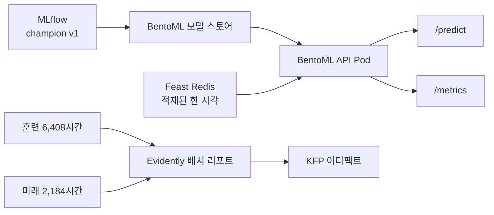

# 6장: 서울 자전거 모델을 BentoML로 서빙하고 Evidently 드리프트를 검증하기

> 이 글은 개인 학습 기록이며 현재 재직 중인 회사와 관계가 없다.
>
> **읽은 자료:** *Machine Learning Platform Engineering* 6장. **직접 실행:** 2026년 11월 5일 Mac M3 Pro의 Rancher Desktop Kubernetes에서 BentoML API와 KFP 배치 드리프트 작업을 실행했다. Yatai, Evidently UI, 실제 시간별 새 데이터가 들어오는 온라인 드리프트 서비스는 설치·실행하지 않았다. 책의 소득 분류 수치를 서울 자전거 실험 결과로 옮기지 않았다.

> **시리즈 순서:** [발행된 4\~5장](https://ddii.dev/mlops/ml-platform-engineering-ch4-5-practice/) (모델·피처·배치 추론) → **이 글, 6장(서빙·드리프트)** → 7장(KFP 데이터 준비) → Part 2 후속 실험(Notebook·KServe 정합성 검사).

4\~5장 서울 자전거 실험에서 MLflow 레지스트리에 `seoul-bike-hourly` 버전 1을 등록하고 `champion` 별칭을 붙였다. Feast에는 시간별 시차 피처를 올렸고, 미래 2,184시간을 따로 평가해 MAE 90.8443대를 확인했다. 6장의 질문은 두 가지다. **등록된 모델을 호출 가능한 API로 만들 수 있는가? 그 API가 받는 데이터가 훈련 때와 달라지면 알아챌 수 있는가?**

> **발행된 4\~5장 수치 정정:** 그 글의 “원본에서 `Functioning Day=No`인 시간 247시간”은 미래 테스트 구간의 집계다. UCI 원본 8,760시간 전체에서는 **295시간**, 미래 테스트 구간에서는 **247시간**이다. 원본 ZIP·CSV의 SHA-256을 확인한 뒤 두 구간을 다시 집계했다.

책은 BentoML·Yatai로 배포를, Evidently로 배치·실시간 드리프트 감시를 설명한다. 그대로 따라 적기 전에 기존 실험의 제약을 확인했다. Feast Redis 온라인 스토어에는 `city_id=seoul`의 **마지막 한 시각**만 적재돼 있다. 따라서 임의의 예측 시각을 받으면서 같은 온라인 피처로 예측하거나, 같은 행을 50번 호출해 실시간 드리프트를 측정하면 잘못된 결과가 나온다. 이번 실험에서는 API가 **실제로 적재된 시각만** 받게 하고, Evidently는 시각이 다른 과거 행들의 **배치**로 검증했다.

<!--truncate-->

***

## 1. 이번 실험의 입력과 실행 범위

| 항목 | 실제 확인한 값 |
| --- | --- |
| 데이터 | UCI *Seoul Bike Sharing Demand*, 2017-12-01 ~ 2018-11-30, 원본 8,760시간 |
| 모델 | `seoul-bike-hourly` v1, MLflow 별칭 `champion`, HistGradientBoosting 회귀 |
| 모델 입력 | `hour`, `weekday`, `month`, `holiday`, `lag_1`, `lag_24`, `lag_168` |
| Feast 온라인 행 | `city_id=seoul`, 2018-11-30 23시 KST 한 행 |
| 실행 환경 | k3s `v1.34.4+k3s1`, arm64, VM 8 CPU·16 GiB, BentoML `1.1.10`, Evidently `0.5.0` |
| 확인한 배포 | `mlpe-seoul-bike` 네임스페이스의 `bike-bento` Deployment 1/1. Yatai는 이번 클러스터에 설치하지 않았다 |

이 데이터는 시각과 대여량이 함께 있어 **서빙 시점의 피처가 정말 그 시점에 사용 가능한 값인가**를 묻기 좋다. 예측 시각 `t`에서 모델이 쓰는 `lag_1`은 `t-1`의 관측 대여량이다. 온라인 적재가 늦거나 Redis가 비면, API가 정상적으로 떠 있어도 예측 입력은 정상이 아닐 수 있다. 실제로 클러스터를 다시 켠 직후 Redis의 값이 없어 첫 로컬 API 요청은 503이었고, 온라인 머티리얼라이제이션 Job을 다시 돌린 뒤 200으로 바뀌었다. 이 과정이 6장의 첫 번째 운영 교훈이었다.



## 2. MLflow 모델을 BentoML로 가져오기

책 6장 코드는 BentoML `1.1.10` 스타일의 `Service`·`runner`·`bentofile.yaml`을 사용한다. 그래서 이번에는 해당 버전을 고정했다. 반면 기존 서울 모델이 기록된 MLflow는 `3.0.0`이다. 모델을 가져오는 코드는 레지스트리의 별칭을 **먼저 버전 1인지 검사한 뒤** BentoML 로컬 모델 스토어로 복사한다. `champion`은 MLflow 레지스트리 별칭이고, BentoML 모델 태그와는 다른 이름 공간이다.

```python
tracking_uri = "http://127.0.0.1:15002"
mlflow.set_tracking_uri(tracking_uri)
version = MlflowClient(tracking_uri).get_model_version_by_alias(
    "seoul-bike-hourly", "champion"
)
assert version.version == "1"
model = bentoml.mlflow.import_model(
    "seoul-bike-hourly",
    model_uri="models:/seoul-bike-hourly@champion",
)
print(model.tag)
```

먼저 MLflow 서비스에 포트포워딩을 건다. 부록의 파일을 `ch06_seoul_bike/`에 저장하고 그 상위 디렉터리에서 아래 명령을 시작한다. 4\~5장의 `seoul_bike_k8s/`와 나란히 두면 된다. 모델 태그는 가져올 때마다 바뀔 수 있으므로, 재실행 시 출력된 태그를 확인한다.

```bash
# 터미널 A
kubectl -n mlpe-seoul-bike port-forward svc/mlflow 15002:5000

# 터미널 B: ch06_seoul_bike/의 상위 디렉터리에서 시작
cd ch06_seoul_bike
uv venv --python 3.11 .venv
uv pip install --python .venv/bin/python -r requirements.txt 'evidently==0.5.0'
uv pip uninstall --python .venv/bin/python multipart
BENTOML_HOME="$PWD/.bentoml" MLFLOW_TRACKING_URI=http://127.0.0.1:15002 \
  .venv/bin/python import_model.py
```

이번 실행에서는 BentoML 모델 태그가 `seoul-bike-hourly:6qg3ynwy3kr64upy`로 생성됐다. 환경을 만들 때 두 호환성 문제가 있었다. 오래된 BentoML은 최신 setuptools에서 빠진 `pkg_resources`를 필요로 해서 `setuptools==80.9.0`으로 고정했다. 또 Evidently를 같은 Python 환경에 설치하면 `multipart`라는 별도 패키지가 `python-multipart`의 모듈을 가려 BentoML import가 실패했다. 위 설치 명령의 마지막 줄은 그 충돌을 해결하기 위한 것이다. 이 문제를 버전 핀 없이 "한 줄 설치"로 재현할 수 있다고 적으면 안 되겠다고 느꼈다.

## 3. Bento 서비스 계약: 적재된 시각만 예측한다

서비스 시작 시 Feast 레지스트리와 모델 선택 기록을 읽는다. `/predict`에는 `prediction_time`을 받지만, 온라인 머티리얼라이즈 기록의 시각과 다르면 400을 돌려준다. 모델 입력 7개 중 달력 피처 네 개는 예측 시각·공휴일 행에서, 시차 피처 세 개는 Feast `get_online_features`에서 가져온다. 모델은 BentoML runner가 실행한다.

```python
@svc.api(input=JSON(), output=JSON(), route="/predict")
def predict(payload: dict, ctx: bentoml.Context) -> dict:
    expected = pd.Timestamp(
        ctx.state["latest"]["event_timestamp_utc"]
    ).tz_convert("Asia/Seoul")
    requested = pd.Timestamp(payload["prediction_time"])
    if requested.tz_convert("UTC") != expected.tz_convert("UTC"):
        raise BadInput("Only the materialized hour is available")

    online = ctx.state["store"].get_online_features(
        features=[
            "bike_hourly:lag_1",
            "bike_hourly:lag_24",
            "bike_hourly:lag_168",
        ],
        entity_rows=[{"city_id": "seoul"}],
    ).to_df()
    # 달력 피처를 합쳐 모델 학습 때의 컬럼 순서로 runner에 전달한다.
```

중간 코드를 생략한 위 단락은 동작을 설명하기 위한 발췌다. **실제로 실행한 전체 `service.py`는 부록에 실었다.** 처음 초안처럼 시각을 바꾸면서 Redis의 같은 값을 읽는 엔드포인트는 만들지 않았다. `bentofile.yaml`에는 서비스 진입점, 코드·의존성, `/work` 데이터 경로만 적었다. BentoML 모델 스토어의 모델은 빌드 결과에 함께 묶인다.

```bash
BENTOML_HOME="$PWD/.bentoml" .venv/bin/bentoml build -f bentofile.yaml
```

빌드 출력은 `seoul_bike_service:g6sv42gy3okfuxjb`였다. 책은 이어서 `bentoml containerize`와 Yatai 배포를 보여 준다. 이번 Mac에서는 Bento 생성까지는 성공했지만 `bentoml containerize`는 `NotImplementedError`로 끝났다. 원인을 확정하지 못한 실패를 감추고 자동 이미지 빌드에 성공했다고 적을 수 없다. 그래서 **BentoML 모델 스토어와 서비스 소스를 넣은 `Dockerfile.k8s`를 직접 만들어** 로컬 Kubernetes에서 실행했다. 이 이미지는 방금 만든 Bento 아카이브 자체에서 생성된 것이 아니다. Yatai의 이미지 빌더 Job·UI·독립 runner Pod와 Bento 아카이브의 배포 이식성은 이번 실험에서 확인하지 못했다.

## 4. Kubernetes 배포와 API 검증

기존 4\~5장 이미지 `seoul-bike-ml:dev`에는 Feast·MLflow·모델 런타임이 설치돼 있다. 여기에 BentoML과 서비스를 추가했다. Kubernetes Deployment는 기존 실습의 `experiment-data` PVC를 읽기 전용으로 마운트한다. 이 PVC에는 Feast 레지스트리, `entities.parquet`, 모델 선택·온라인 적재 기록이 있다. Redis는 같은 네임스페이스의 서비스 주소로 연결한다. API Pod 안에서 runner는 별도 프로세스로 실행되지만, 이번 설정에서 별도의 runner Deployment로 확장하지는 않았다.

Mac의 로컬 클러스터에서는 API Pod를 1개, API 워커를 1개로 두고 메모리 한도를 2 GiB로 잡았다. 이 표 형식 모델은 CPU로 추론하며 별도의 가속기를 요청하지 않는다. 책의 Yatai 화면에서 API·runner 복제 수를 각각 고르는 부분은 이번 수동 Deployment와 다르다.

Redis가 비어 있을 때는 아래 Job으로 마지막 시각 한 행을 다시 적재했다. 기존 4\~5장 코드의 `online` 단계가 오프라인 피처 마지막 행과 온라인 조회값이 같은지도 검사한다.

```bash
kubectl apply -f online.yaml
kubectl -n mlpe-seoul-bike wait --for=condition=complete job/online-ch06 --timeout=120s
kubectl -n mlpe-seoul-bike logs job/online-ch06
```

그다음 이미지와 배포를 만들고 API를 호출한다. `port-forward`는 별도 터미널에서 켜 둔다.

```bash
docker build -f Dockerfile.k8s -t seoul-bike-bento:dev .
kubectl apply -f k8s.yaml
kubectl -n mlpe-seoul-bike rollout status deploy/bike-bento --timeout=120s
kubectl -n mlpe-seoul-bike port-forward svc/bike-bento 13000:3000
```

```bash
curl -sS -H 'Content-Type: application/json' \
  -d '{"prediction_time":"2018-11-30T23:00:00+09:00"}' \
  http://127.0.0.1:13000/predict
python3 verify_api.py
```

실제 Kubernetes 서비스의 응답은 다음과 같다.

```json
{
  "prediction_time": "2018-11-30T23:00:00+09:00",
  "predicted_rented_bikes": 480.29197201636924,
  "model_version": "1",
  "feature_source": "Feast Redis online store"
}
```

Pod 1개가 Ready였고, 위 요청은 200을 반환했다. 하루 전인 `2018-11-29T23:00:00+09:00`을 보내면 **400**을, `/metrics`를 조회하면 **200**을 받았다. `/metrics`의 존재는 확인했지만 Prometheus가 실제로 수집하는지, 지연 시간 알림이 울리는지는 이번에 측정하지 않았다. 앞서 4\~5장 FastAPI 서비스에서 했던 HPA 부하 실험도 이 Bento 서비스에는 다시 적용하지 않았다.

해당 시각의 기록된 실제 대여량은 584대라 이 한 건의 절대 오차는 약 103.71대다. API의 200은 요청 처리 성공을 뜻할 뿐, 예측이 정확하다는 증거는 아니다. 한 건의 오차로 모델의 전체 성능을 판단할 수도 없다. 또 현재 코드는 적재 기록 JSON의 시각과 **요청 시각**을 비교하지만, Feast 응답에서 실제 피처 시각을 다시 읽지는 않는다. Redis에 더 새로운 행을 넣으면서 적재 기록을 갱신하지 않으면 잘못된 조합이 될 수 있다. 운영용으로 넓힐 때는 피처의 사용 가능 시각까지 응답이나 별도 상태 키로 검사해야 한다.

## 5. Evidently 배치 드리프트: 대조군을 먼저 만든 이유

드리프트는 **입력 분포의 변화**다. 입력이 바뀌었다고 해서 예측 오차가 반드시 늘었다는 결론은 아니다. 성능을 알려면 같은 기간의 정답과 예측을 함께 봐야 한다. 이번에는 모델이 실제 사용하는 **7개 컬럼만** Evidently `DataDriftPreset`에 넣었다. 피처 스토어에 있는 직전 온도·강수는 챔피언 모델 입력이 아니므로 이 경보의 분모에 넣지 않았다.

비교를 세 번 했다.

1. **음성 대조군:** 최종 학습 구간 6,408시간을 고정 난수 `42`로 섞어 서로 겹치지 않는 3,204시간씩 나눴다. 모델 평가를 위한 분할이 아니라 같은 모집단에서 드리프트 판정이 얼마나 나오는지 보는 대조 실험이다.
2. **미래 구간:** 최종 학습 6,408시간과 한 번도 학습에 쓰지 않은 2018년 9\~11월 2,184시간을 비교했다.
3. **인위적 이동:** 대조군의 현재 쪽 `lag_1`에 300대를 더했다. 다른 여섯 피처는 그대로 두어 "중요한 피처 하나만 바뀔 때 전체 판정은 어떻게 되는가"를 확인했다.

| 비교 | 드리프트된 피처 | 전체 데이터셋 판정 | 해석 |
| --- | ---: | --- | --- |
| 음성 대조군 3,204 대 3,204 | 0/7 | `False` | 같은 기간의 분포를 둘로 나눴을 때는 신호가 없었다 |
| 학습 6,408 대 미래 2,184 | 4/7 | `True` | `month`, `lag_1`, `lag_24`, `lag_168`이 바뀌었다 |
| `lag_1`에 300대 더함 | 1/7 | `False` | 개별 피처 변화는 잡혔지만 전체 판정은 놓쳤다 |

이번 버전의 자동 검정은 `hour`·`weekday`·`month`·시차 피처에 **정규화된 Wasserstein 거리**, `holiday`에 **Jensen–Shannon 거리**를 선택했다. 개별 컬럼 임계값은 리포트에 0.1로 기록됐다. `month`의 미래 구간 점수는 1.628, `lag_1`은 0.254였다. 인위적으로 바꾼 `lag_1` 점수는 0.460으로, 개별 피처는 분명히 드리프트로 표시됐다. 하지만 `DataDriftPreset`의 전체 판정 기준은 기본적으로 **드리프트된 컬럼 비율 50%**다. 1/7은 이 기준에 못 미쳐 전체 판정이 `False`가 된다. 전체 불리언 하나만 보고 알림을 만들면 중요한 피처 하나의 이상을 놓칠 수 있다는 걸 직접 확인했다.

여기에는 다른 해석상의 함정도 있다. 미래 구간의 `month` 값은 훈련 기간과 계절이 다르므로, 드리프트가 뜨는 것이 예상 가능한 결과다. 이것을 곧바로 장애로 취급하면 계절이 바뀔 때마다 알림이 울릴 수 있다. 같은 데이터의 이전 평가에서 미래 구간의 월별 MAE는 9월 98.18대, 10월 98.09대, 11월 76.02대였다. 드리프트가 있다고 해서 월별 오차가 계속 증가한 것은 아니다. 실제 운영에서는 시각·계절을 맞춘 참조 구간, 핵심 피처별 경보, 정답이 들어온 뒤의 MAE를 따로 봐야 한다.

## 6. 드리프트 작업을 KFP 흐름에 넣기

배치 검사 코드는 `drift.py`다. 먼저 위 세 비교를 실행해 JSON과 HTML 리포트를 만든다. 로컬에서는 4\~5장 Pod의 `features.parquet`와 `entities.parquet`을 읽어 확인했고, KFP에서는 동일한 코드를 `seoul-bike-drift:dev` 이미지로 포장했다. 새로운 DAG는 다음 순서로 묶었다.

```text
collect → features → detect_drift → registered → infer
```

`detect_drift`는 결과 JSON을 KFP `Artifact` 출력 경로에도 쓴다. 이 단계는 **관측 단계**다. 미래 구간에 드리프트가 있다고 뒤의 추론을 자동으로 중단하지 않는다. 막아야 할 정도인지 결정하려면, 계절성이나 한 피처만 바뀐 대조 실험을 보고 별도의 정책을 정해야 한다. 처음 초안에 적었던 "드리프트가 감지되면 파이프라인을 멈춘다"는 설명은 해당 코드의 동작과 맞지 않아 고쳤다.

```bash
docker build -f Dockerfile.drift -t seoul-bike-drift:dev .
uv pip install --python .venv/bin/python 'kfp==2.17.3' 'kfp-kubernetes==2.17.3'
.venv/bin/python pipeline.py

# 다른 터미널에서 KFP UI/API 포워딩
kubectl -n kubeflow port-forward svc/ml-pipeline-ui 18088:80

# 원래 터미널에서
.venv/bin/python submit.py
```

이번 KFP run `04937bbb-fa5f-40ac-9c96-11628f317d9d`는 `SUCCEEDED`였다. `features` 단계의 8,592행 Feast 과거 시점 대조, 드리프트 단계의 **0/7·4/7·1/7** 결과, 이어진 등록 모델 조회와 미래 테스트 추론까지 로그로 확인했다. KFP 추론 단계가 남긴 미래 구간 MAE도 기존 기록과 같은 **90.8443대**였다. 이 값은 새로운 모델을 학습해 얻은 점수가 아니라 같은 모델·데이터로 다시 계산한 결과다.

## 7. 아직 실시간 드리프트라고 부르지 않은 이유

책은 API에 들어오는 요청을 최근 50개처럼 작은 윈도우로 모아 Evidently를 실행하는 방식을 보여 준다. 서울 자전거 실험의 현재 온라인 스토어에는 한 시각의 행만 있으므로, 같은 `/predict` 요청을 50번 보내도 서로 다른 50시간의 입력을 얻지 못한다. 그것은 마이크로배치 50개가 아니라 같은 데이터의 복사본 50개다. 그 결과를 "실시간 드리프트"라고 쓰면 안 된다.

이 모델에서 온라인 감시를 제대로 하려면, **새 시간이 시작될 때 이전 시간의 실제 대여량과 달력·공휴일 값을 수집하고, Feast에 새 시각의 피처를 적재한 뒤, 해당 시각별로 한 번씩 관측값을 남기는 루프**가 먼저 필요하다. 그다음 `prediction_time`으로 중복을 제거하고, 예를 들어 최근 168개 **서로 다른 시간**을 참조 구간과 비교해야 한다. 이 기간의 정답이 늦게 도착하면 입력 분포 경보와 예측 오차 경보의 시점도 다르게 설계해야 한다. Evidently UI와 장기 대시보드, Yatai 자동 배포는 그 데이터 흐름을 만든 뒤 확인할 과제로 남겼다.

이번 6장에서 얻은 인사이트는 도구 자체보다 **서빙 계약과 판정 기준**에 있다. BentoML이 모델을 API로 감싸도 Feast가 마지막 한 행만 주면 서비스할 수 있는 시각은 하나다. Evidently가 드리프트 점수를 내도 전체 판정만 보면 `lag_1` 단독 이상을 놓친다. 서빙 가능한 데이터의 범위와 경보가 뜻하는 바를 코드와 숫자로 먼저 정해야, 4\~5장의 실험을 실제 운영 루프로 이어 갈 수 있다.

다음 7장 글에서는 서빙에서 데이터 준비 단계로 돌아간다. 이 글의 드리프트 KFP 실행은 **4\~5장에서 만든 PVC의 데이터와 등록 모델**을 사용했다. 7장에서는 같은 UCI 원본을 새 KFP 파이프라인으로 내려받아 검증하고, 결과를 별도의 `Dataset` 아티팩트로 저장한다. **7장의 아티팩트가 이 API의 Feast·MLflow 입력으로 자동 반영되는 것은 아니다.** 이 경계는 Part 2 후속 실험에서도 계속 구분한다.

## 부록: 실행한 소스 전체

본문의 명령은 아래 파일들로 실행했다. 이번 6장 실험에서 작성한 코드는 모두 이 글 안에 있으며, 40줄 이상인 파일은 ‘전체 코드 보기’를 눌러 펼칠 수 있다. 생성되는 모델 태그와 KFP run ID는 환경마다 다를 수 있다. `service.py`의 BentoML 태그 기본값은 `:latest`이며, 정확한 버전을 고정하고 싶으면 출력된 태그를 `BENTOML_MODEL_TAG`로 넘길 수 있다.

```text
ch06_seoul_bike/
├── requirements.txt
├── import_model.py
├── service.py
├── bentofile.yaml
├── Dockerfile.k8s
├── online.yaml
├── k8s.yaml
├── verify_api.py
├── drift.py
├── Dockerfile.drift
├── pipeline.py
└── submit.py
```

### `ch06_seoul_bike/requirements.txt`

```text
bentoml==1.1.10
mlflow==3.0.0
feast[redis]==0.40.1
numpy==1.26.4
pandas==2.2.3
pyarrow==17.0.0
scikit-learn==1.5.2
setuptools==80.9.0
python-multipart==0.0.9
sqlalchemy>=2.0,<2.1
```

### `ch06_seoul_bike/import_model.py`

```python
"""Import the verified MLflow champion into BentoML's local model store."""
import os

import bentoml
import mlflow
from mlflow import MlflowClient


tracking_uri = os.environ.get("MLFLOW_TRACKING_URI", "http://127.0.0.1:15002")
mlflow.set_tracking_uri(tracking_uri)
version = MlflowClient(tracking_uri).get_model_version_by_alias(
    "seoul-bike-hourly", "champion"
)
if version.version != "1":
    raise ValueError(f"Unexpected champion version: {version.version}")
model = bentoml.mlflow.import_model(
    "seoul-bike-hourly",
    model_uri="models:/seoul-bike-hourly@champion",
)
print(f"mlflow_version={version.version} bentoml_tag={model.tag}")
```

### `ch06_seoul_bike/service.py`

<details markdown="1">
<summary>전체 코드 보기: service.py (75줄)</summary>

~~~python
"""BentoML 1.1 service for the latest materialized Seoul Bike hour."""
import json
import os
from pathlib import Path

import bentoml
import pandas as pd
from bentoml.exceptions import BadInput, ServiceUnavailable
from bentoml.io import JSON


ROOT = Path(os.environ.get("BIKE_DATA_ROOT", "/work"))
MODEL_TAG = os.environ.get("BENTOML_MODEL_TAG", "seoul-bike-hourly:latest")
runner = bentoml.mlflow.get(MODEL_TAG).to_runner()
svc = bentoml.Service("seoul_bike_service", runners=[runner])


@svc.on_startup
async def startup(ctx: bentoml.Context):
    from feast import FeatureStore

    selection = json.loads((ROOT / "selection.json").read_text())
    latest = json.loads((ROOT / "online_audit.json").read_text())
    calendar = pd.read_parquet(
        ROOT / "entities.parquet",
        columns=["event_timestamp", "holiday"],
    ).iloc[-1]
    if pd.Timestamp(calendar.event_timestamp) != pd.Timestamp(
        latest["event_timestamp_utc"]
    ):
        raise ValueError("Calendar and online audit timestamps differ")
    ctx.state["selection"] = selection
    ctx.state["latest"] = latest
    ctx.state["calendar"] = calendar
    ctx.state["store"] = FeatureStore(
        repo_path=os.environ.get("FEAST_REPO_PATH", str(ROOT / "feast_repo"))
    )


@svc.api(input=JSON(), output=JSON(), route="/predict")
def predict(payload: dict, ctx: bentoml.Context) -> dict:
    latest = ctx.state["latest"]
    expected = pd.Timestamp(latest["event_timestamp_utc"]).tz_convert("Asia/Seoul")
    try:
        requested = pd.Timestamp(payload["prediction_time"])
    except (KeyError, TypeError, ValueError) as error:
        raise BadInput("prediction_time must be an ISO 8601 timestamp") from error
    if requested.tzinfo is None or requested.tz_convert("UTC") != expected.tz_convert(
        "UTC"
    ):
        raise BadInput(
            f"Only the materialized hour {expected.isoformat()} is available"
        )
    feature_names = ["lag_1", "lag_24", "lag_168"]
    frame = ctx.state["store"].get_online_features(
        features=[f"bike_hourly:{name}" for name in feature_names],
        entity_rows=[{"city_id": "seoul"}],
    ).to_df()
    if frame.empty or frame[feature_names].isna().any().any():
        raise ServiceUnavailable("Feast online features are unavailable")
    row = {
        "hour": expected.hour,
        "weekday": expected.dayofweek,
        "month": expected.month,
        "holiday": int(ctx.state["calendar"].holiday),
        **{name: float(frame[name].iloc[0]) for name in feature_names},
    }
    columns = ctx.state["selection"]["model"]["columns"]
    estimate = runner.predict.run(pd.DataFrame([row])[columns])[0]
    return {
        "prediction_time": expected.isoformat(),
        "predicted_rented_bikes": max(0.0, float(estimate)),
        "model_version": ctx.state["selection"]["model"]["version"],
        "feature_source": "Feast Redis online store",
    }
~~~

</details>

### `ch06_seoul_bike/bentofile.yaml`

```yaml
service: "service:svc"
labels:
  dataset: seoul-bike-sharing-demand
  study_chapter: "6"
include:
  - "service.py"
  - "requirements.txt"
python:
  requirements_txt: "requirements.txt"
docker:
  env:
    - BIKE_DATA_ROOT=/work
```

### `ch06_seoul_bike/Dockerfile.k8s`

```dockerfile
FROM seoul-bike-ml:dev

COPY requirements.txt /app/ch06-requirements.txt
RUN pip install --no-cache-dir -r /app/ch06-requirements.txt \
    && pip uninstall -y multipart
COPY service.py /app/service.py
COPY .bentoml/models /opt/bentoml/models
ENV BENTOML_HOME=/opt/bentoml BIKE_DATA_ROOT=/work
EXPOSE 3000
ENTRYPOINT ["bentoml", "serve", "service:svc", "--api-workers", "1", "--port", "3000"]
```

### `ch06_seoul_bike/online.yaml`

```yaml
apiVersion: batch/v1
kind: Job
metadata:
  name: online-ch06
  namespace: mlpe-seoul-bike
spec:
  backoffLimit: 0
  template:
    spec:
      restartPolicy: Never
      containers:
        - name: online-ch06
          image: seoul-bike-ml:dev
          imagePullPolicy: Never
          args: ["online"]
          resources:
            requests:
              cpu: 200m
              memory: 256Mi
            limits:
              memory: 1Gi
          volumeMounts:
            - name: data
              mountPath: /work
      volumes:
        - name: data
          persistentVolumeClaim:
            claimName: experiment-data
```

### `ch06_seoul_bike/k8s.yaml`

<details markdown="1">
<summary>전체 코드 보기: k8s.yaml (53줄)</summary>

~~~yaml
apiVersion: apps/v1
kind: Deployment
metadata:
  name: bike-bento
  namespace: mlpe-seoul-bike
spec:
  replicas: 1
  selector:
    matchLabels:
      app: bike-bento
  template:
    metadata:
      labels:
        app: bike-bento
    spec:
      containers:
        - name: api
          image: seoul-bike-bento:dev
          imagePullPolicy: Never
          ports:
            - containerPort: 3000
          resources:
            requests:
              cpu: 100m
              memory: 512Mi
            limits:
              memory: 2Gi
          readinessProbe:
            httpGet:
              path: /readyz
              port: 3000
            periodSeconds: 5
          volumeMounts:
            - name: data
              mountPath: /work
              readOnly: true
      volumes:
        - name: data
          persistentVolumeClaim:
            claimName: experiment-data
---
apiVersion: v1
kind: Service
metadata:
  name: bike-bento
  namespace: mlpe-seoul-bike
spec:
  selector:
    app: bike-bento
  ports:
    - name: http
      port: 3000
      targetPort: 3000
~~~

</details>

### `ch06_seoul_bike/verify_api.py`

<details markdown="1">
<summary>전체 코드 보기: verify_api.py (45줄)</summary>

~~~python
"""Verify the Kubernetes Bento endpoint and save a compact audit record."""
import json
import os
from pathlib import Path
from urllib.error import HTTPError
from urllib.request import Request, urlopen


HOST = os.environ.get("BENTO_HOST", "http://127.0.0.1:13000")
HOUR = "2018-11-30T23:00:00+09:00"


def post(hour: str) -> tuple[int, str]:
    request = Request(
        HOST + "/predict",
        data=json.dumps({"prediction_time": hour}).encode(),
        headers={"Content-Type": "application/json"},
        method="POST",
    )
    try:
        with urlopen(request, timeout=30) as response:
            return response.status, response.read().decode()
    except HTTPError as error:
        return error.code, error.read().decode()


valid_status, valid_body = post(HOUR)
invalid_status, invalid_body = post("2018-11-29T23:00:00+09:00")
with urlopen(HOST + "/metrics", timeout=15) as response:
    metrics_status = response.status
result = {
    "valid_status": valid_status,
    "valid_response": json.loads(valid_body),
    "unmaterialized_hour_status": invalid_status,
    "unmaterialized_hour_response": invalid_body,
    "metrics_status": metrics_status,
}
if valid_status != 200 or invalid_status != 400 or metrics_status != 200:
    raise ValueError(result)
if result["valid_response"]["model_version"] != "1":
    raise ValueError(result)
out = Path(__file__).parent / "evidence" / "api-results.json"
out.parent.mkdir(exist_ok=True)
out.write_text(json.dumps(result, ensure_ascii=False, indent=2) + "\n")
print(json.dumps(result, ensure_ascii=False))
~~~

</details>

### `ch06_seoul_bike/drift.py`

<details markdown="1">
<summary>전체 코드 보기: drift.py (112줄)</summary>

~~~python
"""Evidently 0.5 batch drift controls on the verified Seoul Bike features."""
import argparse
import json
import os
from pathlib import Path

import numpy as np
import pandas as pd
from evidently.metric_preset import DataDriftPreset
from evidently.report import Report


ROOT = Path(os.environ.get("BIKE_DATA_ROOT", "/work"))
OUT = Path(os.environ.get("DRIFT_OUTPUT_ROOT", str(Path(__file__).parent / "evidence")))
COLS = ["hour", "weekday", "month", "holiday", "lag_1", "lag_24", "lag_168"]


def joined_inputs() -> pd.DataFrame:
    features = pd.read_parquet(ROOT / "features.parquet")
    entities = pd.read_parquet(ROOT / "entities.parquet")
    if not features["event_timestamp"].equals(entities["event_timestamp"]):
        raise ValueError("Feature/entity time misalignment")
    joined = entities[["event_timestamp", "local_time", "hour", "weekday", "month", "holiday"]].merge(
        features[["event_timestamp", "lag_1", "lag_24", "lag_168"]],
        on="event_timestamp",
        how="inner",
        validate="one_to_one",
    )
    joined["local_time"] = pd.to_datetime(joined["local_time"], utc=True).dt.tz_convert("Asia/Seoul")
    if len(joined) != 8592 or joined[COLS].isna().any().any():
        raise ValueError("Unexpected joined features")
    return joined


def summarize(report: Report) -> dict:
    raw = report.as_dict()
    dataset = next(
        metric["result"]
        for metric in raw["metrics"]
        if metric["metric"] == "DatasetDriftMetric"
    )
    table = next(
        metric["result"]
        for metric in raw["metrics"]
        if metric["metric"] == "DataDriftTable"
    )
    columns = {}
    for name, item in table["drift_by_columns"].items():
        columns[name] = {
            "drift_detected": bool(item["drift_detected"]),
            "drift_score": float(item["drift_score"]),
            "stattest_name": item["stattest_name"],
            "stattest_threshold": float(item["stattest_threshold"]),
        }
    return {
        "dataset_drift": bool(dataset["dataset_drift"]),
        "share_of_drifted_columns": float(dataset["share_of_drifted_columns"]),
        "number_of_columns": int(dataset["number_of_columns"]),
        "number_of_drifted_columns": int(dataset["number_of_drifted_columns"]),
        "columns": columns,
    }


def run_case(name: str, reference: pd.DataFrame, current: pd.DataFrame) -> dict:
    report = Report(metrics=[DataDriftPreset(columns=COLS)])
    report.run(reference_data=reference[COLS], current_data=current[COLS])
    result = summarize(report)
    result["reference_rows"] = len(reference)
    result["current_rows"] = len(current)
    if name == "future":
        report.save_html(str(OUT / "future-drift.html"))
    return result


def main(report_path: str | None = None) -> None:
    OUT.mkdir(parents=True, exist_ok=True)
    joined = joined_inputs()
    final_train = joined[joined.local_time < pd.Timestamp("2018-09-01", tz="Asia/Seoul")]
    future = joined[joined.local_time >= pd.Timestamp("2018-09-01", tz="Asia/Seoul")]
    if len(final_train) != 6408 or len(future) != 2184:
        raise ValueError("Unexpected time split")
    rng = np.random.default_rng(42)
    permutation = rng.permutation(len(final_train))
    control_a = final_train.iloc[permutation[:3204]].copy()
    control_b = final_train.iloc[permutation[3204:]].copy()
    shifted = control_b.copy()
    shifted["lag_1"] += 300
    results = {
        "evidently_version": "0.5.0",
        "model_columns": COLS,
        "negative_control": run_case("negative_control", control_a, control_b),
        "future": run_case("future", final_train, future),
        "shifted_lag_1": run_case("shifted_lag_1", control_a, shifted),
    }
    output = json.dumps(results, ensure_ascii=False, indent=2) + "\n"
    (OUT / "drift-results.json").write_text(output)
    if report_path:
        Path(report_path).parent.mkdir(parents=True, exist_ok=True)
        Path(report_path).write_text(output)
    for name, result in results.items():
        if isinstance(result, dict) and "share_of_drifted_columns" in result:
            print(
                f"{name}: {result['number_of_drifted_columns']}/"
                f"{result['number_of_columns']} drifted, "
                f"dataset_drift={result['dataset_drift']}"
            )


if __name__ == "__main__":
    parser = argparse.ArgumentParser()
    parser.add_argument("--report-path")
    main(parser.parse_args().report_path)
~~~

</details>

### `ch06_seoul_bike/Dockerfile.drift`

```dockerfile
FROM seoul-bike-ml:dev

RUN pip install --no-cache-dir evidently==0.5.0
COPY drift.py /app/drift.py
ENV BIKE_DATA_ROOT=/work DRIFT_OUTPUT_ROOT=/work/ch06-drift
ENTRYPOINT ["python", "/app/drift.py"]
```

### `ch06_seoul_bike/pipeline.py`

<details markdown="1">
<summary>전체 코드 보기: pipeline.py (76줄)</summary>

~~~python
"""KFP v2 batch inference with an Evidently drift report before inference."""
from kfp import compiler, dsl
import kfp.kubernetes


BIKE_IMAGE = "seoul-bike-ml:dev"
DRIFT_IMAGE = "seoul-bike-drift:dev"
MLFLOW_URI = "http://mlflow.mlpe-seoul-bike.svc.cluster.local:5000"


@dsl.container_component
def collect():
    return dsl.ContainerSpec(
        image=BIKE_IMAGE,
        command=["python", "/app/experiment.py", "collect"],
    )


@dsl.container_component
def features():
    return dsl.ContainerSpec(
        image=BIKE_IMAGE,
        command=["python", "/app/experiment.py", "features"],
    )


@dsl.container_component
def detect_drift(report: dsl.Output[dsl.Artifact]):
    return dsl.ContainerSpec(
        image=DRIFT_IMAGE,
        command=["python", "/app/drift.py"],
        args=["--report-path", report.path],
    )


@dsl.container_component
def registered():
    return dsl.ContainerSpec(
        image=BIKE_IMAGE,
        command=["env", f"MLFLOW_TRACKING_URI={MLFLOW_URI}", "python", "/app/experiment.py"],
        args=["registered"],
    )


@dsl.container_component
def infer():
    return dsl.ContainerSpec(
        image=BIKE_IMAGE,
        command=["env", f"MLFLOW_TRACKING_URI={MLFLOW_URI}", "python", "/app/experiment.py"],
        args=["infer"],
    )


@dsl.pipeline(name="seoul-bike-batch-with-drift")
def pipeline():
    downloaded = collect()
    prepared = features().after(downloaded)
    drifted = detect_drift().after(prepared)
    model = registered().after(drifted)
    inference = infer().after(model)
    for task, limit in (
        (downloaded, "512Mi"),
        (prepared, "2Gi"),
        (drifted, "2Gi"),
        (model, "512Mi"),
        (inference, "2Gi"),
    ):
        kfp.kubernetes.mount_pvc(task, pvc_name="seoul-bike-work", mount_path="/work")
        task.set_caching_options(False)
        task.set_cpu_request("200m")
        task.set_memory_request("256Mi")
        task.set_memory_limit(limit)


if __name__ == "__main__":
    compiler.Compiler().compile(pipeline, "seoul-bike-with-drift.yaml")
~~~

</details>

### `ch06_seoul_bike/submit.py`

```python
"""Submit the chapter-6 batch drift DAG to KFP standalone."""
import json
from pathlib import Path

import kfp


client = kfp.Client(host="http://127.0.0.1:18088", namespace="kubeflow")
run = client.create_run_from_pipeline_package(
    "seoul-bike-with-drift.yaml",
    run_name="seoul-bike-batch-with-drift",
    experiment_name="seoul-bike-study",
    namespace="kubeflow",
    enable_caching=False,
)
finished = client.wait_for_run_completion(run.run_id, timeout=1500)
result = {"run_id": run.run_id, "state": finished.state}
Path("evidence").mkdir(exist_ok=True)
Path("evidence/kfp-run.json").write_text(json.dumps(result, indent=2) + "\n")
print(json.dumps(result))
if finished.state != "SUCCEEDED":
    raise SystemExit(1)
```

## 참고 자료

- *Machine Learning Platform Engineering*, Benjamin Tan Wei Hao·Shanoop Padmanabhan·Varun Mallya, 6장.
- *Machine Learning Platform Engineering*, 6장
- [UCI Seoul Bike Sharing Demand 데이터 카드](https://archive.ics.uci.edu/dataset/560/seoul+bike+sharing+demand)
- [BentoML 공식 문서](https://docs.bentoml.com/)
- [Evidently 공식 문서](https://docs.evidentlyai.com/)
