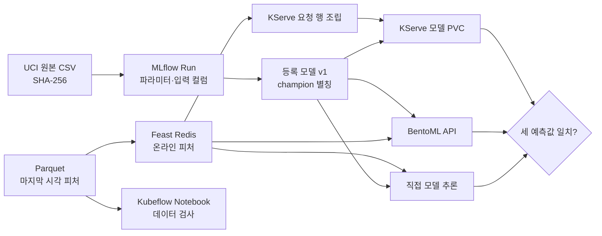

# [MLOps] Mac k3s에서 모델 검증 - MLflow·Feast·KServe

> 이 글은 개인 학습 기록이며 현재 재직 중인 회사와 관계가 없다.
>
> **참고 자료:** 최성욱 님의 *ML Platform Engineering Part 2 핸즈온*(확인한 커밋 `162b2f7`, 2026-11-02)과 *Machine Learning Platform Engineering* 4\~6장. 참고 저장소의 도메인은 성인 소득 분류다. 이 글은 서울 공공자전거 시간별 수요 모델로 **별도 실험**한 결과이며, 참고 저장소의 실행 수치를 내 결과로 옮기지 않았다.
>
> **직접 실행한 범위:** 2026년 11월 5일 Mac M3 Pro의 Rancher Desktop k3s에서 MLflow·Feast·BentoML·KServe 사이의 계약을 검사하는 Kubernetes Job을 실행했다. 같은 클러스터에 Kubeflow Notebook 컨트롤러와 자전거 노트북을 띄워 데이터 점검 셀도 실행했다. 기존 KFP는 standalone 설치이며, 이번 검증 Job은 KFP를 사용하지 않았다. Kubeflow 전체 배포판과 GitOps PR 프리뷰를 설치한 결과도 아니다.

> **시리즈 순서:** [Feast·MLflow·KFP 잇기](https://ddii.dev/mlops/ml-platform-engineering-ch4-5-practice/) (모델·피처·배치 추론) → [BentoML 서빙과 Evidently 드리프트 검증](https://ddii.dev/mlops/ml-platform-engineering-ch6-practice/) → [KFP v2 데이터 준비·검증](https://ddii.dev/mlops/ml-platform-engineering-ch7-practice/) → **이 글, Mac k3s 모델 검증** (Notebook·KServe 정합성 검사).

앞선 글들에서는 서울 자전거 데이터로 시차 피처를 만들고, MLflow에 모델을 등록하고, Feast로 피처를 조회하고, KFP로 미래 구간을 평가했다. 이어서 등록된 모델을 BentoML API로 서빙했고, 같은 UCI 원본의 데이터 준비를 별도의 KFP 파이프라인으로 실행했다. 이 글에는 **이번 검증 Job에 필요한 선행 환경을 만드는 파일과 실행 명령**을 본문에 실었다. 다른 글이나 코드 저장소를 열지 않아도 이 글의 실험용 파일을 구성할 수 있다. 이렇게 구성요소를 하나씩 확인하면 각각은 정상처럼 보인다. 그러나 한 가지 질문은 남는다.

> 지금 API가 반환하는 숫자는 **어떤 원본 데이터로 훈련한 모델**이 **어느 시각의 피처**를 받아 계산한 값인가?

**KFP 데이터 준비 글과 이 글의 범위는 다르다.** 그 글에서는 다운로드·검증·피처 생성·시간 분할·QA를 **KFP의 서로 다른 Pod**에서 실행하고, 단계별 `Dataset` 아티팩트가 SeaweedFS를 거쳐 전달되는지 확인했다. 이 글의 4.0절에 넣은 `collect → features → train → infer → online`은 Notebook·KServe 검증의 선행 환경을 만드는 **일반 Kubernetes Job**이다. KFP 데이터 준비 결과를 MLflow·Feast 훈련 입력으로 자동 승격시키는 연결은 아직 만들지 않았다. 따라서 이 글만으로 KFP 데이터 준비 실험까지 재현했다고 볼 수는 없다.

참고 저장소의 Part 2에서 가장 배울 만한 점은 이 질문을 시스템 경계마다 확인한다는 것이다. MLflow의 모델 별칭에서 출처 Run과 데이터 기록까지 거슬러 올라가고, Feast의 오프라인·온라인 값을 대조하고, 서빙 API 결과를 직접 추론값과 비교한다. 참고 저장소에는 KServe가 `Ready`인데도 훈련과 서빙의 라이브러리 차이로 예측값이 달라진 사례가 있다. 이 글에서는 **같은 입력에 대해 직접 추론·BentoML·KServe가 같은 값을 내는지** Kubernetes Job으로 확인하고, Kubeflow Notebook에서 그 입력 데이터의 시간 규칙도 다시 검사했다.

<!--truncate-->

***

## 1. 참고 저장소에서 무엇을 가져왔나

참고 저장소는 단일 노드 k3s에 Argo CD, Kubeflow 배포판, MLflow, Feast, KServe를 연결한다. Lab 1에서는 성인 소득 분류 데이터를 90개 피처로 변환하고, 모델의 Run과 데이터셋을 추적하고, `champion` 별칭을 붙여 서빙한 다음 오프라인·온라인 피처를 대조한다. 특히 실험과 계보, 모델 승격, 서빙, 피처 스토어 절의 **검증 순서**를 가져와 기존 Mac 클러스터와 서울 데이터에 맞게 실행 대상을 바꿨다.

| 주제 | 참고 저장소의 경로 | 이 글의 경로 |
| --- | --- | --- |
| 데이터·모델 | 성인 소득 분류, 원핫 인코딩, 분류 AUC | 서울 시간별 자전거 대여량, 시차 피처, 회귀 MAE |
| 실험·모델 계보 | MLflow Run → 데이터셋 → 등록 모델 → `champion` | `seoul-bike-hourly` v1의 Run·원본 해시·입력 컬럼 대조 |
| 피처 | Feast 오프라인 Parquet과 온라인 Redis | 마지막 한 시각의 `lag_1`·`lag_24`·`lag_168` 대조 |
| 파이프라인·노트북 | Kubeflow Pipelines의 훈련·승격과 Notebook | 앞선 글에서 KFP 배치 추론과 데이터 준비 실행, 이번 글에서 Notebook의 데이터 검사 셀 실행 |
| 서빙 | KServe `InferenceService` | 같은 MLflow 모델을 KServe와 기존 BentoML API에서 각각 호출해 대조 |
| 플랫폼 배포 | Argo CD ApplicationSet과 PR 프리뷰 | 기존 Rancher Desktop 클러스터를 사용하며 이번 글에서 프리뷰는 실행하지 않음 |

참고 저장소의 MLflow는 PostgreSQL과 S3 호환 스토리지를 쓴다. 이 글에서는 앞선 로컬 실험의 SQLite·PVC를 그대로 사용하고, KServe에는 `pvc://`로 모델 디렉터리를 연결했다. Kubeflow도 전체 배포판을 설치하지 않고 기존 **KFP standalone**에 **Notebook v1 컨트롤러**만 추가했다. 인증 게이트웨이가 없는 구성이라 노트북 접속은 로컬 포트포워딩으로 제한했다.

## 2. 왜 서울 자전거 데이터로 계약을 시험했나

참고 저장소의 소득 분류 데이터는 피처 인코딩과 모델 등록을 설명하기 좋다. 하지만 피처의 **시각**을 확인하려면 시계열 데이터가 더 직접적이다. UCI *Seoul Bike Sharing Demand*는 서울의 1년치 시간별 대여량과 시각을 제공한다. 원본 8,760시간에서 일주일 전 값이 없는 첫 168시간을 제외해 8,592시간을 사용했다.

이번 모델은 `t`시가 시작할 때 그 시간의 대여 대수를 예측한다. `lag_1`은 `t-1`의 실제 대여량, `lag_24`는 하루 전, `lag_168`은 일주일 전 값이다. 예측 시각·요일·월·공휴일을 더해 총 7개 컬럼으로 HistGradientBoosting 회귀 모델을 훈련했다. 2018년 7\~8월 검증 구간에서 피처 조합을 고르고, 9\~11월 **미래 2,184시간**을 따로 평가했다. 등록 모델의 미래 MAE는 **90.8443대**, 하루 전 대여량을 그대로 답하는 기준선은 **386.4167대**였다. 이 수치는 앞선 실험의 기록이다. 이번 Job이 모델을 다시 훈련하거나 새로운 MAE를 낸 것은 아니다.

모델에는 `seoul-bike-hourly`라는 이름과 `champion` 별칭을 붙였다. 원본 CSV의 SHA-256은 `373339b71a8935d69e9af0abf26a70744632119862eeb3919efb389a7b749c60`이고, MLflow Run 파라미터에도 같은 값을 기록했다. 데이터의 시각과 해시가 모두 있으니 “어떤 모델인가”와 “어느 시각의 값인가”를 따로 확인할 수 있다. 데이터 카드의 공개 라이선스는 CC BY 4.0이다.



## 3. 검증할 계약을 먼저 적었다

API가 200을 내는지는 마지막 검사에 가깝다. 그 전에 모델의 신원, 피처의 신원, 피처의 시각을 알아야 200이 뜻하는 바를 말할 수 있다.

| 검사 | 성립해야 하는 조건 | 실패했을 때 예상되는 문제 |
| --- | --- | --- |
| 모델 신원 | MLflow `champion`의 버전·Run ID가 선택 기록과 같다 | 별칭이 바뀌었는데 API는 예전 모델을 계속 사용 |
| 데이터 계보 | Run의 `dataset_sha256`이 수집 명세의 해시와 같다 | 다른 원본으로 훈련한 모델을 같은 실험으로 오인 |
| 입력 계약 | Run에 기록한 피처 이름·순서가 모델 선택 기록과 같다 | 컬럼 순서나 피처 조합이 달라진 입력으로 추론 |
| 시각 계약 | Parquet 피처·달력 행의 `event_timestamp`가 온라인 적재 시각과 같다 | 다른 시간의 달력과 시차 피처를 결합 |
| 피처 계약 | 같은 시각의 오프라인 값과 Feast Redis 값이 같다 | 적재(materialize) 누락이나 값 불일치 |
| 예측 계약 | 등록 모델의 직접 예측과 BentoML·KServe 예측이 같다 | 서빙 런타임·전처리 차이로 조용히 다른 예측 |
| 오래된 시각 | 적재되지 않은 시각을 API가 거절한다 | 최신 피처 한 행을 과거 요청에도 재사용 |

이 검사를 **Kubernetes Job**으로 묶으면 실패한 단언은 Job 실패가 된다. 검증 파드의 메모리는 1GiB로 제한했다. 각 도구의 웹 화면을 번갈아 확인하는 대신 클러스터 안에서 MLflow, Feast Redis, BentoML, KServe 서비스와 PVC를 직접 읽는다.

## 4. 실행 준비

이 글을 빈 Rancher Desktop k3s 클러스터에서 시작한다면 **4.0절의 선행 환경 생성 코드부터** 실행한다. 여기에는 UCI 데이터 다운로드·해시 검사, Feast 피처 생성과 Redis 적재, MLflow 모델 훈련·등록, BentoML API 이미지 빌드와 Deployment가 들어 있다. 이어서 Notebook과 KServe를 추가하고 검증 Job을 실행한다. 글의 코드 블록만으로 실습용 파일을 구성할 수 있으며, 40줄 이상인 코드는 ‘전체 코드 보기’를 눌러 펼칠 수 있다. 단, Rancher Desktop의 Kubernetes·Docker·`kubectl`·Helm·Python 3.11과 PyPI·컨테이너 이미지·UCI 데이터에 접근할 수 있는 네트워크는 필요하다. **이번 글의 검증에는 KFP 설치가 필요하지 않다.**

### 4.0 빈 클러스터에서 선행 환경 만들기

아래 파일을 같은 폴더 구조로 저장한다. 이 단계에서 모델과 피처 스토어를 직접 만든다. 따라서 이어지는 Notebook·KServe 실험을 위해 예전 글의 저장소를 받을 필요가 없다. 이 코드는 앞선 서울 자전거 실험에서 사용한 구현을 이번 글의 검증에 필요한 범위로 묶은 것이다. **다만 이 묶음 전체를 빈 클러스터에서 처음부터 다시 실행해 보지는 않았다.** 2절과 5절의 숫자는 앞선 모델 실험의 기록과 이번 Notebook·KServe·검증 Job의 실행 기록을 구분해 적었다.

```text
bootstrap/
├── Dockerfile
├── requirements.txt
├── experiment.py
├── run.sh
├── k8s/
│   ├── base.yaml
│   ├── collect.yaml
│   ├── features.yaml
│   ├── train.yaml
│   ├── infer.yaml
│   └── online.yaml
└── bento/
    ├── requirements.txt
    ├── import_model.py
    ├── service.py
    ├── bentofile.yaml
    ├── Dockerfile
    └── deployment.yaml
```

**데이터·모델 단계.** `collect`가 UCI ZIP의 SHA-256을 확인해 8,760시간을 저장한다. `features`는 일주일 시차를 만들고 Feast 레지스트리에 `bike_hourly`를 등록한다. `train`은 달력 순서로 4,920/1,488/2,184시간을 나눠 모델을 고르고 MLflow의 `champion` 별칭에 등록한다. `infer`는 건드리지 않은 미래 구간을 평가하고, `online`은 마지막 시각의 피처를 Redis에 적재한다. 각 Job은 앞 단계의 완료를 기다린다.

#### 데이터 수집·피처·훈련 코드

`bootstrap/requirements.txt`:

```text
feast[redis]==0.40.1
mlflow==3.0.0
numpy==1.26.4
pandas==2.2.3
pyarrow==17.0.0
scikit-learn==1.5.2
sqlalchemy>=2.0,<2.1
```

`bootstrap/Dockerfile`:

```dockerfile
FROM python:3.11-slim-bookworm

ENV PYTHONUNBUFFERED=1 PIP_NO_CACHE_DIR=1 GIT_PYTHON_REFRESH=quiet
WORKDIR /app
COPY requirements.txt .
RUN pip install --no-cache-dir -r requirements.txt
COPY experiment.py .
ENTRYPOINT ["python", "/app/experiment.py"]
```

`bootstrap/experiment.py`:

<details markdown="1">
<summary>전체 코드 보기: bootstrap/experiment.py (377줄)</summary>

~~~python
"""Point-in-time Seoul bike demand experiment for local arm64 Kubernetes."""
import argparse
import hashlib
import io
import json
import os
import sys
import urllib.request
import zipfile
from datetime import timedelta
from pathlib import Path

import mlflow
import mlflow.sklearn
import numpy as np
import pandas as pd
from feast import Entity, FeatureStore, FeatureView, Field, FileSource
from feast.types import Float32, Int64
from mlflow import MlflowClient
from sklearn.ensemble import HistGradientBoostingRegressor
from sklearn.metrics import mean_absolute_error, mean_squared_error
from sklearn.model_selection import train_test_split


ROOT = Path(os.environ.get("BIKE_DATA_ROOT", "/work"))
REPO = ROOT / "feast_repo"
URL = "https://archive.ics.uci.edu/static/public/560/seoul+bike+sharing+demand.zip"
ZIP_SHA256 = "139e9908f0a3544bb222386855c9ce107e96467306bb8e4ce936aab59e7baac4"
MODEL_NAME = "seoul-bike-hourly"
FEATURES = ["lag_1", "lag_24", "lag_168", "prev_temperature", "prev_rainfall"]
FEATURE_REFS = [f"bike_hourly:{name}" for name in FEATURES]
BASE_COLS = ["hour", "weekday", "month", "holiday", "lag_1", "lag_24", "lag_168"]
WEATHER_COLS = BASE_COLS + ["prev_temperature", "prev_rainfall"]
TRAIN_END = pd.Timestamp("2018-07-01", tz="Asia/Seoul")
VAL_END = pd.Timestamp("2018-09-01", tz="Asia/Seoul")


def save_json(name, value):
    ROOT.mkdir(parents=True, exist_ok=True)
    (ROOT / name).write_text(json.dumps(value, ensure_ascii=False, indent=2) + "\n")


def collect():
    request = urllib.request.Request(URL, headers={"User-Agent": "mlpe-study/1.0"})
    with urllib.request.urlopen(request, timeout=90) as response:
        data = response.read()
    digest = hashlib.sha256(data).hexdigest()
    if digest != ZIP_SHA256:
        raise ValueError(f"Dataset ZIP SHA-256 changed: {digest}")
    with zipfile.ZipFile(io.BytesIO(data)) as archive:
        raw = archive.read("SeoulBikeData.csv")
    csv_digest = hashlib.sha256(raw).hexdigest()
    df = pd.read_csv(io.BytesIO(raw), encoding="latin1")
    local_time = pd.to_datetime(
        df["Date"] + " " + df["Hour"].astype(str).str.zfill(2),
        format="%d/%m/%Y %H",
    ).dt.tz_localize("Asia/Seoul")
    df.insert(0, "local_time", local_time)
    df.insert(1, "event_timestamp", local_time.dt.tz_convert("UTC"))
    df = df.sort_values("event_timestamp").reset_index(drop=True)
    if len(df) != 8760 or df["event_timestamp"].nunique() != 8760:
        raise ValueError("Expected 8760 unique hourly rows")
    if not df["event_timestamp"].diff().dropna().eq(pd.Timedelta(hours=1)).all():
        raise ValueError("Missing or duplicated hours")
    if df.isna().any().any():
        raise ValueError("Unexpected missing cells")
    df.to_parquet(ROOT / "source.parquet", index=False)
    save_json("manifest.json", {
        "dataset": "UCI Seoul Bike Sharing Demand",
        "source": URL,
        "zip_sha256": digest,
        "csv_sha256": csv_digest,
        "rows": len(df),
        "first_local_time": str(df["local_time"].iloc[0]),
        "last_local_time": str(df["local_time"].iloc[-1]),
        "missing_hours": 0,
        "target": "Rented Bike Count",
        "prediction_time": "start of target hour in Asia/Seoul",
    })
    print(f"COLLECT rows={len(df)} zip_sha256={digest} csv_sha256={csv_digest}")


def prepare_features():
    df = pd.read_parquet(ROOT / "source.parquet")
    count = df["Rented Bike Count"]
    local = df["local_time"].dt.tz_convert("Asia/Seoul")
    feature_df = pd.DataFrame({
        "city_id": "seoul",
        "event_timestamp": df["event_timestamp"],
        "lag_1": count.shift(1).astype("float32"),
        "lag_24": count.shift(24).astype("float32"),
        "lag_168": count.shift(168).astype("float32"),
        "prev_temperature": df["Temperature(°C)"].shift(1).astype("float32"),
        "prev_rainfall": df["Rainfall(mm)"].shift(1).astype("float32"),
    }).iloc[168:].reset_index(drop=True)
    entity = pd.DataFrame({
        "city_id": "seoul",
        "event_timestamp": df["event_timestamp"].iloc[168:].reset_index(drop=True),
        "local_time": local.iloc[168:].reset_index(drop=True),
        "hour": local.dt.hour.iloc[168:].reset_index(drop=True).astype("int64"),
        "weekday": local.dt.dayofweek.iloc[168:].reset_index(drop=True).astype("int64"),
        "month": local.dt.month.iloc[168:].reset_index(drop=True).astype("int64"),
        "holiday": (df["Holiday"] == "Holiday").iloc[168:].reset_index(drop=True).astype("int64"),
        "target": count.iloc[168:].reset_index(drop=True).astype("int64"),
    })
    assert len(feature_df) == 8592
    assert feature_df[FEATURES].notna().all().all()
    assert feature_df["lag_1"].iloc[-1] == count.iloc[-2]
    assert feature_df["lag_24"].iloc[-1] == count.iloc[-25]
    assert feature_df["lag_168"].iloc[-1] == count.iloc[-169]
    REPO.mkdir(parents=True, exist_ok=True)
    feature_df.to_parquet(ROOT / "features.parquet", index=False)
    entity.to_parquet(ROOT / "entities.parquet", index=False)
    (REPO / "feature_store.yaml").write_text(
        "project: seoul_bike\n"
        "registry: /work/feast_repo/registry.db\n"
        "provider: local\n"
        "offline_store:\n  type: file\n"
        "online_store:\n  type: redis\n  connection_string: redis:6379\n"
        "entity_key_serialization_version: 2\n"
    )
    user = Entity(name="city_id", join_keys=["city_id"])
    source = FileSource(path="/work/features.parquet", timestamp_field="event_timestamp")
    view = FeatureView(
        name="bike_hourly",
        entities=[user],
        ttl=timedelta(hours=1),
        schema=[
            Field(name="lag_1", dtype=Float32),
            Field(name="lag_24", dtype=Float32),
            Field(name="lag_168", dtype=Float32),
            Field(name="prev_temperature", dtype=Float32),
            Field(name="prev_rainfall", dtype=Float32),
        ],
        source=source,
        online=True,
    )
    store = FeatureStore(repo_path=str(REPO))
    store.apply([user, view])
    audit_entity = entity[["city_id", "event_timestamp"]].iloc[::269].copy()
    historical = store.get_historical_features(
        entity_df=audit_entity, features=FEATURE_REFS
    ).to_df()
    historical = historical.sort_values("event_timestamp").reset_index(drop=True)
    expected = feature_df.iloc[::269].sort_values("event_timestamp").reset_index(drop=True)
    for name in FEATURES:
        if not np.allclose(historical[name], expected[name], equal_nan=True):
            raise AssertionError(f"Feast PIT mismatch for {name}")
    print(f"FEATURES rows={len(feature_df)} feast_historical_parity=true")
    save_json("feature_audit.json", {
        "rows": len(feature_df),
        "feature_view": "bike_hourly",
        "feast_historical_parity": True,
        "historical_audit_rows": len(audit_entity),
        "features": FEATURES,
        "timestamp_rule": "feature row at prediction hour t contains observations through t-1 only",
        "feast_ttl_hours": 1,
    })


def joined_frame():
    entity = pd.read_parquet(ROOT / "entities.parquet")
    store = FeatureStore(repo_path=str(REPO))
    # Feast 0.40 file-store PIT join can create a large intermediate table for
    # one city with thousands of timestamps. Bounded batches keep memory stable.
    parts = []
    for start in range(0, len(entity), 168):
        part = store.get_historical_features(
            entity_df=entity.iloc[start:start + 168], features=FEATURE_REFS
        ).to_df()
        parts.append(part)
        if start % 2016 == 0:
            print(f"Feast PIT joined {min(start + 168, len(entity))}/{len(entity)}", flush=True)
    joined = pd.concat(parts, ignore_index=True)
    joined["local_time"] = pd.to_datetime(joined["local_time"], utc=True).dt.tz_convert("Asia/Seoul")
    joined = joined.sort_values("event_timestamp").reset_index(drop=True)
    if len(joined) != 8592 or joined[FEATURES].isna().any().any():
        raise AssertionError("Feast training join incomplete")
    return joined


def metrics(y, p):
    return {
        "mae": round(float(mean_absolute_error(y, p)), 4),
        "rmse": round(float(np.sqrt(mean_squared_error(y, p))), 4),
    }


def make_model():
    return HistGradientBoostingRegressor(
        max_iter=160, max_leaf_nodes=15, l2_regularization=1.0,
        learning_rate=0.06, random_state=42,
    )


def train():
    mlflow.set_tracking_uri(os.environ.get("MLFLOW_TRACKING_URI", "http://mlflow:5000"))
    mlflow.set_experiment("seoul-bike-hourly")
    df = joined_frame()
    train_df = df[df.local_time < TRAIN_END]
    val_df = df[(df.local_time >= TRAIN_END) & (df.local_time < VAL_END)]
    test_df = df[df.local_time >= VAL_END]
    if min(map(len, (train_df, val_df, test_df))) == 0:
        raise AssertionError("Empty time split")
    baseline_val = metrics(val_df.target, val_df.lag_24)
    with mlflow.start_run(run_name="seasonal-naive-24h") as run:
        mlflow.log_params({"method": "y[t-24]", "split": "calendar", "dataset_sha256": json.loads((ROOT / "manifest.json").read_text())["csv_sha256"]})
        mlflow.log_metrics({f"val_{k}": v for k, v in baseline_val.items()})
    candidate_results = {}
    for name, cols in [("calendar-and-lags", BASE_COLS), ("plus-previous-weather", WEATHER_COLS)]:
        model = make_model().fit(train_df[cols], train_df.target)
        score = metrics(val_df.target, model.predict(val_df[cols]).clip(min=0))
        candidate_results[name] = {"columns": cols, "validation": score}
        with mlflow.start_run(run_name=name):
            mlflow.log_params({
                "features": ",".join(cols),
                "train_end_exclusive": str(TRAIN_END),
                "validation_end_exclusive": str(VAL_END),
                "random_state": 42,
                "dataset_sha256": json.loads((ROOT / "manifest.json").read_text())["csv_sha256"],
            })
            mlflow.log_metrics({f"val_{k}": v for k, v in score.items()})
    selected = min(candidate_results, key=lambda x: candidate_results[x]["validation"]["mae"])
    cols = candidate_results[selected]["columns"]
    final_train = df[df.local_time < VAL_END]
    final_model = make_model().fit(final_train[cols], final_train.target)
    # Demonstrate what a shuffled evaluation would have claimed with the same code and all seasons.
    random_train, random_test = train_test_split(df, test_size=0.25, random_state=42)
    random_model = make_model().fit(random_train[cols], random_train.target)
    random_score = metrics(random_test.target, random_model.predict(random_test[cols]).clip(min=0))
    with mlflow.start_run(run_name=f"champion-{selected}") as run:
        mlflow.log_params({
            "selected_candidate": selected,
            "features": ",".join(cols),
            "train_rows": len(final_train),
            "validation_rows": len(val_df),
            "future_test_rows": len(test_df),
            "dataset_sha256": json.loads((ROOT / "manifest.json").read_text())["csv_sha256"],
        })
        mlflow.log_metrics({f"selection_val_{k}": v for k, v in candidate_results[selected]["validation"].items()})
        model_info = mlflow.sklearn.log_model(final_model, name="model")
        run_id = run.info.run_id
    registered = mlflow.register_model(model_info.model_uri, MODEL_NAME)
    MlflowClient().set_registered_model_alias(MODEL_NAME, "champion", registered.version)
    output = {
        "splits": {"train": len(train_df), "validation": len(val_df), "future_test": len(test_df), "final_train": len(final_train)},
        "validation_baseline_24h": baseline_val,
        "candidates": candidate_results,
        "selected": selected,
        "random_holdout": random_score,
        "model": {"name": MODEL_NAME, "version": registered.version, "alias": "champion", "run_id": run_id, "columns": cols},
    }
    save_json("selection.json", output)
    print("TRAIN " + json.dumps(output, ensure_ascii=False))


def registered():
    """Resolve the chapter-4 registered model for a chapter-5 inference DAG."""
    tracking_uri = os.environ.get("MLFLOW_TRACKING_URI", "http://mlflow:5000")
    client = MlflowClient(tracking_uri)
    version = client.get_model_version_by_alias(MODEL_NAME, "champion")
    if not version.run_id:
        raise AssertionError("Registered model version has no source run")
    run = client.get_run(version.run_id)
    cols = run.data.params["features"].split(",")
    if not set(cols).issubset(set(WEATHER_COLS)):
        raise AssertionError(f"Unexpected registered model columns: {cols}")
    manifest = json.loads((ROOT / "manifest.json").read_text())
    if run.data.params["dataset_sha256"] != manifest["csv_sha256"]:
        raise AssertionError("Registered model was trained with different source data")
    output = {
        "model": {
            "name": MODEL_NAME,
            "version": version.version,
            "alias": "champion",
            "run_id": version.run_id,
            "columns": cols,
        },
        "source_csv_sha256": manifest["csv_sha256"],
        "lineage_check": True,
    }
    save_json("selection.json", output)
    print("REGISTERED " + json.dumps(output, ensure_ascii=False))


def infer():
    mlflow.set_tracking_uri(os.environ.get("MLFLOW_TRACKING_URI", "http://mlflow:5000"))
    selection = json.loads((ROOT / "selection.json").read_text())
    df = joined_frame()
    test_df = df[df.local_time >= VAL_END].copy()
    model_spec = selection["model"]
    version_uri = f"models:/{MODEL_NAME}/{model_spec['version']}"
    model = mlflow.sklearn.load_model(version_uri)
    alias_model = mlflow.sklearn.load_model(f"models:/{MODEL_NAME}@champion")
    predictions = model.predict(test_df[model_spec["columns"]]).clip(min=0)
    alias_predictions = alias_model.predict(test_df[model_spec["columns"]]).clip(min=0)
    if not np.allclose(predictions, alias_predictions):
        raise AssertionError("MLflow alias and version predictions differ")
    future = metrics(test_df.target, predictions)
    baseline = metrics(test_df.target, test_df.lag_24)
    test_df["prediction"] = predictions
    test_df["baseline_24h"] = test_df.lag_24
    test_df["absolute_error"] = abs(test_df.target - test_df.prediction)
    source_test = pd.read_parquet(ROOT / "source.parquet")
    source_test = source_test[
        source_test.local_time >= VAL_END
    ].sort_values("event_timestamp").reset_index(drop=True)
    if not np.array_equal(
        source_test.event_timestamp.to_numpy(), test_df.event_timestamp.to_numpy()
    ):
        raise AssertionError("Operational status audit is not time aligned")
    non_functioning = source_test["Functioning Day"].eq("No").to_numpy()
    if not np.all(test_df.target.to_numpy()[non_functioning] == 0):
        raise AssertionError("Non-functioning hours contain rentals")
    oracle_predictions = predictions.copy()
    oracle_predictions[non_functioning] = 0
    test_df[["local_time", "target", "prediction", "baseline_24h", "absolute_error"]].to_parquet(
        ROOT / "future_predictions.parquet", index=False
    )
    by_month = {
        str(month): metrics(group.target, group.prediction)
        for month, group in test_df.groupby(test_df.local_time.dt.strftime("%Y-%m"))
    }
    result = {
        "model": model_spec,
        "future_test": future,
        "baseline_24h": baseline,
        "rows": len(test_df),
        "by_month": by_month,
        "zero_target_hours": int((test_df.target == 0).sum()),
        "non_functioning_hours": int(non_functioning.sum()),
        "non_functioning_mean_prediction": round(float(predictions[non_functioning].mean()), 4),
        "oracle_status_mask_mae": metrics(test_df.target, oracle_predictions)["mae"],
        "max_absolute_error": round(float(test_df.absolute_error.max()), 4),
        "alias_prediction_parity": True,
    }
    if "random_holdout" in selection:
        result["random_holdout"] = selection["random_holdout"]
    save_json("results.json", result)
    print("INFER " + json.dumps(result, ensure_ascii=False))


def online():
    store = FeatureStore(repo_path=str(REPO))
    feature_df = pd.read_parquet(ROOT / "features.parquet")
    last_time = pd.Timestamp(feature_df.event_timestamp.iloc[-1])
    store.materialize(
        start_date=last_time.to_pydatetime() - timedelta(hours=1),
        end_date=last_time.to_pydatetime() + timedelta(minutes=1),
    )
    actual = store.get_online_features(
        features=FEATURE_REFS, entity_rows=[{"city_id": "seoul"}]
    ).to_df()
    expected = feature_df.iloc[-1]
    for name in FEATURES:
        if not np.isclose(float(actual[name].iloc[0]), float(expected[name])):
            raise AssertionError(f"Feast online mismatch for {name}")
    result = {
        "materialized_rows": 1,
        "city_id": "seoul",
        "online_matches_offline": True,
        "event_timestamp_utc": str(last_time),
        "online_features": {name: float(actual[name].iloc[0]) for name in FEATURES},
    }
    save_json("online_audit.json", result)
    print("ONLINE " + json.dumps(result, ensure_ascii=False))


def main():
    parser = argparse.ArgumentParser()
    parser.add_argument("stage", choices=["collect", "features", "train", "registered", "infer", "online"])
    args = parser.parse_args()
    globals()[args.stage if args.stage != "features" else "prepare_features"]()


if __name__ == "__main__":
    main()
~~~

</details>

`bootstrap/k8s/base.yaml`:

<details markdown="1">
<summary>전체 코드 보기: bootstrap/k8s/base.yaml (138줄)</summary>

~~~yaml
apiVersion: v1
kind: Namespace
metadata:
  name: mlpe-seoul-bike
---
apiVersion: v1
kind: PersistentVolumeClaim
metadata:
  name: experiment-data
  namespace: mlpe-seoul-bike
spec:
  accessModes: [ReadWriteOnce]
  resources:
    requests:
      storage: 1Gi
---
apiVersion: v1
kind: PersistentVolumeClaim
metadata:
  name: mlflow-data
  namespace: mlpe-seoul-bike
spec:
  accessModes: [ReadWriteOnce]
  resources:
    requests:
      storage: 2Gi
---
apiVersion: apps/v1
kind: Deployment
metadata:
  name: mlflow
  namespace: mlpe-seoul-bike
spec:
  replicas: 1
  selector:
    matchLabels:
      app: mlflow
  template:
    metadata:
      labels:
        app: mlflow
    spec:
      containers:
        - name: mlflow
          image: seoul-bike-ml:dev
          imagePullPolicy: Never
          command: ["mlflow"]
          args:
            - server
            - --host
            - 0.0.0.0
            - --port
            - "5000"
            - --workers
            - "1"
            - --backend-store-uri
            - sqlite:////mlflow/mlflow.db
            - --artifacts-destination
            - /mlflow/artifacts
            - --serve-artifacts
          ports:
            - containerPort: 5000
          readinessProbe:
            httpGet:
              path: /health
              port: 5000
            initialDelaySeconds: 5
            periodSeconds: 5
          resources:
            requests:
              cpu: 100m
              memory: 256Mi
            limits:
              memory: 1Gi
          volumeMounts:
            - name: mlflow-data
              mountPath: /mlflow
      volumes:
        - name: mlflow-data
          persistentVolumeClaim:
            claimName: mlflow-data
---
apiVersion: v1
kind: Service
metadata:
  name: mlflow
  namespace: mlpe-seoul-bike
spec:
  type: ClusterIP
  selector:
    app: mlflow
  ports:
    - port: 5000
      targetPort: 5000
---
apiVersion: apps/v1
kind: Deployment
metadata:
  name: redis
  namespace: mlpe-seoul-bike
spec:
  replicas: 1
  selector:
    matchLabels:
      app: redis
  template:
    metadata:
      labels:
        app: redis
    spec:
      containers:
        - name: redis
          image: redis:7.4-alpine
          ports:
            - containerPort: 6379
          readinessProbe:
            exec:
              command: ["redis-cli", "ping"]
            periodSeconds: 5
          resources:
            requests:
              cpu: 50m
              memory: 64Mi
            limits:
              memory: 256Mi
---
apiVersion: v1
kind: Service
metadata:
  name: redis
  namespace: mlpe-seoul-bike
spec:
  type: ClusterIP
  selector:
    app: redis
  ports:
    - port: 6379
      targetPort: 6379
~~~

</details>

`bootstrap/k8s/collect.yaml`:

```yaml
apiVersion: batch/v1
kind: Job
metadata:
  name: collect
  namespace: mlpe-seoul-bike
spec:
  backoffLimit: 0
  template:
    spec:
      restartPolicy: Never
      containers:
        - name: collect
          image: seoul-bike-ml:dev
          imagePullPolicy: Never
          args: ["collect"]
          resources:
            requests: {cpu: 100m, memory: 128Mi}
            limits: {memory: 512Mi}
          volumeMounts:
            - {name: data, mountPath: /work}
      volumes:
        - name: data
          persistentVolumeClaim: {claimName: experiment-data}
```

`bootstrap/k8s/features.yaml`:

```yaml
apiVersion: batch/v1
kind: Job
metadata:
  name: features
  namespace: mlpe-seoul-bike
spec:
  backoffLimit: 0
  template:
    spec:
      restartPolicy: Never
      containers:
        - name: features
          image: seoul-bike-ml:dev
          imagePullPolicy: Never
          args: ["features"]
          resources:
            requests: {cpu: 300m, memory: 512Mi}
            limits: {memory: 2Gi}
          volumeMounts:
            - {name: data, mountPath: /work}
      volumes:
        - name: data
          persistentVolumeClaim: {claimName: experiment-data}
```

`bootstrap/k8s/train.yaml`:

```yaml
apiVersion: batch/v1
kind: Job
metadata:
  name: train
  namespace: mlpe-seoul-bike
spec:
  backoffLimit: 0
  template:
    spec:
      restartPolicy: Never
      containers:
        - name: train
          image: seoul-bike-ml:dev
          imagePullPolicy: Never
          args: ["train"]
          env:
            - {name: MLFLOW_TRACKING_URI, value: "http://mlflow:5000"}
          resources:
            requests: {cpu: 500m, memory: 1Gi}
            limits: {memory: 3Gi}
          volumeMounts:
            - {name: data, mountPath: /work}
      volumes:
        - name: data
          persistentVolumeClaim: {claimName: experiment-data}
```

`bootstrap/k8s/infer.yaml`:

```yaml
apiVersion: batch/v1
kind: Job
metadata:
  name: infer
  namespace: mlpe-seoul-bike
spec:
  backoffLimit: 0
  template:
    spec:
      restartPolicy: Never
      containers:
        - name: infer
          image: seoul-bike-ml:dev
          imagePullPolicy: Never
          args: ["infer"]
          env:
            - {name: MLFLOW_TRACKING_URI, value: "http://mlflow:5000"}
          resources:
            requests: {cpu: 300m, memory: 512Mi}
            limits: {memory: 2Gi}
          volumeMounts:
            - {name: data, mountPath: /work}
      volumes:
        - name: data
          persistentVolumeClaim: {claimName: experiment-data}
```

`bootstrap/k8s/online.yaml`:

```yaml
apiVersion: batch/v1
kind: Job
metadata:
  name: online
  namespace: mlpe-seoul-bike
spec:
  backoffLimit: 0
  template:
    spec:
      restartPolicy: Never
      containers:
        - name: online
          image: seoul-bike-ml:dev
          imagePullPolicy: Never
          args: ["online"]
          resources:
            requests: {cpu: 200m, memory: 256Mi}
            limits: {memory: 1Gi}
          volumeMounts:
            - {name: data, mountPath: /work}
      volumes:
        - name: data
          persistentVolumeClaim: {claimName: experiment-data}
```

`bootstrap/run.sh`:

```bash
#!/usr/bin/env bash
set -euo pipefail

cd "$(dirname "$0")"
namespace=mlpe-seoul-bike

if [[ "$(kubectl config current-context)" != "rancher-desktop" ]]; then
  echo "Select the rancher-desktop Kubernetes context first" >&2
  exit 1
fi

docker build --platform linux/arm64 -t seoul-bike-ml:dev .
kubectl apply -f k8s/base.yaml
kubectl -n "$namespace" rollout status deploy/mlflow --timeout=240s
kubectl -n "$namespace" rollout status deploy/redis --timeout=180s

for stage in collect features train infer online; do
  kubectl -n "$namespace" delete job "$stage" --ignore-not-found --wait=true
  kubectl apply -f "k8s/$stage.yaml"
  if ! kubectl -n "$namespace" wait --for=condition=complete "job/$stage" --timeout=1200s; then
    kubectl -n "$namespace" logs "job/$stage" --all-containers=true
    exit 1
  fi
  kubectl -n "$namespace" logs "job/$stage" --all-containers=true
done
```

Mac의 Rancher Desktop에서 Kubernetes 컨텍스트를 `rancher-desktop`으로 선택한 뒤 `bootstrap` 폴더에서 아래처럼 실행한다. Docker와 k3s가 로컬 이미지를 공유하는 구성이므로 `imagePullPolicy: Never`를 사용했다. 새로 만든 클러스터라면 첫 등록 모델이 v1이다. 이미 같은 이름의 모델이 있는 클러스터에서 재실행하면 다음 버전이 생기므로 뒤의 KServe 모델 경로도 새 버전에 맞춰야 한다.

```bash
cd bootstrap
bash run.sh
kubectl -n mlpe-seoul-bike get job collect features train infer online
kubectl -n mlpe-seoul-bike get deploy mlflow redis
```

**BentoML 단계.** 이제 같은 `champion` 모델을 BentoML 모델 스토어에 복사하고 `/predict` 서비스를 올린다. 서비스는 마지막으로 Redis에 적재한 시간만 허용한다. 다음 코드는 검증 Job이 호출하는 `bike-bento` Deployment까지 만드는 데 필요하다. `bentofile.yaml`로 Bento도 빌드하지만, 이 로컬 Kubernetes 배포 이미지는 `Dockerfile`로 만들었다. 이 실험에서 Yatai를 사용하지 않았기 때문이다.

#### BentoML 모델·서비스·배포 코드

`bootstrap/bento/requirements.txt`:

```text
bentoml==1.1.10
mlflow==3.0.0
feast[redis]==0.40.1
numpy==1.26.4
pandas==2.2.3
pyarrow==17.0.0
scikit-learn==1.5.2
setuptools==80.9.0
python-multipart==0.0.9
sqlalchemy>=2.0,<2.1
```

`bootstrap/bento/import_model.py`:

```python
"""Import the verified MLflow champion into BentoML's local model store."""
import os

import bentoml
import mlflow
from mlflow import MlflowClient


tracking_uri = os.environ.get("MLFLOW_TRACKING_URI", "http://127.0.0.1:15002")
mlflow.set_tracking_uri(tracking_uri)
version = MlflowClient(tracking_uri).get_model_version_by_alias(
    "seoul-bike-hourly", "champion"
)
model = bentoml.mlflow.import_model(
    "seoul-bike-hourly",
    model_uri="models:/seoul-bike-hourly@champion",
)
print(f"mlflow_version={version.version} bentoml_tag={model.tag}")
```

`bootstrap/bento/service.py`:

<details markdown="1">
<summary>전체 코드 보기: bootstrap/bento/service.py (75줄)</summary>

~~~python
"""BentoML 1.1 service for the latest materialized Seoul Bike hour."""
import json
import os
from pathlib import Path

import bentoml
import pandas as pd
from bentoml.exceptions import BadInput, ServiceUnavailable
from bentoml.io import JSON


ROOT = Path(os.environ.get("BIKE_DATA_ROOT", "/work"))
MODEL_TAG = os.environ.get("BENTOML_MODEL_TAG", "seoul-bike-hourly:latest")
runner = bentoml.mlflow.get(MODEL_TAG).to_runner()
svc = bentoml.Service("seoul_bike_service", runners=[runner])


@svc.on_startup
async def startup(ctx: bentoml.Context):
    from feast import FeatureStore

    selection = json.loads((ROOT / "selection.json").read_text())
    latest = json.loads((ROOT / "online_audit.json").read_text())
    calendar = pd.read_parquet(
        ROOT / "entities.parquet",
        columns=["event_timestamp", "holiday"],
    ).iloc[-1]
    if pd.Timestamp(calendar.event_timestamp) != pd.Timestamp(
        latest["event_timestamp_utc"]
    ):
        raise ValueError("Calendar and online audit timestamps differ")
    ctx.state["selection"] = selection
    ctx.state["latest"] = latest
    ctx.state["calendar"] = calendar
    ctx.state["store"] = FeatureStore(
        repo_path=os.environ.get("FEAST_REPO_PATH", str(ROOT / "feast_repo"))
    )


@svc.api(input=JSON(), output=JSON(), route="/predict")
def predict(payload: dict, ctx: bentoml.Context) -> dict:
    latest = ctx.state["latest"]
    expected = pd.Timestamp(latest["event_timestamp_utc"]).tz_convert("Asia/Seoul")
    try:
        requested = pd.Timestamp(payload["prediction_time"])
    except (KeyError, TypeError, ValueError) as error:
        raise BadInput("prediction_time must be an ISO 8601 timestamp") from error
    if requested.tzinfo is None or requested.tz_convert("UTC") != expected.tz_convert(
        "UTC"
    ):
        raise BadInput(
            f"Only the materialized hour {expected.isoformat()} is available"
        )
    feature_names = ["lag_1", "lag_24", "lag_168"]
    frame = ctx.state["store"].get_online_features(
        features=[f"bike_hourly:{name}" for name in feature_names],
        entity_rows=[{"city_id": "seoul"}],
    ).to_df()
    if frame.empty or frame[feature_names].isna().any().any():
        raise ServiceUnavailable("Feast online features are unavailable")
    row = {
        "hour": expected.hour,
        "weekday": expected.dayofweek,
        "month": expected.month,
        "holiday": int(ctx.state["calendar"].holiday),
        **{name: float(frame[name].iloc[0]) for name in feature_names},
    }
    columns = ctx.state["selection"]["model"]["columns"]
    estimate = runner.predict.run(pd.DataFrame([row])[columns])[0]
    return {
        "prediction_time": expected.isoformat(),
        "predicted_rented_bikes": max(0.0, float(estimate)),
        "model_version": ctx.state["selection"]["model"]["version"],
        "feature_source": "Feast Redis online store",
    }
~~~

</details>

`bootstrap/bento/bentofile.yaml`:

```yaml
service: "service:svc"
labels:
  dataset: seoul-bike-sharing-demand
  study_chapter: "6"
include:
  - "service.py"
  - "requirements.txt"
python:
  requirements_txt: "requirements.txt"
docker:
  env:
    - BIKE_DATA_ROOT=/work
```

`bootstrap/bento/Dockerfile`:

```dockerfile
FROM seoul-bike-ml:dev

COPY requirements.txt /app/ch06-requirements.txt
RUN pip install --no-cache-dir -r /app/ch06-requirements.txt \
    && pip uninstall -y multipart
COPY service.py /app/service.py
COPY .bentoml/models /opt/bentoml/models
ENV BENTOML_HOME=/opt/bentoml BIKE_DATA_ROOT=/work
EXPOSE 3000
ENTRYPOINT ["bentoml", "serve", "service:svc", "--api-workers", "1", "--port", "3000"]
```

`bootstrap/bento/deployment.yaml`:

<details markdown="1">
<summary>전체 코드 보기: bootstrap/bento/deployment.yaml (53줄)</summary>

~~~yaml
apiVersion: apps/v1
kind: Deployment
metadata:
  name: bike-bento
  namespace: mlpe-seoul-bike
spec:
  replicas: 1
  selector:
    matchLabels:
      app: bike-bento
  template:
    metadata:
      labels:
        app: bike-bento
    spec:
      containers:
        - name: api
          image: seoul-bike-bento:dev
          imagePullPolicy: Never
          ports:
            - containerPort: 3000
          resources:
            requests:
              cpu: 100m
              memory: 512Mi
            limits:
              memory: 2Gi
          readinessProbe:
            httpGet:
              path: /readyz
              port: 3000
            periodSeconds: 5
          volumeMounts:
            - name: data
              mountPath: /work
              readOnly: true
      volumes:
        - name: data
          persistentVolumeClaim:
            claimName: experiment-data
---
apiVersion: v1
kind: Service
metadata:
  name: bike-bento
  namespace: mlpe-seoul-bike
spec:
  selector:
    app: bike-bento
  ports:
    - name: http
      port: 3000
      targetPort: 3000
~~~

</details>

MLflow 모델을 로컬에서 가져올 때 포트포워딩이 필요하다. 다음 첫 명령은 별도 터미널에서 켜 두고, 나머지는 `bootstrap/bento` 디렉터리에서 실행한다. 모델을 가져올 때 `BENTOML_HOME`을 빌드 디렉터리의 `.bentoml`로 지정해야 위 Dockerfile의 `COPY .bentoml/models`가 같은 모델을 이미지에 담는다.

```bash
# 터미널 A
kubectl -n mlpe-seoul-bike port-forward \
  svc/mlflow 15002:5000 --address 127.0.0.1

# 터미널 B
cd bootstrap/bento
python3.11 -m venv .venv
.venv/bin/python -m pip install -r requirements.txt
BENTOML_HOME="$PWD/.bentoml" MLFLOW_TRACKING_URI=http://127.0.0.1:15002 \
  .venv/bin/python import_model.py
BENTOML_HOME="$PWD/.bentoml" .venv/bin/bentoml build -f bentofile.yaml
docker build --platform linux/arm64 -f Dockerfile -t seoul-bike-bento:dev .
kubectl apply -f deployment.yaml
kubectl -n mlpe-seoul-bike rollout status deploy/bike-bento --timeout=180s
```

서비스 호출까지 확인하면 선행 환경은 준비됐다. 이 예의 `prediction_time`은 Redis에 넣은 마지막 시각이며, 다른 시각을 보내면 이 API는 HTTP 400을 돌려준다.

```bash
kubectl -n mlpe-seoul-bike port-forward \
  svc/bike-bento 13000:3000 --address 127.0.0.1

# 별도 터미널
curl -sS -X POST http://127.0.0.1:13000/predict \
  -H "Content-Type: application/json" \
  --data '{"prediction_time":"2018-11-30T23:00:00+09:00"}
```

이제 필요한 PVC·MLflow 등록 모델·Feast Redis 피처·BentoML API가 모두 생성됐다. **이하 명령은 `bootstrap`의 상위 디렉터리인 `part2_cpu_model_contract`에서 실행한다.** 터미널 B가 `bootstrap/bento`에 있다면 `cd ../..`로 이동한다. 아래 상태를 확인한다. 서비스 이름과 네임스페이스는 **이 실습의 이름**이므로 자신의 환경이 다르면 이후 매니페스트의 값도 바꿔야 한다.

```bash
kubectl config current-context
kubectl -n mlpe-seoul-bike get deploy mlflow redis bike-bento
kubectl -n mlpe-seoul-bike get svc mlflow redis bike-bento
kubectl -n mlpe-seoul-bike get pvc experiment-data mlflow-data
```

내 클러스터에서는 컨텍스트가 `rancher-desktop`이었고 세 Deployment가 모두 `1/1`이었다. `experiment-data`는 1GiB PVC이며 피처 Parquet과 Feast 레지스트리를 담고 있다. 다만 **Deployment가 Ready인 것만으로 예측값의 일치를 증명할 수 없으므로** 다음 단계에서 데이터를 직접 대조한다.

4.1절부터 추가로 만들 파일 구성은 이렇다. 아래 파일도 모두 본문에 실었다.

```text
part2_cpu_model_contract/
├── audit.py
├── job.yaml
├── run.sh
├── Dockerfile.kserve
├── seoul-bike-kserve.yaml
├── seoul-bike-notebook.yaml
├── notebook_check.py
└── notebook-controller/
    └── kustomization.yaml
```

이어서 같은 PVC를 Kubeflow Notebook에 읽기 전용으로 붙이고, 동일한 모델 아티팩트를 KServe로 서빙한다.

### 4.1 Kubeflow Notebook에서 원본과 피처 다시 확인하기

내가 실행한 클러스터에는 KFP standalone이 이미 있었지만, **이번 Notebook과 검증 Job에는 KFP가 필요하지 않다.** 이 단계에서 추가한 것은 **Notebook v1 컨트롤러**다. Kubeflow 대시보드나 인증 게이트웨이를 포함한 전체 배포판을 올린 것이 아니다. 메모리 16GiB인 로컬 클러스터라서 필요한 리소스만 설치하고, `experiment-data` PVC를 노트북에 읽기 전용으로 연결했다. 컨트롤러는 Kubeflow 커뮤니티 배포판의 `release-26.03.1` 리소스를 사용하고, 현재 클러스터에 Istio가 없으므로 `USE_ISTIO=false`로 지정한다.

`notebook-controller/kustomization.yaml`:

```yaml
apiVersion: kustomize.config.k8s.io/v1beta1
kind: Kustomization
resources:
  - https://github.com/kubeflow/community-distribution//applications/notebooks-v1/upstream/notebook-controller/base?ref=release-26.03.1
configMapGenerator:
  - name: config
    behavior: merge
    literals:
      - USE_ISTIO=false
```

아래 명령으로 컨트롤러를 설치했다. 첫 설치에서는 CRD와 컨트롤러 Deployment가 생기고, `kubectl rollout status`로 준비를 확인한다.

```bash
kubectl apply --server-side -k notebook-controller
kubectl -n notebook-controller-system rollout status \
  deploy/notebook-controller-deployment --timeout=180s
kubectl get crd notebooks.kubeflow.org
```

노트북 자체는 `Notebook` 리소스로 만든다. 같은 YAML의 `NetworkPolicy`는 노트북 Pod로 들어오는 일반 클러스터 트래픽을 막는다. 인증 게이트웨이가 없는 이 최소 구성에서 Jupyter 이미지의 인증은 꺼져 있으므로 외부 인그레스나 NodePort는 만들지 않았다. 연결은 호스트의 `127.0.0.1`에 바인딩한 포트포워딩을 사용한다.

`seoul-bike-notebook.yaml`:

<details markdown="1">
<summary>전체 코드 보기: seoul-bike-notebook.yaml (44줄)</summary>

~~~yaml
apiVersion: kubeflow.org/v1
kind: Notebook
metadata:
  name: seoul-bike-notebook
  namespace: mlpe-seoul-bike
  labels:
    app: seoul-bike-notebook
spec:
  template:
    spec:
      containers:
        - name: notebook
          image: ghcr.io/kubeflow/kubeflow/notebook-servers/jupyter-scipy:v1.11.0
          ports:
            - containerPort: 8888
              name: notebook-port
          resources:
            requests:
              cpu: 200m
              memory: 512Mi
            limits:
              cpu: "2"
              memory: 2Gi
          volumeMounts:
            - name: data
              mountPath: /home/jovyan/bike-data
              readOnly: true
      volumes:
        - name: data
          persistentVolumeClaim:
            claimName: experiment-data
---
apiVersion: networking.k8s.io/v1
kind: NetworkPolicy
metadata:
  name: seoul-bike-notebook-ingress
  namespace: mlpe-seoul-bike
spec:
  podSelector:
    matchLabels:
      app: seoul-bike-notebook
  policyTypes:
    - Ingress
  ingress: []
~~~

</details>

```bash
kubectl apply -f seoul-bike-notebook.yaml
kubectl -n mlpe-seoul-bike rollout status \
  statefulset/seoul-bike-notebook --timeout=180s
kubectl -n mlpe-seoul-bike get notebook,pod,svc | grep seoul-bike-notebook

# 이 명령은 별도 터미널에서 켜 둔다.
kubectl -n mlpe-seoul-bike port-forward \
  pod/seoul-bike-notebook-0 18888:8888 --address 127.0.0.1
```

브라우저 주소는 `http://127.0.0.1:18888/notebook/mlpe-seoul-bike/seoul-bike-notebook/lab`이다. 이 경로의 HTTP 200과 Notebook의 `readyReplicas=1`을 확인했다. 4.0절의 Job을 마치면 `source.parquet`, `features.parquet`, `entities.parquet`, `selection.json`이 PVC에 생성된다. 아래 코드를 노트북 셀로 실행했고, 같은 내용을 재실행할 수 있도록 `notebook_check.py`에도 저장했다.

`notebook_check.py`:

<details markdown="1">
<summary>전체 코드 보기: notebook_check.py (69줄)</summary>

~~~python
"""Run inside the Kubeflow Notebook Pod against the read-only bike-data PVC."""

import json
from pathlib import Path

import pandas as pd

data_dir = Path("/home/jovyan/bike-data")
source = pd.read_parquet(data_dir / "source.parquet")
features = pd.read_parquet(data_dir / "features.parquet")
entities = pd.read_parquet(data_dir / "entities.parquet")
selection = json.loads((data_dir / "selection.json").read_text())

assert len(source) == 8760
assert len(features) == len(entities) == 8592
assert source["event_timestamp"].diff().dropna().eq(
    pd.Timedelta(hours=1)
).all()
assert features["event_timestamp"].equals(entities["event_timestamp"])
assert features[["lag_1", "lag_24", "lag_168"]].notna().all().all()

local_time = entities["local_time"]
train_end = pd.Timestamp("2018-07-01", tz="Asia/Seoul")
validation_end = pd.Timestamp("2018-09-01", tz="Asia/Seoul")
train_rows = int((local_time < train_end).sum())
validation_rows = int(
    ((local_time >= train_end) & (local_time < validation_end)).sum()
)
future_test_rows = int((local_time >= validation_end).sum())
assert (train_rows, validation_rows, future_test_rows) == (4920, 1488, 2184)

stopped = source["Functioning Day"].eq("No")
assert int(stopped.sum()) == 295
assert source.loc[stopped, "Rented Bike Count"].eq(0).all()
stopped_future_test = int(
    (
        stopped
        & (
            source["local_time"]
            >= pd.Timestamp("2018-09-01", tz="Asia/Seoul")
        )
    ).sum()
)
assert stopped_future_test == 247

last_feature = features.iloc[-1]
last_entity = entities.iloc[-1]
assert last_entity["local_time"].isoformat() == "2018-11-30T23:00:00+09:00"
assert [float(last_feature[name]) for name in ("lag_1", "lag_24", "lag_168")] == [
    712.0,
    559.0,
    548.0,
]

result = {
    "source_rows": len(source),
    "feature_rows": len(features),
    "split_rows": [train_rows, validation_rows, future_test_rows],
    "non_functioning_hours_all": int(stopped.sum()),
    "non_functioning_hours_future_test": stopped_future_test,
    "last_local_time": last_entity["local_time"].isoformat(),
    "last_lags": [
        float(last_feature[name]) for name in ("lag_1", "lag_24", "lag_168")
    ],
    "last_target": int(last_entity["target"]),
    "selected_model": selection["selected"],
    "checks_passed": True,
}
print(json.dumps(result, ensure_ascii=False, indent=2))
~~~

</details>

다음은 위 파일에서 실행 가능한 `.ipynb`를 만드는 코드다. Jupyter 화면에서 새 Python 노트북을 만들고 위 셀을 붙여 넣어도 같다.

```bash
python3 - <<'PY'
import json
from pathlib import Path

code = Path("notebook_check.py").read_text()
notebook = {
    "cells": [{
        "cell_type": "code",
        "id": "data-contract",
        "execution_count": None,
        "metadata": {},
        "outputs": [],
        "source": code.splitlines(keepends=True),
    }],
    "metadata": {
        "kernelspec": {
            "display_name": "Python 3",
            "language": "python",
            "name": "python3",
        },
        "language_info": {"name": "python"},
    },
    "nbformat": 4,
    "nbformat_minor": 5,
}
Path("seoul-bike-notebook.ipynb").write_text(
    json.dumps(notebook, ensure_ascii=False, indent=2) + "\n"
)
PY
```

노트북 Pod에서 `.ipynb` 셀을 실제 실행할 때 쓴 명령은 다음과 같다. 경로가 `/tmp`인 것은 검증 결과를 기존 PVC에 덮어쓰지 않기 위해서다.

```bash
kubectl -n mlpe-seoul-bike cp seoul-bike-notebook.ipynb \
  seoul-bike-notebook-0:/tmp/seoul-bike-notebook.ipynb
kubectl -n mlpe-seoul-bike exec seoul-bike-notebook-0 -- \
  jupyter nbconvert --to notebook --execute \
  /tmp/seoul-bike-notebook.ipynb \
  --output /tmp/seoul-bike-notebook-executed.ipynb \
  --ExecutePreprocessor.timeout=120
```

원본은 8,760행이고 첫 168시간을 뺀 피처는 8,592행이었다. 시간 순서 분할도 4,920/1,488/2,184행으로 맞았다. `Functioning Day=No`는 **전체에서 295시간**이며 **미래 테스트 구간에서 247시간**이다. 295시간 모두 실제 대여량이 0이었다. 앞선 글에서 이 값을 구간 구분 없이 적었던 부분은 이 기준으로 정정했다. 마지막 시각의 시차 값은 712·559·548이고 실제 대여량은 584였다.

### 4.2 KServe에 같은 등록 모델 올리기

참고 저장소의 KServe 예제는 객체 저장소를 모델 소스로 사용한다. 내 MLflow 모델은 `mlflow-data` PVC에 있으므로, KServe의 **Standard 모드**와 `pvc://` 저장 경로를 썼다. Standard 모드는 이 실험에 별도 Knative 설치를 요구하지 않는다. 모델 경로를 읽는 `ServingRuntime`과 요청을 받는 `InferenceService`가 필요하다.

클러스터의 Kubernetes는 `v1.34.4+k3s1`이고, 아래처럼 cert-manager `v1.19.1`과 KServe `v0.20.0`을 설치했다. Helm의 `--wait`는 첫 실행에서 CRD 준비 대기 중 제한 시간에 걸렸지만 세 cert-manager Pod와 CRD는 정상 상태였다. 그래서 설치 명령은 `--wait=false`로 두고 Deployment 상태를 별도로 확인했다. 인그레스 자동 생성을 끄고 클러스터 내부 Service를 호출한다.

```bash
helm repo add jetstack https://charts.jetstack.io
helm upgrade --install cert-manager jetstack/cert-manager \
  --version v1.19.1 -n cert-manager --create-namespace \
  --set crds.enabled=true --wait=false
kubectl -n cert-manager rollout status deploy/cert-manager --timeout=180s
kubectl -n cert-manager rollout status deploy/cert-manager-cainjector --timeout=180s
kubectl -n cert-manager rollout status deploy/cert-manager-webhook --timeout=180s

helm upgrade --install kserve-crd oci://ghcr.io/kserve/charts/kserve-crd \
  --version v0.20.0 -n kserve --create-namespace --wait=false
helm upgrade --install kserve oci://ghcr.io/kserve/charts/kserve-resources \
  --version v0.20.0 -n kserve \
  --set kserve.controller.deploymentMode=Standard \
  --set kserve.controller.gateway.disableIngressCreation=true \
  --set kserve.controller.gateway.ingressGateway.className=traefik \
  --wait=false
kubectl -n kserve rollout status \
  deploy/kserve-controller-manager --timeout=180s
kubectl get crd inferenceservices.serving.kserve.io
```

처음에는 기존 `seoul-bike-ml:dev` 이미지를 KServe 런타임에 지정했다. 모델 PVC는 마운트됐지만, `mlflow models serve`가 시작 과정에서 `AttributeError: 'FastAPI' object has no attribute 'route'`로 종료됐다. 이미지에 MLflow 3.0.0과 FastAPI 0.162.0, Starlette 1.10.0이 함께 들어 있었기 때문이다. **모델 파일을 읽을 수 있는 것과 모델 서버가 요청을 받을 수 있는 것은 별개의 단계**라는 사실을 여기서 확인했다.

최종 런타임은 모델 폴더의 `requirements.txt`에 기록된 핵심 버전과 FastAPI·Starlette 버전을 명시해 새로 만들었다. 다음 `Dockerfile.kserve`는 앞선 실험 이미지를 베이스로 요구하지 않으므로, 이 파일만으로 런타임 이미지를 빌드할 수 있다. 모델 자체는 이미지에 넣지 않고 PVC에서 읽는다.

`Dockerfile.kserve`:

```dockerfile
FROM python:3.11-slim-bookworm

ENV PYTHONUNBUFFERED=1 PIP_NO_CACHE_DIR=1

# The model's requirements.txt pins the training dependencies. MLflow 3.0.0's
# scoring server also needs a Starlette release that provides FastAPI.route().
RUN pip install --no-cache-dir \
    "mlflow==3.0.0" \
    "cloudpickle==3.1.2" \
    "numpy==1.26.4" \
    "pandas==2.2.3" \
    "scikit-learn==1.5.2" \
    "scipy==1.17.1" \
    "fastapi==0.115.12" \
    "starlette==0.46.2" \
    "uvicorn==0.54.0"
```

```bash
docker build --platform linux/arm64 \
  -f Dockerfile.kserve \
  -t seoul-bike-kserve-runtime:mlflow3 .
```

이 실습은 Rancher Desktop의 로컬 Docker 이미지 저장소와 k3s가 연결된 환경이다. `imagePullPolicy: Never`는 방금 빌드한 이미지를 노드에서 사용한다는 뜻이다. 원격 클러스터에서는 이미지를 레지스트리에 푸시하고 `image`를 그 주소로 바꿔야 한다.

`storageUri`를 적기 전에 MLflow 별칭과 모델 소스를 조회했다.

```bash
kubectl -n mlpe-seoul-bike exec deploy/mlflow -- python -c \
  'from mlflow import MlflowClient; c=MlflowClient("http://mlflow:5000"); v=c.get_model_version_by_alias("seoul-bike-hourly","champion"); print(v.version,v.run_id,v.source)'
kubectl -n mlpe-seoul-bike exec deploy/mlflow -- \
  find /mlflow/artifacts/1/models -name MLmodel -print
```

모델 버전은 v1, 출처 Run은 `0f3408f8cf3d4e0796a747b93b5f1c26`, 모델 소스는 `models:/m-b6a8e358a86242a2b85aee88f63051ed`였다. 실제 파일은 `/mlflow/artifacts/1/models/m-b6a8e358a86242a2b85aee88f63051ed/artifacts/MLmodel`에 있었다. `storageUri`에는 볼륨 이름과 그 안의 경로를 적는다. **아래 YAML의 모델 ID는 내가 실행한 클러스터의 값이다.** 새 클러스터에서는 바로 뒤의 명령이 등록 모델의 실제 ID를 조회해 해당 줄을 바꾼 뒤 적용한다.

`seoul-bike-kserve.yaml`:

<details markdown="1">
<summary>전체 코드 보기: seoul-bike-kserve.yaml (55줄)</summary>

~~~yaml
apiVersion: serving.kserve.io/v1alpha1
kind: ServingRuntime
metadata:
  name: seoul-bike-mlflow
  namespace: mlpe-seoul-bike
spec:
  supportedModelFormats:
    - name: mlflow
      version: "3"
      autoSelect: true
      priority: 1
  containers:
    - name: kserve-container
      image: seoul-bike-kserve-runtime:mlflow3
      imagePullPolicy: Never
      command:
        - mlflow
        - models
        - serve
      args:
        - -m
        - /mnt/models
        - -h
        - 0.0.0.0
        - -p
        - "8080"
        - --env-manager
        - local
      ports:
        - containerPort: 8080
          name: http1
          protocol: TCP
      resources:
        requests:
          cpu: 200m
          memory: 512Mi
        limits:
          cpu: "2"
          memory: 2Gi
---
apiVersion: serving.kserve.io/v1beta1
kind: InferenceService
metadata:
  name: seoul-bike-kserve
  namespace: mlpe-seoul-bike
  annotations:
    serving.kserve.io/deploymentMode: Standard
spec:
  predictor:
    model:
      modelFormat:
        name: mlflow
        version: "3"
      runtime: seoul-bike-mlflow
      storageUri: pvc://mlflow-data/artifacts/1/models/m-b6a8e358a86242a2b85aee88f63051ed/artifacts
~~~

</details>

새 클러스터에서 같은 이름의 모델을 등록해도 MLflow가 생성한 모델 ID는 달라진다. 먼저 별칭이 가리키는 모델 소스와 Run의 실험 ID를 읽어 `storageUri`를 만든다. 아래 명령은 이 글의 YAML에서 **`storageUri` 한 줄만** 바꿔 KServe에 제출한다. `storageUri`를 하드코딩한 채 적용하면 앞선 클러스터의 모델 경로를 찾느라 실패한다.

```bash
model_storage_uri="$(
  kubectl -n mlpe-seoul-bike exec deploy/mlflow -- python -c '
from mlflow import MlflowClient
client = MlflowClient("http://mlflow:5000")
version = client.get_model_version_by_alias("seoul-bike-hourly", "champion")
experiment_id = client.get_run(version.run_id).info.experiment_id
model_id = version.source.removeprefix("models:/")
print(f"pvc://mlflow-data/artifacts/{experiment_id}/models/{model_id}/artifacts")
'
)"
printf 'KServe model source: %s\n' "$model_storage_uri"
sed "s#pvc://mlflow-data/artifacts/.*#${model_storage_uri}#" \
  seoul-bike-kserve.yaml | kubectl apply -f -
kubectl -n mlpe-seoul-bike wait --for=condition=Ready \
  inferenceservice/seoul-bike-kserve --timeout=240s
kubectl -n mlpe-seoul-bike get inferenceservice seoul-bike-kserve

# 로컬에서 호출할 때만 별도 터미널에서 사용한다.
kubectl -n mlpe-seoul-bike port-forward \
  svc/seoul-bike-kserve-predictor 18085:80 --address 127.0.0.1
```

MLflow 서빙 형식인 `dataframe_split`으로 **정확히 일곱 개 입력 컬럼**을 보냈다. 이 요청은 KServe Pod의 모델을 직접 부른다. Feast 조회나 달력 피처 생성은 KServe가 대신하지 않으므로, 운영 서비스에서는 앞단이 입력 행을 만들어야 한다. 아래 값은 노트북에서 확인한 마지막 시각의 행과 같다.

```bash
curl -sS -X POST http://127.0.0.1:18085/invocations \
  -H 'Content-Type: application/json' \
  --data '{"dataframe_split":{"columns":["hour","weekday","month","holiday","lag_1","lag_24","lag_168"],"data":[[23,4,11,0,712.0,559.0,548.0]]}}'
```

```json
{"predictions": [480.29197201636924]}
```

이 클러스터에서는 KServe의 `InferenceService`가 `READY=True`이고 `/ping`, `/invocations` 모두 HTTP 200을 반환했다. `URL` 열의 `example.com` 주소는 이 설정에서 실제 외부 접속 주소가 아니다. 외부 인그레스를 만들지 않았으므로 **검증 Job은 `http://seoul-bike-kserve-predictor`라는 내부 Service 주소**를 사용한다.

### 4.3 검증 코드: `audit.py`

`champion` 별칭에서 모델 버전과 출처 Run을 읽고, Run의 데이터 해시와 컬럼 목록을 검사한다. 이어 Parquet의 마지막 행과 Redis의 피처 세 개를 대조한다. 마지막으로 같은 입력 행을 MLflow 모델에 직접 넣고 BentoML·KServe API에도 보내 예측값을 비교한다. 한 시간 전 요청이 BentoML에서 HTTP 400인지도 검사한다.

<details markdown="1">
<summary>전체 코드 보기: audit.py (161줄)</summary>

~~~python
"""Audit the registered Seoul Bike model, Feast features, and live CPU APIs."""

import json
import math
import os
from pathlib import Path
from urllib.error import HTTPError
from urllib.request import Request, urlopen

import mlflow
import mlflow.sklearn
import pandas as pd
from feast import FeatureStore
from mlflow import MlflowClient


ROOT = Path(os.environ.get("BIKE_DATA_ROOT", "/work"))
MLFLOW_URI = os.environ.get("MLFLOW_TRACKING_URI", "http://mlflow:5000")
API_URI = os.environ.get("BIKE_BENTO_URI", "http://bike-bento:3000")
KSERVE_URI = os.environ.get(
    "BIKE_KSERVE_URI", "http://seoul-bike-kserve-predictor"
)


def read_json(name):
    return json.loads((ROOT / name).read_text())


def post_prediction(prediction_time):
    request = Request(
        f"{API_URI}/predict",
        data=json.dumps({"prediction_time": prediction_time}).encode(),
        headers={"Content-Type": "application/json"},
        method="POST",
    )
    with urlopen(request, timeout=20) as response:
        return response.status, json.load(response)


def post_kserve_prediction(row, columns):
    body = {
        "dataframe_split": {
            "columns": columns,
            "data": [[row[name] for name in columns]],
        }
    }
    request = Request(
        f"{KSERVE_URI}/invocations",
        data=json.dumps(body).encode(),
        headers={"Content-Type": "application/json"},
        method="POST",
    )
    with urlopen(request, timeout=20) as response:
        return response.status, json.load(response)


def main():
    manifest = read_json("manifest.json")
    selection = read_json("selection.json")["model"]
    materialized = read_json("online_audit.json")
    mlflow.set_tracking_uri(MLFLOW_URI)
    client = MlflowClient(MLFLOW_URI)

    version = client.get_model_version_by_alias(selection["name"], "champion")
    assert version.version == selection["version"]
    assert version.run_id == selection["run_id"]
    run = client.get_run(version.run_id)
    assert run.data.params["dataset_sha256"] == manifest["csv_sha256"]
    assert run.data.params["features"].split(",") == selection["columns"]

    offline = pd.read_parquet(ROOT / "features.parquet").iloc[-1]
    calendar = pd.read_parquet(ROOT / "entities.parquet").iloc[-1]
    event_time = pd.Timestamp(materialized["event_timestamp_utc"])
    assert pd.Timestamp(offline.event_timestamp) == event_time
    assert pd.Timestamp(calendar.event_timestamp) == event_time

    names = ["lag_1", "lag_24", "lag_168"]
    store = FeatureStore(repo_path=str(ROOT / "feast_repo"))
    online = store.get_online_features(
        features=[f"bike_hourly:{name}" for name in names],
        entity_rows=[{"city_id": "seoul"}],
    ).to_df()
    assert len(online) == 1
    assert all(pd.notna(online[name].iloc[0]) for name in names)
    assert all(
        math.isclose(
            float(online[name].iloc[0]),
            float(offline[name]),
            rel_tol=0,
            abs_tol=1e-6,
        )
        for name in names
    )

    prediction_time = event_time.tz_convert("Asia/Seoul").isoformat()
    row = {
        "hour": event_time.tz_convert("Asia/Seoul").hour,
        "weekday": event_time.tz_convert("Asia/Seoul").dayofweek,
        "month": event_time.tz_convert("Asia/Seoul").month,
        "holiday": int(calendar.holiday),
        **{name: float(online[name].iloc[0]) for name in names},
    }
    model = mlflow.sklearn.load_model(
        f"models:/{selection['name']}/{version.version}"
    )
    direct = max(
        0.0,
        float(model.predict(pd.DataFrame([row])[selection["columns"]])[0]),
    )
    with urlopen(f"{API_URI}/readyz", timeout=20) as response:
        ready_status = response.status
    api_status, api = post_prediction(prediction_time)
    assert api["model_version"] == version.version
    assert math.isclose(
        float(api["predicted_rented_bikes"]), direct, rel_tol=0, abs_tol=1e-9
    )

    with urlopen(f"{KSERVE_URI}/ping", timeout=20) as response:
        kserve_ready_status = response.status
    kserve_status, kserve = post_kserve_prediction(
        row, selection["columns"]
    )
    kserve_prediction = float(kserve["predictions"][0])
    assert math.isclose(
        kserve_prediction, direct, rel_tol=0, abs_tol=1e-9
    )

    old_time = (
        event_time.tz_convert("Asia/Seoul") - pd.Timedelta(hours=1)
    ).isoformat()
    try:
        post_prediction(old_time)
    except HTTPError as error:
        stale_status = error.code
    else:
        stale_status = 200
    assert stale_status == 400

    result = {
        "model": selection["name"],
        "version": version.version,
        "run_id": version.run_id,
        "dataset_sha256": manifest["csv_sha256"],
        "feature_columns": selection["columns"],
        "prediction_time": prediction_time,
        "offline_online_equal": True,
        "direct_prediction": direct,
        "api_prediction": float(api["predicted_rented_bikes"]),
        "kserve_prediction": kserve_prediction,
        "ready_http": ready_status,
        "prediction_http": api_status,
        "kserve_ready_http": kserve_ready_status,
        "kserve_prediction_http": kserve_status,
        "stale_request_http": stale_status,
        "checks_passed": True,
    }
    print(json.dumps(result, ensure_ascii=False, indent=2))


if __name__ == "__main__":
    main()
~~~

</details>

여기서 `model.predict()`에는 입력 컬럼을 `selection["columns"]` 순서로 다시 정렬해 넘긴다. 컬럼 이름만 같고 순서가 다르면 서빙 환경에 따라 오류가 나거나 다른 값이 나올 수 있다. `offline_online_equal`은 **마지막 한 시각의 세 피처**에 대한 판정이다. 전체 8,592시간이 같다는 주장은 아니다.

### 4.4 Kubernetes Job: `job.yaml`

Job은 4.0절에서 만든 `seoul-bike-ml:dev` 이미지를 사용한다. 검증 스크립트는 ConfigMap으로, 실험 데이터는 읽기 전용 PVC로 마운트한다. 별도 비밀번호를 커맨드에 쓰지 않는다. 로컬 Rancher Desktop의 단일 노드 이미지이므로 `imagePullPolicy: Never`를 지정했다. 원격 클러스터에서는 이미지를 레지스트리에 올린 뒤 이미지 주소와 pull 정책을 바꿔야 한다.

<details markdown="1">
<summary>전체 코드 보기: job.yaml (43줄)</summary>

~~~yaml
apiVersion: batch/v1
kind: Job
metadata:
  name: part2-model-contract-audit
  namespace: mlpe-seoul-bike
spec:
  backoffLimit: 0
  template:
    spec:
      restartPolicy: Never
      containers:
        - name: audit
          image: seoul-bike-ml:dev
          imagePullPolicy: Never
          command: ["python", "/audit/audit.py"]
          env:
            - name: MLFLOW_TRACKING_URI
              value: http://mlflow:5000
            - name: BIKE_BENTO_URI
              value: http://bike-bento:3000
            - name: BIKE_KSERVE_URI
              value: http://seoul-bike-kserve-predictor
          resources:
            requests:
              cpu: 100m
              memory: 256Mi
            limits:
              cpu: "1"
              memory: 1Gi
          volumeMounts:
            - name: script
              mountPath: /audit
              readOnly: true
            - name: data
              mountPath: /work
              readOnly: true
      volumes:
        - name: script
          configMap:
            name: part2-model-contract-script
        - name: data
          persistentVolumeClaim:
            claimName: experiment-data
~~~

</details>

### 4.5 제출 명령: `run.sh`

스크립트는 `audit.py`로 ConfigMap을 만들고, 같은 이름의 이전 Job이 있으면 지운 뒤 새 Job을 제출한다. `Complete`까지 기다리고 로그를 출력한다. 참고 저장소의 Lab 1이 단계별 로그와 산출물을 대조했던 방식을 이 작은 검증 작업에 적용했다.

```bash
#!/usr/bin/env bash
set -euo pipefail

cd "$(dirname "$0")"
namespace=mlpe-seoul-bike
job=part2-model-contract-audit

kubectl -n "$namespace" create configmap part2-model-contract-script \
  --from-file=audit.py --dry-run=client -o yaml | kubectl apply -f -
kubectl -n "$namespace" delete job "$job" --ignore-not-found --wait=true
kubectl apply -f job.yaml
if ! kubectl -n "$namespace" wait --for=condition=complete "job/$job" --timeout=180s; then
  kubectl -n "$namespace" logs "job/$job" || true
  exit 1
fi
kubectl -n "$namespace" logs "job/$job"
```

같은 디렉터리에서 실행한다.

```bash
bash run.sh
kubectl -n mlpe-seoul-bike get job part2-model-contract-audit
```

## 5. Kubernetes에서 실제로 나온 결과

KServe `InferenceService`는 `READY=True`, Kubeflow Notebook은 `readyReplicas=1`, 검증 Job은 `Complete`가 됐다. Job의 핵심 출력은 다음과 같다. 모델 로딩 진행 막대와 Feast 경고 메시지는 가독성을 위해 결과에서 뺐다.

```json
{
  "model": "seoul-bike-hourly",
  "version": "1",
  "run_id": "0f3408f8cf3d4e0796a747b93b5f1c26",
  "dataset_sha256": "373339b71a8935d69e9af0abf26a70744632119862eeb3919efb389a7b749c60",
  "feature_columns": ["hour", "weekday", "month", "holiday", "lag_1", "lag_24", "lag_168"],
  "prediction_time": "2018-11-30T23:00:00+09:00",
  "offline_online_equal": true,
  "direct_prediction": 480.29197201636924,
  "api_prediction": 480.29197201636924,
  "kserve_prediction": 480.29197201636924,
  "ready_http": 200,
  "prediction_http": 200,
  "kserve_ready_http": 200,
  "kserve_prediction_http": 200,
  "stale_request_http": 400,
  "checks_passed": true
}
```

노트북 셀 출력도 함께 보면 검사 범위가 분명해진다.

| 확인 지점 | 실제 결과 | 이 결과가 뜻하는 것 |
| --- | --- | --- |
| Kubeflow Notebook | 원본 8,760행 → 피처 8,592행, 분할 4,920/1,488/2,184행 | 모델 입력을 만든 시간 처리 규칙과 분할 경계가 맞다 |
| Feast | 마지막 시각의 `lag_1`·`lag_24`·`lag_168` 오프라인·온라인 값 일치 | 두 조회 경로에서 이 시각의 세 값이 같다 |
| BentoML | `/readyz` 200, `/predict` 200, 오래된 시각 요청 400 | API가 지원하는 시각을 제한한다 |
| KServe | `READY=True`, `/ping` 200, `/invocations` 200 | 모델 서버와 요청 경로가 동작한다 |
| 예측 | 직접 추론 = BentoML = KServe = `480.29197201636924` | 같은 일곱 피처를 넣은 이 한 행에서 결과가 같다 |

`480.29197201636924`는 **2018년 11월 30일 23시** 한 시각의 예측 대수다. 그 시각의 실제 대여량은 584대였고, 이 한 건의 절대오차는 약 103.71대다. 전체 미래 구간의 MAE 90.8443대와는 다른 수치다. 이번 Job이 입증한 것은 **그 한 시각의 입력에서 등록 모델 직접 호출과 현재 두 서빙 API의 예측값이 같다**는 사실이다. 한 행의 값만으로 API에 묶인 모델 아티팩트가 바이트 단위로 같다는 것까지 증명하지는 못한다. BentoML API가 반환한 `model_version`도 현재 서비스 구현에서는 모델 객체를 조사한 값이 아니라 선택 기록 파일에서 읽은 값이다. 배포 게이트로 강화하려면 빌드할 때 모델 아티팩트의 해시를 묶어 노출하고 그 값도 비교해야 한다.

한 시간 전 시각의 400도 중요하다. 현재 Redis에는 `city_id=seoul`의 **마지막 한 행**만 적재돼 있다. BentoML API가 과거 시각 요청에도 200을 내주면 응답은 성공처럼 보이지만 값은 잘못된 시각에서 왔을 수 있다. 그래서 이 서비스는 지원하지 않는 시각을 거절한다. **KServe는 원시 모델 서빙 경로라 시각 제한을 수행하지 않는다.** 이 비교는 두 API의 역할 차이를 드러낸다. 이 구성의 Feast 온라인 조회 응답에는 피처의 타임스탬프가 오지 않는다. 그래서 Job은 적재 기록 JSON에 적힌 시각과 Parquet의 마지막 행 시각을 대조하고, Redis 값 세 개가 그 행과 같은지 검사했다. Redis 적재가 지연되거나 더 새 행으로 바뀌는 운영 상황까지 이번 한 번의 Job이 검증하지는 않았다.

## 6. 참고 저장소를 읽으며 얻은 세 가지 운영 교훈

### `champion`은 모델 파일이 아니라 이동하는 포인터다

참고 저장소의 모델 승격 시나리오는 모델 버전과 `champion` 별칭을 나눠 관리한다. 이번 Job도 먼저 별칭이 가리키는 버전이 **v1**인지 확인한 뒤 실행했다. 다만 별칭을 옮긴다고 실행 중인 서빙 파드의 메모리에 든 모델이 자동으로 바뀌지는 않는다. 이 글의 BentoML 이미지에는 가져올 당시의 모델이 묶여 있다. 참고 저장소의 KServe 역시 `InferenceService`의 `storageUri`에 **별칭을 풀어 얻은 실제 저장 경로**를 지정하므로 별칭 이동과 서빙 갱신을 별도 배포 단계로 연결해야 한다.

따라서 모델을 승격할 때는 `등록 → 동일한 평가 데이터에서 품질 확인 → 별칭 이동 → 서빙 배포 갱신 → 직접 추론과 API 값 대조` 순서가 필요하다. 참고 저장소가 제안한 품질 게이트는 이 가운데 **별칭 이동 이전의 판정**을 담당한다. 이번 Job은 **이미 배포된 결과의 대조**를 담당한다. 둘은 시점이 다른 검사다. 이번에는 별칭을 새 버전으로 옮기거나 새 모델을 승격하지 않았다.

서울 데이터에 품질 게이트를 추가한다면 평가 구간도 조심해야 한다. 현재 v1 모델은 7\~8월 검증 구간까지 합쳐 **6,408시간**으로 최종 재훈련했다. 새 후보를 7\~8월에만 평가하고 v1과 단순 비교하면 v1은 이미 그 구간을 훈련했으므로 비교가 공정하지 않다. 동일한 모델 선택 규칙과 같은 기간에 대해 양쪽 모델을 다시 평가하거나, 승격용으로 따로 남겨 둔, v1이 훈련하지 않은 이후 기간의 라벨을 사용해야 한다. 한 번 승격 판정에 쓴 기간을 계속 “건드리지 않은 미래 테스트”라고 부를 수도 없다.

### 피처 스토어는 값의 일관성을 주지만 신선도를 대신 판단하지 않는다

Feast는 과거 시점 조회와 Redis 온라인 조회의 인터페이스를 제공한다. 참고 저장소는 오프라인·온라인 피처가 같음을 보여 준다. 여기서는 값뿐 아니라 적재 기록의 `event_timestamp`까지 대조했다. 마지막 시각의 시차 피처가 같아도, 현재 서비스 시각이 그보다 앞으로 흘렀다면 온라인 피처는 **낡은 값**이다. 피처의 값과 함께 **언제 사용 가능한 값인지**를 다뤄야 한다는 점이 서울 데이터에서 특히 분명해졌다.

또한 MLflow Run의 `dataset_sha256`과 수집 명세의 해시가 같은 것은 **기록 간 일치**다. 이번 Job은 UCI 원본 CSV를 다시 내려받아 해시를 재계산하지 않았다. 원본 파일 자체까지 독립적으로 확인하려면 수집 단계의 다운로드 해시 검사를 재실행해야 한다. 앞선 데이터 준비 파이프라인은 ZIP과 CSV 해시를 각각 검사한다.

### `Ready`와 HTTP 200은 모델 정합성 검사가 아니다

참고 저장소의 KServe 시나리오에는 모델 훈련 환경과 서빙 런타임의 라이브러리 버전이 달라, 파드가 Ready이고 예측 요청도 성공했지만 예측값은 달랐던 사례가 기록돼 있다. 이것은 **참고 저장소의 관찰**이다. 내 서울 실험에서는 다른 형태의 의존성 문제를 실제로 만났다. 처음 런타임의 MLflow 3.0.0이 FastAPI·Starlette의 최신 조합에서 시작하지 못해 Pod가 Ready에 도달하지 않았다. `Dockerfile.kserve`에서 버전을 고정한 뒤에는 Ready와 HTTP 200이 되었고, 같은 피처 행에서 직접 추론·BentoML·KServe 수치가 모두 `480.29197201636924`로 일치했다.

## 7. 남아 있는 연결: KFP 데이터 준비와 GitOps 배포

이 글의 검증 Job은 KFP Run이 아니라 Kubernetes Job으로 제출했다. 앞선 글들에서는 KFP 파이프라인을 각각 실행했다. 이번에 추가한 Kubeflow Notebook은 **4.0절에서 만든 `experiment-data` PVC**를 읽어 같은 원본 데이터와 분할 규칙을 별도로 살펴보는 자리다. KFP 데이터 준비 글의 `Dataset` 아티팩트는 SeaweedFS에 있으며, 이번 Notebook이나 KServe가 그 아티팩트를 직접 읽지는 않았다. 네 구성요소의 경계를 정리하면 다음과 같다.

| 구성요소 | 이번 글에서 한 일 | 아직 연결하지 않은 부분 |
| --- | --- | --- |
| KFP standalone | 앞선 글의 배치 추론과 데이터 준비에 사용 | 데이터 준비 글의 SeaweedFS 아티팩트를 Feast·MLflow 훈련 입력으로 자동 전달하지 않았고, 이번 검증 Job을 재현하는 데 KFP 설치는 필요하지 않음 |
| Kubeflow Notebook v1 | 데이터 PVC를 읽기 전용으로 연결해 실제 점검 셀 실행 | 전체 Kubeflow 대시보드·SSO와 노트북 수명 주기 정책 |
| KServe Standard | `pvc://`로 등록 모델의 실제 디렉터리를 마운트해 추론 | `champion` 별칭 이동 시 `storageUri`를 자동 갱신하는 배포 단계 |
| GitOps PR 프리뷰 | 참고 저장소의 MLflow 변경 검증 흐름을 검토 | PR 라벨과 임시 MLflow 인스턴스 생성은 이번 클러스터에서 실행하지 않음 |

모델을 새로 승격한 다음 단계에서 특히 조심해야 한다. MLflow의 `champion` 별칭은 레지스트리에서 이동하지만 KServe의 `storageUri`와 BentoML 이미지에 포함된 모델은 자동으로 바뀌지 않는다. **별칭이 가리키는 모델 ID 확인 → KServe 저장 경로 갱신 → 새 Pod Ready 확인 → 같은 행의 직접·서빙 예측 대조**를 하나의 배포 절차로 묶어야 한다. 지금은 v1 한 버전에서 이 순서를 수동으로 검증했다.

설치와 실행 상태는 아래처럼 확인했다.

```bash
kubectl get crd inferenceservices.serving.kserve.io
kubectl get crd notebooks.kubeflow.org
kubectl -n mlpe-seoul-bike get inferenceservice seoul-bike-kserve
kubectl -n mlpe-seoul-bike get notebook seoul-bike-notebook
kubectl -n mlpe-seoul-bike get job part2-model-contract-audit
```

참고 저장소를 따라 읽다가 예상보다 큰 교훈을 얻었다. 모델 레지스트리, 피처 스토어, 노트북, 파이프라인, 서빙 도구가 각각 정상이라고 해도 **그 사이가 같은 버전과 같은 시각을 가리킨다는 증거**는 저절로 생기지 않는다. 이번 Job은 그 증거를 코드로 묶었다. 다음에 모델이나 피처 갱신 경로를 바꾸면 같은 Job을 다시 실행해 무엇이 달라졌는지 확인할 수 있다. 한 시각의 일치만으로 장기간의 예측 품질을 보증할 수는 없으므로, 미래 구간의 MAE와 드리프트 검사도 함께 보아야 한다.

### 참고한 자료

- 최성욱 님의 *ML Platform Engineering Part 2 핸즈온*, 커밋 `162b2f7` - 모델 계보, 별칭, KServe 서빙, Feast 일치 검증, GitOps 프리뷰 시나리오
- UCI *Seoul Bike Sharing Demand* - 원본 데이터와 라이선스. 실제 다운로드 주소는 `experiment.py`의 `URL`에 적었다.
- KServe Standard 모드·PVC 모델 저장소, Kubeflow Notebook 컨트롤러 공식 배포 리소스 - 설치 명령과 버전은 4.1\~4.2절에 적었다.
- 앞선 서울 공공자전거 실험 글(Feast·MLflow·KFP 잇기, BentoML 서빙과 Evidently 드리프트 검증, KFP v2 데이터 준비·검증) - 이번 글의 선행 환경을 만든 과정. 재현에 필요한 코드는 4.0절에 실었다.
