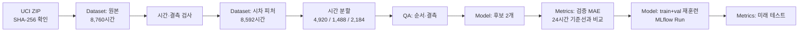
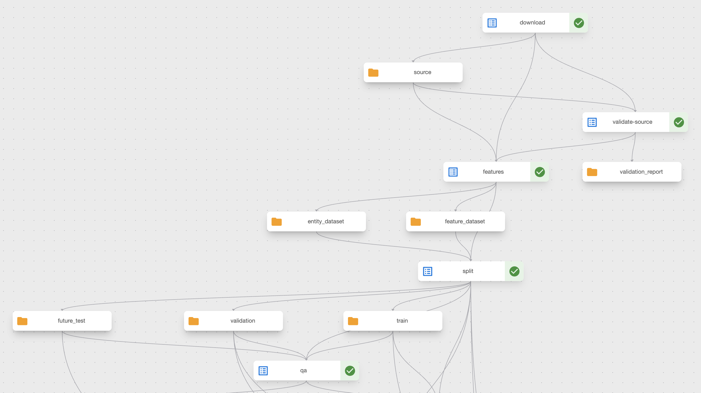
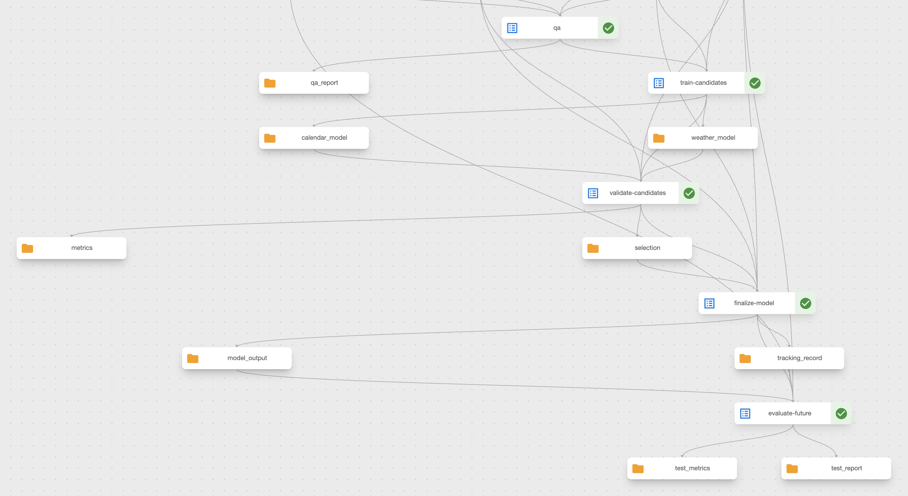
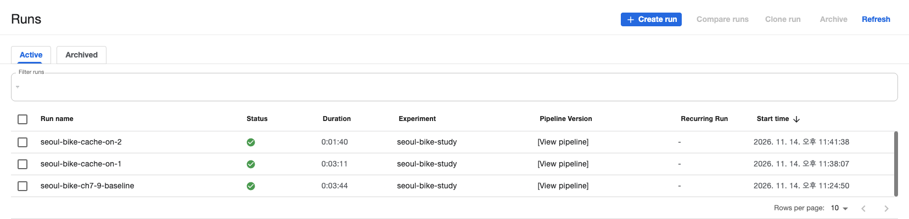
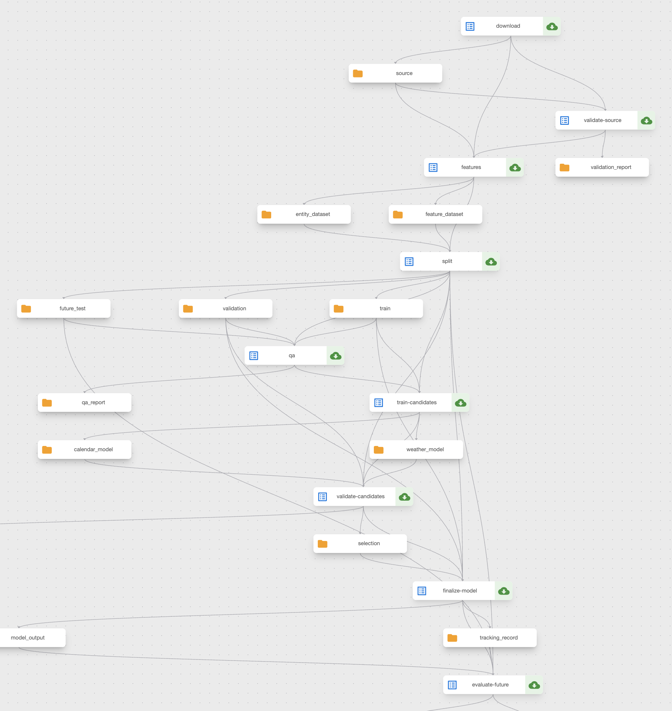
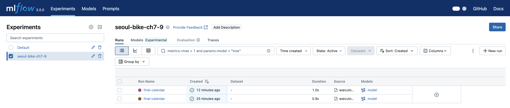

# KFP로 서울 자전거 수요 모델 훈련·검증 - PVC 공유와 MLflow 추적

> **시리즈 순서:** [1\~2장 이론](https://ddii.dev/mlops/ml-platform-engineering-ch1-2/) → [3장 쿠버네티스 토대](https://ddii.dev/mlops/ml-platform-engineering-ch3/) → [4\~5장 Feast·MLflow·KFP](https://ddii.dev/mlops/ml-platform-engineering-ch4-5-practice/) → [6장 BentoML·Evidently](https://ddii.dev/mlops/ml-platform-engineering-ch6-practice/) → [7장 KFP 데이터 준비](https://ddii.dev/mlops/ml-platform-engineering-ch7-practice/) → [모델 검증](https://ddii.dev/mlops/ml-platform-engineering-model-contract/) → **이 글**

> 해당 포스팅은 현재 재직 중인 회사와 관련이 없고, 개인 역량 개발을 위한 스터디 자료로 활용할 예정입니다.
>
> **읽은 범위:** *Machine Learning Platform Engineering* 7\~9장. 책의 객체 탐지 실습은 MIDV-500·YOLO, 추천 실습은 MovieLens를 쓴다. 여기서는 앞선 글과 같은 **서울 공공자전거 시간별 대여량**으로 데이터 전달, 훈련, 검증, 공유 저장소를 다시 구성했다. 책의 YOLO mAP나 MovieLens 결과를 자전거 회귀 모델의 성능으로 옮기지 않았다.
>
> **확인한 범위:** 7장의 데이터 준비는 2026년 11월 5일 Rancher Desktop k3s에서 성공했다. 11월 13일에는 Docker Desktop이나 Podman 없이 **Apple `container` 1.7.1의 로컬 Kubernetes 클러스터**에서 이 글의 7\~9장 통합 파이프라인을 다시 실행했다. 통합 Run, PVC 적재 Run, PVC 재사용 Run이 모두 성공했고, 클러스터의 MLflow 서비스에도 모델과 지표가 남았다. 아래의 모델 수치는 실제 KFP Pod 로그와 MLflow Run에서 확인했다.

이 글은 [Mac k3s에서 모델 검증 - MLflow·Feast·KServe](https://ddii.dev/mlops/ml-platform-engineering-model-contract/)의 후속편이다. 앞 글에서는 서울 자전거 모델의 MLflow 출처, Feast의 오프라인·온라인 피처, 직접 추론·BentoML·KServe의 예측이 같은 계약을 지키는지 확인했다. 당시 **KFP 데이터 준비 결과와 모델 훈련·MLflow 기록은 자동으로 이어지지 않았다.**

이번에는 같은 UCI 원본을 KFP `Dataset`으로 준비하고, 후보 훈련과 검증 게이트를 거쳐 최종 `Model`을 만든 다음 MLflow Run에 선택 근거를 기록한다. PVC 공유 방식도 별도 Run으로 확인했다. 앞 글에서 점검한 서빙 계약의 상류인 **데이터 준비·훈련·추적 과정**을 이어서 살펴본다.

<!--truncate-->

***

## 실습 환경부터 보기: Apple `container`의 특징과 장단점

Apple [`container`](https://github.com/apple/container/blob/main/README.md)는 **Apple Silicon·macOS 26 이상**에서 OCI 이미지를 실행한다. Linux 컨테이너를 macOS 커널에서 직접 실행하는 방식은 아니다. 컨테이너마다 경량 Linux VM을 사용한다. 이 글에서는 기본 컨테이너 실행부터 Linux 개발 환경, 로컬 Kubernetes까지 세 기능을 확인했다.

| 기능 | 장점 | 고려할 점 |
| --- | --- | --- |
| `container run` | Docker Desktop·Podman 설치 없이 OCI 이미지를 실행하고, 같은 도구의 `container build`로 실습 이미지를 만들 수 있다. | Linux VM을 사용하므로 VM의 CPU·메모리·디스크 자원을 할당해야 한다. |
| [`container machine`](https://github.com/apple/container/blob/main/docs/container-machine.md) | 지속되는 Linux 개발 환경에서 Mac과 같은 사용자·홈 디렉터리·작업 디렉터리를 쓴다. Mac에서 편집한 파일을 Linux에서 바로 빌드할 수 있다. | 홈 디렉터리가 읽기·쓰기 권한으로 마운트되고 SSH 에이전트도 전달된다. 일반 컨테이너보다 격리가 약해 신뢰하는 이미지에 적합하다. |
| [`container cluster`](https://github.com/apple/container/blob/main/docs/cluster.md) | `kubectl`로 로컬 Kubernetes를 다룰 수 있다. `--shared-image-store`를 켜면 직접 빌드한 이미지를 레지스트리에 올리지 않고 Pod에서 쓸 수 있다. | 로컬 개발·검증용 클러스터다. 공유 이미지 저장소를 켜면 노드의 root 권한을 얻은 Pod가 Mac의 로컬 이미지에 접근할 수 있다. 이 실습에서는 KFP에 필요한 StorageClass도 직접 설치했다. |

Mac에서 `hello` 컨테이너와 Linux machine을 확인한 뒤, 클러스터에서 7\~9장 KFP 파이프라인을 재실행했다. 이 환경에서는 외부 HTTPS 접근에 프록시가 필요했고 KFP 보조 이미지 하나는 Rosetta로 실행했다. 아래에 설치 과정과 Run 결과를 구분해 기록했다.

## 1. 세 장을 하나의 데이터 흐름으로 묶기

| 장 | 책에서 다루는 문제 | 서울 자전거 실습에서 만든 것 | 확인 수준 |
| --- | --- | --- | --- |
| 7장 | 격리된 KFP 컴포넌트 사이 데이터 전달·분할 | 원본 검증 → 시차 피처 → 시간 분할 → QA, `Dataset` 아티팩트 | Apple 클러스터의 통합 KFP Run 성공 |
| 8장 | 모델 훈련·검증, `Model`·`Metrics` | 두 피처 조합 훈련 → 검증 MAE 비교 → 기준선 게이트 → 최종 훈련 → 미래 평가 | 통합 KFP Run과 MLflow 지표 확인 |
| 9장 | PVC로 데이터 공유, 실험 추적 | PVC 적재·재사용 경로, MLflow에 데이터 해시·선택 지표·모델 기록 | PVC 적재·재사용 Run과 중앙 MLflow 기록 확인 |

책의 흐름을 확인하면 7.1절은 **Kubeflow Notebook을 통한 데이터 분석**, 7.2\~7.3절은 **컴포넌트 사이 값·파일 전달과 데이터 준비**, 8.1절은 **YOLO 훈련·검증 컴포넌트**, 9.1절은 **PVC 공유**를 다룬다. 9.2절은 TensorBoard, 9.3절은 영화 추천기와 MLflow 실험 추적이다. Notebook 데이터 검사는 앞선 모델 계약 글의 Rancher k3s 환경에서 수행했다. 이번 실습에서는 Mac의 `local_check.py`와 Apple 클러스터의 KFP 검증 태스크로 입력을 확인했다. 이 글의 MLflow 기록은 책 9.3절의 추적 방식을 서울 자전거 회귀 문제에 적용한 결과다.

책의 객체 탐지 데이터는 이미지와 라벨을 무작위 75/15/10으로 나눈다. 자전거 수요 예측에는 그 비율을 그대로 적용하지 않았다. 목표가 **미래 시간의 대여량**이기 때문이다. 원본 8,760시간에서 `lag_168`을 만들 수 없는 첫 168시간을 뺀 후, 2018년 7월과 9월을 경계로 과거 훈련 4,920시간, 검증 1,488시간, 미래 테스트 2,184시간으로 나눴다. 검증은 모델 선택에 쓰고, 미래 테스트는 선택과 최종 훈련이 끝난 뒤에만 연다.

<details open>
<summary>7~9장 데이터 흐름도 보기/접기</summary>



</details>

### 책의 파일 경로와 이 파이프라인의 경로

책의 7.2.1\~7.2.3절은 반환할 수 있는 작은 값과 파일로 남겨야 하는 큰 결과를 구분하고, 결과에 맞는 아티팩트 타입을 고른다. KFP 컴포넌트는 서로 다른 Pod에서 실행된다. 작은 정수나 문자열은 파라미터로 주고받을 수 있지만, 표 데이터와 모델 파일은 아티팩트로 연결하는 편이 읽고 추적하기 쉽다. `Output[Dataset]`을 선언하면 KFP가 출력 경로를 지정한다. 이번 구현은 **그 `.path` 자체에 Parquet 파일 한 개를 쓴다.** 다음 단계는 `Input[Dataset].path`에서 그 파일을 읽는다. 디렉터리를 만들고 그 안에 여러 파일을 쓰는 방식도 가능하지만, 그때는 읽는 쪽도 같은 디렉터리 규약을 따라야 한다.

| 이 파이프라인의 결과 | KFP 타입 | 선택한 이유 |
| --- | --- | --- |
| 원본·피처·시간 분할 Parquet | `Dataset` | 훈련 데이터와 그 변환 결과를 다음 Pod에 전달 |
| 후보·최종 훈련 가중치 | `Model` | 모델 파일과 훈련 정보의 계보를 함께 확인 |
| 검증·미래 테스트 MAE | `Metrics` | KFP Run에서 숫자 지표를 바로 확인 |
| QA·선택 기록·MLflow Run ID | `Artifact` | JSON 보고서와 추적용 식별자를 파일로 보존 |

7장에서 성공한 KFP 설치는 별도 MinIO 서비스가 아니라 **SeaweedFS를 S3 호환 아티팩트 저장소로 사용**했다. KFP 런처가 Pod 사이의 아티팩트를 저장·복원하므로 다운로드 컴포넌트 안에서 `boto3`로 별도 버킷에 다시 올리지 않았다. 이 방식에도 복사 비용이 든다. Pod가 달라질 때 파일 업로드와 다운로드가 일어난다. 9장의 PVC 경로는 그 비용과 파일시스템 접근이 필요한 경우를 비교하기 위해 만들었다.

### KFP 파이프라인 한 번 훑어보기
이 글의 코드는 모두 같은 네 단계를 거친다. 컴포넌트를 쓰고, 파이프라인으로 묶고, 컴파일해 YAML을 만들고, 그 YAML을 제출해 Run을 만든다. 부록의 `pipeline.py`와 `submit.py`가 이 단계를 그대로 담고 있으므로, 여기서는 핵심 부분만 발췌한다.

**1) 컴포넌트: 입력과 출력을 타입으로 선언한다.** `Input[Dataset]`과 `Output[Model]`처럼 선언하면 KFP가 각 Pod 안의 파일 경로를 `.path`로 알려 준다. 함수는 그 경로를 읽고 쓰기만 하면 된다. 아래 발췌는 `validate_candidates`의 뼈대다. 지표는 `Output[Metrics]`로, 선택 근거는 `Output[Artifact]`로 남긴다.

```python
@dsl.component(base_image=IMAGE, install_kfp_package=False)
def validate_candidates(
    validation: dsl.Input[dsl.Dataset],
    calendar_model: dsl.Input[dsl.Model],
    weather_model: dsl.Input[dsl.Model],
    selection: dsl.Output[dsl.Artifact],
    metrics: dsl.Output[dsl.Metrics],
):
    frame = pd.read_parquet(validation.path)       # 입력은 .path로 읽고
    ...
    metrics.log_metric(f"val_mae_{name}", scores[name])   # KFP UI에 숫자 지표로 남는다
    if not np.isfinite(scores[chosen]) or scores[chosen] >= baseline:
        raise ValueError("Validation gate failed ...")    # 예외가 곧 게이트
```

이 글의 검증 게이트는 `dsl.If` 같은 조건 분기가 아니다. 컴포넌트가 예외를 던지면 그 태스크가 실패하고, 입력을 기다리던 뒤 단계는 실행되지 않는다. 분기 없이도 "기준선보다 나쁜 모델은 다음 단계로 가지 못한다"는 규칙을 코드 한 곳에 둘 수 있다.

**2) 파이프라인: 출력을 다음 태스크의 입력에 꽂는다.** 태스크 사이의 의존 관계는 두 가지로 생긴다. 한 태스크의 `outputs[...]`를 다른 태스크의 입력으로 넘기면 데이터 의존이 생기고, `.after()`를 붙이면 데이터는 주고받지 않아도 순서가 생긴다.

```python
@dsl.pipeline(name="seoul-bike-ch7-9")
def pipeline(mlflow_uri: str = "http://mlflow...:5000", download_proxy: str = ""):
    source = download(proxy=download_proxy)
    checked = validate_source(source=source.outputs["source"])
    made = features(source=source.outputs["source"]).after(checked)   # 데이터는 안 받아도 검증 뒤에 실행
    divided = split(feature_dataset=made.outputs["feature_dataset"], ...)
    verified = qa(train=divided.outputs["train"], ...)
    candidates = train_candidates(train=divided.outputs["train"]).after(verified)  # QA가 끝나야 훈련
    selected = validate_candidates(validation=divided.outputs["validation"], ...)
    ...
    for task in (source, checked, made, divided, verified, candidates, selected, final, evaluated):
        task.set_caching_options(False)
        task.set_cpu_request("200m")
        task.set_memory_limit("2Gi")
```

이 연결이 KFP UI에서는 그래프로 보인다. 파란 아이콘이 컴포넌트 태스크, 주황 폴더가 태스크 사이를 오가는 아티팩트다. 위쪽은 `validate-source` → `features` → `split` → `qa`의 데이터 준비 구간이고, `split`이 내보낸 `train`·`validation`·`future_test` 세 `Dataset`이 아래 태스크들로 갈라진다.



아래쪽은 `train-candidates`가 `calendar_model`·`weather_model`을 만들고, `validate-candidates`가 `metrics`와 `selection`을 남긴 뒤 `finalize-model`이 최종 `model_output`과 `tracking_record`를 내는 구간이다. `qa`에서 `train-candidates`로 이어진 선이 코드의 `.after(verified)`다.



**3) 컴파일과 제출: 파이프라인을 YAML로 만들고 Run으로 올린다.** `Compiler().compile()`은 파이프라인 함수를 YAML 명세로 바꾼다. `submit.py`는 그 YAML을 KFP 서버에 올려 Run을 만들고, 끝날 때까지 기다린 뒤 상태가 `SUCCEEDED`가 아니면 종료 코드 1로 끝낸다.

```python
compiler.Compiler().compile(pipeline, "seoul-bike-ch7-9.yaml")

client = kfp.Client(host="http://127.0.0.1:18088", namespace="kubeflow")
run = client.create_run_from_pipeline_package(
    "seoul-bike-ch7-9.yaml",
    experiment_name="seoul-bike-study",
    enable_caching=False,
    ...
)
finished = client.wait_for_run_completion(run.run_id, timeout=3600)
```

**캐싱은 껐다.** KFP는 같은 컴포넌트를 같은 입력으로 다시 실행하면 이전 실행의 출력을 재사용할 수 있다. 이 실습에서는 제출 시 `enable_caching=False`를 주고 모든 태스크에도 `set_caching_options(False)`를 걸었다. 그래서 통합 Run 258초와 모델 재실행 Run 111초의 차이는 캐시 때문이 아니다. 재실행 Run은 `dsl.importer`로 분할 결과를 가져와 다운로드·전처리·QA 태스크를 아예 건너뛰었기 때문에 짧다.

캐시를 켜면 무엇이 달라지는지도 확인했다. 11월 14일 Apple `container` 1.7.1로 클러스터를 새로 만들고, 같은 `seoul-bike-ch7-9.yaml`을 세 번 제출했다. 첫 Run은 본문과 같이 캐시를 끈 `submit.py`, 나머지 두 Run은 제출 인자만 `enable_caching=True`로 바꿨다. 실행 단위의 이 인자가 YAML에 컴파일된 태스크별 설정보다 우선한다.

| Run | 캐시 | 실행된 컴포넌트 Pod | KFP 소요 시간 | 새 MLflow Run |
| --- | --- | ---: | ---: | --- |
| `seoul-bike-ch7-9-baseline` | 끔 | 9개 | 3분 44초 | 생성 |
| `seoul-bike-cache-on-1` | 켬, 첫 실행 | 9개 | 3분 11초 | 생성 |
| `seoul-bike-cache-on-2` | 켬, 같은 입력 재실행 | **0개** | **1분 40초** | **생성 안 됨** |



캐시를 켠 첫 Run도 9개 컴포넌트를 모두 실행했다. 앞선 baseline Run은 캐시를 끈 채 실행돼 재사용할 캐시 항목을 남기지 않았기 때문이다. 같은 입력으로 다시 낸 두 번째 Run에서는 태스크마다 드라이버 Pod만 떠서 캐시 항목을 찾았고, 실제 코드를 실행하는 컴포넌트 Pod는 하나도 뜨지 않았다. UI에서도 각 태스크의 상태 아이콘이 성공 체크 대신 캐시 재사용 아이콘으로 바뀐다. 남은 1분 40초는 드라이버 Pod 10개를 차례로 띄우고 정리한 시간이다.



MLflow에서는 차이가 더 분명하다. KFP Run은 세 개인데 `seoul-bike-ch7-9` 실험의 Run은 **두 개**뿐이다. MLflow 기록은 `finalize-model` 컴포넌트 코드 안에서 일어나므로, 그 컴포넌트가 캐시로 건너뛰어지면 새 MLflow Run도 생기지 않는다. 두 MLflow Run의 지표는 검증 MAE 103.7623, 미래 MAE 90.8443, RMSE 147.3341로 본문의 값과 같았다.



정리하면 캐시는 같은 입력의 반복 실행 시간을 줄이지만, **컴포넌트 안의 부수 효과까지 건너뛴다.** MLflow 기록, 외부 저장소 업로드, 알림처럼 매번 일어나야 하는 동작이 컴포넌트 안에 있다면 그 태스크만 `set_caching_options(False)`로 두고, 실행 단위 제출 인자로 태스크 설정을 덮어쓰지 않도록 해야 한다. 이 글의 `submit.py`가 `enable_caching=False`를 명시한 이유도 같다.

태스크마다 CPU 요청 `200m`, 메모리 한도 `2Gi`를 건 것도 이 단계에서 정한다. 로컬 클러스터 한 대에서 여러 Pod가 겹쳐 뜨므로 자원을 명시했다. 이 값은 이 실습에서 정한 값이며 다른 데이터에 맞춘 권장값이 아니다.

## 2. 7장: 분할보다 앞에 데이터 계약을 둔다

UCI ZIP과 내부 CSV의 SHA-256을 고정했다. CSV는 `latin1`로 읽어 `Temperature(°C)` 같은 열 이름을 유지하고, `Date`·`Hour`는 `Asia/Seoul`로 해석한 뒤 UTC `event_timestamp`를 만든다. 8,760개의 시각이 1시간 간격으로 이어지는지, 중복과 결측이 없는지를 **별도 검증 단계**에서 검사한다.

피처는 예측 시각 `t`에 이미 알고 있는 값으로 만든다. `lag_1`, `lag_24`, `lag_168`은 각각 1시간·하루·일주일 전 대여량이다. 날씨도 현재 시각의 온도와 강수량을 쓰지 않고 **이전 시간** 값으로 밀었다. 원본의 처음 168행을 제외해 남은 8,592행에 결측이 없는지 확인한다. 이 규칙은 4\~5장 모델의 입력 시각과 같다. 검증·테스트의 `lag_1`에는 **같은 구간의 직전 시간 정답**이 들어갈 수 있다. 매 시간 직전 관측을 받은 뒤 다음 시간을 예측한다는 운영 가정이며, 며칠치를 한꺼번에 미리 예측하는 문제에는 이 평가 방법을 그대로 쓸 수 없다.

<details>
<summary>데이터 분할 크기와 기간 보기</summary>

```text
원본                  8,760시간
시차 피처 생성 후     8,592시간
훈련                  4,920시간, 2018-07-01 00:00 KST 이전
검증                  1,488시간, 2018-07-01 ~ 2018-08-31
미래 테스트           2,184시간, 2018-09-01 이후
```

</details>

`qa`는 세 파일의 크기, 필요한 모델 컬럼의 결측, `train < validation < future_test` 시각 순서를 확인한다. 훈련 태스크에는 `.after(verified)`를 붙였다. 훈련이 `train` 아티팩트만 입력으로 받으면 분할이 끝난 직후 QA와 **동시에** 시작할 수 있기 때문이다. QA가 모델 훈련을 막으려면 실행 순서도 코드에 있어야 한다.

2026년 11월 5일 KFP Run `2609613e-954c-407c-9a56-c21fa3f1d05e`는 **7장 데이터 준비만** 실행한 기록이다. Apple 클러스터에서 다시 실행한 통합 Run `2d7530d5-999d-405f-bdfa-26c9c34d0211`에서도 다운로드 8,760행 → 피처 8,592행 → 4,920/1,488/2,184행 분할 → QA 통과를 Pod 로그에서 확인했다.

## 3. 8장: 검증 점수로 고르고, 고른 뒤 다시 훈련한다

이번 회귀 모델은 앞선 글과 같은 `HistGradientBoostingRegressor`다. 후보 둘의 차이는 입력 컬럼이다.

| 후보 | 모델 입력 |
| --- | --- |
| calendar | `hour`, `weekday`, `month`, `holiday`, `lag_1`, `lag_24`, `lag_168` |
| weather | calendar의 7개 + `prev_temperature`, `prev_rainfall` |

책의 8.1.3\~8.1.4절은 시스템 패키지까지 셸에서 준비해야 하는 YOLO 훈련에 `@dsl.container_component`와 `ContainerSpec`을 쓰고, 검증에는 필요한 라이브러리가 든 이미지를 `@dsl.component`의 `base_image`로 지정한다. 이 실습에서도 **데이터 준비는 `ContainerSpec`으로 `prep.py` 명령을 호출하고, 훈련·검증은 `@dsl.component` 함수로 작성**했다. 두 종류 모두 미리 빌드한 `seoul-bike-ch79:apple` 이미지를 사용한다. `Dockerfile`에 의존성을 고정했고, 이미지 안에 KFP가 있으므로 함수 컴포넌트에는 `install_kfp_package=False`를 지정했다.

두 후보는 **훈련 4,920행으로만** 적합한다. 검증 컴포넌트가 1,488행에서 각각 MAE를 재고, 가장 낮은 후보를 고른다. 계절성 기준선은 “어제 같은 시각의 대여량”인 `lag_24`다. 선택된 후보가 이 기준선보다도 나쁘거나 점수가 유한하지 않으면 검증 태스크를 실패시킨다. KFP `Output[Metrics]`에는 후보와 기준선의 MAE가 기록되고, `Output[Artifact]`에는 선택 이름·입력 컬럼·원본 CSV 해시가 JSON으로 남는다.

검증이 통과한 다음에야 선택한 컬럼으로 **훈련+검증 6,408행을 다시 훈련**해 최종 `Output[Model]`을 만든다. 이 파일에는 훈련된 추정기와 **입력 컬럼 순서**를 함께 담았다. 이 최종 모델을 검증 1,488행에 다시 재서 같은 “검증 성능”이라고 부르면 안 된다. 그 1,488행이 이미 최종 훈련에 들어갔기 때문이다. 최종 모델의 독립 평가는 미래 테스트 2,184행에서 한다.

책의 8.1.7절은 저장된 `best.pt`를 다시 불러와 새 이미지에 추론해 보는 확인을 강조한다. 이 회귀 실습에서는 **별도 평가 Pod가 `Output[Model]` 파일을 다시 읽어 미래 테스트 2,184시간을 예측**한다. 검증 단계의 모델 점수와 저장된 최종 모델의 동작을 각각 확인한 셈이다.

11월 13일 실제 UCI 원본으로 실행한 결과다. Apple 클러스터의 **KFP Pod 로그**에서 확인했고, 선택 모델의 검증 점수와 미래 점수는 **MLflow Run**에서도 대조했다. 로컬 함수 실행 결과와도 소수 넷째 자리까지 같았다.

| 지표 | KFP 실행 결과, 대여 대수 |
| --- | ---: |
| 검증 MAE, calendar | **103.7623** |
| 검증 MAE, weather | 118.4589 |
| 검증 MAE, `lag_24` 기준선 | 265.5457 |
| 최종 모델 미래 테스트 MAE | **90.8443** |
| 최종 모델 미래 테스트 RMSE | 147.3341 |
| 미래 테스트 `lag_24` 기준선 MAE | 386.4167 |

선택은 calendar였다. 미래 MAE 90.8443은 앞선 4\~5장과 소수 넷째 자리까지 같다. 이번에는 통합 KFP Run이 같은 원본 해시·시간 분할·7개 입력·모델 설정으로 이 값을 냈고, MLflow Run `9169a861c3754c30b4eb5c631124f794`에 선택 근거와 미래 평가 지표가 함께 기록됐다. 통합 Argo Workflow의 시작부터 종료까지는 **258초**였다.

처음 컴파일한 YAML을 점검하니 데이터 준비 컴포넌트는 `seoul-bike-ch79:apple`, 훈련·검증 컴포넌트는 이전에 Apple `container build`로 만든 `:dev`를 참조하고 있었다. `model_steps.py`도 `:apple`로 고치고, 앞선 Run의 분할 아티팩트 세 개를 `dsl.importer`로 가져오는 **모델 재실행 Run** `8ddf9aad-1fcb-4582-be14-122b8c53ea6b`을 돌렸다. 네 훈련·평가 컴포넌트가 모두 `:apple` 이미지를 사용해 **111초 만에** 성공했고, 검증 MAE **103.7623**, 미래 MAE **90.8443**을 다시 기록했다. 두 번째 MLflow Run ID는 `74bc54d3aed849ddbc269702d6289ff7`이다. 이 재실행에는 원본 다운로드·전처리가 포함되지 않는다.

## 4. 9장: PVC는 공유 파일 경로, MLflow는 실험 기록

### 4.1 PVC에 적재하고 다음 Run에서 재사용했다

아티팩트 파이프라인에서는 `train`, `validation`, `future_test`가 KFP 저장소를 통해 다음 Pod로 전달된다. PVC 경로에서는 먼저 **검증을 통과한 train·validation만** PVC의 `/data`에 한 번 복사하고, 뒤의 두 Pod가 같은 파일 경로를 읽는다. 미래 테스트는 그 PVC에 올리지 않았다. 훈련 Pod가 미래 정답 파일에 접근할 수 없도록 하기 위해서다.

`pvc_pipeline.py`에는 세 파이프라인이 있다. `seoul-bike-pvc-stage`는 원본 다운로드부터 다시 시작한다. 이번에 성공한 `seoul-bike-pvc-from-artifacts`는 앞서 성공한 통합 Run의 train·validation `Dataset` URI를 `dsl.importer`로 가져와 PVC에 적재한다. 두 방식 모두 `CreatePVC`로 1Gi 볼륨을 만들고 Parquet 두 개와 SHA-256 명세를 `/data`에 쓴 뒤, PVC를 마운트한 Pod에서 훈련·검증한다. `seoul-bike-pvc-reuse`는 남아 있는 PVC 이름을 받아 적재 단계를 건너뛴다. 이 PVC는 재사용 확인을 위해 자동 삭제하지 않았다.

PVC 경로의 검증 모델은 **calendar 7개 컬럼으로 훈련 4,920행만 적합한 단일 후보**다. 주 통합 경로처럼 후보를 비교하거나 최종 6,408행을 훈련하지 않으므로 두 파이프라인의 점수를 성능 경쟁 결과로 비교하면 안 된다. 이 경로의 확인 대상은 **데이터 접근 방식**이다.

PVC는 Pod에 일반 파일시스템을 제공하지만 그 안의 파일이 바뀌어도 KFP가 자동으로 데이터 버전을 아는 것은 아니다. 그래서 적재할 때 두 Parquet의 SHA-256을 JSON으로 남기고, 훈련·검증 Pod가 읽기 직전에 다시 검사하도록 했다. 반면 KFP `Dataset` 연결은 어느 단계의 출력이 다음 단계의 입력이었는지를 파이프라인 그래프에 남긴다. PVC를 쓸 때는 `.after(staged)`처럼 파일에 드러나지 않는 실행 순서도 직접 연결해야 한다.

책의 9.1.5절에서도 **PVC 마운트만으로는 태스크 순서가 정해지지 않으므로** 분할 태스크에 `.after(download_op)`를 붙인다. 이번 코드에서는 `CreatePVC`가 내보낸 PVC 이름을 마운트에 전달하고, `train_on_pvc().after(staged)`로 파일 적재가 끝난 뒤 훈련하도록 했다. 책의 listing 9.5는 파일을 “이동”한다고 설명하지만 실제 호출은 `shutil.copy2`다. 원본 파일은 남기 때문에 PVC를 쓴다는 이유만으로 저장량이 줄었다고 계산할 수 없다.

| 경로 | 이번 코드가 하는 일 | 운영 시 확인할 점 |
| --- | --- | --- |
| KFP `Dataset` | 파일을 태스크의 입력·출력 아티팩트로 연결 | Pod 전환마다 저장소 업로드·다운로드, 아티팩트 보존 기간 |
| PVC `/data` | 검증된 파일을 한 번 적재하고 뒤 Pod가 같은 경로를 읽음 | PVC 수명·접근 모드·스토리지 클래스, 파일 버전과 정리 |

Apple 클러스터에서 PVC `1c995531-db56-4fff-8869-bf64c60fab40-bike`가 `local-path` StorageClass로 **Bound**가 됐다. 적재 Run `9b8667fd-ab7e-431f-b408-72e975b66733`은 **80초 만에**, 같은 PVC를 지정한 재사용 Run `150bd17e-77d5-4acd-a8f6-1e2127f81db9`은 **50초 만에** 성공했다. 두 Run의 훈련 Pod가 확인한 train 4,920행의 SHA-256은 `6585ac53…`으로 같았고, 검증 Pod도 1,488행에서 MAE **103.7623**을 동일하게 기록했다. 재사용 Run에는 다운로드·분할·적재 태스크가 없다. 두 실행의 시간 차이는 이번 로컬 실행의 관측값이며, 반복 측정한 성능 지표는 아니다.

첫 `seoul-bike-pvc-stage` 시도는 데이터 다운로드 Pod에서 Mac 호스트 프록시 연결이 시간 초과돼 실패했다. 이어서 아티팩트 적재 경로를 실행할 때는 `CreatePVC`의 기본 요청 이름 `standard`가 이 클러스터에 없어 PVC가 Pending으로 남았다. `storage_class_name="local-path"`를 명시한 뒤 바인딩과 세 Pod의 `/data` 공유를 확인했다. 실패한 두 시도의 Pending PVC는 정리했다.

### 4.2 MLflow에는 모델 선택의 근거를 남겼다

최종 훈련 컴포넌트는 원본 CSV 해시, 선택된 피처, 분할 행 수, 난수 시드, 검증 MAE를 MLflow Run에 기록한다. `selection.json`과 모델도 함께 올리고, MLflow Run ID를 KFP `Model` 아티팩트 메타데이터와 `tracking_record`에 적는다. 마지막 미래 테스트 컴포넌트는 그 Run ID에 테스트 MAE·RMSE를 추가한다. **KFP는 단계와 파일의 흐름**, **MLflow는 모델 선택 근거와 훈련 결과**를 확인하는 곳이다.

로컬 확인의 MLflow `file://` 저장소에 이어, 이번에는 클러스터의 `mlflow.mlpe-seoul-bike.svc.cluster.local:5000` 서비스에도 통합 파이프라인이 기록을 올렸다. MLflow Run `9169a861c3754c30b4eb5c631124f794`에는 원본 CSV SHA-256 `373339b7…`, 선택된 `calendar`, 검증 MAE **103.7623**, 미래 테스트 MAE **90.8443**과 RMSE **147.3341**이 남았다. 기존 `seoul-bike-hourly`의 `champion` 별칭은 바꾸지 않았다.

책의 9.2절은 TensorBoard로 훈련 과정의 곡선을 보고, 9.3.4절은 MLflow로 실행별 파라미터·지표·모델을 추적한다. 이번 **scikit-learn 히스토그램 부스팅** 코드는 TensorBoard 이벤트 파일을 만들지 않으므로 MLflow의 실행 기록만 확인했다. 에포크별 손실을 출력하는 신경망을 실험할 때는 TensorBoard 로그 디렉터리를 PVC에 쓰고 해당 PVC를 뷰어 Pod에 마운트하면 된다.

## 5. 재현 절차

이 글은 코드를 별도 저장소로 공개하지 않는다. 부록의 8개 파일을 같은 이름으로 저장한 작업 디렉터리 `ch07_09_seoul_bike/`를 직접 만들어 쓴다. **로컬 확인**은 Kubernetes 없이 UCI 원본 다운로드, 해시·분할·모델 검증, MLflow 로컬 파일 기록까지 수행한다. `local_check.py`를 실행하면 결과가 `evidence/local-check.json`으로 생성된다.

<details>
<summary>로컬 확인 환경 설치·실행 명령 보기</summary>

```bash
cd ch07_09_seoul_bike
uv venv --python 3.11 .venv
uv pip install --python .venv/bin/python \
  'kfp==2.17.3' 'kfp-kubernetes==2.17.3' \
  'numpy==1.26.4' 'pandas==2.2.3' 'pyarrow==17.0.0' \
  'scikit-learn==1.5.2' 'mlflow==3.0.0' 'sqlalchemy==2.0.36'
.venv/bin/python local_check.py
```

</details>

### Apple 기본 컨테이너와 클러스터

실행 환경은 **macOS 26.7.3, Apple Silicon, Apple `container` 1.7.1**이었다. 공식 릴리스의 서명된 pkg를 macOS Installer로 설치하고 다음 세 가지를 확인했다.

<details>
<summary>Apple 컨테이너·machine·cluster 실행 명령 보기</summary>

```bash
container system start
container run --rm alpine echo hello
container machine create alpine:latest --name mlpe-dev
container machine run -n mlpe-dev -- sh -c 'id -un; pwd; test -f README.md'
container machine stop mlpe-dev

container cluster create --name mlpe-apple-ch79 \
  --cpus 8 --memory 16g --shared-image-store
kubectl --context mlpe-apple-ch79 get nodes
```

</details>

`alpine`에서 `hello`가 출력됐고, machine에서는 Mac 사용자 `jinwoong`, 같은 작업 디렉터리, `README.md` 접근을 확인했다. 클러스터는 단일 **arm64 Kubernetes v1.35.5 노드**로 올라왔다. `--shared-image-store`를 켜서 Apple `container build`로 만든 이미지를 레지스트리에 올리지 않고 Pod에서 사용했다.

이 클러스터에는 StorageClass가 처음부터 있지 않아 `local-path`를 설치했다. KFP standalone **2.17.3**과 `apple-mlflow.yaml`의 MLflow **3.0.0**을 배포한 뒤, 파이프라인 이미지를 Apple 빌더로 만들었다. `kfp==2.17.3`이 이미지에 있으므로 경량 컴포넌트의 `install_kfp_package=False`와 맞는다.

<details>
<summary>StorageClass·KFP·MLflow 설치와 이미지 빌드 명령 보기</summary>

```bash
kubectl --context mlpe-apple-ch79 apply -f \
  https://raw.githubusercontent.com/rancher/local-path-provisioner/v0.0.37/deploy/local-path-storage.yaml

kubectl --context mlpe-apple-ch79 apply -k \
  'github.com/kubeflow/pipelines/manifests/kustomize/cluster-scoped-resources?ref=2.17.3'
kubectl --context mlpe-apple-ch79 apply -k \
  'github.com/kubeflow/pipelines/manifests/kustomize/env/platform-agnostic?ref=2.17.3'

container build --arch arm64 --tag seoul-bike-ch79:apple \
  --cpus 4 --memory 6g .
kubectl --context mlpe-apple-ch79 apply -f apple-mlflow.yaml
.venv/bin/python pipeline.py
.venv/bin/python pvc_pipeline.py
```

</details>

이 Mac에서는 Apple VM에서 외부 HTTPS로 직접 나가는 연결이 막혀 이미지 pull과 UCI 다운로드에 **Mac 브리지 주소 `192.168.64.1`의 제한된 프록시**를 사용했다. 일반적인 네트워크에서는 프록시 인자를 비워 두면 된다. KFP 2.17.3의 `metadata-writer` 이미지는 이 설치에서 amd64 변형만 제공해, **그 보조 컨테이너만 Apple VM의 Rosetta 지원을 이용**해 실행했다. 따라서 전체 KFP가 순수 arm64 이미지로 실행됐다는 뜻은 아니다. `container cluster` 자체도 로컬 개발용 기능이므로, 위 설치 과정은 KFP 배포 환경과 네트워크에 맞게 조정해야 한다.

<details>
<summary>KFP·MLflow 포트포워딩과 Run 제출 명령 보기</summary>

```bash
# 각 명령은 별도 터미널에서 실행
kubectl --context mlpe-apple-ch79 -n kubeflow \
  port-forward svc/ml-pipeline 18088:8888
kubectl --context mlpe-apple-ch79 -n mlpe-seoul-bike \
  port-forward svc/mlflow 15000:5000

# Pod에서 외부 HTTPS에 접근할 수 있다면
.venv/bin/python submit.py
# 외부 HTTPS가 막힌 환경은 접근 가능한 프록시를 준비한 뒤:
# MLPE_DOWNLOAD_PROXY=http://<proxy-host>:<port> .venv/bin/python submit.py
```

</details>

`submit.py`는 통합 YAML을 한 번의 Run 명세로 제출한다. 아래에 나오는 `seoul-bike-*.yaml` 파일은 따로 싣지 않았다. 부록의 `pipeline.py`와 `pvc_pipeline.py`를 실행하면 같은 디렉터리에 생성된다. 태그를 통일한 모델 재실행에는 `seoul-bike-model-from-artifacts.yaml`을 사용했다. PVC 성공 경로는 `seoul-bike-pvc-from-artifacts.yaml`에 통합 Run의 `split/train`·`split/validation` URI를 `train_uri`·`validation_uri`로 전달했다. 생성된 PVC 이름은 `kubectl --context mlpe-apple-ch79 -n kubeflow get pvc`로 확인하고, 그 이름을 `seoul-bike-pvc-reuse.yaml`의 `pvc_name`에 전달했다. 네 Run의 ID, 실행 시간, 해시와 지표는 본문의 각 절에 적었다. 아티팩트 URI와 PVC 이름은 실행할 때마다 달라지므로 KFP UI의 Run 상세 화면과 `kubectl get pvc` 출력에서 확인해 넣는다.

## 6. 이번 실행에서 확인한 것

Apple `container`에서 OCI 컨테이너, 같은 사용자·디렉터리를 쓰는 Linux machine, 로컬 Kubernetes 클러스터를 각각 실행했다. 클러스터의 통합 Run은 데이터 준비→후보 훈련→검증 게이트→최종 훈련→미래 평가를 끝까지 수행했고, 훈련·평가 이미지를 통일한 Run도 같은 점수를 냈다. MLflow의 두 Run에서 선택 근거와 미래 점수를 대조했다. PVC 경로도 적재 후 다른 Run에서 같은 파일 해시와 검증 MAE를 재현했다. **검증용 후보 모델과 train+validation으로 다시 훈련한 최종 모델은 분리**했으므로, 검증 MAE와 미래 테스트 MAE의 의미가 다르다.

이번 PVC 실습은 작은 Parquet 파일 두 개를 공유한 사례다. 대용량 이미지 데이터에서의 저장 공간·전송 시간 이득까지 측정한 결과로 일반화할 수는 없다. 직접 다운로드로 시작하는 PVC 변형은 Mac 브리지 연결 시간 초과로 끝내 성공시키지 못했고, 실제로 확인한 PVC 적재 경로는 **앞선 KFP Run의 아티팩트를 재사용**했다.

## 부록: 재현 코드 전체

아래는 이 글의 로컬 확인과 KFP 실행에 사용한 주요 파이프라인 파일이다. 코드와 명령 예시는 제목을 눌러 펼치거나 접을 수 있다. 각 파일은 아래 구조의 디렉터리에 같은 이름으로 저장한다. `evidence/`는 스크립트를 실행하면 생기는 결과 폴더라 따로 만들 필요가 없다. 책의 예제를 그대로 복사하면 라이브러리 버전 차이로 실행되지 않을 수 있으므로, 실제 컴파일·실행한 파일 내용을 싣는다.

<details>
<summary>실습 파일 구조 보기</summary>

```text
ch07_09_seoul_bike/
├── Dockerfile
├── prep.py
├── model_steps.py
├── pipeline.py
├── pvc_pipeline.py
├── apple-mlflow.yaml
├── submit.py
└── local_check.py
```

</details>

### `Dockerfile`

<details>
<summary>Dockerfile 전체 코드 보기</summary>

~~~dockerfile
FROM python:3.11-slim

RUN pip install --no-cache-dir \
    kfp==2.17.3 \
    mlflow==3.0.0 \
    numpy==1.26.4 \
    pandas==2.2.3 \
    pyarrow==17.0.0 \
    scikit-learn==1.5.2 \
    sqlalchemy==2.0.36

COPY prep.py /app/prep.py
~~~

</details>

### `prep.py`

<details>
<summary>prep.py 전체 코드 보기</summary>

~~~python
"""KFP v2 container steps for the Seoul Bike data preparation experiment."""
import argparse
import hashlib
import io
import json
import urllib.request
import zipfile
from pathlib import Path

import pandas as pd


URL = "https://archive.ics.uci.edu/static/public/560/seoul+bike+sharing+demand.zip"
ZIP_SHA256 = "139e9908f0a3544bb222386855c9ce107e96467306bb8e4ce936aab59e7baac4"
CSV_SHA256 = "373339b71a8935d69e9af0abf26a70744632119862eeb3919efb389a7b749c60"
COLS = ["hour", "weekday", "month", "holiday", "lag_1", "lag_24", "lag_168"]


def write_parquet(frame: pd.DataFrame, path: str) -> None:
    Path(path).parent.mkdir(parents=True, exist_ok=True)
    frame.to_parquet(path, index=False)


def write_json(data: dict, path: str) -> None:
    Path(path).parent.mkdir(parents=True, exist_ok=True)
    Path(path).write_text(json.dumps(data, ensure_ascii=False, indent=2) + "\n")


def download(output: str, proxy: str = "") -> None:
    request = urllib.request.Request(URL, headers={"User-Agent": "mlpe-study/1.0"})
    opener = urllib.request.build_opener(
        urllib.request.ProxyHandler({"http": proxy, "https": proxy} if proxy else {})
    )
    with opener.open(request, timeout=90) as response:
        raw_zip = response.read()
    if hashlib.sha256(raw_zip).hexdigest() != ZIP_SHA256:
        raise ValueError("ZIP SHA-256 mismatch")
    with zipfile.ZipFile(io.BytesIO(raw_zip)) as archive:
        raw_csv = archive.read("SeoulBikeData.csv")
    if hashlib.sha256(raw_csv).hexdigest() != CSV_SHA256:
        raise ValueError("CSV SHA-256 mismatch")
    source = pd.read_csv(io.BytesIO(raw_csv), encoding="latin1")
    local_time = pd.to_datetime(
        source["Date"] + " " + source["Hour"].astype(str).str.zfill(2),
        format="%d/%m/%Y %H",
    ).dt.tz_localize("Asia/Seoul")
    source.insert(0, "local_time", local_time)
    source.insert(1, "event_timestamp", local_time.dt.tz_convert("UTC"))
    source = source.sort_values("event_timestamp").reset_index(drop=True)
    write_parquet(source, output)
    print(f"download: rows={len(source)} zip_sha256={ZIP_SHA256}")


def validate(source_path: str, report_path: str) -> None:
    source = pd.read_parquet(source_path)
    times = pd.to_datetime(source["event_timestamp"], utc=True)
    if len(source) != 8760 or times.nunique() != 8760:
        raise ValueError("Expected 8760 unique hourly rows")
    if not times.diff().dropna().eq(pd.Timedelta(hours=1)).all():
        raise ValueError("Missing or duplicated hours")
    if source.isna().any().any():
        raise ValueError("Unexpected nulls")
    report = {
        "rows": len(source),
        "first_local_time": str(source["local_time"].iloc[0]),
        "last_local_time": str(source["local_time"].iloc[-1]),
        "missing_hours": 0,
        "null_cells": 0,
    }
    write_json(report, report_path)
    print(f"validate: {report}")


def make_features(source_path: str, features_path: str, entities_path: str) -> None:
    source = pd.read_parquet(source_path)
    count = source["Rented Bike Count"]
    local = pd.to_datetime(source["local_time"], utc=True).dt.tz_convert("Asia/Seoul")
    features = pd.DataFrame({
        "city_id": "seoul",
        "event_timestamp": source["event_timestamp"],
        "lag_1": count.shift(1).astype("float32"),
        "lag_24": count.shift(24).astype("float32"),
        "lag_168": count.shift(168).astype("float32"),
        "prev_temperature": source["Temperature(°C)"].shift(1).astype("float32"),
        "prev_rainfall": source["Rainfall(mm)"].shift(1).astype("float32"),
    }).iloc[168:].reset_index(drop=True)
    entities = pd.DataFrame({
        "city_id": "seoul",
        "event_timestamp": source["event_timestamp"].iloc[168:].reset_index(drop=True),
        "local_time": local.iloc[168:].reset_index(drop=True),
        "hour": local.dt.hour.iloc[168:].reset_index(drop=True).astype("int64"),
        "weekday": local.dt.dayofweek.iloc[168:].reset_index(drop=True).astype("int64"),
        "month": local.dt.month.iloc[168:].reset_index(drop=True).astype("int64"),
        "holiday": (source["Holiday"] == "Holiday").iloc[168:].reset_index(drop=True).astype("int64"),
        "target": count.iloc[168:].reset_index(drop=True).astype("int64"),
    })
    if len(features) != 8592 or features.isna().any().any():
        raise ValueError("Feature shape/null check failed")
    if not features["event_timestamp"].equals(entities["event_timestamp"]):
        raise ValueError("Feature/entity time misalignment")
    write_parquet(features, features_path)
    write_parquet(entities, entities_path)
    print(f"make_features: rows={len(features)}")


def split(
    features_path: str,
    entities_path: str,
    train_path: str,
    validation_path: str,
    test_path: str,
) -> None:
    features = pd.read_parquet(features_path)
    entities = pd.read_parquet(entities_path)
    if not features["event_timestamp"].equals(entities["event_timestamp"]):
        raise ValueError("Feature/entity time misalignment")
    joined = entities.merge(
        features.drop(columns=["city_id"]),
        on="event_timestamp",
        how="inner",
        validate="one_to_one",
    )
    local_time = pd.to_datetime(joined["local_time"], utc=True).dt.tz_convert("Asia/Seoul")
    masks = (
        local_time < pd.Timestamp("2018-07-01", tz="Asia/Seoul"),
        (local_time >= pd.Timestamp("2018-07-01", tz="Asia/Seoul"))
        & (local_time < pd.Timestamp("2018-09-01", tz="Asia/Seoul")),
        local_time >= pd.Timestamp("2018-09-01", tz="Asia/Seoul"),
    )
    for path, mask, expected in zip(
        (train_path, validation_path, test_path),
        masks,
        (4920, 1488, 2184),
    ):
        part = joined.loc[mask].reset_index(drop=True)
        if len(part) != expected or part[COLS + ["target"]].isna().any().any():
            raise ValueError(f"Split check failed: {path}")
        write_parquet(part, path)
    print("split: train=4920 validation=1488 future_test=2184")


def qa(train_path: str, validation_path: str, test_path: str, report_path: str) -> None:
    parts = [pd.read_parquet(path) for path in (train_path, validation_path, test_path)]
    counts = [len(part) for part in parts]
    if counts != [4920, 1488, 2184]:
        raise ValueError(f"Unexpected split counts: {counts}")
    for part in parts:
        if part[COLS + ["target"]].isna().any().any():
            raise ValueError("Null model input or target")
    times = [pd.to_datetime(part["event_timestamp"], utc=True) for part in parts]
    if not (times[0].max() < times[1].min() < times[1].max() < times[2].min()):
        raise ValueError("Chronological split violated")
    if sum(counts) != 8592:
        raise ValueError("Split total mismatch")
    report = {
        "train": counts[0],
        "validation": counts[1],
        "future_test": counts[2],
        "total": sum(counts),
        "null_model_input_or_target": 0,
        "chronological": True,
        "model_columns": COLS,
    }
    write_json(report, report_path)
    print(f"qa: {report}")


def main() -> None:
    parser = argparse.ArgumentParser()
    sub = parser.add_subparsers(dest="step", required=True)
    download_parser = sub.add_parser("download")
    download_parser.add_argument("--output", required=True)
    download_parser.add_argument("--proxy", default="")
    validate_parser = sub.add_parser("validate")
    validate_parser.add_argument("--source", required=True)
    validate_parser.add_argument("--report", required=True)
    features_parser = sub.add_parser("features")
    features_parser.add_argument("--source", required=True)
    features_parser.add_argument("--features", required=True)
    features_parser.add_argument("--entities", required=True)
    split_parser = sub.add_parser("split")
    for name in ("features", "entities", "train", "validation", "test"):
        split_parser.add_argument(f"--{name}", required=True)
    qa_parser = sub.add_parser("qa")
    for name in ("train", "validation", "test", "report"):
        qa_parser.add_argument(f"--{name}", required=True)
    args = parser.parse_args()
    if args.step == "download":
        download(args.output, args.proxy)
    elif args.step == "validate":
        validate(args.source, args.report)
    elif args.step == "features":
        make_features(args.source, args.features, args.entities)
    elif args.step == "split":
        split(args.features, args.entities, args.train, args.validation, args.test)
    else:
        qa(args.train, args.validation, args.test, args.report)


if __name__ == "__main__":
    main()
~~~

</details>

### `model_steps.py`

<details>
<summary>model_steps.py 전체 코드 보기</summary>

~~~python
"""Chapter 8–9: train, validate, track, and evaluate Seoul bike models."""
from kfp import dsl


IMAGE = "seoul-bike-ch79:apple"


@dsl.component(base_image=IMAGE, install_kfp_package=False)
def train_candidates(
    train: dsl.Input[dsl.Dataset],
    calendar_model: dsl.Output[dsl.Model],
    weather_model: dsl.Output[dsl.Model],
):
    import joblib
    import pandas as pd
    from pathlib import Path
    from sklearn.ensemble import HistGradientBoostingRegressor

    frame = pd.read_parquet(train.path)
    base = ["hour", "weekday", "month", "holiday", "lag_1", "lag_24", "lag_168"]
    variants = [
        (base, calendar_model),
        (base + ["prev_temperature", "prev_rainfall"], weather_model),
    ]
    if len(frame) != 4920 or frame[variants[1][0] + ["target"]].isna().any().any():
        raise ValueError("Unexpected training split")
    for columns, output in variants:
        model = HistGradientBoostingRegressor(
            max_iter=160, max_leaf_nodes=15, l2_regularization=1.0,
            learning_rate=0.06, random_state=42,
        ).fit(frame[columns], frame["target"])
        Path(output.path).parent.mkdir(parents=True, exist_ok=True)
        joblib.dump({"model": model, "columns": columns}, output.path)
        output.metadata.update({"rows": len(frame), "features": columns})
        print(f"train_candidates: columns={columns} rows={len(frame)}")


@dsl.component(base_image=IMAGE, install_kfp_package=False)
def validate_candidates(
    validation: dsl.Input[dsl.Dataset],
    calendar_model: dsl.Input[dsl.Model],
    weather_model: dsl.Input[dsl.Model],
    selection: dsl.Output[dsl.Artifact],
    metrics: dsl.Output[dsl.Metrics],
):
    import json
    import joblib
    import numpy as np
    import pandas as pd
    from pathlib import Path
    from sklearn.metrics import mean_absolute_error

    frame = pd.read_parquet(validation.path)
    if len(frame) != 1488 or frame["target"].isna().any():
        raise ValueError("Unexpected validation split")
    scores = {}
    for name, artifact in [("calendar", calendar_model), ("weather", weather_model)]:
        bundle = joblib.load(artifact.path)
        if frame[bundle["columns"]].isna().any().any():
            raise ValueError(f"Null validation input: {name}")
        predicted = np.clip(bundle["model"].predict(frame[bundle["columns"]]), 0, None)
        scores[name] = float(mean_absolute_error(frame["target"], predicted))
        metrics.log_metric(f"val_mae_{name}", scores[name])
    baseline = float(mean_absolute_error(frame["target"], frame["lag_24"]))
    metrics.log_metric("val_mae_lag24", baseline)
    chosen = min(scores, key=scores.get)
    if not np.isfinite(scores[chosen]) or scores[chosen] >= baseline:
        raise ValueError(f"Validation gate failed: candidate={scores[chosen]}, baseline={baseline}")
    columns = joblib.load(
        calendar_model.path if chosen == "calendar" else weather_model.path
    )["columns"]
    result = {
        "selected": chosen, "columns": columns, "val_mae": scores[chosen],
        "val_mae_calendar": scores["calendar"], "val_mae_weather": scores["weather"],
        "val_mae_lag24": baseline, "validation_rows": len(frame),
        "source_csv_sha256": "373339b71a8935d69e9af0abf26a70744632119862eeb3919efb389a7b749c60",
    }
    Path(selection.path).parent.mkdir(parents=True, exist_ok=True)
    with open(selection.path, "w") as file:
        json.dump(result, file, ensure_ascii=False, indent=2)
    selection.metadata.update({"selected": chosen, "val_mae": scores[chosen]})
    print(f"validate_candidates: {result}")


@dsl.component(base_image=IMAGE, install_kfp_package=False)
def finalize_model(
    train: dsl.Input[dsl.Dataset],
    validation: dsl.Input[dsl.Dataset],
    selection: dsl.Input[dsl.Artifact],
    model_output: dsl.Output[dsl.Model],
    tracking_record: dsl.Output[dsl.Artifact],
    mlflow_uri: str,
):
    import json
    import joblib
    import mlflow
    import mlflow.sklearn
    import pandas as pd
    from pathlib import Path
    from mlflow.models import infer_signature
    from sklearn.ensemble import HistGradientBoostingRegressor

    with open(selection.path) as file:
        selected = json.load(file)
    train_frame = pd.read_parquet(train.path)
    val_frame = pd.read_parquet(validation.path)
    if len(train_frame) != 4920 or len(val_frame) != 1488:
        raise ValueError("Unexpected training or validation split")
    if train_frame["event_timestamp"].max() >= val_frame["event_timestamp"].min():
        raise ValueError("Train and validation overlap")
    columns = selected["columns"]
    final_frame = pd.concat([train_frame, val_frame], ignore_index=True)
    if len(final_frame) != 6408 or final_frame[columns + ["target"]].isna().any().any():
        raise ValueError("Invalid final training data")
    model = HistGradientBoostingRegressor(
        max_iter=160, max_leaf_nodes=15, l2_regularization=1.0,
        learning_rate=0.06, random_state=42,
    ).fit(final_frame[columns], final_frame["target"])
    Path(model_output.path).parent.mkdir(parents=True, exist_ok=True)
    joblib.dump({"model": model, "columns": columns}, model_output.path)

    mlflow.set_tracking_uri(mlflow_uri)
    mlflow.set_experiment("seoul-bike-ch7-9")
    with mlflow.start_run(run_name=f"final-{selected['selected']}") as run:
        mlflow.log_params({
            "source_csv_sha256": selected["source_csv_sha256"],
            "selected": selected["selected"],
            "features": ",".join(columns),
            "train_rows": len(train_frame),
            "validation_rows": len(val_frame),
            "final_train_rows": len(final_frame),
            "random_state": 42,
        })
        mlflow.log_metric("selection_val_mae", selected["val_mae"])
        mlflow.log_metric("selection_val_mae_lag24", selected["val_mae_lag24"])
        mlflow.log_dict(selected, "selection.json")
        sample = final_frame[columns].iloc[:5]
        signature = infer_signature(sample, model.predict(sample))
        info = mlflow.sklearn.log_model(model, name="model", signature=signature)
        record = {"run_id": run.info.run_id, "model_uri": info.model_uri}
    Path(tracking_record.path).parent.mkdir(parents=True, exist_ok=True)
    with open(tracking_record.path, "w") as file:
        json.dump(record, file, ensure_ascii=False, indent=2)
    model_output.metadata.update({
        "mlflow_run_id": record["run_id"], "features": columns,
        "source_csv_sha256": selected["source_csv_sha256"],
    })
    print(f"finalize_model: rows={len(final_frame)} {record}")


@dsl.component(base_image=IMAGE, install_kfp_package=False)
def evaluate_future(
    future_test: dsl.Input[dsl.Dataset],
    model: dsl.Input[dsl.Model],
    tracking_record: dsl.Input[dsl.Artifact],
    test_metrics: dsl.Output[dsl.Metrics],
    test_report: dsl.Output[dsl.Artifact],
    mlflow_uri: str,
):
    import json
    import joblib
    import numpy as np
    import pandas as pd
    from pathlib import Path
    from mlflow import MlflowClient
    from sklearn.metrics import mean_absolute_error, mean_squared_error

    frame = pd.read_parquet(future_test.path)
    bundle = joblib.load(model.path)
    if len(frame) != 2184 or frame[bundle["columns"] + ["target"]].isna().any().any():
        raise ValueError("Unexpected future test split")
    predicted = np.clip(bundle["model"].predict(frame[bundle["columns"]]), 0, None)
    mae = float(mean_absolute_error(frame["target"], predicted))
    rmse = float(np.sqrt(mean_squared_error(frame["target"], predicted)))
    baseline = float(mean_absolute_error(frame["target"], frame["lag_24"]))
    test_metrics.log_metric("future_mae", mae)
    test_metrics.log_metric("future_rmse", rmse)
    test_metrics.log_metric("future_mae_lag24", baseline)
    result = {"rows": len(frame), "future_mae": mae, "future_rmse": rmse,
              "future_mae_lag24": baseline, "features": bundle["columns"]}
    Path(test_report.path).parent.mkdir(parents=True, exist_ok=True)
    with open(test_report.path, "w") as file:
        json.dump(result, file, ensure_ascii=False, indent=2)
    with open(tracking_record.path) as file:
        record = json.load(file)
    client = MlflowClient(tracking_uri=mlflow_uri)
    for key in ("future_mae", "future_rmse", "future_mae_lag24"):
        client.log_metric(record["run_id"], key, result[key])
    print(f"evaluate_future: {result}")
~~~

</details>

### `pipeline.py`

<details>
<summary>pipeline.py 전체 코드 보기</summary>

~~~python
"""Chapter 7–9: data preparation -> model selection -> final fit -> future test."""
from kfp import compiler, dsl

from model_steps import train_candidates, validate_candidates, finalize_model, evaluate_future


IMAGE = "seoul-bike-ch79:apple"


@dsl.container_component
def download(proxy: str, source: dsl.Output[dsl.Dataset]):
    return dsl.ContainerSpec(
        image=IMAGE, command=["python", "/app/prep.py", "download"],
        args=["--output", source.path, "--proxy", proxy],
    )


@dsl.container_component
def validate_source(
    source: dsl.Input[dsl.Dataset],
    validation_report: dsl.Output[dsl.Artifact],
):
    return dsl.ContainerSpec(
        image=IMAGE, command=["python", "/app/prep.py", "validate"],
        args=["--source", source.path, "--report", validation_report.path],
    )


@dsl.container_component
def features(
    source: dsl.Input[dsl.Dataset],
    feature_dataset: dsl.Output[dsl.Dataset],
    entity_dataset: dsl.Output[dsl.Dataset],
):
    return dsl.ContainerSpec(
        image=IMAGE, command=["python", "/app/prep.py", "features"],
        args=[
            "--source", source.path, "--features", feature_dataset.path,
            "--entities", entity_dataset.path,
        ],
    )


@dsl.container_component
def split(
    feature_dataset: dsl.Input[dsl.Dataset],
    entity_dataset: dsl.Input[dsl.Dataset],
    train: dsl.Output[dsl.Dataset],
    validation: dsl.Output[dsl.Dataset],
    future_test: dsl.Output[dsl.Dataset],
):
    return dsl.ContainerSpec(
        image=IMAGE, command=["python", "/app/prep.py", "split"],
        args=[
            "--features", feature_dataset.path, "--entities", entity_dataset.path,
            "--train", train.path, "--validation", validation.path,
            "--test", future_test.path,
        ],
    )


@dsl.container_component
def qa(
    train: dsl.Input[dsl.Dataset],
    validation: dsl.Input[dsl.Dataset],
    future_test: dsl.Input[dsl.Dataset],
    qa_report: dsl.Output[dsl.Artifact],
):
    return dsl.ContainerSpec(
        image=IMAGE, command=["python", "/app/prep.py", "qa"],
        args=[
            "--train", train.path, "--validation", validation.path,
            "--test", future_test.path, "--report", qa_report.path,
        ],
    )


@dsl.pipeline(name="seoul-bike-ch7-9")
def pipeline(
    mlflow_uri: str = "http://mlflow.mlpe-seoul-bike.svc.cluster.local:5000",
    download_proxy: str = "",
):
    source = download(proxy=download_proxy)
    checked = validate_source(source=source.outputs["source"])
    made = features(source=source.outputs["source"]).after(checked)
    divided = split(
        feature_dataset=made.outputs["feature_dataset"],
        entity_dataset=made.outputs["entity_dataset"],
    )
    verified = qa(
        train=divided.outputs["train"],
        validation=divided.outputs["validation"],
        future_test=divided.outputs["future_test"],
    )
    candidates = train_candidates(train=divided.outputs["train"]).after(verified)
    selected = validate_candidates(
        validation=divided.outputs["validation"],
        calendar_model=candidates.outputs["calendar_model"],
        weather_model=candidates.outputs["weather_model"],
    )
    final = finalize_model(
        train=divided.outputs["train"],
        validation=divided.outputs["validation"],
        selection=selected.outputs["selection"],
        mlflow_uri=mlflow_uri,
    )
    evaluated = evaluate_future(
        future_test=divided.outputs["future_test"],
        model=final.outputs["model_output"],
        tracking_record=final.outputs["tracking_record"],
        mlflow_uri=mlflow_uri,
    )
    for task in (source, checked, made, divided, verified, candidates, selected, final, evaluated):
        task.set_caching_options(False)
        task.set_cpu_request("200m")
        task.set_memory_limit("2Gi")


@dsl.pipeline(name="seoul-bike-model-from-artifacts")
def model_from_artifacts(
    train_uri: str,
    validation_uri: str,
    future_test_uri: str,
    mlflow_uri: str = "http://mlflow.mlpe-seoul-bike.svc.cluster.local:5000",
):
    """Rerun training and evaluation from one completed data-preparation run."""
    train = dsl.importer(
        artifact_uri=train_uri, artifact_class=dsl.Dataset, reimport=False,
    )
    validation = dsl.importer(
        artifact_uri=validation_uri, artifact_class=dsl.Dataset, reimport=False,
    )
    future_test = dsl.importer(
        artifact_uri=future_test_uri, artifact_class=dsl.Dataset, reimport=False,
    )
    candidates = train_candidates(train=train.output)
    selected = validate_candidates(
        validation=validation.output,
        calendar_model=candidates.outputs["calendar_model"],
        weather_model=candidates.outputs["weather_model"],
    )
    final = finalize_model(
        train=train.output,
        validation=validation.output,
        selection=selected.outputs["selection"],
        mlflow_uri=mlflow_uri,
    )
    evaluated = evaluate_future(
        future_test=future_test.output,
        model=final.outputs["model_output"],
        tracking_record=final.outputs["tracking_record"],
        mlflow_uri=mlflow_uri,
    )
    for task in (candidates, selected, final, evaluated):
        task.set_caching_options(False)
        task.set_cpu_request("200m")
        task.set_memory_limit("2Gi")


if __name__ == "__main__":
    compiler.Compiler().compile(pipeline, "seoul-bike-ch7-9.yaml")
    compiler.Compiler().compile(
        model_from_artifacts, "seoul-bike-model-from-artifacts.yaml",
    )
~~~

</details>

### `pvc_pipeline.py`

<details>
<summary>pvc_pipeline.py 전체 코드 보기</summary>

~~~python
"""Chapter 9: stage the chapter-7 splits on a shared PVC, then train from it."""
from kfp import compiler, dsl, kubernetes

from pipeline import download, validate_source, features, split, qa


IMAGE = "seoul-bike-ch79:apple"


@dsl.component(base_image=IMAGE, install_kfp_package=False)
def stage_pvc(
    train: dsl.Input[dsl.Dataset],
    validation: dsl.Input[dsl.Dataset],
    manifest: dsl.Output[dsl.Artifact],
):
    import hashlib
    import json
    from pathlib import Path

    root = Path("/data")
    root.mkdir(parents=True, exist_ok=True)
    checksums = {}
    for name, artifact in [("train", train), ("validation", validation)]:
        data = Path(artifact.path).read_bytes()
        digest = hashlib.sha256(data).hexdigest()
        target = root / f"{name}.parquet"
        if target.exists() and hashlib.sha256(target.read_bytes()).hexdigest() != digest:
            raise ValueError(f"PVC has another version of {name}")
        target.write_bytes(data)
        checksums[name] = digest
    (root / "manifest.json").write_text(json.dumps(checksums, indent=2))
    Path(manifest.path).parent.mkdir(parents=True, exist_ok=True)
    Path(manifest.path).write_text(json.dumps(checksums, indent=2))
    print(f"stage_pvc: {checksums}")


@dsl.component(base_image=IMAGE, install_kfp_package=False)
def train_on_pvc(model_output: dsl.Output[dsl.Model]):
    import hashlib
    import json
    from pathlib import Path

    import joblib
    import pandas as pd
    from sklearn.ensemble import HistGradientBoostingRegressor

    root = Path("/data")
    expected = json.loads((root / "manifest.json").read_text())["train"]
    if hashlib.sha256((root / "train.parquet").read_bytes()).hexdigest() != expected:
        raise ValueError("PVC training file changed")
    frame = pd.read_parquet(root / "train.parquet")
    columns = ["hour", "weekday", "month", "holiday", "lag_1", "lag_24", "lag_168"]
    if len(frame) != 4920 or frame[columns + ["target"]].isna().any().any():
        raise ValueError("Unexpected PVC training split")
    model = HistGradientBoostingRegressor(
        max_iter=160, max_leaf_nodes=15, l2_regularization=1.0,
        learning_rate=0.06, random_state=42,
    ).fit(frame[columns], frame["target"])
    Path(model_output.path).parent.mkdir(parents=True, exist_ok=True)
    joblib.dump({"model": model, "columns": columns}, model_output.path)
    model_output.metadata.update({"train_sha256": expected, "rows": len(frame)})
    print(f"train_on_pvc: rows={len(frame)} sha256={expected}")


@dsl.component(base_image=IMAGE, install_kfp_package=False)
def validate_on_pvc(
    model: dsl.Input[dsl.Model],
    metrics: dsl.Output[dsl.Metrics],
):
    import hashlib
    import json
    from pathlib import Path

    import joblib
    import numpy as np
    import pandas as pd
    from sklearn.metrics import mean_absolute_error

    root = Path("/data")
    expected = json.loads((root / "manifest.json").read_text())["validation"]
    if hashlib.sha256((root / "validation.parquet").read_bytes()).hexdigest() != expected:
        raise ValueError("PVC validation file changed")
    frame = pd.read_parquet(root / "validation.parquet")
    bundle = joblib.load(model.path)
    if len(frame) != 1488 or frame[bundle["columns"] + ["target"]].isna().any().any():
        raise ValueError("Unexpected PVC validation split")
    predicted = np.clip(bundle["model"].predict(frame[bundle["columns"]]), 0, None)
    mae = float(mean_absolute_error(frame["target"], predicted))
    metrics.log_metric("val_mae", mae)
    metrics.log_metric(
        "val_mae_lag24", float(mean_absolute_error(frame["target"], frame["lag_24"]))
    )
    print(f"validate_on_pvc: rows={len(frame)} mae={mae}")


@dsl.pipeline(name="seoul-bike-pvc-stage")
def stage_and_train(download_proxy: str = ""):
    claim = kubernetes.CreatePVC(
        pvc_name_suffix="-bike", access_modes=["ReadWriteOnce"], size="1Gi",
        storage_class_name="local-path",
    )
    source = download(proxy=download_proxy)
    checked = validate_source(source=source.outputs["source"])
    made = features(source=source.outputs["source"]).after(checked)
    divided = split(
        feature_dataset=made.outputs["feature_dataset"],
        entity_dataset=made.outputs["entity_dataset"],
    )
    verified = qa(
        train=divided.outputs["train"],
        validation=divided.outputs["validation"],
        future_test=divided.outputs["future_test"],
    )
    staged = stage_pvc(
        train=divided.outputs["train"],
        validation=divided.outputs["validation"],
    ).after(verified)
    trained = train_on_pvc().after(staged)
    validated = validate_on_pvc(model=trained.outputs["model_output"])
    for task in (staged, trained, validated):
        kubernetes.mount_pvc(task, pvc_name=claim.outputs["name"], mount_path="/data")
        task.set_caching_options(False)
        task.set_memory_limit("2Gi")
    for task in (source, checked, made, divided, verified):
        task.set_caching_options(False)


@dsl.pipeline(name="seoul-bike-pvc-from-artifacts")
def stage_from_artifacts(train_uri: str, validation_uri: str):
    """Stage validated splits from an existing KFP run onto one shared PVC."""
    claim = kubernetes.CreatePVC(
        pvc_name_suffix="-bike", access_modes=["ReadWriteOnce"], size="1Gi",
        storage_class_name="local-path",
    )
    train = dsl.importer(
        artifact_uri=train_uri, artifact_class=dsl.Dataset, reimport=False,
    )
    validation = dsl.importer(
        artifact_uri=validation_uri, artifact_class=dsl.Dataset, reimport=False,
    )
    staged = stage_pvc(
        train=train.output, validation=validation.output,
    )
    trained = train_on_pvc().after(staged)
    validated = validate_on_pvc(model=trained.outputs["model_output"])
    for task in (staged, trained, validated):
        kubernetes.mount_pvc(task, pvc_name=claim.outputs["name"], mount_path="/data")
        task.set_caching_options(False)
        task.set_memory_limit("2Gi")


@dsl.pipeline(name="seoul-bike-pvc-reuse")
def reuse(pvc_name: str):
    trained = train_on_pvc()
    validated = validate_on_pvc(model=trained.outputs["model_output"])
    for task in (trained, validated):
        kubernetes.mount_pvc(task, pvc_name=pvc_name, mount_path="/data")
        task.set_caching_options(False)
        task.set_memory_limit("2Gi")


if __name__ == "__main__":
    compiler.Compiler().compile(stage_and_train, "seoul-bike-pvc-stage.yaml")
    compiler.Compiler().compile(stage_from_artifacts, "seoul-bike-pvc-from-artifacts.yaml")
    compiler.Compiler().compile(reuse, "seoul-bike-pvc-reuse.yaml")
~~~

</details>

### `apple-mlflow.yaml`

<details>
<summary>apple-mlflow.yaml 전체 코드 보기</summary>

~~~yaml
apiVersion: v1
kind: Namespace
metadata:
  name: mlpe-seoul-bike
---
apiVersion: v1
kind: PersistentVolumeClaim
metadata:
  name: mlflow-data
  namespace: mlpe-seoul-bike
spec:
  accessModes:
    - ReadWriteOnce
  resources:
    requests:
      storage: 2Gi
---
apiVersion: apps/v1
kind: Deployment
metadata:
  name: mlflow
  namespace: mlpe-seoul-bike
spec:
  replicas: 1
  selector:
    matchLabels:
      app: mlflow
  template:
    metadata:
      labels:
        app: mlflow
    spec:
      containers:
        - name: mlflow
          image: seoul-bike-ch79:apple
          imagePullPolicy: Never
          command: ["mlflow"]
          args:
            - server
            - --host
            - 0.0.0.0
            - --port
            - "5000"
            - --workers
            - "1"
            - --backend-store-uri
            - sqlite:////mlflow/mlflow.db
            - --artifacts-destination
            - /mlflow/artifacts
            - --serve-artifacts
          ports:
            - containerPort: 5000
          readinessProbe:
            httpGet:
              path: /health
              port: 5000
            initialDelaySeconds: 5
            periodSeconds: 5
          resources:
            requests:
              cpu: 100m
              memory: 256Mi
            limits:
              memory: 1Gi
          volumeMounts:
            - name: mlflow-data
              mountPath: /mlflow
      volumes:
        - name: mlflow-data
          persistentVolumeClaim:
            claimName: mlflow-data
---
apiVersion: v1
kind: Service
metadata:
  name: mlflow
  namespace: mlpe-seoul-bike
spec:
  type: ClusterIP
  selector:
    app: mlflow
  ports:
    - port: 5000
      targetPort: 5000
~~~

</details>

### `submit.py`

<details>
<summary>submit.py 전체 코드 보기</summary>

~~~python
"""Submit the compiled pipeline when KFP and MLflow are available."""
import json
import os
from pathlib import Path

import kfp


client = kfp.Client(host="http://127.0.0.1:18088", namespace="kubeflow")
run = client.create_run_from_pipeline_package(
    "seoul-bike-ch7-9.yaml",
    arguments={"download_proxy": os.getenv("MLPE_DOWNLOAD_PROXY", "")},
    run_name=os.getenv("MLPE_RUN_NAME", "seoul-bike-ch7-9"),
    experiment_name="seoul-bike-study",
    namespace="kubeflow",
    enable_caching=False,
)
finished = client.wait_for_run_completion(run.run_id, timeout=3600)
result = {"run_id": run.run_id, "state": finished.state}
Path("evidence").mkdir(exist_ok=True)
Path("evidence/kfp-run.json").write_text(json.dumps(result, indent=2) + "\n")
print(json.dumps(result))
if finished.state != "SUCCEEDED":
    raise SystemExit(1)
~~~

</details>

### `local_check.py`

<details>
<summary>local_check.py 전체 코드 보기</summary>

~~~python
"""Run the same step functions locally; this does not create a KFP run."""
import json
import tempfile
from pathlib import Path

from kfp import dsl

import prep
from model_steps import (
    evaluate_future,
    finalize_model,
    train_candidates,
    validate_candidates,
)


def artifact(root: Path, name: str, cls: type[dsl.Artifact]):
    return cls(uri=str(root / name))


with tempfile.TemporaryDirectory() as directory:
    root = Path(directory)
    source = artifact(root, "source.parquet", dsl.Dataset)
    features = artifact(root, "features.parquet", dsl.Dataset)
    entities = artifact(root, "entities.parquet", dsl.Dataset)
    train = artifact(root, "train.parquet", dsl.Dataset)
    validation = artifact(root, "validation.parquet", dsl.Dataset)
    future_test = artifact(root, "future_test.parquet", dsl.Dataset)

    prep.download(source.path)
    prep.validate(source.path, str(root / "validation.json"))
    prep.make_features(source.path, features.path, entities.path)
    prep.split(features.path, entities.path, train.path, validation.path, future_test.path)
    prep.qa(train.path, validation.path, future_test.path, str(root / "qa.json"))

    calendar = artifact(root, "calendar.joblib", dsl.Model)
    weather = artifact(root, "weather.joblib", dsl.Model)
    train_candidates.python_func(train, calendar, weather)
    selection = artifact(root, "selection.json", dsl.Artifact)
    val_metrics = artifact(root, "val-metrics", dsl.Metrics)
    validate_candidates.python_func(validation, calendar, weather, selection, val_metrics)

    model = artifact(root, "final.joblib", dsl.Model)
    tracking = artifact(root, "tracking.json", dsl.Artifact)
    mlflow_uri = (root / "mlruns").as_uri()
    finalize_model.python_func(train, validation, selection, model, tracking, mlflow_uri)

    test_metrics = artifact(root, "test-metrics", dsl.Metrics)
    test_report = artifact(root, "test.json", dsl.Artifact)
    evaluate_future.python_func(
        future_test, model, tracking, test_metrics, test_report, mlflow_uri
    )
    result = {
        "qa": json.loads((root / "qa.json").read_text()),
        "selection": json.loads(Path(selection.path).read_text()),
        "test": json.loads(Path(test_report.path).read_text()),
    }
    Path("evidence").mkdir(exist_ok=True)
    Path("evidence/local-check.json").write_text(
        json.dumps(result, ensure_ascii=False, indent=2) + "\n"
    )
    print(json.dumps(result, ensure_ascii=False, indent=2))
~~~

</details>

## 참고 자료

- *Machine Learning Platform Engineering*([Manning](https://www.manning.com/books/machine-learning-platform-engineering)), 7.1\~7.3절(Notebook·값·아티팩트 전달과 데이터 준비), 8.1절(훈련·검증 컴포넌트), 9.1\~9.3절(PVC·TensorBoard·MLflow). PVC 복사 동작은 listing 9.5를 확인했다.
- [1\~13장 순차 실습 가이드](https://johklo.github.io/docs/tech/machine-learning-platform-engineering/lab-guide/)와 [장별 실습 기록](https://johklo.github.io/docs/tech/machine-learning-platform-engineering/practice/)
- [KFP: Artifacts](https://www.kubeflow.org/docs/components/pipelines/user-guides/data-handling/artifacts/)
- [KFP: Lightweight Python components](https://www.kubeflow.org/docs/components/pipelines/user-guides/components/lightweight-python-components/)
- [kfp-kubernetes: PVC 기능](https://kfp-kubernetes.readthedocs.io/en/stable/source/kubernetes.html)
- [MLflow: scikit-learn 모델 기록](https://mlflow.org/docs/latest/ml/traditional-ml/sklearn/guide/)
- [UCI: Seoul Bike Sharing Demand](https://archive.ics.uci.edu/dataset/560/seoul+bike+sharing+demand)
- [Apple container: 설치와 기본 사용법](https://github.com/apple/container/blob/main/README.md)
- [Apple container machine](https://github.com/apple/container/blob/main/docs/container-machine.md)
- [Apple container cluster](https://github.com/apple/container/blob/main/docs/cluster.md)
