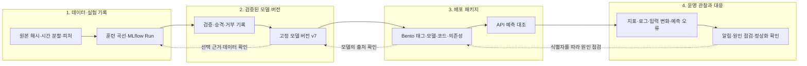
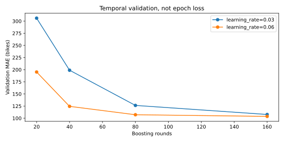
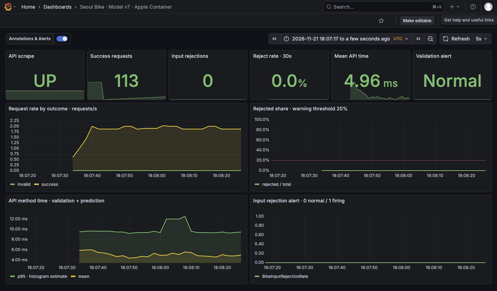
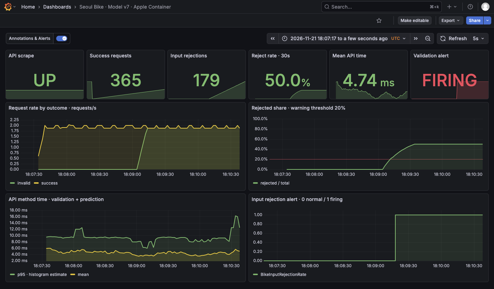
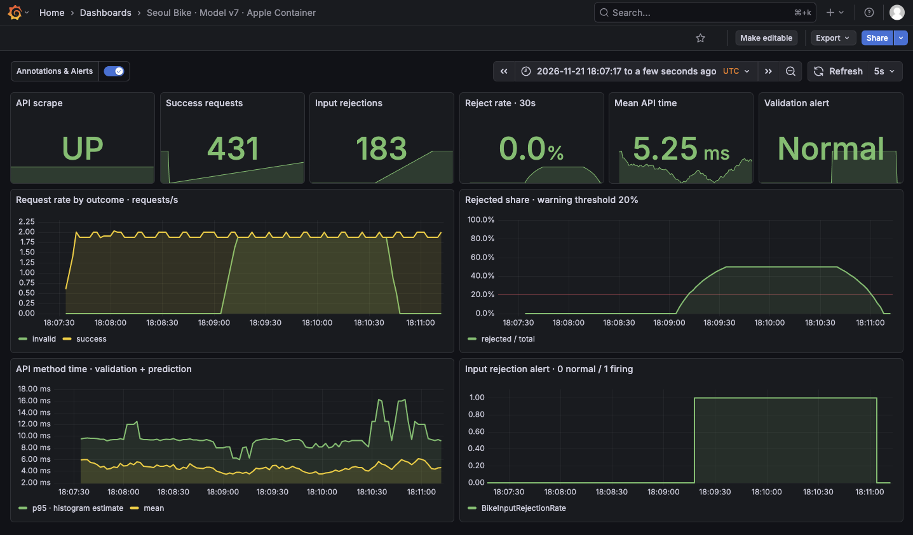
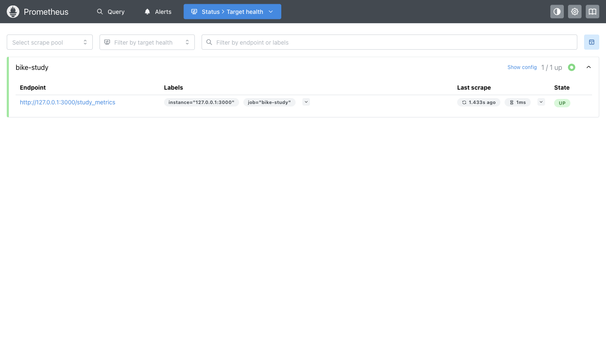
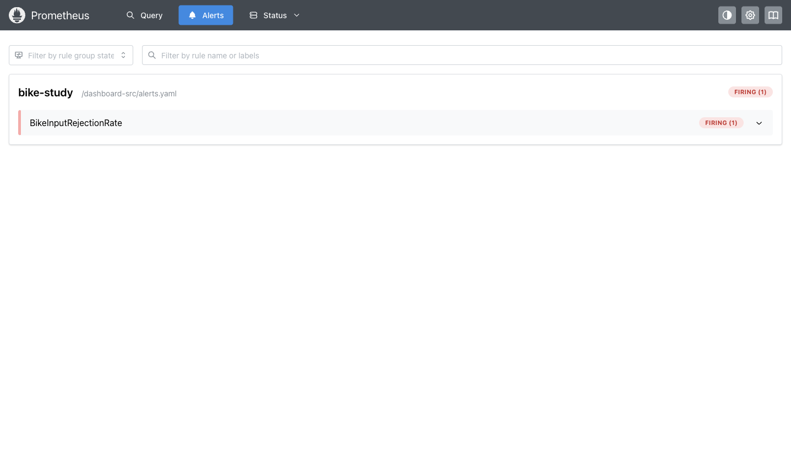
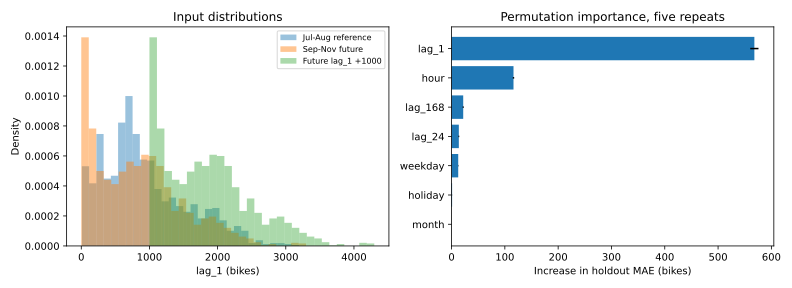

# 서울 자전거 모델 추적·서빙·모니터링 - MLflow·BentoML·Prometheus

> **시리즈 순서:** [1\~2장 이론](https://ddii.dev/mlops/ml-platform-engineering-ch1-2/) → [3장 쿠버네티스 토대](https://ddii.dev/mlops/ml-platform-engineering-ch3/) → [4\~5장 Feast·MLflow·KFP](https://ddii.dev/mlops/ml-platform-engineering-ch4-5-practice/) → [6장 BentoML·Evidently](https://ddii.dev/mlops/ml-platform-engineering-ch6-practice/) → [7장 KFP 데이터 준비](https://ddii.dev/mlops/ml-platform-engineering-ch7-practice/) → [모델 검증](https://ddii.dev/mlops/ml-platform-engineering-model-contract/) → [7\~9장 KFP 훈련·검증](https://ddii.dev/mlops/ml-platform-engineering-ch7-9-practice/) → **이 글**

> 해당 포스팅은 현재 재직 중인 회사와 관련이 없고, 개인 역량 개발을 위한 스터디 자료로 활용할 예정입니다.
>
> **읽은 범위:** *Machine Learning Platform Engineering* 9\~11장. 책의 인쇄 페이지 기준으로 PVC 데이터 관리는 p. 263, TensorBoard는 p. 272, 모델 레지스트리는 p. 290, 서빙은 p. 299, 모니터링은 p. 325부터 이어진다. 9.1절의 PVC는 앞선 실습에서 다뤘으므로, 이번에는 서울 공공자전거 회귀 모델의 실험 추적·패키징·모니터링에 집중했다.

[모델 계약 검증 글](https://ddii.dev/mlops/ml-platform-engineering-model-contract/)에서는 같은 모델이 여러 추론 경로에서 같은 값을 내는지 확인했다. 이어 [7\~9장 실습](https://ddii.dev/mlops/ml-platform-engineering-ch7-9-practice/)에서는 KFP 파이프라인으로 데이터 준비, 훈련·검증, PVC 재사용, MLflow 기록을 한 번에 실행했다.

서비스의 예측이 이상해지면 배포한 모델 버전부터 확인해야 한다. 그 버전을 고른 검증 결과와 훈련 데이터까지 거슬러 찾아갈 수 있어야 원인을 좁힐 수 있다. 반대로 새 모델을 배포할 때는 선택 근거를 남기고, 그 모델이 실제 API에서도 같은 예측을 내는지 확인해야 한다.

이번 글은 **데이터·실험 기록 → 검증된 모델 버전 → 배포 패키지 → 운영 관찰과 대응**의 순서로 9\~11장을 따라간다. 서울 자전거 모델의 원본 해시와 실험 Run에서 시작해 승격한 모델 버전과 Bento 태그를 고정하고, API의 지표·로그·알림과 입력 변화까지 살펴본다.

<!--truncate-->

## 네 단계가 넘겨주는 증거

각 단계에서 남긴 식별자와 결과가 다음 단계의 판단 근거가 된다. 운영에서 이상이 보이면 이 기록을 따라 배포 패키지, 모델 버전, 훈련·데이터 기록을 차례로 확인한다.

| 흐름 | 답해야 할 질문 | 다음 단계에 넘기는 증거 | 책의 관련 범위 |
| --- | --- | --- | --- |
| **1. 데이터·실험 기록** | 무엇으로, 어떤 조건에서 훈련했는가? | 원본 해시, 시간 분할, 피처 정의, 후보 Run ID와 훈련·검증 곡선 | 9.1\~9.3.4 |
| **2. 검증된 모델 버전** | 어떤 후보를 왜 배포 대상으로 골랐는가? | 선택 지표, 승격·거부 기록, 최종 Run ID, 고정 모델 URI | 9.3.3·9.3.5·9.3.7 |
| **3. 배포 패키지** | 선택한 모델이 실제 API에서 실행되는가? | 모델·코드·의존성이 담긴 Bento 태그, API와 직접 추론의 대조 결과 | 10.1\~10.8 |
| **4. 운영 관찰과 대응** | 어떤 이상이 생겼고 어떻게 정상화됐는가? | 요청 지표·로그, 알림 발동·해제, 분포 변화·예측 오류·피처 의존도 | 11.1\~11.3 |

<details>
<summary>데이터 기록부터 운영 대응까지의 흐름도 보기</summary>



</details>

## 실습 환경: Mac 컨테이너와 디스크 관리

앞선 실습의 Apple Kubernetes 클러스터는 디스크를 정리하면서 지웠다. 이번에는 Apple `container`로 띄운 Linux ARM64 컨테이너 하나에서 모두 실행했다. 그 안에서 MLflow, TensorBoard, BentoML, Prometheus, Alertmanager를 각각 별도 프로세스로 띄우고 HTTP로 주고받게 했다. 라이브러리와 서버는 실제 것을 쓰지만, Kubernetes 배포·PodMonitor·PVC는 이번에 다시 검증하지 않았다.

| 특징 | 이번 실습에서 얻는 점 | 제약 |
| --- | --- | --- |
| OCI 이미지와 Apple Silicon | 기존 서울 자전거 이미지를 재사용한다. Docker Desktop이나 Podman의 VM을 추가로 켤 필요가 없다. | 실행 환경이 Linux VM이라 macOS에 설치한 Python 패키지를 그대로 쓸 수 없다. |
| CPU·메모리 지정 | 빌더와 실험 컨테이너 각각 4 CPU·4GiB로 자원을 제한한다. | 라이브러리와 바이너리의 Linux ARM64 호환성을 확인해야 한다. |
| 호스트 디렉터리 마운트 | 결과·모델 기록·TensorBoard 이벤트를 Mac 쪽 디렉터리에 저장한다. | 컨테이너를 지워도 마운트한 결과 파일은 남으므로 따로 지워야 한다. |
| 이미지 빌드 | Python 의존성과 모니터링 바이너리를 같은 실행 이미지에 담는다. | 이미지 빌더도 별도의 VM 디스크와 캐시를 쓴다. 실험 컨테이너를 지워도 빌더 캐시는 남는다. |

이 Mac에서는 Linux VM의 외부 연결이 `Network is unreachable`로 실패했다. 그래서 공개 데이터, Linux ARM64 wheel, Prometheus·Alertmanager 바이너리를 **Mac에서 내려받아 컨테이너에 넣는 방식**으로 바꿨다. 데이터와 바이너리는 SHA-256으로 검사했다. TLS 인증서 검증을 끄거나 외부에 프록시 포트를 여는 우회는 쓰지 않았다.

처음 실행한 자동 검사에서는 각 서버를 컨테이너 안의 `127.0.0.1`에만 바인딩하고 호스트 포트를 열지 않았다. HTTP 요청, 이벤트 파일 검사, 모델 예측 대조를 마치면 서버를 내리고 결과만 호스트에 남겼다. 그다음 대시보드를 캡처하려고 저장해 둔 Bento를 다시 띄웠다. 이 추가 세션에서는 Grafana·Prometheus·Alertmanager 화면을 Mac의 `127.0.0.1`에만 열었고, 아래 브라우저 캡처가 그 화면이다.

성공한 실행 환경은 macOS 26.7.3·Apple `container` 1.7.1, 컨테이너 안의 Linux `aarch64`·Python **3.11.18**이었다. MLflow **3.0.0**, BentoML **1.4.40**, TensorBoard **2.21.0**, scikit-learn **1.5.2**, Prometheus **3.16.0**, Alertmanager **0.35.0**을 썼다. 설치한 패키지 전체 목록도 실행 결과와 함께 저장했다.

대시보드 세션에서는 Grafana **12.3.0**의 Linux ARM64 바이너리를 Mac에서 내려받아 SHA-256을 검사한 뒤 마운트했다. 기존 실행 이미지를 그대로 썼으므로 이미지 빌더나 Kubernetes 클러스터를 새로 만들지 않았다.

이 글에는 코드 전문을 싣지 않았다. 본문의 코드 발췌와 설정은 실제 실행에 쓴 파일에서 가져왔다.

## 1. 데이터·실험 기록: 훈련 조건과 결과를 다시 찾을 수 있게 한다

첫 단계에서는 모델을 만든 조건을 남긴다. 원본 파일의 해시와 시간 분할을 확인하고, 같은 조건에서 훈련한 후보의 곡선과 검증 점수를 기록한다. 책의 9장은 모델 파일뿐 아니라 지표·하이퍼파라미터·검증 예시까지 추적해야 운영에서 생긴 문제를 재현할 수 있다고 강조한다.

### 데이터 접근: PVC와 객체 저장소를 고르는 기준

9.1절은 7\~8장 파이프라인에서 같은 데이터가 여러 번 오가는 문제에서 출발한다. 다운로드 컴포넌트가 데이터를 객체 저장소에 올리면, 훈련 컴포넌트가 분할 데이터를 다시 받고 검증 컴포넌트가 검증 데이터를 또 받는다. 이미지 데이터셋이 크면 모델 계산과 별개로 파일 전송과 임시 디스크 준비가 매번 반복된다.

책은 여러 컴포넌트에 같은 PVC를 마운트해 이 비용을 줄인다. `/data` 아래에 데이터를 한 번 준비하면 훈련과 검증이 같은 파일을 읽는다. `CreatePVC`에는 용량·접근 모드·StorageClass를 지정하고, `mount_pvc`로 각 태스크에 연결한다. StorageClass 이름은 실행할 클러스터에 맞춰야 한다. 앞선 7\~9장 실습의 클러스터에는 `CreatePVC`의 기본값인 `standard`가 없어 `local-path`를 직접 지정했다.

공유 파일 경로만으로는 실행 순서가 정해지지 않는다. 아티팩트 출력을 다음 컴포넌트의 입력으로 넘기면 KFP가 의존 관계를 알지만, 두 함수가 같은 `/data`를 읽고 쓴다는 것만으로는 다운로드가 끝났는지 알 수 없다. 책이 분할 태스크에 `.after(download_op)`를 붙이는 이유다. PVC 이름을 마운트에 넘기는 연결과, 파일 쓰기가 끝난 뒤에 읽기를 시작하게 하는 순서를 따로 챙겨야 한다.

반면 9.3.1절의 영화 추천 예제는 MinIO에 있는 Parquet 데이터를 직접 읽는다. 책도 데이터를 공유 볼륨에 먼저 복사하는 방법과 객체 저장소에서 바로 읽는 방법이 모두 쓸 만하다고 본다. 작은 파일이 많은 이미지인지, 컬럼 단위로 읽을 수 있는 표 데이터인지, 네트워크와 로컬 디스크 여건이 어떤지에 따라 고르면 된다.

| 데이터 접근 방식 | 장점 | 함께 정할 것 |
| --- | --- | --- |
| KFP 아티팩트 | 입력·출력 연결에 데이터 의존성과 출처를 남긴다. | 단계별 업로드·다운로드, 아티팩트 보존 기간과 저장 용량 |
| 공유 PVC | 같은 파일을 여러 컴포넌트가 재사용한다. | 명시적인 실행 순서, 접근 모드·노드 배치, 파일 변경과 정리 책임 |
| 객체 저장소 직접 읽기 | 공용 볼륨 없이 저장소의 데이터를 바로 읽는다. | 데이터 형식과 읽기 단위, 네트워크 비용, 클라이언트의 접근 권한 |

이 표는 책의 9.1절과 9.3.1절을 함께 읽고 정리했다. 이번 컨테이너에서 호스트 디렉터리를 마운트한 것은 결과를 보존하기 위해서이고, Kubernetes PVC의 동작은 [앞선 7\~9장 글](https://ddii.dev/mlops/ml-platform-engineering-ch7-9-practice/)에서 확인했다. 공유 디스크를 써도 데이터 버전이 저절로 생기지는 않는다. 그래서 어떤 파일을 읽었는지 알 수 있도록 원본 해시·분할 경계·피처 정의를 실험 기록에 함께 남겼다.

### 데이터를 쓰기 직전에 가정을 다시 검사한다

9.3.1절은 데이터 준비 단계에서 QA를 했더라도 훈련·평가 직전에 스키마와 타입을 다시 확인하라고 권한다. 데이터 수집·변환 파이프라인과 모델 훈련 파이프라인이 서로 다른 주기로 바뀔 수 있기 때문이다. 파일을 문제없이 읽었다고 해서 모델이 기대한 의미의 데이터를 받았다는 뜻은 아니다.

책의 추천 모델에서는 사용자 ID·아이템 ID·평점 컬럼과 그 타입이 이런 가정이다. 서울 자전거 문제에서는 원본 파일이 같은지, 일곱 입력 컬럼의 순서, 결측 여부, 시간 분할과 시차 피처를 만든 조건이 여기에 해당한다. 특히 `lag_1`이 예측 시점보다 앞선 관측값이어야 한다는 조건은 타입 검사만으로는 잡을 수 없다.

QA 항목은 결함을 발견할 때마다 늘려 간다. 컬럼 이름이 바뀌어 실패했다면 스키마 검사를, 정답이 피처에 섞였다면 시간 관계 검사를 추가한다. 이런 검사를 데이터를 읽어 쓰는 지점에 두면 전처리 코드가 바뀌어도 훈련 단계가 기대하는 계약이 지켜지는지 확인할 수 있다.

### 시간 분할과 예측 조건

UCI Seoul Bike Sharing Demand의 원본 CSV 해시는 `373339b7…`이며 앞선 글과 같다. `lag_168`을 만들 수 없는 첫 168시간을 뺀 뒤 훈련 4,920행·검증 1,488행·미래 테스트 2,184행으로 나눴다. 검증은 2018년 7\~8월, 미래 테스트는 9\~11월이다.

입력은 `hour`, `weekday`, `month`, `holiday`, `lag_1`, `lag_24`, `lag_168`의 일곱 컬럼이다. 이 평가는 직전 시간의 실제 대여량을 받아 **한 시간 뒤를 차례로 예측하는 조건**이다. 9월 1일에 이후 석 달을 한꺼번에 예측한 결과가 아니다.

미래 구간은 앞선 글에서 이미 평가했다. 따라서 이번 결과는 운영 경로를 다시 확인한 기록이고, 처음 열어 본 테스트셋의 성능으로 보면 안 된다. 후보 선택과 승격 조건에도 미래 테스트 점수는 쓰지 않았다.

### 훈련 곡선과 실행 기록을 함께 남긴다

9.2절의 TensorBoard와 9.3.4절의 MLflow는 답하는 질문이 다르다. TensorBoard로는 한 번의 훈련 동안 손실과 검증 지표가 어떻게 움직이는지 본다. MLflow로는 여러 실행 가운데 어떤 데이터·설정·코드가 어떤 결과를 냈는지 찾는다. 곡선으로 훈련 상태를 파악하고, Run으로 그 상태를 만든 조건을 찾는 식이다.

TensorBoard는 TensorFlow 모델 전용이 아니다. 책의 YOLO도 TensorBoard 이벤트 파일을 남긴다. 책의 Kubeflow 구성에서는 훈련 로그가 쌓이는 PVC를 TensorBoard 인스턴스도 함께 마운트한다. 그래서 로그를 쓸 디렉터리, TensorBoard가 읽을 경로, PVC를 유지할 기간을 함께 정해야 한다.

| 기록 도구 | 책에서 강조하는 역할 | 이번 서울 자전거 실습 |
| --- | --- | --- |
| TensorBoard | 훈련 과정의 손실·지표 변화와 시각화 | 반복 수별 train·validation MAE 이벤트 |
| MLflow Tracking | 실행 조건·지표·모델 아티팩트의 기록과 검색 | 후보 Run, 원본 해시, 모델 설정, 최종 Run과 후보의 연결 |
| MLflow Model Registry | 등록 버전과 별칭, 승격 이력 관리 | 통과한 v7과 거부한 v8, `champion` 별칭 |

책의 9.2절은 YOLO 훈련 로그를 TensorBoard로 본다. 여기서는 `HistGradientBoostingRegressor`에 `warm_start=True`를 주고 반복 수를 20·40·80·160으로 늘리며 시점마다 train·validation MAE를 기록했다. 이미 만든 트리에 새 트리를 더해 가는 방식이라 신경망의 에포크와는 다르다.

`tensorboardX`로 이벤트 파일을 쓰고 TensorBoard 서버를 띄웠다. 같은 값을 MLflow에도 step과 함께 남겼다. 이벤트 파일은 `EventAccumulator`로 다시 읽어, 두 후보 모두 step이 실제로 `[20, 40, 80, 160]`인지 검사했다.

| 학습률 | 20회 검증 MAE | 40회 | 80회 | 160회 |
| --- | ---: | ---: | ---: | ---: |
| 0.03 | 306.1207 | 198.8955 | 126.3824 | 107.7182 |
| 0.06 | 195.2188 | 124.4655 | 107.1661 | **103.7623** |



두 후보 모두 반복 수를 160으로 고정하고, 마지막 검증 점수를 비교해 학습률 0.06을 골랐다. 중간에 가장 좋은 step에서 멈추는 조기 종료는 쓰지 않았다.

<details>
<summary>TensorBoard와 MLflow에 같은 훈련 지표를 남기는 코드 보기</summary>

```python
model = HistGradientBoostingRegressor(
    max_leaf_nodes=15,
    l2_regularization=1.0,
    random_state=42,
    early_stopping=False,
    learning_rate=rate,
    warm_start=True,
)
with SummaryWriter(log_dir) as writer:
    for rounds in (20, 40, 80, 160):
        model.set_params(max_iter=rounds)
        model.fit(train[columns], train["target"])
        prediction = np.clip(model.predict(validation[columns]), 0, None)
        value = mean_absolute_error(validation["target"], prediction)
        writer.add_scalar("validation_mae", value, rounds)
        mlflow.log_metric("validation_mae", value, step=rounds)
```

</details>

선택한 후보의 Run ID는 `b62398d53add4a0fb464a0b6612993ec`다. 이 Run에는 원본 CSV 해시, 훈련·검증 행 수, 학습률과 모델 설정, 반복 수별 MAE가 남는다. 다음 단계에서는 이 Run의 검증 결과로 후보를 고르고, 최종 모델 Run의 `selected_run_id`에 이 Run ID를 적는다.

### Run의 메타데이터와 모델 파일이 저장되는 경로

9.3.4절의 MLflow 설명에서 운영상 눈여겨볼 부분은 아티팩트를 올리는 경로다. 훈련 Pod가 Tracking 서버에 지표를 보낼 수 있다고 해서 모델 파일을 저장할 권한까지 있는 것은 아니다. 책은 메타데이터를 보내는 경로와 모델·보고서 같은 파일을 올리는 경로를 함께 설계하라고 한다.

직접 접근 방식에서는 훈련 클라이언트가 S3 같은 아티팩트 저장소에도 직접 붙어 인증해야 한다. 프록시 방식에서는 Tracking 서버가 아티팩트를 대신 받아 저장하므로 클라이언트 설정이 단순해진다. 대신 모델 파일이 모두 서버를 거치므로 그 경로의 처리량과 용량을 따져야 한다. 이번 실습은 컨테이너 안의 로컬 Tracking 서버와 파일 저장소를 썼고, 두 S3 전송 방식은 따로 시험하지 않았다.

책은 훈련과 평가를 다른 컴포넌트로 나눠도 Run ID를 넘겨 평가 지표를 같은 실행에 기록한다. 가중치 파일만 남길 때보다 “이 모델의 평가는 어느 실행에서 나왔는가”를 찾기 쉽다. 이번에는 후보 평가 Run과 train+validation 재훈련 Run을 나누고, `selected_run_id`로 두 실행의 관계를 남겼다.

## 2. 검증된 모델 버전: 선택 근거를 남기고 승격을 통제한다

검증 단계에서는 어떤 모델을 다음 단계로 넘길지 정한다. 이번에는 학습률 0.03과 0.06 후보의 160회 검증 MAE를 비교해 0.06을 골랐다. 그 설정으로 최종 모델을 만들고, 게이트를 통과한 버전만 `champion`으로 지정한다.

### 책의 추천 모델: 평점 오차와 추천 품질을 함께 본다

9.3.2절의 추천 모델은 사용자와 영화의 임베딩을 훈련한다. 두 벡터의 원소별 곱을 만들고, 선형 층·활성화·드롭아웃을 거쳐 평점을 예측하는 PyTorch 모델이다. 사용자·아이템을 숫자 ID로 매핑하는 규칙도 모델 입력의 일부가 된다. 책은 알고리즘 최적화보다 QA·훈련·평가·기록을 재사용할 수 있는 컴포넌트로 만드는 데 초점을 둔다.

이어서 9.3.3절은 지표를 비즈니스 목적에 맞춰 골라야 한다고 말한다. 평점을 잘 맞히는 것과 사용자가 관심 가질 영화를 상위 목록에 올리는 것은 서로 다른 평가 질문이다. RMSE는 평점 예측 오차를 보고, Precision@50은 추천한 상위 50개 중 관련 있는 항목의 비율을, Recall@50은 관련 있는 항목 중 상위 목록으로 찾아낸 비율을 본다.

책 pp. 284\~285의 작은 실험은 6,400개 표본, 배치 64, 30에포크 조건에서 학습률을 바꾼다. 아래 수치는 책에 실린 결과이고, 영화 추천 모델을 직접 돌려 얻은 값이 아니다.

| 책의 실험 | Precision@50, 높을수록 좋음 | Recall@50, 높을수록 좋음 | RMSE, 낮을수록 좋음 |
| --- | ---: | ---: | ---: |
| 기본 설정 | **0.7533** | 0.6316 | 0.2904 |
| 학습률 `1e-2` | 0.7422 | **0.8649** | **0.2836** |

책 본문은 설정을 바꾼 실험이 조금 나빠졌다고 쓰지만, 표를 보면 정밀도만 낮아지고 재현율과 RMSE는 좋아졌다. 어떤 지표를 우선하고 얼마까지 나빠져도 되는지 정해 둬야 후보를 고를 수 있다. 관련 영화를 덜 놓치려는 서비스와 상위 목록의 정확성을 중시하는 서비스는 같은 표를 보고도 다른 후보를 고를 수 있다.

서울 자전거 실습은 MAE를 주 선택 지표로 삼고 RMSE와 `lag_24` 기준선을 함께 기록했다. 실제 서비스의 승격 기준으로 쓰려면 어느 시간대의 큰 오차가 더 치명적인지, 예측이 충분히 빠른지, 필요한 시차 데이터가 제때 들어오는지도 따로 정해야 한다. 이번의 상대 MAE 게이트가 그 요구를 모두 대신하지는 못한다.

### 모델 이름·버전·별칭을 구분한다

9.3.5절은 여러 실험 결과 가운데 유망한 모델을 레지스트리에 등록하고, 검토를 거친 버전이 배포 대상이 되도록 관리한다. 책에서 쓰는 `staging`과 `prod`도 코드로 보면 특정 버전을 가리키는 별칭일 뿐이다. 별칭 이름을 붙인다고 검증이나 배포가 저절로 일어나지는 않는다.

| 식별자 | 답하는 질문 | 이번 예 |
| --- | --- | --- |
| Experiment / Run | 어떤 목적의 실험이며 어떤 실행에서 만들어졌는가? | 후보 Run과 최종 재훈련 Run |
| 등록 모델 이름 | 어느 모델의 버전들을 묶는가? | `seoul-bike-ch9-11-study` |
| 모델 버전 | 그 이름 아래의 어떤 등록 결과인가? | v7, v8 |
| 별칭 | 현재 선택한 버전은 무엇인가? | `champion`이 v7을 가리킴 |
| 고정 모델 URI | 패키지에 넣을 모델을 어디에서 가져오는가? | `models:/seoul-bike-ch9-11-study/7` |

버전은 실험마다 새로 생기고, 별칭은 검토 결과에 따라 다른 버전으로 옮겨 갈 수 있다. 그래서 배포를 준비할 때는 별칭으로 버전을 찾은 뒤 실제 버전 번호를 기록한다. 나중에 별칭이 옮겨 가도 그 패키지에 어떤 모델이 들어 있는지 알 수 있게 하기 위해서다.

### 책의 승격 게이트를 읽는 방법

리스트 9.15는 새 후보의 지표를 현재 `staging` 모델과 비교한다. 오차 지표인 RMSE는 새 값에서 기존 값을 뺀 차이가 허용 한도를 넘는지 보고, 정밀도·재현율은 그 차이가 허용 하한보다 작아지는지 본다. 지표마다 좋아지는 방향이 다르므로 같은 비교 연산을 쓰면 안 된다.

책의 기본 인자는 RMSE가 조금이라도 늘면 막고, 정밀도·재현율에는 각각 줄어들어도 되는 폭을 둔다. 이 숫자는 예제의 정책일 뿐이다. 실제 서비스라면 같은 평가 데이터와 조건으로 비교할지, 전체 평균 말고 어떤 집단의 성능을 볼지, 첫 버전에는 어떤 절대 기준을 적용할지 정해야 한다.

책은 staging까지 자동으로 올리는 경로와, 프로덕션 배포 전에 사람이 검토해야 하는 경우를 함께 다룬다. 자동 승격을 넓히려면 경험적 모델 검사를 더할 수 있다고도 한다. 어느 쪽이든 검증 지표, 대표 입력에서의 동작, 승인 근거가 특정 버전에 묶여 있어야 한다. 이번에는 정상 후보가 통과하는지와 함께, 성능이 낮은 후보가 거부되고 기존 별칭이 그대로 남는지도 검사했다.

### 등록된 버전의 승격 여부를 기록한다

선택한 설정으로 train+validation 6,408행을 훈련해 최종 모델을 등록했다. 별칭은 검증 게이트를 통과할 때만 바뀐다. 통과 기준은 선택한 후보의 검증 MAE 103.7623에 1.02를 곱한 **105.8376 이하**로 잡았다. 103.7623은 최종 모델로 재훈련하기 전 후보의 검증 점수다. 2% 여유는 승격 동작을 시험하려고 정한 상대 조건이며 운영 기준으로 쓸 값은 아니다.

기준을 선택한 후보 자신의 점수로 만들었으니 이 후보는 당연히 통과한다. 이번에 검증한 것은 통과·거부와 별칭 유지라는 제어 흐름이다. 현재 운영 모델과의 회귀 비교나, 재훈련한 최종 가중치를 독립적으로 평가한 승격으로 읽으면 안 된다. 최종 모델의 평가와 패키지 동작은 뒤의 미래 평가와 API 대조에서 따로 확인한다.

평균값만 내놓는 `DummyRegressor`도 따로 후보 버전으로 등록했다. 이 후보는 검증 MAE가 **518.3378**이라 승격이 거부됐다. 거부된 버전에는 `gate=rejected` 태그를 남기고, `champion`이 여전히 정상 모델 버전을 가리키는지 조회했다. 레지스트리에 버전이 생겼다고 해서 배포 대상이 되는 것은 아니다.

성공한 실행에서는 정상 모델이 **v7**, 거부한 후보가 **v8**이었다. 패키징 오류를 고치며 여러 번 실행한 기록이 같은 로컬 레지스트리에 남아 있어 버전이 1부터 시작하지 않는다. 최종 MLflow Run ID는 `be89aa18efcb46aa9314f0cce6d6f6d2`이고, 모델을 가져온 URI는 `models:/seoul-bike-ch9-11-study/7`이다.

<details>
<summary>승격 조건과 별칭 변경 코드 보기</summary>

```python
accepted = bool(
    np.isfinite(validation_mae)
    and validation_mae <= ceiling
)
client.set_model_version_tag(
    registry_name, version, "gate",
    "passed" if accepted else "rejected",
)
if accepted:
    client.set_registered_model_alias(
        registry_name, "champion", version,
    )
```

</details>

최종 모델의 미래 MAE는 **90.8443**, RMSE는 **147.3341**이었다. 같은 구간에서 `lag_24`를 그대로 예측으로 쓰는 기준선 MAE는 **386.4167**이다. 선택 과정의 검증 점수와 최종 모델의 미래 점수는 섞이지 않도록 서로 다른 필드에 기록했다.

이 단계가 배포 준비로 넘기는 것은 최종 Run ID와 **고정 모델 URI `models:/seoul-bike-ch9-11-study/7`이다.** 모델 파일을 다시 내려받아 미래 구간을 평가한 결과도 함께 남겼다. 책 9장 요약이 강조하는 “모델을 직접 불러와 확인하기”를 회귀 문제에 적용한 셈이다.

9.3.7절의 추천 예제도 등록한 모델을 노트북에서 불러와 특정 사용자의 추천 목록을 직접 본다. 지표 숫자를 얻은 뒤 실제 출력의 형태와 내용까지 살펴보는 단계다. 회귀 API에서는 예측 개수, 행 순서, 음수 처리, 여러 행 입력의 결과를 직접 추론과 대조하는 검사가 이에 해당한다.

## 3. 배포 패키지: 검증한 버전을 실제 서비스와 묶는다

모델을 고른 다음에는 실행할 코드와 의존성, 입력 규약을 함께 고정한다. 책 10장의 Bento가 이런 배포 단위다. 여기서는 앞 단계의 v7을 가져와 패키지를 만들고, 그 패키지의 API가 같은 모델을 실행하는지 확인했다.

### 모델 배포에서 추가로 결정해야 하는 것

10.1절은 모델 배포에 일반 소프트웨어의 버전 관리·테스트·CI/CD 외에 어떤 책임이 더해지는지 정리한다. 배치 예측과 실시간 API 중 무엇을 제공할지, 어느 부하까지 감당할지, 훈련 때의 데이터 형식과 전처리를 어떻게 재현할지, CPU·GPU·메모리를 어떻게 배치할지가 그 예다.

이런 문제는 모델의 정확도만 보고 정할 수 없다. 같은 가중치라도 피처 순서나 후처리가 다르면 출력이 달라지고, 모델을 제대로 불러왔어도 요청 대기가 길면 실시간 요구를 맞추지 못한다. 그래서 모델 버전과 함께 입력 처리 코드, 의존성, 실행 자원, 서비스 지표를 같이 관리해야 한다.

책은 모델 개발자가 운영 환경이 아닌 곳에서 직접 서버를 띄워 보는 흐름도 강조한다. API로 일찍 띄워 보면 배포할 수 있는지, 입력·출력 계약이 맞는지를 개발 중에 알 수 있다. 운영에 배포할 때는 이 검증 결과와 패키지를 넘기고, 배포·운영 담당자가 자원·네트워크·관찰 경로를 이어서 검토한다.

### 책의 API 서버와 모델 실행 단위

10.3\~10.4절은 BentoML 1.1.6의 `Service`·`Runnable`·Runner 구성을 설명한다. API 서버는 HTTP 입력을 받아 형식을 처리하고, Runner는 모델 계산을 맡는다. YOLO 가중치는 `Runnable`을 초기화할 때 한 번만 불러와, 요청마다 모델을 다시 읽지 않게 한다.

객체 탐지 예제에는 두 API가 있다. `/inference`는 클래스·신뢰도·박스 좌표를 JSON으로 돌려줘 다른 프로그램이 받아 쓰게 한다. `/render`는 박스와 라벨을 그린 이미지를 돌려줘 사람이 결과를 바로 볼 수 있게 한다. 같은 모델이라도 결과를 받는 쪽이 프로그램인지 사람인지에 따라 서비스 계약이 달라진다.

책은 입력 이미지를 회색조로 바꾼 뒤 두 탐지 Runner를 비동기로 부르는 예도 보여 준다. 전처리와 여러 모델을 한 서비스 안에서 조합할 수 있다는 예다. 다만 실제 처리 시간은 자원과 실행 방식에 따라 직접 재야 하며, 비동기로 호출한다고 계산이 빨라지는 것은 아니다.

이번 실습은 BentoML **1.4.40**의 클래스 기반 `@bentoml.service`·`@bentoml.api`를 썼다. 10.3\~10.4절의 Runner 코드를 그대로 옮기지 않고, 초기화할 때 고정 모델을 읽고 API 메서드 안에서 입력 검사·예측·지표 기록을 하도록 짰다. 서비스 워커 하나로 실행했으므로, 책에서 설명한 API 서버와 여러 Runner의 분산 확장은 시험하지 않았다.

### 레지스트리에서 가져온 모델을 배포 입력으로 고정한다

서빙 준비 단계에서는 `champion`을 한 번 조회해 버전 번호를 얻은 뒤 `models:/seoul-bike-ch9-11-study/<version>`으로 모델을 불러온다. 그 모델을 BentoML 모델 저장소에 저장하고, API 코드·일곱 피처의 순서·MLflow Run ID·정확한 모델 태그를 Bento 패키지에 담는다.

10.6절의 그림 10.11도 실험 추적과 모델 레지스트리를 거쳐 추론 서비스와 컨테이너화로 이어지는 흐름이다. 책은 서비스가 MLflow에서 프로덕션 별칭을 조회하는 방법과 함께, 파이프라인 앞 단계에서 고른 모델 URI를 넘겨받는 방법도 설명한다. 뒤의 방법을 쓰면 모델을 고른 단계와 패키징 단계가 같은 모델을 썼는지 확인하기 쉽다.

고정 버전과 별칭을 나누는 이유는 배포 기록을 정확히 남기기 위해서다. 레지스트리에서 별칭을 바꿔도 이미 떠 있는 Python 프로세스의 가중치는 바뀌지 않는다. 롤백할 때는 별칭을 원하는 버전으로 옮기는 데서 끝내지 말고, 그 버전으로 만든 패키지를 실제로 다시 띄워 확인해야 한다.

<details>
<summary>등록 모델을 고정 버전으로 불러오는 코드 보기</summary>

```python
champion = client.get_model_version_by_alias(
    "seoul-bike-ch9-11-study", "champion",
)
model_uri = (
    f"models:/seoul-bike-ch9-11-study/{champion.version}"
)
model = mlflow.sklearn.load_model(model_uri)
stored = bentoml.sklearn.save_model(
    "seoul-bike-ch9-11",
    model,
    signatures={"predict": {"batchable": False}},
    metadata={
        "mlflow_model_uri": model_uri,
        "mlflow_run_id": champion.run_id,
        "features": columns,
    },
)
```

</details>

### 모델 버전·Bento·OCI 이미지의 역할

10.5절의 `bentofile.yaml`에는 서비스 진입점, 함께 담을 코드·모델 파일, 컨테이너화에 쓸 기반 이미지를 적는다. `bentoml build`는 이를 Bento라는 배포 패키지로 묶고 고유 태그를 붙인다. 책은 이어서 `bentoml containerize`로 실행 이미지를 만드는 과정을 보여 준다.

| 관리 단위 | 포함하거나 식별하는 대상 | 새로 만들어야 하는 경우 |
| --- | --- | --- |
| MLflow 모델 버전 | 등록한 훈련 결과와 원래 Run | 새 데이터·설정으로 모델을 다시 훈련했을 때 |
| Bento 패키지 | 모델과 서비스 코드·의존성·설정 | 입력 검사·API·의존성이 바뀌었을 때 |
| OCI 실행 이미지 | 프로세스를 실행할 OS·라이브러리·코드·파일 | 기반 환경이나 Bento가 바뀌었을 때 |

같은 모델 버전으로도 Bento는 여러 개 나올 수 있다. 입력 검사 버그를 고치거나 의존성을 바꾸면 가중치가 같아도 동작이 달라지기 때문이다. 그래서 운영 기록에는 모델 URI와 패키지 태그를 둘 다 남겨야 한다.

이번에는 Apple `container`용 OCI 실행 이미지를 먼저 만들고, 그 안에서 Bento를 빌드해 태그로 서빙했다. 책처럼 `bentoml containerize`로 만든 이미지를 따로 띄우지는 않았다. 최종 검사는 **빌드한 Bento 태그를 `bentoml serve`로 띄운 서버**에 요청을 보내므로, 패키지에 담긴 모델과 서비스의 동작을 확인한 셈이다.

### 패키지의 실제 API를 직접 추론과 대조한다

API는 행마다 일곱 값이 모두 들어 있는지, 모두 유한한 수인지, 시각·요일·월·휴일이 범위 안에 있는지 검사한다. 과거 대여량에 음수가 들어오면 거부한다. 예측값은 앞선 훈련·평가와 같은 규칙으로 0 미만을 0으로 자른다.

한 요청에 담는 행 수를 1·8·32로 바꿔 가며 직접 추론과 대조했다. 여기서 여러 행을 한 요청에 담은 것은 **클라이언트가 직접 만든 배치**다. 서버가 여러 요청을 합치는 BentoML의 adaptive batching은 켜지 않았다.

10.2절의 적응형 마이크로배치(adaptive microbatching)는 서버에 들어온 여러 요청을 한 번의 계산으로 묶어 자원 사용과 처리량을 개선하는 기능이다. 묶는 동안 개별 요청이 기다리는 시간과 묶어서 얻는 계산 이득을 함께 따져야 한다. 이번 대조는 행 수가 달라도 같은 예측이 나오는지 보는 검사이고, 동시 요청 처리량을 재는 부하 시험은 아니다.

실제로 빌드해 실행한 패키지는 `bike_service:biwiiwxfvc25l5qr`다. 세 요청 모두 반환된 모델 버전이 v7이었고, 직접 추론과의 **최대 절대 차이는 0.0**이었다.

| 요청의 행 수 | 최대 예측 차이 | 확인 |
| --- | ---: | --- |
| 1 | 0.0 | 고정 버전의 직접 추론과 일치 |
| 8 | 0.0 | 행 순서와 예측 개수 유지 |
| 32 | 0.0 | 여러 행을 받은 API와 직접 추론 일치 |

세 요청의 응답 시간도 기록했지만, 워밍업도 반복 측정도 하지 않았으므로 처리량이나 p95 비교에는 쓰지 않았다.

이 API는 이미 만들어진 피처 배열을 입력으로 받는다. 앞선 모델 계약 글의 Feast 온라인 조회와 시각 검증은 이번 서버에 붙이지 않았다. 그래서 피처 순서와 수치 검사를 통과하더라도, 호출하는 쪽이 엉뚱한 시점의 `lag_1`을 넣으면 API가 알아채지 못한다.

### 시작 상태와 예측 동작을 각각 확인한다

10.4절은 서비스의 health·liveness·readiness 엔드포인트를 설명한다. Liveness는 프로세스를 계속 실행해도 되는지, readiness는 요청을 받을 준비가 됐는지를 알린다. 책의 Kubernetes 구성에서는 이 결과에 따라 Pod를 재시작하거나 트래픽을 보내지 않는다.

이번에는 Bento의 `/readyz`가 응답한 뒤에 예측 대조를 시작했다. 준비 완료 응답을 받은 다음, 대표 입력을 넣어 기대한 모델 버전과 예측이 나오는지도 검사했다. 두 결과를 함께 남겨야 서버가 뜨지 못한 경우와 모델이 잘못 동작하는 경우를 구분할 수 있다. Kubernetes의 재시작·트래픽 제외 동작은 단일 컨테이너인 이번 구성에서 시험하지 않았다.

### 책이 비교하는 서빙 도구의 선택 기준

10.7절은 MLflow만으로 등록 모델을 REST 서버로 띄우는 방법을, 10.8절은 KServe의 `InferenceService` 리소스로 서빙하는 방법을 다룬다. 아래 표는 책의 비교 관점을 정리한 것이고, 각 도구의 최신 기능을 모두 평가한 것은 아니다.

| 도구 | 책에서 중심에 두는 역할 | 이 글의 흐름에 연결할 질문 |
| --- | --- | --- |
| MLflow | 실험 추적·버전 관리에서 기본 모델 서빙까지 연결 | 등록 모델을 빠르게 호출하는 경로로 충분한가? |
| BentoML | 모델과 사용자 정의 서비스 로직을 패키징하고 서빙 | 입력 처리·여러 모델·API 계약을 어떻게 묶을까? |
| KServe | Kubernetes 중심의 모델 서빙 오케스트레이션 | 클러스터의 배포·확장 체계를 어떻게 사용할까? |

책은 팀의 경험과 인프라, 요구 사항에 맞춰 고르라고 한다. 이번에는 앞선 MLflow 기록을 그대로 쓰면서 직접 만든 입력 검사와 지표를 패키지에 담으려고 MLflow+BentoML 조합을 택했다. KServe·Yatai 배포와 도구 간 성능 비교는 이번 범위에 넣지 않았다.

### 원본 데이터에서 API까지 식별자를 연결한다

이번 실행에서 식별자는 다음처럼 이어진다. 후보의 검증 기록은 최종 Run의 `selected_run_id`로, 최종 모델은 레지스트리 URI로, 실행한 서비스는 Bento 태그로 찾아간다.

| 확인할 대상 | 이번 실행의 식별자 | 연결 |
| --- | --- | --- |
| 원본 CSV | SHA-256 `373339b7…` | 후보·최종 Run의 데이터 출처 |
| 선택한 후보 | Run `b62398d53add4a0fb464a0b6612993ec` | 최종 Run의 `selected_run_id` |
| 최종 훈련 | Run `be89aa18efcb46aa9314f0cce6d6f6d2` | 레지스트리 v7과 Bento 모델 메타데이터 |
| 검증을 통과한 모델 | `models:/seoul-bike-ch9-11-study/7` | Bento에 담을 가중치의 고정 출처 |
| Bento 모델 | `seoul-bike-ch9-11:bgvn2lxfvctqf5qr` | 패키지에 포함한 모델 태그 |
| 실행한 서비스 패키지 | `bike_service:biwiiwxfvc25l5qr` | 실제 API 예측을 대조한 배포 단위 |

다음 단계에서는 이 패키지가 돌아가는 동안의 요청 지표와 모델 버전 로그를 관찰한다. 운영 중인 패키지의 태그만 알면 그 안의 모델과 선택 근거까지 거슬러 올라갈 수 있다.

## 4. 운영 관찰과 대응: 이상을 발견하고 정상화를 확인한다

배포한 뒤에는 요청 처리 상태와 모델의 입력·예측을 관찰한다. 책의 11장은 서비스 지표·로그·알림에 더해 데이터 드리프트와 설명 가능성을 다룬다. 이번에는 잘못된 입력을 보내 알림이 발동하고, 정상 요청으로 바꾼 뒤 알림이 해제되는 과정을 확인했다. 분포 변화와 예측 오류는 별도 배치 분석으로 측정했다.

### 서비스 상태와 모델 품질의 관찰을 나눈다

11.1.1절은 CPU·메모리 같은 자원 사용량과 지연·실패 응답 같은 요청 지표를 기본 모니터링으로 다룬다. 서비스가 자원 한도 안에서 요청을 처리하고 있는지 보는 관찰이다. 이어 11.1.2절에서는 객체 탐지의 신뢰도나 추천 요청의 `ranked_movies` 유무처럼 애플리케이션 고유의 의미를 담은 커스텀 지표를 더한다.

| 관찰 대상 | 책의 예와 확장할 질문 | 이상이 보일 때의 점검 |
| --- | --- | --- |
| 자원·처리 상태 | CPU·메모리, 요청 수·지연·실패 응답 | 부하 증가, 자원 한도, 모델 초기화·계산 오류 |
| 모델·요청의 의미 | 탐지 신뢰도, 추천 요청의 `ranked_movies` 유무 | 입력 변화, 요청 유형, 특정 클래스나 사용자에 치우친 출력 |
| 데이터·정답 | 입력 분포와 이후 확인한 예측 오류 | 피처 생성 문제, 기간·집단별 변화, 평가 조건 |

책의 객체 탐지 예제는 신뢰도를 Histogram에 넣어 점수의 분포를 관찰한다. 추천 예제는 요청에 `ranked_movies`가 주어진 경우와 없는 경우를 Counter로 센다. 각각 모델 출력의 상태와 요청의 특성을 보여 준다. 정답과 비교한 정확도는 따로 관측해야 한다. 신뢰도가 높거나 HTTP 응답이 정상이라고 해서 예측이 맞았다는 뜻은 아니다.

11.1.1절은 지표를 내보내는 데서 그치지 않고 실제로 수집되는지까지 확인한다. 책의 Kubernetes 배포에서는 PodMonitor로 대상 Pod·포트·경로를 지정한 뒤 Prometheus의 Service Discovery 화면과 질의 결과를 본다. `/metrics` 엔드포인트가 있는지만 보면 수집 설정이 빠진 것을 놓칠 수 있다. 이번에는 고정된 로컬 주소의 `/study_metrics`를 수집 대상으로 두고, 실제 PromQL 응답으로 수집 여부를 확인했다.

### 요청 거부율·계산 시간·로그

책의 11.1절은 기본 지표, 커스텀 지표, 로그, 알림을 순서대로 다룬다. 회귀 모델에는 객체 탐지의 신뢰도에 해당하는 값이 없으므로 그 Histogram을 억지로 옮기지 않고, 이번 서비스에 맞는 두 지표를 직접 정의했다.

| 지표 | 무엇을 세는가 | 해석 범위 |
| --- | --- | --- |
| `bike_requests_total{outcome="success"}` | API 메서드에서 정상 처리한 요청 수 | 여러 행을 담은 요청도 한 건으로 센다. |
| `bike_requests_total{outcome="invalid"}` | API 메서드의 피처 검사에서 거부한 요청 수 | 메서드 호출 전에 프레임워크가 거부한 요청이나 HTTP 5xx는 세지 않는다. |
| `bike_inference_seconds` | 정상 요청의 API 메서드 내부 입력 검사·예측 시간 | 타이머는 입력 검사 전에 시작하며, 네트워크·요청 대기·전체 왕복 시간은 포함하지 않는다. |

`outcome` 라벨 값은 두 가지로 제한했고, 요청 ID나 타임스탬프는 메트릭 라벨로 붙이지 않았다. 서비스 코드에는 모델 버전·행 수·처리 시간을 JSON으로 남기는 INFO 로그도 있다. 다만 저장된 서버 로그에서 이 메시지를 찾지 못했으므로 로그 수집의 근거로 쓰지 않았다. 입력 피처 원문은 로그에 남기지 않았다.

Prometheus는 `/study_metrics`를 2초마다 수집한다. 이 경로는 BentoML의 기본 `/metrics`와 별개다. 실행 결과에는 수집 상태 `up`, Counter 값, PromQL 응답을 남겼다.

### 지표에서 발견한 문제를 로그로 좁힌다

11.1.3절은 지표와 로그가 알려 주는 정보가 어떻게 다른지 설명한다. 거부율이나 지연 곡선은 문제가 언제, 얼마나 생겼는지 알려 준다. 로그로는 그때 어떤 입력 검사가 실패했고 어떤 예외가 났는지, 어느 버전의 서비스가 처리했는지를 확인한다.

책은 BentoML의 Python 로그를 수집해 Loki·Grafana에서 지표와 함께 조회하는 구성을 다룬다. 여러 서버의 로그를 한곳에서 찾을 수 있어야 Pod를 하나씩 열어 보는 수고를 덜 수 있다. 모델 버전·배포·시간 구간으로 범위를 좁힌 다음 관련 메시지를 보는 식이다.

이번에는 중앙 로그 저장소를 설치하지 않고 서버 로그를 파일로 남겼다. BentoML 서버 로그에는 실행한 패키지 태그, HTTP 200·400 접근 기록, 입력 검사 실패로 난 `BadInput` 예외가 남았다. 요청별로 직접 남긴 JSON 로그까지 수집되는지는 더 확인해야 한다. 지금까지 확인한 출처 추적은 서버 시작 로그의 Bento 태그, 그리고 API 응답과 실행 결과에 담긴 모델 버전·Run ID에 기대고 있다.

### 알림 규칙과 알림 전달의 책임

11.1.4절에서 Prometheus는 질의를 평가해 이상 여부를 판단하고, Alertmanager는 발생한 알림을 받는 사람에게 전달한다. 규칙에는 조건식, 지속 시간, 심각도 라벨, 설명을 넣고, 전달 설정에는 어떤 알림을 누구에게 보낼지 정한다.

책의 가용성 규칙은 `up == 0`인 경우와 `up` 시계열 자체가 없는 경우를 나눠 본다. 대상은 남아 있는데 수집에 실패한 경우와, 대상이 사라져 질의 결과가 아예 없는 경우를 구분하려는 것이다. 반대로 `up=1`은 지표 수집에 성공했다는 뜻일 뿐이므로, 모델 API의 예측이 맞는지는 따로 검사해야 한다.

책에서는 배포를 내려 시계열이 끊기게 만든 뒤, 조건이 5분간 이어지고 나서 알림이 발동하는 것을 확인한다. `for`가 있는 규칙은 조건이 성립하면 먼저 pending 상태가 되고, 지정한 시간 동안 유지되면 firing으로 바뀐다. 이 값으로 순간적인 변화에도 바로 반응할지, 계속되는 문제에만 반응할지를 정한다.

### 잘못된 요청을 정상화하고 알림 해제까지 확인한다

정상 요청 10건과 일곱 값을 갖추지 않은 요청 10건을 보내면 서비스는 각각 HTTP 200과 400을 돌려줘야 한다. 최근 30초의 입력 거부율이 20%를 넘은 상태가 4초간 이어지면 `BikeInputRejectionRate`가 발동하게 했다. Alertmanager는 같은 컨테이너 안의 로컬 HTTP 수신기로 알림을 보낸다. 그다음 정상 요청만 보내 거부율이 내려가면 해제 알림도 와야 한다.

실제 결과는 **200 응답 10건·400 응답 10건**, Prometheus `up=1`, 해당 구간의 거부율 **0.5**였다. 정상 요청 Counter가 13인 것은 앞서 예측 대조에 쓴 세 요청이 포함됐기 때문이다. 로컬 수신기에 `firing` 알림이 온 뒤 정상 요청 25건을 더 보내자 `resolved`가 왔고, Prometheus의 활성 알림 목록도 비었다. Counter 증가부터 규칙 평가, 알림 전달과 해제까지 한 흐름으로 동작했다.

이번 시험에서 한 대응은 **피처 개수가 틀린 요청을 멈추고 정상 형식의 요청을 보내는 것**이었다. 입력을 바로잡은 뒤 알림이 해제되는 것까지 확인했다. 이 시험은 요청 오류를 감지하고 정상화하는 과정을 보여 줄 뿐, 뒤에서 측정하는 데이터 드리프트에 자동으로 대응하는 기능을 만든 것은 아니다.

<details>
<summary>이번에 실행한 Prometheus 알림 규칙 보기</summary>

```yaml
groups:
  - name: bike-study
    rules:
      - alert: BikeInputRejectionRate
        expr: |
          sum(rate(bike_requests_total{outcome="invalid"}[30s]))
          / clamp_min(sum(rate(bike_requests_total[30s])), 0.001) > 0.20
        for: 4s
        labels:
          severity: warning
        annotations:
          summary: "Study API rejected more than 20% of requests"
```

</details>

20%와 4초는 짧은 로컬 시험에 맞춘 값이며, 실제 트래픽 규모나 허용 오류율을 반영한 SLO가 아니다. Slack·메일 전송도 하지 않았다. 처음 자동 검사에는 Grafana가 없었고, 아래 추가 세션에서 같은 모델과 알림 규칙으로 대시보드를 띄웠다.

### 실제 Grafana 화면: 정상 요청 → 입력 오류 → 정상화

대시보드를 보려고 `models:/seoul-bike-ch9-11-study/7`을 담은 기존 Bento `bike_service:biwiiwxfvc25l5qr`를 다시 띄웠다. 재훈련과 레지스트리 승격은 다시 하지 않았다. 앞선 실행 결과는 읽기 전용으로 두고, 새 지표·로그·Grafana 데이터는 따로 저장했다.

Grafana는 실제 Prometheus 서버를 데이터 소스로 쓴다. 위쪽 여섯 패널은 수집 상태, 성공 요청 수, 입력 거부 건수, 최근 30초 거부율, API 메서드 평균 처리 시간, 활성 알림을 보여 준다. 아래 네 그래프에는 요청률, 거부율, 처리 시간, 알림 상태의 변화가 그려진다. `Validation alert` 패널은 Prometheus의 `ALERTS` 질의 결과를 쓴다.

**정상 요청을 보내는 구간.** `API scrape`는 UP, 거부 건수와 거부율은 0, 알림은 Normal이다. 성공 요청만 누적되고 오류 요청률은 0으로 유지된다.



**입력 오류를 일으킨 구간.** 한 주기마다 정상 입력 한 건과 피처가 하나뿐인 입력 한 건을 보낸다. 정상 입력에는 HTTP 200, 잘못된 입력에는 HTTP 400이 돌아온다. 최근 거부율이 **50%까지** 올라가고, 20% 초과가 4초간 유지되면서 알림이 **FIRING**으로 바뀐다. 수집 상태는 계속 UP이다. 서비스는 멀쩡히 떠 있는데도 요청의 의미를 담은 지표가 문제를 잡아냈다.



**정상 입력으로 되돌린 구간.** 오류 요청을 멈추고 정상 요청만 보내면 30초 창에서 오류가 빠져나간다. 거부율은 **0%**, 알림은 다시 **Normal**이 된다. 오른쪽 아래 그래프에는 0 → 1 → 0의 알림 이력이, 거부율 그래프에는 올랐다 내려온 곡선이 남는다. Alertmanager 수신 기록에서도 `firing`과 `resolved`를 확인했다.



복구 화면에서도 누적 거부 건수는 **183건**으로 그대로다. Counter는 지금까지 들어온 요청을 계속 누적하고, `rate(...[30s])`는 최근 30초의 변화만 본다. 그래서 정상화는 누적 건수가 줄었는지가 아니라 최근 거부율이 내려가고 활성 알림이 해제됐는지로 판단한다.

| 캡처 상태 | Prometheus 수집 `up` | 최근 30초 거부율 | 활성 알림 값 |
| --- | ---: | ---: | ---: |
| 정상 요청 | 1 | 0% | 0 |
| 입력 오류 | 1 | 50% | 1 |
| 정상화 | 1 | 0% | 0 |

위 표는 캡처 직후 Prometheus에 질의한 실제 응답이다. Prometheus는 2초, Grafana는 5초마다 갱신하므로 누적 요청 수는 캡처와 질의 사이에도 늘 수 있다. 캡처의 시간 축은 UTC다.

평균 처리 시간과 p95 곡선은 입력 검사와 예측을 합친 API 메서드 내부 시간이다. p95는 Histogram 버킷으로 추정한 값이다. 이 작은 로컬 실험은 지표가 수집되고 화면에 표시되는지를 확인한 것이라, 네트워크를 포함한 응답 시간이나 운영 부하 성능의 기준으로 쓸 수 없다. 뒤에 나오는 드리프트, 정답 기반 오차, 피처 중요도는 별도 배치 분석의 결과다.

<details>
<summary>실제 Prometheus 수집 대상과 알림 규칙 화면 보기</summary>

`bike-study` 대상의 `/study_metrics`가 **1 / 1 UP**으로 표시되는 화면이다.



같은 입력 오류 구간에서 Prometheus 규칙 화면에도 `BikeInputRejectionRate`가 **FIRING (1)** 상태로 표시됐다.



</details>

캡처 세션에서는 같은 Bento에 정상 입력만 보내는 구간, 정상 입력과 잘못된 입력을 같은 수로 보내는 오류 구간, 다시 정상 입력만 보내는 정상화 구간을 차례로 바꿔 가며 만들었다. 세션용 컨테이너는 30분이 지나면 저절로 종료·삭제되게 했다.

### 입력 분포와 예측 오류를 함께 확인한다

11.2절은 모델이 받는 데이터의 형태에 맞춰 드리프트를 관찰할 대상을 고른다. 이미지 원본은 표의 컬럼처럼 바로 비교하기 어려우므로 밝기·대비·면적·종횡비처럼 해석할 수 있는 속성으로 바꿔 본다. 추천 모델에서는 사용자와 아이템의 잠재 요인을 본다.

책의 객체 탐지 실험은 신분증 이미지 약 100장과 라벨을 준비하고 이미지 밝기를 일부러 바꾼다. deepchecks의 `ImagePropertyDrift`로 비교하면 밝기·대비 분포는 달라지지만, 크기를 건드리지 않은 면적·종횡비는 그대로다. 어떤 변환이 어떤 관찰 지표에 드러나는지 확인하는 실험이다.

추천 실험은 일부 영화의 평점을 1씩 올리되 5를 넘지 않게 한 데이터를 만든다. 원본과 바꾼 데이터로 각각 훈련한 뒤 사용자·아이템 임베딩을 꺼내 deepchecks의 `FeatureDrift`로 비교한다. 원시 평점이 아니라 모델이 훈련으로 얻은 표현을 본다는 점이 다르다. 두 번의 훈련 결과를 비교하는 실험이므로, 고정 모델에 들어오는 입력만 비교한 이번 회귀 실험과 같은 측정으로 볼 수 없다.

| 문제 | 책이 관찰하는 표현 | 변화 실험 | 이번 실습과의 연결 |
| --- | --- | --- | --- |
| 신분증 탐지 | 이미지의 밝기·대비·면적·종횡비 | 밝기만 바꾼 이미지와 원본 비교 | 의도적으로 바꾼 입력과 그대로 둔 입력을 구분 |
| 영화 추천 | 사용자·아이템의 잠재 요인 | 일부 평점을 바꾸고 재훈련한 표현 비교 | 문제의 의미에 맞는 관찰 표현 선택 |
| 서울 자전거 | 수치형 시차 피처 | 미래 구간, `lag_1`만 훼손한 구간 비교 | 입력 변화와 정답 기반 오차를 함께 기록 |

책은 운영 중에 들어온 이미지와 예측 결과를 저장해 두고 기준 데이터와 주기적으로 비교하는 흐름도 설명한다. 요청이 올 때마다 비교할 필요는 없다. 기준 구간과 현재 구간, 관찰할 속성, 결과를 묶을 모델 버전을 정해 두면 배치 분석만으로도 점검을 시작할 수 있다.

이번에는 수치형 입력인 `lag_1`, `lag_24`, `lag_168`을 비교했다. 기준 데이터는 최종 훈련에 들어간 7\~8월 검증 구간이다. deepchecks의 이미지·임베딩 분석 대신, 표 데이터에 맞게 SciPy의 KS 검정을 썼다.

비교한 입력은 셋이다. 기준 구간을 그대로 복사한 대조군, 실제 9\~11월 미래 데이터, 미래 데이터에서 `lag_1`만 1,000대 늘린 데이터다. 마지막 것은 센서나 피처 처리 오류를 흉내 내려고 **일부러 훼손한 데이터**이며 실제로 관측된 현상이 아니다. 정답 대여량은 건드리지 않았다.

분포 비교에는 SciPy의 두 표본 KS 검정을 썼다. KS 통계량이 0.10 이상이고 p-value가 `0.01 / 3`보다 작으면 점검 대상으로 표시한다. `/ 3`은 피처 세 개를 함께 검정하는 데 따른 단순 보정이다. 이 결과로 자동 재훈련이나 승격을 결정하지는 않는다.

시간별 데이터에는 자기상관이 있는데, KS 검정이 전제하는 독립 표본 가정이 성립하는지는 확인하지 않았다. 그래서 p-value는 탐색용 지표로만 읽는다. 같은 분포의 대조군은 감지기가 괜히 경보를 내지 않는지 보는 검사일 뿐, 새 기간에서도 오탐이 적다는 증거는 아니다.

모델의 MAE는 정답이 있는 배치에서 따로 계산했다. 실제 온라인 환경이라면 정답을 모으고 예측 시점과 맞춰 붙이는 작업이 먼저 필요하다. 이번에는 배치 결과를 JSON 보고서로 남겼을 뿐, 실시간으로 정답과 비교하는 모니터링은 만들지 않았다.

| 입력 구간 | `lag_1` KS 통계량 | `lag_24` | `lag_168` | 최종 모델의 MAE |
| --- | ---: | ---: | ---: | ---: |
| 기준 구간의 동일 복사본 | 0.0000 | 0.0000 | 0.0000 | - |
| 실제 미래 구간 | 0.1435 | 0.1437 | 0.1631 | **90.8443** |
| 미래 구간의 `lag_1` +1,000 | **0.6337** | 0.1437 | 0.1631 | **837.2853** |

동일 복사본에서는 세 피처 모두 걸리지 않았다. 실제 미래 구간에서는 세 피처 모두 점검 대상으로 표시됐지만, 모델 MAE는 여전히 같은 구간의 `lag_24` 기준선 386.4167보다 낮았다. 그렇다고 “이 드리프트는 무해하다”거나 “성능이 떨어지지 않았다”고 결론 내릴 수는 없다. 다만 분포 변화 플래그와 예측 오류가 서로 다른 것을 잰다는 점은 확인했다.

훼손한 입력에서는 `lag_1`의 분포 차이가 더 커졌고 MAE도 837.2853으로 뛰었다. `lag_24`와 `lag_168`의 통계량은 실제 미래 구간과 같으므로, 추가로 바뀐 것이 `lag_1`뿐이라는 점도 결과에서 드러난다. 동일 복사본의 MAE를 표에서 뺀 것은 이 구간이 최종 모델 훈련에 들어가 독립 평가가 될 수 없기 때문이다.

### 피처 의존도로 원인 점검의 우선순위를 정한다

11.3절은 설명 가능성을 두 가지 용도로 본다. 하나는 모델 디버깅으로, 모델이 의도한 특징을 쓰는지, 특정 입력에서 왜 기대와 다른 결과가 나오는지 살펴본다. 다른 하나는 이해관계자가 출력을 이해하도록 돕는 것으로, 추천의 근거처럼 결과를 판단할 맥락을 준다.

책은 구조 자체로 해석이 되는 모델과, 이미 훈련한 모델에 사후 분석을 덧붙이는 방식을 구분한다. 객체 탐지에는 Eigen-CAM을, 추천에는 설명 가능한 행렬 분해인 EMF를 써서 그 차이를 보여 준다.

11.3.1절의 Eigen-CAM 예제는 YOLO의 대상 레이어를 지정해 원본 이미지 위에 활성화 히트맵을 겹친다. 신분증 영역과 주변 가운데 어디가 두드러지는지 본다. 얼굴이 없는 신분증에서도 잘 동작할지 따져 보거나, 더 모을 데이터와 검증 사례를 고를 때 단서가 된다. 다만 히트맵은 모델 내부를 들여다보는 진단 자료일 뿐, 그 영역을 봤으니 예측이 맞다는 증거는 아니다.

11.3.2절의 EMF는 비슷한 사용자들의 평점을 훈련과 설명에 함께 쓴다. 책의 출력 `{3: 1, 4: 4, 5: 4}`는 비슷한 사용자 9명 중 8명이 그 영화에 4점 이상을 줬다는 뜻으로 읽는다. 책은 순위가 가장 높은 추천인데도 설명이 비어 있는 예도 보여 준다. 추천 순위가 높다고 설명까지 붙는 것은 아니므로 둘을 따로 확인해야 한다.

이번 회귀 모델에는 Eigen-CAM이나 EMF 대신 permutation importance를 적용했다. 고정한 모델이 미래 구간 전체에서 어떤 컬럼에 기대는지 보는 전역 분석으로 범위를 좁혔다.

최종 모델은 그대로 두고 미래 구간에서 컬럼 하나의 값만 무작위로 섞은 뒤 MAE가 얼마나 늘어나는지 다섯 번 쟀다. 예측값을 0 이상으로 자르는 규칙도 원래 평가와 같다. 이 결과를 보고 모델을 다시 훈련하거나 승격 조건을 바꾸지는 않았다.

| 섞은 피처 | MAE 증가 평균, 대여 대수 | 다섯 반복의 표준편차 |
| --- | ---: | ---: |
| `lag_1` | **568.0969** | 7.7252 |
| `hour` | 116.2442 | 1.2997 |
| `lag_168` | 21.9075 | 1.0463 |
| `lag_24` | 13.6755 | 0.8521 |
| `weekday` | 12.5385 | 0.3436 |
| `holiday` | 1.0674 | 0.1231 |
| `month` | 0.0819 | 0.0202 |

`lag_1`에 대한 의존도가 가장 컸다. 앞에서 이 피처를 훼손했을 때 오류가 크게 늘어난 결과와도 맞아떨어진다. 표의 표준편차는 무작위 섞기 다섯 번 사이의 차이이며, 모델 성능의 신뢰구간이 아니다.



이 분석은 **이 데이터에서 모델이 각 피처에 얼마나 기대는가**를 보는 전역 진단이다. 특정 시간에 대여량이 왜 늘었는지나 정책의 인과 효과는 설명하지 못한다. 시차 피처끼리는 서로 상관이 있어, 하나만 섞으면 실제 시간 관계가 깨진다는 점도 함께 고려해야 한다.

<details>
<summary>서비스와 같은 예측 규칙으로 피처 중요도를 재는 코드 보기</summary>

```python
def score(estimator, X, y):
    prediction = np.clip(estimator.predict(X), 0, None)
    return -mean_absolute_error(y, prediction)

importance = permutation_importance(
    model,
    future[columns],
    future["target"],
    scoring=score,
    n_repeats=5,
    random_state=42,
    n_jobs=1,
)
```

</details>

### 관찰 결과를 앞 단계의 기록으로 되짚는다

실제 미래 구간에서는 입력 분포가 바뀌었고, `lag_1`을 훼손한 구간에서는 예측 오류가 훨씬 커졌다. 피처 중요도에서도 `lag_1`의 비중이 가장 컸다. 증거가 이렇게 모이면 `lag_1`의 시점 정렬과 생성 과정부터 점검하는 것이 순서다.

운영에서는 먼저 실행 중인 패키지의 태그와 모델 버전을 확인한다. 그 버전의 MLflow Run에서 선택 지표와 피처 정의를 보고, 원본 데이터와 전처리 기록으로 범위를 좁힌다. 입력 데이터가 문제라면 생성 과정을 고치고, 모델을 바꿔야 하면 새 후보를 다시 검증해 새 버전과 패키지를 만든다. 바꾼 뒤에는 같은 API 검사와 운영 지표로 정상화를 확인한다.

| 관찰한 상황 | 먼저 확인할 기록 | 이어질 판단 |
| --- | --- | --- |
| 입력 거부율 증가 | 실패 로그, 입력 계약, 패키지 변경 이력 | 호출 형식·입력 처리 문제를 고치고 거부율 정상화 확인 |
| 지연·자원 사용량 증가 | 요청량·계산 시간·자원 지표, 실행 설정 | 부하와 실행 자원을 점검하고 같은 조건에서 재측정 |
| 입력 분포 변화 | 기준 구간·현재 구간, 피처 생성과 시점, 모델 버전 | 데이터 이상 여부와 정답 기반 오차를 확인 |
| 예측 오류 증가 | 기간·집단별 평가, 후보·최종 Run, 피처 정의 | 데이터 수정 또는 새 후보 훈련 후 검증·패키징 반복 |

이 표는 책의 관찰 도구를 이 글의 네 단계 흐름에 맞춰 늘어놓은 점검 순서다. 재훈련이 필요하다고 판단하면 새 데이터와 설정을 기록하는 첫 단계로 돌아간다. 이전 모델로 되돌려야 한다면 그 버전의 패키지를 실제로 띄우고 API와 운영 지표로 복구를 확인한다. 어떤 대응을 하든 무엇을 바꿨고 무엇을 보고 정상화를 판단했는지가 다음 기록으로 남아야 한다.

이번에 끝까지 해 본 대응은 잘못된 요청을 바로잡고 `resolved`를 받기까지의 과정이다. 드리프트 보고서와 피처 중요도는 원인 점검용 근거로 저장해 두었다. 자동 재훈련이나 모델 롤백은 하지 않았고, 입력 분포가 바뀌었다는 것만으로는 그런 결정을 내리지 않는다.

## 실행 환경과 기록

베이스 이미지로는 앞선 실습의 `seoul-bike-ch79:apple`을 썼다. 앞선 클러스터를 지운 뒤에도 이 이미지는 남아 있었다. 공개 데이터는 새로 내려받아 원본 해시와 시간 분할을 다시 검사했으므로, 삭제된 PVC나 이전 KFP Run의 파일을 가져다 쓴 것은 아니다.

실험 컨테이너는 종료할 때 함께 삭제하고, 오프라인 다운로드와 빌드용 임시 파일도 성공한 뒤 지웠다. MLflow DB·모델·Bento·TensorBoard 이벤트·서버 로그만 Mac 쪽 디렉터리에 남겼다. 이번 실행에서 만든 이미지 빌더만 정리하고, 원래 있던 빌더는 지우지 않았다.

실행 전에는 임시 빌드 공간으로 디스크 여유가 **16GiB 이상** 필요했다. 개발하는 동안 반복 빌드의 VM 캐시와 이전 이미지 사본이 쌓여 용량을 많이 차지했으므로, 이 글용 빌더와 쓰지 않는 이미지 사본을 정리했다. 최종적으로 실행 중인 컨테이너는 0개였고 결과 파일은 약 **5.2MB**였다.

검사 본체의 실행 시간은 **49.4초**였다. 공개 데이터·wheel·바이너리 다운로드, OCI 이미지 빌드와 VM 시작 시간은 포함하지 않는다. 실행 기록 시각은 2026년 11월 21일 21:36 KST다.

BentoML 1.4.40은 패키지 잠금을 꺼도 먼저 `uv`가 있는지 확인했다. `uv`가 없으면 pip로 설치를 시도하므로 오프라인 VM에서 빌드가 멈췄다. 그래서 `uv`도 이미지에 미리 설치하고, Bento 패키지에는 현재 설치된 전체 버전 목록을 넣었다. 이 실험의 실행 환경은 고정했지만, 만든 Bento를 다른 아키텍처에서 새 이미지로 만드는 과정까지 검증하지는 않았다.

실행 결과에는 네 단계의 기록이 모두 남았다. 원본 해시, 후보 Run ID, 통과·거부한 버전, 실제로 띄운 Bento 태그, API 예측 대조, 알림 발동·해제, 드리프트·피처 중요도다. 문제가 생겼을 때 이 식별자를 따라 배포와 훈련의 출처를 확인할 수 있게 하는 것이 이번 9\~11장 실습의 목적이다.

## 참고 자료

- *Machine Learning Platform Engineering*, 9\~11장. 인쇄 페이지 pp. 261\~298, 299\~324, 325\~356. 데이터 접근은 9.1·9.3.1절, 실험 추적·승격은 9.2·9.3.3\~9.3.7절, 패키징·서빙 선택은 10.1\~10.8절, 관찰·드리프트·설명 가능성은 11.1\~11.3절을 본문 흐름에 연결했다.
- [MLflow 모델 레지스트리와 별칭](https://mlflow.org/docs/3.0.0/model-registry/)
- [BentoML 서비스 정의](https://docs.bentoml.com/en/latest/build-with-bentoml/services.html)
- [Bento 패키지와 의존성 설정](https://docs.bentoml.com/en/latest/reference/bentoml/bento-build-options.html)
- [Prometheus 메트릭 종류](https://prometheus.io/docs/concepts/metric_types/)
- [Prometheus 알림 규칙](https://prometheus.io/docs/prometheus/latest/configuration/alerting_rules/)
- [Alertmanager 설정](https://prometheus.io/docs/alerting/latest/configuration/)
- [Grafana 데이터 소스·대시보드 프로비저닝](https://grafana.com/docs/grafana/latest/administration/provisioning/)
- [Grafana 설정과 파일 제공자](https://grafana.com/docs/grafana/latest/setup-grafana/configure-grafana/)
- [scikit-learn permutation importance](https://scikit-learn.org/1.5/modules/permutation_importance.html)
- [SciPy 두 표본 KS 검정](https://docs.scipy.org/doc/scipy-1.14.1/reference/generated/scipy.stats.ks_2samp.html)
